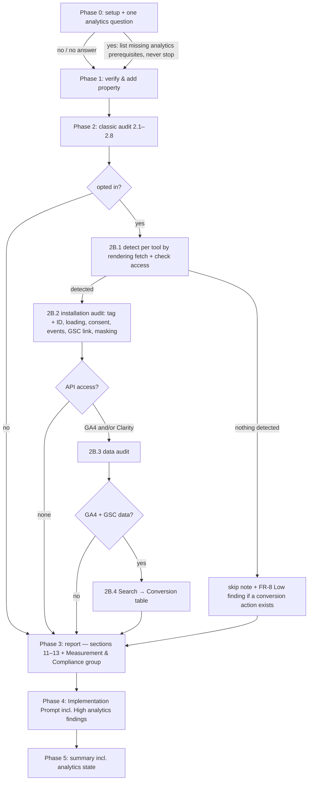

# Design: `/akili-seo` optional analytics phase — GA4 + Microsoft Clarity

## 1. Document Control

| Field | Value |
|---|---|
| Spec Path | `changes/seo-analytics` |
| Depth | Standard |
| Type / Deliverable | Change / software |
| Approval Mode | `gated` |
| Status | **Judgment-day APPROVED** (`judgment.md`: round 1 fixes J-1…J-25, round 2 fixes R-1…R-3), 2026-10-22; user instruction to apply the fixes and continue to `tasks.md` |
| Date | 2026-10-22 |
| Requirements | `requirements.md`: Phase 1 approved 2026-10-22, D-1 approved; gate adjustments GA-1…GA-3 from judgment-day (`judgment.md`) |
| Base commit | `85dba0f` for the original rows; rows added or re-verified at judgment-day carry `0263f82` |
| Architecturally significant? | **No.** This is instruction text for an existing command and skill. There is no new module, service, persistence or runtime data flow in this repository; the GA4 and Clarity calls are made by the agent at audit time. `software-architect` and `diagram-design` are not loaded |

## 2. Executive Summary

Eight files change and two are new. **No code ships except one test.** *(Archive sync 2026-10-22: as shipped, 12 files: 9 changed and 3 new. `test/install-cursor.test.js` was added by the T1 P-16 amendment and `test/seo-analytics-contract.test.js` by `/akili-test`.)*

| File | Change |
|---|---|
| `.claude/commands/akili-seo.md` | Phase 0 question; prerequisites, with the `:57` stop scoped to items 1–5; Tool Inventory rows; a new **Phase 2B** (2B.1–2B.4); report sections 11–13; the Measurement & Compliance group; Phase 4/5; checklist and error rows |
| `.claude/skills/seo-audit/references/analytics.md` (new) | Method and evidence: access, detection, installation and data checklists, the legal table, the join, sources with tiers and check dates |
| `.claude/skills/seo-audit/SKILL.md` | A short *Analytics & Conversion Measurement* section; the engagement-signals rule widened to all behavior metrics; references, tools, AKILI integration |
| Docs (`docs/commands/akili-seo.md`, `docs/skills/seo-audit.md`, `docs/skills/README.md:36`, `README.md:801`) | Describe Phase 2B and the widened rule |
| `evals.json` | Two new cases; case 9 (`:139`) widened to behavior metrics |
| `test/seo-analytics.test.js` (new) | A text contract: FR-11 per surface, plus the clauses the agent must find in the shipped text |
| `CHANGELOG.md` | `[Unreleased]` entry |

The command holds the *what and when*: steps, order, skip rules, report shape. The reference holds the *how and why*: checklists, sources, tiers. This is the split GEO already uses: command Step 2.8 is short, and the evidence lives in `references/geo.md`.

## 3. Architecture Overview



## 4. Extended Directory Structure

```text
.claude/commands/akili-seo.md                       (edit)
.claude/skills/seo-audit/SKILL.md                   (edit)
.claude/skills/seo-audit/references/analytics.md    (new, ~220 lines)
.claude/skills/seo-audit/evals/evals.json           (edit: +2 cases, ids 10 and 11; case 9 widened)
docs/commands/akili-seo.md                          (edit)
docs/skills/seo-audit.md                            (edit)
docs/skills/README.md                               (edit: line 36 description)
README.md                                           (edit: line 801 summary)
test/seo-analytics.test.js                          (new)
CHANGELOG.md                                        (edit: [Unreleased])
```

The installer copies each skill directory recursively, so the new reference ships without a code change (P-15).

## 5. Data Model — report contract

### 5.1 Report sections (Phase 3, FR-12)

Sections 1–10 are kept as they are. These are inserted after **10. GEO Findings**:

| # | Section | Holds |
|---|---|---|
| 11 | Analytics Installation Findings | 2B.2 findings, one sub-table per tool; or the skip/declined note |
| 12 | Analytics Data Findings | 2B.3 findings, with the data window beside every figure; or the skip reason per tool |
| 13 | Search → Conversion | The 2B.4 table, caveats and unmatched rows; or the skip reason |
| 14 | Remediation Plan | The SEO priority list, unchanged, **plus** a separate **Measurement & Compliance** group (D-1) |
| 15 | Re-audit Schedule | Unchanged |

Renumbered: Remediation Plan moves from 11 to 14, and Re-audit Schedule from 12 to 15.

When a run generates hits in the client's property (page views and the WhatsApp click of FR-5), the Analytics Installation Findings section carries a one-line **test-traffic disclosure** naming the date, time and pages, so the owner can filter those hits out.

### 5.2 State vocabulary — one closed set, used in the report, Phase 5 and tests

| State string | When |
|---|---|
| `Analytics: not run — declined at Phase 0` | FR-1: no, or no answer |
| `Analytics: skipped — no GA4 or Clarity detected` | FR-8 |
| `<Tool>: data audit skipped — <missing prerequisite>; obtain: <action>` | FR-2: installed, no access |
| `GSC link: linked (Data API probe)` · `linked (owner-confirmed)` · `not linked (owner-confirmed)` · `not determined` | FR-6. The parenthetical records the evidence that settled the state |
| `not determined` | A check the evidence could not settle: FR-2 with no renderer, the FR-4 Art. 9 record, FR-6, the FR-7 mode |
| `n/a — <reason>` | The check does not apply (FR-5 with no conversion action) |

A state outside this set falls through to `not determined`. The command states this in one sentence (KZ-004).

### 5.3 Finding shape

The existing Issue / Impact / Evidence / Fix / Priority shape, plus one field, **Basis**: the rule or vendor document, with its tier. Basis is used only on consent and vendor-fact findings.

## 6. API Design — external calls the agent makes at audit time

These are described in the command and the reference, not shipped as code (Q1 = c). All calls are read-only (NFR-6).

| Purpose | Preferred route | Fallback route | Notes (premise) |
|---|---|---|---|
| GA4 property and streams | Analytics MCP `get_account_summaries`, `get_property_details`, with the server started **without `--allow-write`** | Admin API `properties.get`, `properties.dataStreams.list` | The MCP is experimental and uses ADC; `create_property_annotation` is its write tool (P-10, DD-12) |
| Key events | (no MCP key-events tool) | Admin API `properties.keyEvents.list` (`conversionEvents` is deprecated) | P-13 |
| Organic landing pages, key events, sources, events | MCP `run_report` | Data API `properties.runReport`. Dimensions: `landingPage`, `hostName`, `sessionDefaultChannelGroup`, `sessionSource`, `eventName`. Metrics: `sessions`, `keyEvents` | P-14 (`hostName` and `sessionSource`: P-27) |
| GA4 ↔ GSC link probe | MCP `run_report` | Data API `runReport` with a Search Console metric such as `organicGoogleSearchClicks` | The metric "requires an active Search Console link" (P-5). There is no Admin API link resource (P-4) |
| Clarity insights | — | `GET https://www.clarity.ms/export-data/api/v1/project-live-insights?numOfDays=1..3&dimension1=URL`, `Authorization: Bearer <token>` | At most 10 requests/day; last 1–3 days; at most 1,000 rows with no pagination, so a 1,000-row response is reported as truncated (P-6) |
| GSC side of the join | `gsc` MCP `search_analytics_query`, **issued by 2B.4 itself**: one call grouped by `page` (row limit 250) and one by `query,page` (row limit 1,000), over GA4's date range | — | Step 2.4's calls are separate, top-25 and ungrouped by `query,page` (P-24). The 250-page cap is stated in the report; pages beyond it are counted, not joined |

Call budget, stated in the report. Clarity: at most **3** requests per run (URL with `numOfDays=3`; URL × Device; one spare), which leaves the owner 7 of the 10 daily. GSC and GA4 have no stated quota concern at these volumes.

## 7. Backend Module Design — command text by step

| Command site | Change | FR | Line budget |
|---|---|---|---|
| `:11` intro | Mentions "an optional analytics phase (GA4, Microsoft Clarity)" | FR-14 | +0 |
| Prerequisites (after item 5) | New **Optional — analytics phase** block, needed only on yes. (6) GA4: Data API and Admin API enabled in the same GCP project; the service-account email added as Viewer on the GA4 property; the Analytics MCP if preferred, started without `--allow-write`. (7) Clarity: a Data Export API token from a project admin, supplied at run time and never stored. `:57` "If any prerequisite is missing, stop" is rescoped to items 1–5; items 6–7 follow FR-2's skip rules | FR-1, FR-2, FR-13, NFR-6 | +8 |
| Tool Inventory | Rows for 2B.1 (rendering browser with network observation), 2B.2 (rendering browser + Admin API), 2B.3 (Data API / MCP, Clarity export), 2B.4 (`gsc` + Data API) | FR-2 | +4 |
| Phase 0, new item 5 | Asks once; never asked again in the run. A no or no answer records the declined state. A yes lists only the missing analytics prerequisites. Never blocks Phases 1–2 | FR-1 | +4 |
| Phase 2 skill bullets | Adds "apply its **Analytics** section in Phase 2B". The GEO bullet is untouched | FR-11 | +1 |
| Step 2.8 *Do not raise* (`:228-229`) | Rewritten: "any finding that asserts a **behavior metric** (bounce or engagement rate, session duration or engagement time, scroll depth, heatmaps, recordings, dead/rage/quickback/error clicks) affects rankings — behavior metrics serve conversion and UX findings" | FR-11 | +2 |
| **Phase 2B** (new, after Step 2.8) | **2B.1** detection per tool by rendering fetch (GA4 collection requests, measurement ID, GTM container; Clarity tag); "never report a tool absent from a static fetch alone"; the access check; the FR-2 state table; the FR-8 rule. **2B.2** installation audit, six bullets, each pointing at `references/analytics.md`: (i) tag, duplicates and measurement-ID consistency with the audited property; (ii) loading, with no ms or score claim without a measurement in this run; (iii) consent: "GA4 does not receive the consent state" when no default precedes measurement, missing Consent Mode parameters named as a signal, the Clarity consent signal where the project requires cookie consent, plus the sentence "compliance signals, not legal advice" and the line `Other jurisdictions: not audited`; (iv) events: form and WhatsApp, with the click intercepted before the external navigation completes and the test-traffic disclosure (§5.1); (v) GSC link, with the evidence suffix of §5.2; (vi) masking. **2B.3** data audit: GA4 and Clarity reads, data window, call budget, 1,000-row truncation. **2B.4** join: own `gsc` calls, normalization, unmatched rows, caveats, no causal wording. Closing paragraph: the hard rule (both halves) and FR-13 | FR-2…FR-11, FR-13 | ≤ 70 |
| Phase 3 report list | Inserts sections 11–13; Remediation Plan (14) gains the Measurement & Compliance group; renumbering | FR-12 | +5 |
| Phase 4 | The Implementation Prompt also covers High findings in Measurement & Compliance | FR-12 | +1 |
| Phase 5 | The summary adds the analytics state and counts | FR-12 | +1 |
| Verification Checklist | `:303` is **rewritten** to carry both halves and the behavior-metric list. Four new items: declined/skip state named; consent findings carry Basis, the not-legal-advice sentence and the other-jurisdictions line; no token or personal data in the report; Search → Conversion carries its caveats | FR-1, FR-4, FR-10, FR-11, FR-13 | +4 |
| Error Handling | GA4 403 → the Viewer grant is missing (data audit skipped, never retried blindly). Clarity 400 → invalid parameters (fix the request, do not spend the quota retrying); 401 → token missing, invalid or expired; 403 → token not authorized; 429 → daily quota spent, data audit skipped for the day. A Search Console metric request that errors → the probe settles nothing: fall back to owner confirmation (FR-6 order), else link `not determined` (amended at execute time 2026-10-22, T3: the shorthand skipped FR-6 step 2) | FR-2, FR-6, FR-9 | +5 |
| **Total** | | | **≤ 105 → ≤ 427 lines** (NFR-2 cap 440) |

## 8. Frontend / UX Component Architecture

n/a. There is no UI; the "interface" is the Phase 0 question and the report (§5).

## 9. Shared Contracts or Package Extensions

### 9.1 `references/analytics.md` outline

1. **Scope and source tiers.** Reuses `references/geo.md`'s `[PRIMARY]` / `[INDUSTRY]` definitions by quoting them, and adds that official legal text is `[PRIMARY]` (Q7).
2. **The hard rule.** Behavior metrics (the Glossary list, in full) serve conversion and UX, and no finding claims they affect Google or Bing ranking. The rule is a **prohibition on claiming an effect**, not an assertion about how either engine ranks. Google's public statements are cited with the tier their source earns (P-21). Bing is not asserted either way. One sentence separates site-analytics data (GA4, Clarity) from a search engine's own interaction signals, which this rule does not describe. A metric → "read it as" table extends the skill's.
3. **Access.** MCP vs direct API; the Viewer grant; the MCP started read-only; the Clarity token; the Clarity quota.
4. **Detection.** Rendering-fetch signals per tool (GA4 collection requests, measurement ID, GTM container ID; Clarity tag and project ID); the static-fetch limitation; what to record when no rendering tool can observe network requests (P-26).
5. **Installation checklist.**
   - Tag, duplicates and measurement-ID consistency.
   - Loading.
   - **Consent.** The legal table:
     - Ley 1581 applies to analytics **where the processing involves datos personales** (Art. 3(c)); the law does not itself prescribe cookie banners (P-22).
     - Ley 1581 Art. 3(a), Art. 9 (with its "sin perjuicio de las excepciones previstas en la ley" opening) and Art. 12.
     - Decreto 1377/2013, as compiled into Decreto 1074/2015 (P-23).
     - ePrivacy Art. 5(3): storage or access "only allowed on condition that the subscriber or user concerned has given his or her consent", after clear and comprehensive information, with a strictly-necessary exception.
     - GDPR Art. 4(11) consent definition, and Art. 7(1) and 7(3) (P-12).
     - Consent Mode v2: the two parameters added "in addition to `ad_storage` and `analytics_storage`", a missing one reported as a signal, and a note that the `ad_*` parameters matter for advertising features (P-8).
     - Clarity `consentv2`, where the project requires cookie consent (P-9).
   - Conversion events: form, WhatsApp URL patterns, key-event marking, the intercepted click, the test-traffic disclosure.
   - GSC link probe order and evidence suffix.
   - Clarity masking (modes, attributes, what no API used here can see).
6. **Data checklist.** GA4 reads (dimensions of §6), the `(not set)` share, self-referral and payment-gateway sources by `sessionSource`, zero-count key events by `eventName`, data thresholds. Clarity metrics, window, truncation.
7. **Search → Conversion join.** `hostName` + `landingPage` normalized against GSC `page`; unmatched rows; the 250-page cap; caveats; wording.
8. **Do not raise.** Ranking claims from behavior data; a ms CWV cost without a measurement; "violates the law"; any user-level data.
9. **Sources.** Each with tier and `checked 2026-10-xx`.

### 9.2 `SKILL.md` additions (≤ 40 lines, NFR-3)

- *User Engagement Signals*: the heading keeps its anchor. The first paragraph extends the rule (not the factual claim about Google) to "analytics engagement metrics **and all behavior data**": Google's statement stays scoped to analytics engagement metrics and tiered `[INDUSTRY]`, and the extension is stated as this skill's rule (amended at execute time 2026-10-22, T4: a literal extension asserted an untiered fact about all behavior data, contradicting P-21), followed by the Glossary list: bounce rate, engagement rate, session duration, engagement time, scroll depth, heatmaps, recordings, dead clicks, rage clicks, quickback clicks, error clicks. One sentence states the positive use (conversion and UX). The table gains a row: rage/dead clicks on a CTA → a conversion blocker.
- New `## Analytics & Conversion Measurement (optional)`, after GEO and before Common Issues, ≤ 15 lines: coverage, the hard rule (both halves), tiers, pointer to `references/analytics.md`, "not legal advice".
- *Do not raise these* (`:491`): the bullet becomes "**'Improve a behavior metric to rank better.'** Behavior metrics serve conversion and UX findings — see User Engagement Signals above."
- *References*, *Tools Referenced* (GA4, Clarity), and *AKILI-SPECS Integration*: a Phase 2B row; `:618` rewritten so that `analytics` points at the new section, while `programmatic-seo` and `cro` stay not packaged.

### 9.3 Test contract — `test/seo-analytics.test.js`

The test reads shipped files only (never `docs/specs/`, KZ-changes--archify-diagrams-1). It extracts each surface **by heading** (the `section()` helper pattern of `test/akili-security-docs.test.js`), so deleting a clause in one surface cannot be masked by the same words elsewhere in the file. Expected literals are constants copied from `requirements.md` at spec commit time and never read from the file under test.

| Group | Assertions |
|---|---|
| FR-11, both halves | 8 surfaces × 2 = **16**. Surfaces: skill *User Engagement Signals*; skill *Do not raise these*; skill Analytics section; command Step 2.8; command Phase 2B; command Verification Checklist; reference §2; `docs/skills/seo-audit.md` *Core Rules* |
| FR-11, metric coverage | skill *User Engagement Signals* and reference §2, each naming `bounce`, `engagement rate`, `session duration`, `scroll`, `heatmap`, `recording`, `rage click`, `dead click` = **16** |
| FR-1 | the declined state in Phase 0; "asked once"; Phase 2B after Step 2.8 and before Phase 3; `:57` stop scoped to items 1–5 = **4** |
| FR-2 | the static-fetch rule in 2B.1; the `obtain:` suffix = **2** |
| FR-3 | measurement-ID consistency; no ms claim without a measurement = **2** |
| FR-4 | "not legal advice" and `Other jurisdictions: not audited` in the command and the reference (4); the reference cites Ley 1581 Art. 3, 9, 12 (3); four Consent Mode parameters (4); the "datos personales" qualifier (1) = **12** |
| FR-5 | the intercepted click; the test-traffic disclosure = **2** |
| FR-6 | no Admin API link resource; the probe; the evidence suffix = **3** |
| FR-8 | skip string; "exactly one" Low = **2** |
| FR-12 | items 11–15 in order; "Measurement & Compliance" in item 14 and Phase 4 = **3** |
| FR-13 | token and user-level data forbidden in the command and the reference = **2** |
| NFR-2/3/4 | command ≤ 440; `SKILL.md` ≤ 658; every Sources line has a tier and `checked 20` = **3** |
| **Total** | **~67 assertions** |

**Falsification (FR-11 scenario):** in the task, delete the prohibition from one surface in a scratch copy, observe the named assertion go red, then restore it and see green. The red output is quoted in `execution.md`.

## 10. Design Decisions

| ID | Decision | Why | Rejected | FR |
|---|---|---|---|---|
| DD-1 | The command holds the steps; `references/analytics.md` holds checklists and sources | The GEO split; keeps the command within NFR-2 | Everything in the command | all |
| DD-2 | Phase 2B runs **after** Step 2.8 as a separate phase | Optional, with its own skip states; "classic audit unchanged" becomes testable by position | Step 2.9 | FR-1, FR-2 |
| DD-3 | The installation audit needs only a rendering browser; the data audit needs API access | Consent, events and masking land with zero credentials | API access for the whole phase | FR-2 |
| DD-4 | GA4 ↔ GSC link: Data API probe, then owner, then `not determined`, with the evidence recorded | No Admin API link resource (P-4); the metric needs an active link (P-5) | Calling a non-existent resource | FR-6 |
| DD-5 | Clarity masking mode is owner-confirmed or `not determined`; page attributes are checked from the DOM | The mode is outside the Data Export API (P-7) | Assuming Balanced | FR-7 |
| DD-6 | Analytics MCP preferred, direct API fallback, both described | Q1 = c; the MCP uses ADC (P-10) | Shipping `scripts/ga4_query.py` | FR-2 |
| DD-7 | Consent checks are **signals** with a **Basis**. Ley 1581 is applied only where analytics processing involves personal data and is never cited as a cookie-banner mandate; "not legal advice" and `Other jurisdictions: not audited` appear in command and reference | Legal exposure; Q5; P-22 | "Compliant" verdicts; an unqualified Ley 1581 basis | FR-4 |
| DD-8 | A Measurement & Compliance group in the Remediation Plan | D-1 (approved) | Merging into the SEO list | FR-12 |
| DD-9 | Clarity budget of ≤ 3 calls per run, stated in the report | 10/day quota shared with the owner (P-6) | Unbounded | FR-9 |
| DD-10 | One closed state vocabulary (§5.2) with a `not determined` fall-through | Every check gets an outcome (KZ-004) | Free text | FR-2, FR-4…FR-8 |
| DD-11 | No real form submissions. The WhatsApp click is intercepted before the external navigation, and the hits the audit generates are disclosed in the report | No leads or personal data created; the owner can filter test traffic (judgment B-10) | Test submissions; undisclosed hits | FR-5, NFR-6 |
| DD-12 | The MCP is used read-only: started without `--allow-write`; no write tool is called | NFR-6; the MCP exposes `create_property_annotation` under `--allow-write` (P-10) | Trusting the default | FR-2, NFR-6 |
| DD-13 | 2B.4 issues its own GSC calls (`page`, `query,page`) instead of reusing Step 2.4 | Step 2.4 is top-25 and never groups by `query,page` (P-24) | Reusing Step 2.4 | FR-10 |

### Reversion challenges (Step 2.3)

No decision removes delivered behavior. The Step 2.8 sentence, `:303`, `:491` and the skill's engagement section are **widened**: every metric each names today stays named. The `:57` stop is **narrowed** to items 1–5 for the new optional items only; its behavior for items 1–5 is unchanged. Challenge question, "what does removing this break?": nothing, because no existing prerequisite loses its stop. The report renumbering (11→14, 12→15) is the one visible shift in an existing contract, and no test or doc pins those numbers (P-3, P-16).

## 11. Budget (Step 2.4 — tripwire for `/akili-execute`)

| Measure | Expected |
|---|---|
| Tasks | 7 |
| LOC | ~790: reference ~220, command ~105, `SKILL.md` ~35, docs + README + evals ~65, test ~350, CHANGELOG ~15 |
| Review rounds | 14 (two per task: rules documents executed by agents) |

Standard depth still fits. Test LOC is budgeted per clause: ~67 assertions × ~5 lines (KZ-bugfix--init-ctrlc-abort-2).

## 12. Premise Ledger

Count: 24 verified · 3 `UNVERIFIED` (0 High, 3 Low). *(Archive sync 2026-10-22: T1 settled all three. P-21: no primary Google record was found, so the statements are cited `[INDUSTRY]` as reported by SEJ and SERoundtable. P-23: Decreto 1377 Arts. 5, 7 and 8 were quoted at Función Pública `i=53646` and compiled as Decreto 1074 Arts. 2.2.2.25.2.2/.4/.5. P-27: `hostName` and `sessionSource` are present in the Data API schema. Final count: 27 verified · 0 `UNVERIFIED`. See `execution.md` T1. The rows below keep their specify-time text.)*

Blast-radius triggers:
- `consumer` fires: the ranking-rule wording, report numbering and `/akili-seo` and `seo-audit` descriptions are read by docs, evals and a CI fixture (P-2, P-3, P-16).
- `shared-state` fires: the opt-in answer and the §5.2 state vocabulary are one condition that many command blocks read (P-25).
- `live-path` none apply: there is no dispatch code. The Phase 0 → Phase 2B chain is instruction text, drawn in §3, and its order is pinned by the FR-1 position assertion (§9.3).

| # | Claim | Class | Citation (as run) | Verified at | If false | Settled by |
|---|---|---|---|---|---|---|
| P-1 | The command has no analytics source; "analytics" means GSC search analytics only | existence | `grep -n -i 'analytics\|clarity\|GA4\|gtag\|consent' .claude/commands/akili-seo.md` → `:11,:69,:177,:179,:246,:314`, all GSC search analytics; no `clarity`, `GA4`, `gtag`, `consent` hit | 85dba0f | Phase 2B partly exists → rescope (High) | — |
| P-2 | Restatements of the engagement-metrics rule outside spec folders | consumer | `grep -rn -i 'bounce\|engagement metric\|time on page' README.md docs .claude test CHANGELOG.md \| grep -v '^docs/specs/'` → relevant hits `SKILL.md:414,415,418,427,431,491`, command `:229,:303`, `docs/skills/seo-audit.md:9,26`, `evals.json:139`, `CHANGELOG.md:546` (the rest are CSS/animation "bounce" in other skills). `:9` is a history line ("the rewrite of engagement metrics…") and stays; `:26`, `:139` are edited | 85dba0f | A restatement keeps the narrow rule (High — owned by T3/T4/T5 + T6 test) | — |
| P-3 | Readers of the `/akili-seo` and `seo-audit` descriptions, whole repository | consumer | `grep -rn 'seo-audit\|akili-seo' README.md docs .claude scripts bin test package.json \| grep -v '^docs/specs/'`, excluding the two edited sources: `README.md:48,97,117,167,283,467,553,587,801,848`; `docs/cli.md:291`; `docs/openspec-comparison.md:29`; `docs/README.md:36`; `docs/model-routing.md:92`; `.claude/templates/model-routing.section.md:34`; `docs/commands/README.md:19,52`; `docs/commands/akili-seo.md`; `docs/skills/governance.md:51`; `docs/skills/systematic-debugging.md:25`; `docs/skills/README.md:28,36,40,43`; `docs/skills/seo-audit.md`; `docs/flow.md:7,469`; `.claude/skills/systematic-debugging/SKILL.md:307`; `scripts/ci/install-layout-regression.js:520`; `test/fixtures/doctor-codex-baseline.txt:19,42`. **Edited:** `README.md:801`, `docs/skills/README.md:36`, `docs/commands/akili-seo.md`, `docs/skills/seo-audit.md`. All others — `README.md:48` (lifecycle figure alt text) and `docs/skills/README.md:28,40,43` (other skills' rows naming `/akili-seo`) included — name the command, file names, model tier or a fixture string (`seo-audit-foreign`) and stay true (hit list completed at judgment-day round 2, R-1) | 05c5c85 | A doc misdescribes the command (Low) | — |
| P-4 | The GA4 Admin API has no Search Console link resource | data-env | WebFetch `developers.google.com/analytics/devguides/config/admin/v1/rest` (2026-10-21): v1alpha/v1beta `properties.*` listed, `searchAds360Links` present, no `searchConsoleLinks`; `…/v1alpha/properties.searchConsoleLinks/list` → HTTP 404 (re-run by both judges) | external, 2026-10-21 | DD-4 could call the resource (Low) | — |
| P-5 | Data API Search Console metrics require an active link | data-env | WebFetch `…/reporting/data/v1/api-schema` offset 100000: `organicGoogleSearchClicks` etc. "This metric requires an active Search Console link." | external, 2026-10-21 | DD-4 probe invalid → owner confirmation only (High) | — |
| P-6 | Clarity Data Export: `project-live-insights`, Bearer token from a project admin, `numOfDays` 1–3, ≤ 10 requests/project/day, ≤ 3 dimensions, ≤ 1,000 rows, no pagination; dimension `URL`; metrics include Dead/Rage/Quickback/Error Click Count, Scroll Depth, Script Error Count; errors 400/401/403/429 | data-env | WebFetch `learn.microsoft.com/en-us/clarity/setup-and-installation/clarity-data-export-api` (updated_at 2025-12-05) | external, 2026-10-21 | FR-9 / DD-9 wrong (High) | — |
| P-7 | Clarity: input boxes and dropdowns masked in all modes; default Balanced (numbers, emails); Strict masks all; Relaxed masks only inputs; `data-clarity-mask` / `data-clarity-unmask` override; the mode is set in Settings › Masking. P-6's API lists no masking field | data-env | WebFetch `…/clarity-masking` (updated_at 2025-12-05); P-6 page | external, 2026-10-21 | DD-5 / FR-7 wrong (High) | — |
| P-8 | Consent Mode v2: "Consent mode users need to send two new parameters in addition to `ad_storage` and `analytics_storage`" (`ad_user_data`, `ad_personalization`); `gtag('consent','default',…)` "before any commands that send measurement data"; `wait_for_update` for async banners. A missing parameter is reported as a signal; the `ad_*` pair matters for advertising features | data-env | WebFetch `developers.google.com/tag-platform/security/guides/consent` ("Last updated 2026-10-13 UTC") | external, 2026-10-21 | FR-4 check wrong (High) | — |
| P-9 | Clarity enforces consent signals for EEA/UK/CH visits from 2025-10-31 **for projects configured to require cookie consent**; `consentv2` takes `ad_Storage` and `analytics_Storage` (both required); without consent, one ID per page view and no cookies | data-env | WebFetch `learn.microsoft.com/en-us/clarity/setup-and-installation/clarity-consent-api-v2` (ms.date 2025-08-28, updated_at 2025-12-05): "Starting October 31, 2025, Clarity begins enforcing consent signal requirements for page visits originating from the European Economic Area (EEA), United Kingdom (UK), and Switzerland (CH)"; "If your Clarity project is configured to require cookie consent, use the consent V2 API"; Parameters `ad_Storage`, `analytics_Storage`, Required: Yes; "If consent is not granted, Clarity assigns a **unique ID per page view** and does not use cookies" (re-confirmed by both judges) | external, 2026-10-22 | FR-4's Clarity row loses its date basis → the check stays, the date is dropped (Low) | — |
| P-10 | The Analytics MCP (`googleanalytics/google-analytics-mcp`) is "Experimental", uses ADC (user OAuth or `--impersonate-service-account`), scope `analytics.readonly` (`analytics.edit` only with `--allow-write`). Tools: `get_account_summaries`, `get_property_details`, `list_google_ads_links`, `list_property_annotations`, `create_property_annotation` (write, needs `--allow-write`), `run_report`, `run_funnel_report`, `run_realtime_report`, `get_custom_dimensions_and_metrics`. No key-events or Search Console link tool | data-env | WebFetch `github.com/googleanalytics/google-analytics-mcp` (2026-10-21; write-tool detail re-read by both judges) | external, 2026-10-21 | DD-6/DD-12 text wrong (Low) | — |
| P-11 | Ley 1581/2012 (vigente 2012-10-17): Art. 3(a) "Consentimiento previo, expreso e informado del Titular para llevar a cabo el Tratamiento de datos personales"; Art. 9 "Sin perjuicio de las excepciones previstas en la ley, en el Tratamiento se requiere la autorización previa e informada del Titular, la cual deberá ser obtenida por cualquier medio que pueda ser objeto de consulta posterior"; Art. 12 "Deber de informar al Titular" (purpose, rights …) | other | `curl -skL 'https://www.funcionpublica.gov.co/eva/gestornormativo/norma.php?i=49981'`, text extracted (scratchpad `ley/l1581.html`), strings at offsets 8016, 16365, 17921 (re-confirmed by both judges) | external, 2026-10-21 | FR-4 legal table misquotes (High) | — |
| P-12 | ePrivacy Directive 2002/58/EC Art. 5(3) (as substituted by 2009/136/EC): storage or access on terminal equipment "is only allowed on condition that the subscriber or user concerned has given his or her consent, having been provided with clear and comprehensive information", with exceptions for transmission and "strictly necessary" services. GDPR Art. 4(11): consent is a "freely given, specific, informed and unambiguous indication … by a statement or by a clear affirmative action"; Art. 7(1) "the controller shall be able to demonstrate that the data subject has consented"; Art. 7(3) "It shall be as easy to withdraw as to give consent" | other | WebFetch `legislation.gov.uk/eudr/2002/58/article/5`, `legislation.gov.uk/eur/2016/679/article/4`, `…/article/7` (2026-10-22). These are official UK government reproductions; EUR-Lex returned empty pages to both judges and to this session. The wording "prior" is not used; consent precedes the storage by the "only allowed on condition" construction | external, 2026-10-22 | FR-4 basis rows reworded (Low) | — |
| P-13 | GA4 calls conversions "key events": Data API metric `keyEvents`, Admin `properties.keyEvents`, `properties.conversionEvents` deprecated | data-env | WebFetch Admin REST index (P-4): `conversionEvents (deprecated)`, `keyEvents`; api-schema `keyEvents` "The count of key events" | external, 2026-10-21 | Terminology (Low) | — |
| P-14 | Data API: `landingPage` ("The page path associated with the first pageview in a session" — no host), `eventName`, `sessionDefaultChannelGroup` (value `Organic Search`), metrics `sessions`, `engagementRate`, `bounceRate`, `keyEvents` | data-env | WebFetch api-schema, offsets 0 and 100000 (2026-10-21) | external, 2026-10-21 | §6 join fields wrong (Low) | — |
| P-15 | The installer copies each skill directory recursively, and the package ships `.claude/skills`, so a new reference file needs no code change | location | `bin/akili.js:73` `SOURCE_SKILLS = path.join(SOURCE_CLAUDE, "skills")`; `:806` `copyDirectoryContents(SOURCE_SKILLS, targetSkills, args)`; `scripts/ci/install-layout-regression.js:287` "Packaged skill file (any depth, e.g. references/*.md)"; `package.json` `"files"` includes `".claude/skills"` | 0263f82 | An installer task is needed (High) | — |
| P-16 | No test pins `/akili-seo` or `seo-audit` **text**; `npm test` = `node --test`, which picks up `test/*.test.js`. The only other hits are a skill-name listing and a fixture string | existence | `grep -rln 'akili-seo\|seo-audit' test/ scripts/ bin/` → `test/fixtures/doctor-codex-baseline.txt` (names only), `scripts/ci/install-layout-regression.js` (`:520` `"seo-audit-foreign"`); `package.json:39` `"test": "node --test"` | 0263f82 | A consumer test needs editing (Low) | — · **Execute-time correction (T1, 2026-10-22):** the text claim holds, but the grep keyed on the skill name missed a **file-count** pin: `test/install-cursor.test.js` asserts `SKILL_FILE_COUNT === 223` (and 235 shared-root files). The new reference makes it 224/236; T1 updated the two literals and their comments. The Low fallback fired as stated |
| P-17 | Line baselines: command 322, `SKILL.md` 618, `docs/skills/seo-audit.md` 41, `docs/commands/akili-seo.md` 75 | data-env | `wc -l` on the four files (re-run by both judges) | 85dba0f | NFR-2/3 caps mis-set (Low) | — |
| P-18 | No browser-automation skill is packaged; the command names a rendering tool generically | existence | `ls -d .claude/skills/*/ \| wc -l` → 27 directories, none browser-related (`playwright-cli` is a session skill, not packaged) | 85dba0f | The command could name a packaged skill (Low) | — |
| P-19 | `evals.json` holds 9 cases (ids 1–9) and no test runs it | existence | `grep -c '"id"' .claude/skills/seo-audit/evals/evals.json` → 9; `grep -rn 'evals.json' test bin scripts` → 0 hits | 85dba0f | New ids collide (Low) | — |
| P-20 | `CHANGELOG.md:546` (the engagement rewrite) sits in a released section and is not edited | other | `grep -n '^## \[' CHANGELOG.md` → `[Unreleased]` at `:7`, `[2.34.2]` at `:13` | 85dba0f | An edit to a released entry (Low) | — |
| P-21 | Google has publicly said that Analytics bounce rate and engagement data are not used for ranking (Mueller; Illyes; Cutts 2010) | other | `UNVERIFIED — confirm at source before relying on it`. Only secondary coverage was found: `searchenginejournal.com/ranking-factors/bounce-rate/`, `seroundtable.com/google-noindex-canonical-29622.html` (WebSearch, 2026-10-22). No Search Central page was found | — | The reference labels those statements `[INDUSTRY]` (reported) instead of `[PRIMARY]`; the rule stands, because it prohibits claiming an effect and does not assert the absence of one (Low) | T1, first step: look for a primary record (Search Central post, office-hours video, the author's own post); if none is found, cite as `[INDUSTRY]` |
| P-22 | Ley 1581 governs analytics only where the processing involves datos personales — "c) Dato personal: Cualquier información vinculada o que pueda asociarse a una o varias personas naturales determinadas o determinables" — and the law contains no cookie-specific provision | other | Same extraction as P-11: Art. 3(c) found at offset 8232; a case-insensitive count of `cookie` over the extracted text → 0 (python `re.findall('cookie', text, re.I)`) | 0263f82 | DD-7's qualifier is unnecessary or wrong (High) | — |
| P-23 | Decreto 1377/2013 (which regulates Ley 1581, including authorization) is compiled into Decreto Único Reglamentario 1074/2015, Libro 2, Parte 2, Título 2, Capítulo 25 | other | `UNVERIFIED — confirm at source before relying on it` (not fetched this session) | — | The reference cites the wrong instrument (Low) | T1, first step: fetch the decree from Función Pública and quote the authorization articles |
| P-24 | Step 2.4 calls `search_analytics_query` grouped separately by `query` (top 25), `page` (top 25), `country` (top 10) and `device`; never `query,page` | existence | `sed -n 177,186p .claude/commands/akili-seo.md` | 0263f82 | DD-13 unnecessary (Low) | — |
| P-25 | The opt-in answer and the §5.2 states are read by many blocks of the command, all of them new text this spec writes | shared-state | Readers (design-time, by section, all new): Prerequisites block 6–7 and the `:57` rescope; Phase 0 item 5; 2B.1; 2B.2 (v) the link state; 2B.3; 2B.4; Phase 3 items 11–13; Phase 4; Phase 5; Verification Checklist; `test/seo-analytics.test.js`. No existing block reads them (P-1) | 0263f82 | A block ignores the opt-out → it runs or reports when declined (High — owned by T2 and T6's FR-1 assertions) | — |
| P-26 | A rendering tool that observes network requests is available on the main AKILI hosts (e.g. the Chrome automation MCP exposes `read_network_requests`, `read_page`, `computer`; Playwright exposes request interception) | data-env | This session's deferred-tool list names `mcp__claude-in-chrome__read_network_requests`, `…read_page`, `…computer`, `…javascript_tool` (2026-10-22). Playwright: not checked | 0263f82 | Every 2B.2 check falls to `not determined` on such hosts (the FR-2 row already covers it) (Low) | — |
| P-27 | Data API dimensions `hostName` and `sessionSource` exist | data-env | WebSearch/WebFetch of the api-schema did not surface them in the extracts read. `UNVERIFIED — confirm at source before relying on it` | — | §6 / §9.1 item 6–7 choose other dimensions (e.g. `landingPagePlusQueryString`, `sessionSourceMedium`) (Low) | T1, first step: re-read the api-schema dimensions list |
