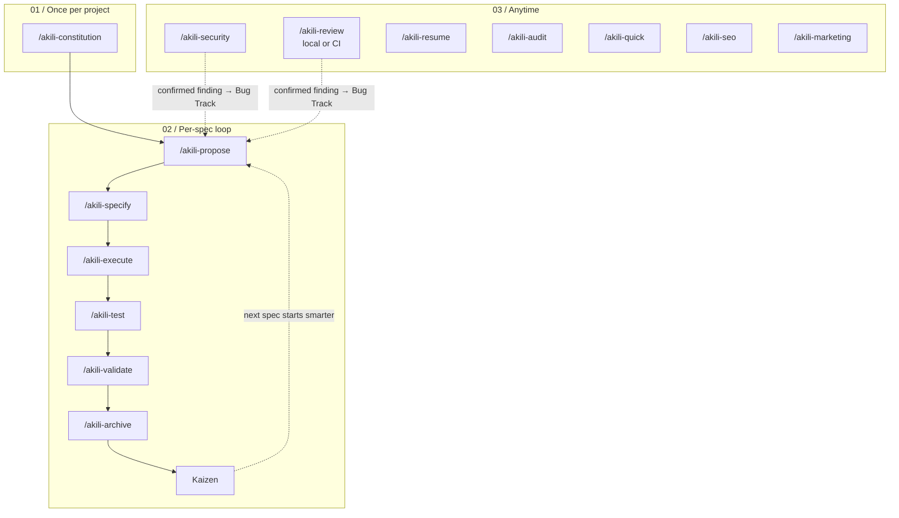

# Proposal: refresh the AKILI lifecycle figure for `/akili-review` and `/akili-marketing`

> **Answer first.** Redraw `assets/akili-flow.svg` and `assets/akili-flow.png` so the *Anytime* lane shows all seven anytime commands. Today it shows five. `/akili-review` goes beside `/akili-security`, carries a "local or CI" sublabel, and shares the dashed hand-off to `/akili-propose` (Bug Track). `/akili-marketing` joins the other anytime commands. The prose already names both commands everywhere it lists them. Three things are out of date: the figure, the `docs/flow.md` alt text, and the "known debt" note in the CHANGELOG and release notes. A new test pins the figure to the command set so it cannot drift silently again. Release: **patch, 2.37.1**.

## 1. Document Control

| Field | Value |
|---|---|
| Spec Path | `changes/flow-diagram-review` |
| Proposal Path | `docs/specs/changes/flow-diagram-review/proposal.md` |
| Type | Change |
| Deliverable | software (a docs figure plus docs text; no command or installer behaviour) |
| Approval Mode | `pre-approved (Juan Carlos Cadavid, 2026-10-26)`: "Answer process gates with the recommended option and stop for product decisions." Exceptions (HALT, Pivot, budget tripwire, `FATAL_FAIL`, `PRODUCT_BUG`, destructive or irreversible actions) still stop |
| Source questions | Skipped: the brief supplies the source, and the current figure is the visual input (pre-approved mode) |
| Branch | `JuankCadavid/flow-diagram-review`, cut from `dev` at `3f718cb`. Commits stay local: no push, merge, tag or publish |
| Depends on | none |
| Parallel-safe | yes. It touches only the figure, docs text, CHANGELOG, `releases/v2.37.0.md` and two test files |
| Release class | patch (docs and assets only; see `versioning-semver-discipline`) |
| Date | 2026-10-26 |

## 2. Intent

The lifecycle figure is the first picture a new user sees, in the README on GitHub and on npm. It should show every command AKILI ships, including the two newest ones.

## 3. Problem / Current Behavior

| Claim about today | Evidence |
|---|---|
| The figure's *03 / Anytime* lane draws five commands: `/akili-security`, `/akili-resume`, `/akili-audit`, `/akili-quick`, `/akili-seo` | `grep -o '<text[^>]*>[^<]*</text>' assets/akili-flow.svg` returns those five, and neither `/akili-review` nor `/akili-marketing`. Rendered PNG read at 1800×1311 |
| The `docs/flow.md` alt text names the same five anytime commands | `docs/flow.md:7` |
| The `docs/flow.md` prose already counts "Seven anytime commands", including both new ones | `docs/flow.md:21` |
| `docs/flow.md:21` says only `/akili-security` findings re-enter through `/akili-propose`. §2d of the same file says confirmed critical `/akili-review` findings can also be routed to a Bug proposal in a local run | `docs/flow.md:21`, `docs/flow.md:450`, `docs/commands/akili-review.md:41` |
| `README.md`, `docs/README.md`, `docs/overview.md` and `docs/commands/README.md` already list both commands | `README.md:122-123`, `docs/README.md:43-44`, `docs/overview.md:38-39,161`, `docs/commands/README.md:21-22,38` |
| CHANGELOG `[2.37.0]` and `releases/v2.37.0.md` both carry "Known debt: the lifecycle figure was not updated" | `CHANGELOG.md:33`, `releases/v2.37.0.md:23` |
| CHANGELOG `[2.36.0]` and `releases/v2.36.0.md` carry the earlier `/akili-marketing` figure debt as debt (1) of three | `CHANGELOG.md:76`, `releases/v2.36.0.md:28` |
| A test pins that debt note: the first CHANGELOG section naming `` `/akili-review` `` must contain `` `assets/akili-flow.svg` `` (DD-12) | `test/akili-review-contract-coverage.test.js:358` |
| The README `` loads the PNG from the `master` raw URL. Two tests pin that URL and the `<p align="center">` block, and one forbids "Kaizen" and "Bug Track" in the README alt text | `README.md:50-52`, `test/docs-overview-contract.test.js:143-160`, `test/docs-overview.test.js:455` |
| The current figure is an Archify `svg-light` export (121,501 B, viewBox 1005×654, embedded latin font subset). `rsvg-convert` cannot render it, but headless Chromium can | `assets/akili-flow.svg` header. `docs/specs/archive/2026-10-19-changes--docs-refresh-2-34/execution.md:33` |
| Archify is not installed in this environment | No `archify/SKILL.md` under `~/.claude/skills/` or `~/.agents/skills/`, and no `archify` skill listed in the session |
| `assets/` and `docs/` ship in the npm package | `package.json` `files` |

**A premise in the brief needs a correction.** The brief targets 2.37.1 "so npm's README shows the new diagram". The npm README loads the PNG from the `master` raw GitHub URL, so npm shows the new figure as soon as this change reaches `master`. Publishing does not change that (the CHANGELOG `[2.34.2]` entry records the same behaviour). A 2.37.1 patch is still worth releasing: the packaged `assets/` and `docs/flow.md` ship stale until a publish, and the published CHANGELOG would keep the debt note.

## 4. Proposed Outcome

- The figure keeps its three lanes and its style. The *Anytime* lane shows seven commands. `/akili-review` sits next to `/akili-security` with a sublabel such as `PR review · local or CI`. Both of them draw the dashed "confirmed finding → Bug Track" edge into `/akili-propose`. `/akili-marketing` sits with the others, with a sublabel such as `social drafts · never publishes`.
- The SVG and the PNG come from the same source in the same run (the PNG is 1800 px wide, as today), so they cannot disagree.
- The `docs/flow.md` alt text and its line 21 name all seven anytime commands and both Bug Track hand-offs.
- The README stays short. Its alt text may name the anytime commands in plain words (it may not use "Kaizen" or "Bug Track"). No new README section.
- The known-debt bullet is removed from CHANGELOG `[2.37.0]` and `releases/v2.37.0.md`. A `[Unreleased]` entry records the refresh for 2.37.1.
- The figure is pinned by a test: every packaged command appears as drawn text in the SVG.

## 5. Scope

| In | Files |
|---|---|
| Figure regeneration, SVG and PNG kept in sync | `assets/akili-flow.svg`, `assets/akili-flow.png` |
| Alt text and the anytime/Bug Track sentence | `docs/flow.md` (lines 7 and 21) |
| README alt text, only if the new figure makes it inaccurate | `README.md` (`## How it works` block) |
| Re-check that the hub, overview and commands index have no figure description to update (no edit expected) | `docs/README.md`, `docs/overview.md`, `docs/commands/README.md` |
| Debt note removal and the 2.37.1 change note | `CHANGELOG.md`, `releases/v2.37.0.md` |
| Test pin update and a new figure-coverage test | `test/akili-review-contract-coverage.test.js`, plus a new assertion in an existing or new docs test |

## 6. Non-Goals

- Any change to command prompts, skills, templates, `bin/` or the installer.
- Redesigning the figure (new lanes, a new palette, video or diagram tracks). The 2026-10-19 decision that removed those lanes stands.
- Running `release:patch`, tagging, pushing or publishing. The release is prepared later, under the Release Rules.
- Editing the published GitHub Release body for v2.37.0 (`gh release edit`). That is an outward-facing action for the user.
- Adding `/akili-marketing` or `/akili-review` to the model-routing registry (separate debt, blocked by the routing template-evolution bug).

## 7. Affected Users, Systems, And Specs

| Affected | How |
|---|---|
| New users reading the README (GitHub and npm) and `docs/flow.md` | They see the full command set |
| `test/akili-review-contract-coverage.test.js` (archived spec `2026-10-26-changes--akili-review`, DD-12) | The debt needle goes. The section lookup must be pinned to `## [2.37.0]`, because a 2.37.1 note naming `/akili-review` would otherwise become the "first section" the test checks |
| `test/docs-overview-contract.test.js`, `test/docs-overview.test.js` | Must stay green. The URL and block stay the same; an alt-text edit must avoid "Kaizen" and "Bug Track" |
| Archived specs `docs-refresh-2-34`, `akili-marketing`, `akili-review` | Their recorded figure debt is closed. The archives themselves are not edited |

## 8. Visual Reference

- Source: the current figure (`assets/akili-flow.png`, 1800×1311). No mockup: this change produces the visual itself.
- Target structure, as Mermaid (the source of truth for the redraw, per `diagram-design`):



Legend: solid arrows are the main path; dashed arrows are feedback into `/akili-propose`. The anytime lane has seven nodes. If the renderer's workflow layout allows at most six columns (as Archify's did on 2026-10-19), it wraps into two rows: `/akili-security` and `/akili-review` on the first row (they carry the edges), and the other five on the second.

## 9. Requirement Delta Preview

### ADDED Requirements

- The figure draws every packaged command (`.claude/commands/akili-*.md`, 14 today) as text, and a test enforces it.
- `/akili-review` carries a visible "local or CI" cue in the figure.

### MODIFIED Requirements

- The anytime lane goes from five to seven commands. The Bug Track hand-off comes from two commands instead of one.
- The `docs/flow.md` alt text and line 21 name seven anytime commands and both hand-offs.
- `test/akili-review-contract-coverage.test.js` FR-14 reads the `[2.37.0]` section by heading and no longer requires the figure-debt note.

### REMOVED Requirements

- The "Known debt: the lifecycle figure was not updated" bullet in CHANGELOG `[2.37.0]` and `releases/v2.37.0.md`.

## 10. Approach Options

| Option | How | For | Against |
|---|---|---|---|
| **A. Regenerate with Archify** (precedent) | Install Archify into the session scratchpad only, as on 2026-10-19 (not in the repo, not globally). Render a `workflow` figure from the Mermaid above, export `svg-light` (latin subset) and an 1800 px PNG from the same run, and check it in headless Chromium | Same look as today. Proven pipeline. The SVG and PNG come from one source. Font floor already agreed (≥ 5.5 px, labels ≥ 8 px at 900 px) | Needs a third-party tool install that only the user can approve (`diagram-design` §7: never install Archify on your own initiative). The six-column limit forces a two-row anytime lane |
| B. Hand-edit the current Archify SVG | Insert two nodes and one edge into the exported SVG, then rasterize the PNG with headless Chromium | No install | Archify's export is laid out with CSS custom properties, so a hand edit is fragile, cannot be re-validated by Archify, and is hard to review (121 KB of generated markup) |
| C. Hand-author a new SVG | A small, readable SVG in the repo (like the v2.17.1 figure), rasterized with Chromium | No install. Small and reviewable | Changes the visual style the 2026-10-19 decision accepted. It is a redesign, which is out of scope |

## 11. Recommended Approach

**Option A.** It is the smallest safe path: it repeats a pipeline that already passed validation and keeps the accepted style. The only new layout work is the second row in the anytime lane. The tool install is the one real decision, and it is the user's (see §12, Q1). If the user declines, fall back to **B**, with Chromium rendering for both files and a visual diff against today's PNG as evidence.

Verification carried forward from `docs-refresh-2-34`:
- the drawn `<text>` covers all 14 commands
- no `<script>`, no external `href`/`src`/`url`, no `@import`
- the SVG has a `<title>`/`<desc>`
- the SVG stays ≤ ~150 KB and the PNG ≤ ~400 KB
- Chromium decodes both files
- `npm test`, `npm run verify:cli`, `npm run pack:dry-run` and `git diff --check` all pass

## 12. Risks, Dependencies, And Open Questions

| # | Item | Recommendation |
|---|---|---|
| Q1 | **Product decision: may Archify be installed into the session scratchpad (not the repo, not global config) to regenerate the figure?** | **Decided (Juan Carlos Cadavid, 2026-10-26): "Archify in scratchpad"**, so Option A |
| Q2 | Should CHANGELOG `[2.36.0]` debt (1) (the figure lacks `/akili-marketing`) also be edited? | No. Leave released history as written, except for the `[2.37.0]` bullet the brief names. The 2.37.1 note says the figure now draws both commands |
| Q3 | The published GitHub Release v2.37.0 body keeps the debt note after `releases/v2.37.0.md` is edited | Report it at the end. Editing it is the user's outward-facing action |
| R1 | KZ-002: CHANGELOG clauses overstate what shipped | Quote-check every 2.37.1 clause at HEAD, including the sentences around each insertion |
| R2 | KZ-changes--archify-diagrams-1: a test must not depend on the active spec path | The new figure test reads only `assets/` and `.claude/commands/` |
| R3 | A two-row anytime lane may push the font below the agreed floor at 900 px | Measure the smallest drawn font against the viewBox. If it is below the floor, stop as a spec tension (Pivot), not as an ADVISORY |
| R4 | The README image is loaded from `master`, so GitHub and npm keep showing the old figure until the dev → master merge | Expected. Record it in the 2.37.1 note |

## 13. Success Criteria

- Both assets draw all 14 commands. `/akili-review` shows a CI cue and a Bug Track edge, and the SVG and PNG show the same figure (same source run, checked visually).
- `docs/flow.md` alt text and line 21 name seven anytime commands and both hand-offs. The README stays the same length or one line longer, and its alt text is accurate.
- No CHANGELOG or `releases/` text still says the figure is not updated for `/akili-review`. `[Unreleased]` carries a quote-checked 2.37.1 note.
- `npm test` passes on the full suite, with the FR-14 pin updated and the new figure-coverage test added. `verify:cli`, `pack:dry-run` and `git diff --check` pass.
- All commits are local, prefixed `[SPEC:changes/flow-diagram-review]`, and nothing is pushed.

## 14. Next Step

```text
/akili-specify changes/flow-diagram-review
```

Lite depth (docs and assets only, one figure, two test edits).
