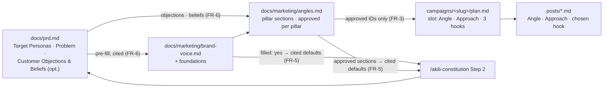

# Design: Growth angles, the growth track, and the flow figure

> **Answer first.** All behaviour lives in prompt text, so the design is a map of which file owns which rule. The skill gains one AKILI-authored reference, `angles-framework.md`, that owns the method: angle types, approaches, IDs, sourcing and the map shape. `brand-voice-template.md` owns the foundation sections. `planning-and-calendar.md` owns the plan-slot fields. `/akili-marketing` owns the `angles` mode, its statuses, refusals and file writes, and gets **one additive sentence** in `## Invariants` so pillar sections use the same approval gate. `/akili-constitution` gets one optional PRD section and one Step 2 bullet. The figure is regenerated in Archify from the recovered source JSON with a **Growth track** group (seo, marketing in columns 4–5) and a dashed `g1` edge from `/akili-constitution`. That layout passed a showcase validation and a render at specify time. Budget: 9 tasks, about 760 LOC, about 17 review rounds.

## 1. Document Control

| Field | Value |
|---|---|
| Spec Path | `changes/growth-angles` |
| Depth | Standard (checked in §8) |
| Approval Mode | `gated`; gates taken at the recommended option under the maintainer's mandate (see `requirements.md`) |
| Inputs | `proposal.md`, `requirements.md`, `figure-source.json` (recovered Archify source), session probes in the scratchpad (`probe/mk.js`, `probe/c-marketing-auto.json`, `probe/c.png`) |
| Skills | `cognitive-doc-design`, `diagram-design` (figure conventions), `social-marketing` (method being extended), `product-manager-toolkit` (PRD section shape) |
| Verified at | `6e381b1` |
| Status | Phase 2 gate: see §12 |

## 2. Architecture Overview

| Layer | Owner | Covers |
|---|---|---|
| Method (what an angle, approach, ID, source is; map shape) | `references/angles-framework.md` (new) | FR-2, FR-4 |
| Foundations (fields and interview questions) | `references/brand-voice-template.md` | FR-1 |
| Slot fields | `references/planning-and-calendar.md` | FR-3 |
| Mode, statuses, refusals, writes, PRD read | `.claude/commands/akili-marketing.md` | FR-1, FR-2, FR-3, FR-6 |
| PRD section, Step 2 defaults | `.claude/commands/akili-constitution.md` | FR-5 |
| Growth track story | docs pages | FR-7 |
| Picture | Archify source → static SVG + PNG → `scripts/animate-flow.js` → animated SVG | FR-8 |

## 3. Extended Directory Structure

| Path | Change | FR |
|---|---|---|
| `.claude/skills/social-marketing/references/angles-framework.md` | New, AKILI-authored | FR-2, FR-4 |
| `.claude/skills/social-marketing/SKILL.md` | Integration table: `angles` row; `brand`, `campaign`, `post` rows load `angles-framework.md` where they use it; body sentence on the method credit | FR-4 |
| `.claude/skills/social-marketing/references/brand-voice-template.md` | Four foundation sections; interview rows; "how a drafting mode reads it" row for files without them | FR-1 |
| `.claude/skills/social-marketing/references/planning-and-calendar.md` | Slot fields Angle, Approach, 3 hooks; worked-shape columns; balance-check line | FR-3 |
| `.claude/commands/akili-marketing.md` | Usage row, Step 0.1 (seven), Step 0.3 (adds `angles`), `brand` foundations + PRD read, new `### \`angles\`` section, `campaign` slot rule, `post` angle/approach/hooks, one invariant sentence, error rows, next steps | FR-1, FR-2, FR-3, FR-6, NFR-1 |
| `.claude/commands/akili-constitution.md` | Step 2 bullet; Step 3 optional section line after the nine required ones | FR-5 |
| `docs/commands/akili-marketing.md`, `docs/skills/social-marketing.md` | `angles` mode, foundations, selection, method credit | FR-7 |
| `docs/overview.md`, `docs/flow.md`, `docs/README.md`, `README.md` | Growth-track naming; data-flow table (`docs/flow.md`); `angles.md` artifact row; figure alt line | FR-7, FR-8 |
| `assets/akili-flow.svg`, `assets/akili-flow.png`, `assets/akili-flow-animated.svg` | Regenerated | FR-8 |
| `docs/specs/changes/growth-angles/figure-source.json` | Recovered source (sha256 `6d4849d2…`), then edited for the growth group | NFR-7 |
| `test/akili-marketing-command.test.js`, `test/social-marketing-skill.test.js`, `test/social-marketing-install.test.js` | Seven modes; 13 files; new clause literals | FR-1–FR-4, NFR-1 |
| `test/growth-track.test.js` | New: constitution FR-5 literals, docs FR-7 literals, NFR-6 | FR-5, FR-7 |
| `test/flow-figure-contract.test.js`, `test/flow-figure.test.js`, `test/flow-figure-animated*.test.js`, `test/docs-overview*.test.js` | Deliberate updates, listed in §7 | FR-8 |
| `CHANGELOG.md` | `[Unreleased]` | FR-9 |

## 4. Data Model

### 4.1 `brand-voice.md` — added sections (after *Audience*)

| Section | Lines |
|---|---|
| Ideal customer | Who (one line), Pains, Desires, Context — each a short list, customer's words preferred, `source:` per line when pre-filled from the PRD |
| Ideal follower | Who follows the account and why; may differ from the customer |
| Offer | Result the customer gets; what makes it unique; the next step (links to *CTA and primary link*, not restated) |
| Message | Positioning (one sentence), narrative (two or three lines); tone points to *Voice fingerprint* and *Per-platform tone* |

`filled` keeps its meaning: it is set by the user's `brand` run and does **not** require the new sections, so older files stay valid (FR-1). Missing foundations are reported by `angles`.

### 4.2 `angles.md`

| Block | Fields |
|---|---|
| Header | `Voice:` line; `Updated:` date; `Language:`; `Request:` quote; `Method:` credit line; `Sources:` list |
| `## <Pillar name> (<CODE>)` | `Status: draft \| approved`; `Approval: — \| <record> \| reset to draft <date>: <what changed>`; `Approved snapshot` (the four lists verbatim, only when approved); `### Problems`, `### Desires`, `### Objections`, `### Beliefs` — each 0–9 lines `- <ID> <angle> — source: <source>` or `- <ID> needs input — <what is missing>` |
| `## Approaches applied` | Table: Approach · What it does here · Suited angle IDs · Needs |
| `## Formats and capacity` (optional) | Table: Format · Who · Pieces per week |
| `## Open questions` | Numbered; `none` when empty |

Status values and their reading reuse the post-section table of `## Invariants` row for row: `draft`; `approved` with lists equal to the snapshot (valid); `approved` with a mismatch or a missing record (invalid → treated as `draft`, reported in one line, reset by the writing mode); missing/other (treated as `draft`). `published` has no meaning for a pillar section and reads as an unrecognized value. **All five post-table states have a stated action here** (design rule *a rule keyed to a field's states lists every state*).

### 4.3 Plan slot and post header

| Artifact | New fields |
|---|---|
| `plan.md` numbered list | `Angle` (ID, optional second ID, or `needs input`), `Approach` (one of five), `Hooks` (three candidates, formula IDs from `hook-formulas.md` plus a one-line draft each) |
| Post file header | `Angle:` (ID[s], or `none — no angles map`), `Approach:` |

Card fields are unchanged; the chosen hook is the first line of *Copy*.

## 5. API Design

`n/a — no API.` Command surface: `/akili-marketing angles [<pillar>]` — with a pillar name or code, only that pillar's section is created or revised; without one, every pillar in *Content pillars*.

## 6. Backend Module Design

`n/a — no code in bin/ changes.` `scripts/animate-flow.js` is run, not edited, unless P-8 is refuted (then the smallest change that keeps its tests is a task-level adjustment).

## 7. Frontend / UX: the figure

**Source edits** (from `figure-source.json`; probe `probe/mk.js`):

| Edit | Value |
|---|---|
| `seo` | `col: 4`, `yOffset: 0` |
| `marketing` | `col: 5`, `yOffset: 0` |
| `groups` | `[{ id: "growth", label: "Growth track", lane: "any", fromCol: 4, toCol: 5 }]` |
| New edge | `{ id: "g1", from: "constitution", to: "marketing", label: "PRD ↔ brand voice · angles", variant: "dashed", role: "branch" }`, automatic route |
| Everything else | Unchanged (lanes, 15 nodes' labels and sublabels, `e1`–`e8`, `s1`, `s2`) |

**Pipeline** (as the previous figure spec ran it, P-6): `archify finalize workflow` (showcase) → serve the HTML → export `svg-light` and PNG through the export menu (playwright) → normalize the SVG (strip the five non-latin font subsets, set `<title>`, set `<desc>` to the new alt text, trim trailing spaces) → PNG to 1800 px with `magick`, losslessly recompressed if over cap → `node scripts/animate-flow.js` → tests.

**Alt text** (one string, used as `<desc>` and as the `docs/flow.md` alt): today's text plus one clause: *"…enter the Bug Track through /akili-propose. /akili-seo and /akili-marketing form the growth track, linked to /akili-constitution: the PRD seeds the brand voice and angles, and they return as cited defaults."* The README `` keeps "seven commands run any time" and adds "two of them, SEO and marketing, form a growth track".

**Colour of `g1`.** The probe drew `g1` in the same dashed purple as `e8` (P-7 render). Archify's `variant` set decides colour; if a distinct variant (e.g. a neutral one) validates, prefer it so the return edge and the growth link differ. Decided at T8 by the rendered look; either outcome satisfies FR-8.

**Test changes (FR-8 *deliberately*).**

| Test | Old expectation | New expectation |
|---|---|---|
| `flow-figure-contract` FR-1 BUT (lanes) | three lanes | unchanged — still exactly three |
| new in `flow-figure-contract` | — | a group labelled `Growth track` whose members are exactly `/akili-seo` and `/akili-marketing` (by `data-node-*` geometry inside the group frame or Archify's group attributes, whichever the export carries — read at T8); an edge `g1` from `constitution` to `marketing`, dashed, labelled |
| `flow-figure-contract` FR-3 (`docs/flow.md` alt) | names seven anytime commands | same, plus the growth clause literal |
| `flow-figure-contract` FR-4 (README alt) | "seven commands run any time" | same, plus "growth track" |
| `flow-figure.test.js` `<desc>` = alt | equality | unchanged (both sides change together) |
| `flow-figure-animated` overlay counts (18), groups (2), pulses (2), cycle, iteration count 3 | — | unchanged; a new assertion that no overlay element references `g1` |
| `flow-figure-animated-contract` byte-size statement (KZ-002) | the CHANGELOG states the committed size | the new CHANGELOG entry states the new size. **Amended at T8 (2026-10-28, execute-time edit):** the test reads the dated `[2.37.2]` section, which can never state the regenerated size, so it now reads `[Unreleased]` when that section states an animated byte size, else falls back to `[2.37.2]`, and still asserts exact equality with the committed file |
| size caps, PNG width | caps | unchanged |

No assertion is removed.

## 8. Budget (Step 2.4)

| Task | Content | LOC | Rounds |
|---|---|---|---|
| T1 | `angles-framework.md` + `SKILL.md` table + skill/install test file lists | ~150 | 2 |
| T2 | `brand-voice-template.md` foundations + `planning-and-calendar.md` slot fields | ~50 | 2 |
| T3 | Command part 1: Usage, Step 0, `brand` + PRD read, `angles` section, invariant sentence, errors/next steps for `angles` | ~80 | 2 |
| T4 | Command part 2: `campaign` slot rule, `post` angle/approach/hooks, social proof, refusals | ~40 | 2 |
| T5 | Command tests for T3–T4 (one literal per clause, mutation-checked) | ~170 | 2 |
| T6 | `/akili-constitution` section + Step 2 bullet + `test/growth-track.test.js` part 1 | ~70 | 2 |
| T7 | Docs (six pages) + `test/growth-track.test.js` part 2 | ~90 | 2 |
| T8 | Figure regeneration + figure test updates + alt lines | ~70 (assets not counted) | 2 |
| T9 | CHANGELOG + dogfood walk (HITL) + NFR-2 leak check | ~40 | 1 |
| **Total** | 9 tasks | **~760** | **~17** |

Basis: rules-document tasks at two rounds each (Step 2.4); test LOC per clause, roughly 3× the rules text (KZ-bugfix--init-ctrlc-abort-2). Depth check: Standard holds — no API, data or auth risk; the size comes from per-clause tests. Above ~400 LOC → two PRs recommended at the tasks gate.

## 9. Shared Contracts or Package Extensions

- `package.json` `files` ships `.claude/skills` and `assets` and excludes `docs/specs` (`!docs/specs`) — the new reference and assets ship; `figure-source.json` does not (P-14).
- Installers copy skill directories whole; the install tests count files dynamically (`test/install-cursor.test.js:224`), so the two explicit file lists change, plus the `install-cursor.test.js` sentinel totals (P-3, refuted at T1).

## 10. Design Decisions

| ID | Decision | Rejected alternative | Premise / lesson |
|---|---|---|---|
| DD-1 | The method lives in one new reference; the command holds only modes, statuses, refusals and writes | Writing the method into the command: it would restate skill content and grow the most-tested file | KZ-changes--kaizen-loop-closure-2 (restatement drift) |
| DD-2 | Pillar approval reuses `## Invariants` by one additive sentence beside the plan-approval sentence | A separate approval block in the `angles` section: a second copy of the gate to drift | P-10, NFR-1 |
| DD-3 | "Up to 9", sourced or `needs input` | Exactly 9: invites padding | Proposal D-2 |
| DD-4 | `filled: yes` does not require the foundations | Requiring them: every existing brand voice would fall to `filled: no` and block drafting | FR-1 |
| DD-5 | `post` without a map keeps working (`Angle: none`) | Requiring a map: a breaking change for current users | FR-3 |
| DD-6 | Constitution reads marketing only as cited defaults → Assumptions | Reading marketing as facts: draft content would become binding constitution | `.claude/commands/akili-constitution.md:148` (thin-seed rule) |
| DD-7 | Growth group in the Anytime lane, columns 4–5; `g1` routed automatically | A fourth lane (breaks the three-lane contract and moves every node); growth nodes in the once lane (mislabels them "once per project") | P-7 |
| DD-8 | `g1` gets no motion | Animating it: changes the tested overlay counts and the 9 s choreography for no reader gain | FR-8 |
| DD-9 | Keep the figure source in the spec folder | Scratchpad only (the previous spec's choice): it survived by luck in `/private/tmp` | P-6, NFR-7 |
| DD-10 | Private reference stays outside the repo; the leak check's term list is never committed | A committed denylist test: it would publish the terms it guards | NFR-2 |
| DD-11 | Constitution tests go in a new `test/growth-track.test.js` | Adding to an existing constitution suite: none pins the PRD section list (P-4), so there is no natural home | NFR-6 |

**Reversion challenge (Step 2.3).** Two decisions take away shipped behaviour. **DD-7** moves `/akili-seo` and `/akili-marketing` from row 2 of the Anytime lane (cols 1–2) to cols 4–5. *What does it break?* Tests key on labels and attributes, not on coordinates (P-9); the probe kept every label and validated with 0 errors and 0 warnings; the font floor is re-measured by its test. Nothing named breaks. **The six-modes sentence** becomes seven: the tests pinning "six modes" (P-2) are updated in T5, not deleted. No other DD removes behaviour.

## 11. Premise Ledger

Count: 15 rows — 13 verified, 2 `UNVERIFIED` (High 0; Low 2: P-8, P-15).
Blast-radius triggers: `consumer` fires (the design changes the mode set, the skill file set, an approval sentence, the figure's nodes/edges, the figure alt texts) → P-2, P-3, P-9, P-11. `live-path` fires (the user actions "run `/akili-marketing angles`" and "a reader opens the README") → P-1 (command dispatch is the mode table read by the agent) and P-12 (the figure the README loads). `shared-state`: none applies — no runtime state, service or lifecycle hook is shared; the approval table is text that the new sentence references, recorded as P-10.

| # | Claim | Class | Citation (as run) | Verified at | If false | Settled by |
|---|---|---|---|---|---|---|
| P-1 | The agent dispatches modes from the Usage table and Step 0.1; there is no other mode registry | live-path | `.claude/commands/akili-marketing.md:19-26` (Usage table), `:81` (Step 0.1); `grep -rn "repurpose" bin/` → no hit (no code-side mode list) | `6e381b1` | T3 scope grows to a code registry (High) | — |
| P-2 | "six modes" appears in `.claude/commands/akili-marketing.md:81`, `test/akili-marketing-command.test.js:94,135,138`; `docs/flow.md:447` says "Six modes" | consumer | `grep -rn -i "six modes" .claude docs/*.md docs/commands docs/skills README.md test/*.js` → those hits; `docs/flow.md:447` read | `6e381b1` | T5/T7 miss a stale count (Low) | — |
| P-3 | The skill's file set is pinned by two explicit lists (`test/social-marketing-skill.test.js:29-42`, `test/social-marketing-install.test.js:35-48`); install totals are computed (`test/install-cursor.test.js:224` `countFiles`) | consumer | files read; `grep -n "SKILL_FILE_COUNT\s*=" test/*.js` → only `install-cursor.test.js:224` | `6e381b1` | T1 misses a pinned count (Low) |**Refuted at T1 (2026-10-28, execute-time edit):** `install-cursor.test.js` also asserts the computed total against hard-coded sentinels (244, 258), which went red at 245; T1 updated them (244 → 245, 258 → 259) |
| P-4 | No test pins the PRD required-section list | existence | `grep -rn "Target Personas\|Required PRD" test/` → no hit | `6e381b1` | T6 must update an existing suite (Low) | — |
| P-5 | A reference may open with `AKILI-authored` | other | `test/social-marketing-skill.test.js:167-170` | `6e381b1` | T1 needs a test change (Low) | — |
| P-6 | `figure-source.json` is the exact source of the shipped figure, and Archify 3.2.0 is runnable | data-env | Delivery receipt `…/flow-diagram-review/…/scratchpad/fig/akili-flow.delivery.json` `specification.sha256` = `6d4849d2…` = `shasum -a 256 figure-source.json`; `cmp fig/final.svg assets/akili-flow.svg` → identical; `cmp fig/flow1800.png assets/akili-flow.png` → identical; Archify `package.json` `version` `3.2.0`; `archify validate workflow base.json --quality showcase` → `0 errors, 0 warnings` | `6e381b1` | DD-7, DD-9 change; the figure must be rebuilt by hand (High) — verified, so no open risk; the `/private/tmp` copy of Archify may vanish before T8, in which case T8 reinstalls `tt-a1i/archify` 3.2 (skills-lock hash `e9ef0923…`) | — |
| P-7 | The source with the growth group and `g1` validates at showcase and routes `g1` without crossing a node | data-env | `node mk.js marketing` → `archify validate workflow c-marketing-auto.json --quality showcase` → `ok … 0 errors, 0 warnings`; rendered `probe/c.png`: `g1` leaves `/akili-constitution` downward, runs above the loop row and enters `/akili-marketing` from the right; the `to: "seo"` variant fails (`workflow/explicit-pin-conflict` on `s2`) | `6e381b1` | DD-7 changes (High) | — |
| P-8 | `scripts/animate-flow.js` accepts the regenerated SVG (an extra labelled edge `g1`, a group frame) without throwing and keeps 18 overlay elements | data-env | `UNVERIFIED — confirm at source before relying on it`. The generator selects edges by id (`scripts/animate-flow.js:28-30`) and checks the order trace < label < end (`:104`); the extra edge is not run | — | T8 adjusts the generator (Low) | T8, first run of the generator on the new export |
| P-9 | Figure consumers: `test/flow-figure-contract.test.js:35-97`, `test/flow-figure.test.js:46-76`, `test/flow-figure-animated.test.js` (overlay 18, groups 2, pulses 2, iterations 3, size ≤ 153,600), `test/flow-figure-animated-contract.test.js:109-112` (stated byte size), `test/docs-overview-contract.test.js:143-168`, `test/docs-overview.test.js:455-456`; all key on labels, ids and attributes, not coordinates | consumer | `grep -rn "akili-flow" test/` and the `^test(` lists of the four figure suites, read | `6e381b1` | T8 misses a pin (Low) | — |
| P-10 | The plan-approval sentence sits at `.claude/commands/akili-marketing.md:63`, inside `## Invariants` | location | file read | `6e381b1` | DD-2 site moves (Low) | — |
| P-11 | The docs name no growth track today | existence | `grep -n "Growth\|growth" docs/overview.md docs/flow.md docs/README.md README.md` → no hit | `6e381b1` | FR-7 is partly done (Low) | — |
| P-12 | The README loads the animated SVG with a reduced-motion PNG source, both from `master` raw URLs | live-path | `README.md:50-54` | `6e381b1` | FR-8's README alt site moves (Low) | — |
| P-13 | Current asset sizes: SVG 144,816 B, animated 134,935 B, PNG 300,763 B (1800 px) | data-env | `ls -la assets` (as run) | `6e381b1` | Headroom for the group is smaller than assumed (Low) | — |
| P-14 | `package.json` `files` ships `.claude/skills` and `assets` and excludes `docs/specs` | data-env | `node -e 'console.log(require("./package.json").files)'` | `6e381b1` | NFR-7's file would ship (Low) | — |
| P-15 | The production font subset kept by normalization renders "↔" in `g1`'s label | data-env | `UNVERIFIED — confirm at source before relying on it`. The probe render (`probe/c.png`) shows "↔", but that is the full Archify viewer, before normalization strips non-latin subsets | — | Label falls back to a system font or shows a box; reword to "PRD to and from brand voice" (Low) | T8, rendered look of the exported SVG |

## 12. Risks

| # | Risk | Response |
|---|---|---|
| R-1 | Agent pads or invents angles at runtime | Sourcing rule in three places that point to one owner (`angles-framework.md`); dogfood walk at T9 |
| R-2 | Private reference content leaks | DD-10; term grep in T1–T9 from the scratchpad; maintainer reads the diff at validation |
| R-3 | Archify gone from `/private/tmp` before T8 | Reinstall 3.2 (P-6); the source is now in the spec folder |
| R-4 | `docs/flow.md` is edited by T7 and T8 | T8 owns only line 7 (figure) and the anytime sentence; T7 owns the rest; T8 runs after T7 |
| R-5 | Version collision with `methodology-mcp` | Recorded only; D-7 decides at release |

**Phase 2 gate:** no open `High` row → recommended option **Continue**; logged `auto-approved (user mandate, 2026-10-28)`.
