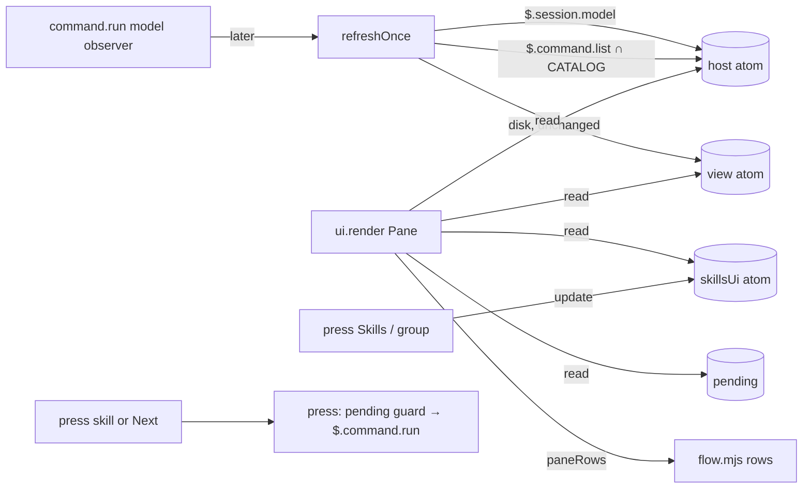

# Design: akili-panel-model-skills — the session's model and a collapsed Skills list in the Akili pane

## 1. Document Control

| Field | Value |
|---|---|
| Spec Path | `changes/akili-panel-model-skills` |
| Status | **Amendment A1 (AKILI title), approved by JC 2026-11-11: «Apruebo la enmienda A1, haz commit y empieza T6».** JC asked «Se puede en el mod tener un titulo de AKILI arriba ? algo asi como en la imagen pero mas pequeño ?», then «Mételo en el cambio actual» and «Opción B, con los valores por defecto»: DD-9, §8.7, §8.1 and §12 amended (marked *A1*). **Approved** by JC (Juan Carlos Cadavid), 2026-11-10: «Pasa a las tareas (tasks.md)» (option 2, Continue). Judgment-day round 1 closed **`fixed, not re-judged` (J-1, J-2)** on JC's «Corrige J-1 y J-2 sin volver a revisar» (2026-11-10); other findings stay recorded in `judgment.md` |
| Requirements | `requirements.md`, approved by JC 2026-11-10: «Continúa al diseño (design.md)» |
| Format source | `docs/specs/archive/2026-11-09-changes--akili-panel-polish/design.md` (no `docs/specs/general-setup/` here) |
| Verified at | `8e8c5ba` (code unchanged since `af41538`) |
| API authority | `types/claude-code.d.ts` of the bundled `plugin-authoring` skill, build **2.1.322** (`/private/tmp/claude-501/bundled-skills/2.1.322/…/plugin-authoring/types/claude-code.d.ts`), cited `types:<line>`; its `reference.md` cited `reference.md:<line>` |
| Probe | Throwaway plugin `probe-panel` in this session's scratchpad (outside the repo), `claude -p "Reply with the single word ok." --model haiku --max-turns 3 --plugin-dir <scratchpad>/probe-panel --debug-file <scratchpad>/debug1.log`, from an empty temp project, Claude Code 2.1.322, macOS. Quoted below as *probe* |
| UI skill | `impeccable-bridge` route: terminal pane, no web target → `ENV-2`, as polish recorded for the same pane (polish tasks `Design route` line; polish W-2: the detector cannot run on a terminal pane). Direction is fixed by the shipped polish look; this spec adds rows in that look, it sets no new direction |
| Delegation | Exploration done inline (4 source files, under the scout threshold with CodeGraph not indexed for `.claude/skills/`). Step 2.3 reversion challenge run inline by the architect (see DD-3), recorded as such |

## 2. Executive Summary

Two new atoms carry what the host knows (`host`: model and runnable listed skills) and what the person opened (`skillsUi`: section open, which group). Refresh fills `host` with one `$.session.model()` and one `$.command.list()` call. `flow.mjs` builds three new kinds of row: `model` after `session`, and the Skills section **after Next**, behind a rule, so Next never moves when a group opens. Presses on the Skills and group rows flip `skillsUi`; a press on a skill runs it through the existing `press()` path. The catalog of 32 skills is a frozen constant in `flow.mjs`, pinned to `.claude/skills/*/SKILL.md` by a test.

## 3. Architecture Overview



Refresh triggers are unchanged (turn.complete main loop, 30 s tick, `/akili-*` observers, `/clear`), plus one new observer for `/model` (DD-6).

## 4. Extended Directory Structure

```text
.claude/skills/akili-panel/
  .claude-plugin/plugin.json     EDIT  version 1.1.0
  hooks/flow.mjs                 EDIT  SKILL_CATALOG, listedSkills(), modelRow, skillsRows, paneRows input { host, skillsUi }
  hooks/register.jsx             EDIT  host + skillsUi atoms, refresh reads, toggles, skill press, /model observer, PANE_ROWS 19
  types/index.d.ts               EDIT  AkiliPanelHost, AkiliPanelSkillsUi
  tests/panel.test.tsx           EDIT  kit cases (model row, toggles, one group, skill press, double press, refusal);
                                       rig mocks for $.session.model and $.command.list; pinned :870 rows 16 → 19,
                                       :888 and :1003-1004 Next last child → Next inside the asked rows, :1033 14 lines (P-8)
  README.md                      EDIT  rows table, Use, Limits
test/akili-panel-flow.test.js    EDIT  new rows; updated id lists (P-8)
test/akili-panel-contract.test.js EDIT :48-49 hook-event list (+1 command.run), :66 gated count 2 → 3,
                                       :148-149 atom list (+host, +skillsUi), :157 render reads (+host, +skillsUi),
                                       :159 functions handed $ in render (+update), :160 press line, :164-176 FR-4 inline test (P-8)
test/akili-panel-catalog.test.js NEW   catalog ↔ .claude/skills
docs/plugins/akili-panel.md      EDIT
docs/skills/governance.md        EDIT  one line: a new or rebound skill updates the pane catalog (the test enforces it)
CHANGELOG.md                     EDIT  Unreleased
```

No new shipped file: the catalog lives in `flow.mjs`, so `install`, `pack` and the plugin file count tests are untouched (P-9).

## 5. Data Model

| Atom | Shape | Initial | Written by | Read by |
|---|---|---|---|---|
| `host` (`shape: 'host-1'`) | `{ model: string \| null, skills: string[] \| null }` — `skills` holds listed names only (catalog ∩ runnable), never the full command list | `{ model: null, skills: null }` | `refreshOnce` (after the `view` write); each call independently: a rejection writes `null` for that field and logs once via `$.ui.log` | render |
| `skillsUi` | `{ open: boolean, group: 'core' \| 'conditional' \| 'stack' \| null }` | `{ open: false, group: null }` | reset in `startSession` and `openPane` (FR-2 closed at every start and open); toggles | render |
| `view`, `tokens`, `usage`, `opened`, `pending` | unchanged | — | unchanged | unchanged; `pending` gains skill readers (P-7) |

`SKILL_CATALOG` (frozen, in `flow.mjs`): `[{ name, binding }]`, 32 entries, `binding ∈ { core, conditional, stack }`. `listedSkills(commandNames)` → catalog entries whose `name` is in the list, grouped and sorted alphabetically.

## 6. API Design

No API. Host calls used, all already in the plugin's reach (`types:2940-2943` `session.model`, `types:3257-3277` `command.list` / `command.run`).

## 7. Backend Module Design

n/a — a local plugin, no server (as parent design §7). No `Backend route:` line.

## 8. Frontend / UX Component Architecture

### 8.1 Row order (closed, full width)

`title`, `branch`, `rule-top`, `constitution`, `cycle`, 6 × `phase-*`, `rule-tokens`, `ctx`, `session`, **`model`**, `gap`, `next`, **`rule-skills`**, **`skills`** → 19 rows. *A1:* **`brand-1`**, **`brand-2`** come first and `title` carries the spec alone → 21 rows (§8.7). Open adds `skills-group-<b>` rows and, under the open group, `skill-<name>` rows.

### 8.2 Text mockup — the three states (80 columns, dark or light: tones are theme keys)

**State 1 — closed (default at every start and open):**

```text
Akili  changes/akili-panel-model-skills
⎇ JuankCadavid/akili-panel-model-skills
────────────────────────────────────────────────────────────────────────────────
01 Constitution  ○
02 Cycle         ━━━━━━────── 2/6
   propose       ✓
   specify       ▶
   execute       ○
   test          ○
   validate      ○
   archive       ○
────────────────────────────────────────────────────────────────────────────────
ctx              ━━━━━─────── 41%  412k/1M
session          18k in / 6k out · $1.20
model            claude-opus-5-5

 Next: /akili-specify changes/akili-panel-model-skills 
────────────────────────────────────────────────────────────────────────────────
Skills (32) ▸
```

**State 2 — section open, every group closed:**

```text
 Next: /akili-specify changes/akili-panel-model-skills 
────────────────────────────────────────────────────────────────────────────────
Skills (32) ▾
  core (12) ▸
  conditional (9) ▸
  stack (11) ▸
```

**State 3 — one group open (`conditional`; opening another closes it):**

```text
 Next: /akili-specify changes/akili-panel-model-skills 
────────────────────────────────────────────────────────────────────────────────
Skills (32) ▾
  core (12) ▸
  conditional (9) ▾
    diagram-design
    frontend-design
    gsap-animation
    impeccable
    impeccable-bridge
    stitch-design
    tdd
    ui-ux-pro-max
    video-production
  stack (11) ▸
```

The nine names are the `conditional` skills at `8e8c5ba` (same `awk` as P-6, filtered on `conditional`); the test-pinned catalog stays the source, not this sketch.

### 8.3 Tones and marks (NFR-1)

| Row | Parts | Tone |
|---|---|---|
| `model` | label padded to the ladder's `col`, then the id | default text, as `ctx`/`session` |
| `rule-skills` | `─` × width | `subtle`, as the other rules |
| `skills` | `Skills (<n>) ` + mark | label default; mark `▸`/`▾` `inactive` |
| `skills-group-<b>` | two spaces, `<b> (<k>) `, mark | label `inactive` while closed, default while open; mark `inactive` |
| `skill-<name>` | four spaces, name | default; `dim` while `pending.command === name` |

Marks carry state without colour (NFR-1). Next keeps its chip and dims while any run is pending, as today.

### 8.4 Presses (render)

`paneRows` marks press rows with a `press` field: `{ kind: 'skills' }`, `{ kind: 'group', binding }`, `{ kind: 'skill', name }`. `register.jsx`'s `draw` maps them to `<Button plain …>` with a key per row; the handler is chosen in register, never in `flow.mjs`:

| Kind | Handler |
|---|---|
| `skills` | `update(skillsUi, s => ({ open: !s.open, group: null }))` |
| `group` | `update(skillsUi, s => ({ ...s, group: s.group === b ? null : b }))` (one open, FR-3) |
| `skill` | `press($, { command: name, args: '' })` — the Next path: atomic `pending` flip, `later(afterRun)`, `$.command.run`, toast `STRINGS.runRefused` on rejection, `clearPending` in `finally` |

### 8.5 Narrow panes (FR-6)

- `model` is **not** in `governedRows` (DD-5): it never moves a ladder step. It takes the step's `col`; the id is `shortenMiddle(id, cols - col)`. When `cols - col < 6`, the label is dropped and the id gets the full width, `shortenMiddle(id, cols)`; at 14 columns that is `claude…-5-5`-style, never empty.
- Skills rows with a mark (`skills`, `skills-group-<b>`) are **built already fitted**, not cut by `fitParts`' `protect` (which keeps a prefix and so cannot keep a trailing mark — judgment J-2): the label part (indent + text + count) is cut first to `cols - 2` with `…`, then the space and the `▸`/`▾` part are appended, so the mark survives at every width ≥ 3; `fitParts` then finds nothing to cut. Below 3 columns the mark alone is drawn. Skill rows (no mark) go through `fitParts` like every row, cut at the end with `…`.

### 8.6 Height (FR-7, R3 decision)

| Placement | What happens | Source |
|---|---|---|
| Inline | `$.ui.open({ rows: 19 })` asks for the closed layout; "inline the frame fits the tree", so opening a group grows the frame up to what the layout spares | `reference.md:169` (`rows` … "as tall as its content needs (up to what the layout spares, and the person's own size wins)"); `types` `Pane.scroll` doc ("Inline the frame fits the tree") |
| Dock | The body is a window over the tree, scrolled by the person's keys while focused | `types` `Pane.scroll`, `Pane.isFocused` ("the arrows scroll") |

**Decision:** no re-open and no own scrolling. Skills sit **after** Next, so whatever the room, Next and every pre-existing row keep their place and the open group grows downward into the frame or the scroll window. Live confirmation is P-5 (owner T1).

### 8.7 AKILI title (A1, FR-10)

```text
▄▀█ █▄▀ █ █   █        ← brand-1, tone planMode
█▀█ █ █ █ █▄▄ █        ← brand-2, tone planMode
changes/akili-panel-model-skills
⎇ JuankCadavid/akili-panel-model-skills
────────────────────────────────────────
```

**Size rule** (pure, in `flow.mjs`): `size = min(byWidth, byHeight)`, where

| Measure | Input | 2 rows | 1 row (`AKILI`, bold) | none |
|---|---|---|---|---|
| `byWidth` | `cols` = `bodyColumns` | `cols` ≥ 15 | 5 ≤ `cols` ≤ 14 | 0 < `cols` < 5 |
| `byHeight` | `rows` = `scroll.bodyRows`; `n` = rows from the header down to and including `Next` (no title) | `n + 2 ≤ rows` | `n + 1 = rows` | `n ≥ rows` |

- A missing or non-positive measure is unbounded (2), as `cols` already is.
- `n` counts only rows above the Skills section, so opening Skills or a group never changes the size; error lines or an empty state change `n`, and the rule follows. With no `Next` row (no view), `n` is every row.
- **Size none** draws the `1.0.0` header (`Akili  <spec>`, or the no-view `Akili` row): FR-8 holds exactly in that case.
- Examples: dock at 23 × 52 → 2 rows; kit 14 columns, tall → 1 row; inline 17 visible rows with `n` = 17 (the T5 session) → none, Next stays on the last visible row; a 13-row inline allowance → none, Next as in `1.0.0`.
- `register.jsx` passes `rows: e.props.scroll && e.props.scroll.bodyRows` beside `cols` into `paneRows` (render reads props only, NFR-2). `PANE_ROWS` 19 → 21.
- Not in `governedRows`: the title never moves a ladder step (FR-6). Glyphs are block elements (U+2580, U+2584, U+2588), single-width.

## 9. Shared Contracts or Package Extensions

`types/index.d.ts`: `AkiliPanelHost`, `AkiliPanelSkillsUi`, and `host: Shaped<AkiliPanelHost>`, `skillsUi: AkiliPanelSkillsUi` in `PluginState['akili-panel']`. `paneRows` input gains `host` and `skillsUi` (both optional: absent → `model —`, no Skills section).

## 10. Design Decisions

| ID | Decision | Rejected | Requirements |
|---|---|---|---|
| DD-1 | Catalog as a frozen constant in `flow.mjs`, with a test that reads every `.claude/skills/*/SKILL.md` frontmatter `metadata.binding` and compares both ways (KZ-002: counts come from the test, not prose) | Generated file (new shipped file, install/pack churn); runtime read of `~/.claude/skills` (reads outside the project, cannot tell AKILI's own) | FR-5 |
| DD-2 | `host` atom holds listed names only, filled in `refreshOnce`; render never calls the host | Calling `$.command.list()` while drawing (polish NFR-4) | FR-1, FR-5, NFR-2, NFR-3 |
| DD-3 | Skills section **after** Next behind `rule-skills`; `PANE_ROWS` 16 → 19; the contract test's "Next is the last asked-for row" becomes "the rows asked equal the closed full layout, and Next is inside them". **Reversion challenge (Step 2.3, inline): "what does removing *Next last* break?"** The guarantee existed so an inline pane opens tall enough to show Next (polish DD-P12). With 19 rows asked, Next is still inside the asked rows; when the layout spares fewer, the rows cut first are now the Skills rows, not Next — the guarantee is stronger, not weaker. No breakage found; no design change | Skills before Next (an open group pushes Next down and, in a dock, out of view) | FR-7, FR-8 |
| DD-4 | Skill press reuses `press()` and `pending` unchanged; one guard for Next and skills (FR-4 *Double press*) | A second guard per skill (two runs could queue) | FR-4 |
| DD-5 | `model` row outside `governedRows`; its own fit rule (§8.5) | Governed (a long id would push the ladder and change pre-existing rows, against FR-6/FR-8) | FR-6, FR-8 |
| DD-6 | `on('command.run', { command: 'model' })` observer: `next(e)` first, then `later(runRefresh)`, `.catch(passOn)` like the others (NFR-5). If P-4 refutes it, turn.complete and the 30 s tick still meet FR-1's bound, and the observer is removed via the Pivot Protocol | Polling faster than 30 s | FR-1 |
| DD-7 | `skillsUi` reset in `startSession` and `openPane`; not reset by refresh, `/clear` or a run (FR-4 *section stays*) | Persist in `$.store` across sessions (FR-2 says closed at every start) | FR-2, FR-4 |
| DD-9 | *A1:* a half-block AKILI title in `planMode` sized two rows, one row or none by the smaller of a width rule and a height rule that keeps `Next` in the opening view (§8.7); the header row drops `Akili  ` only while a title shows; `PANE_ROWS` 21. JC chose option B and the defaults, 2026-11-11, then asked «que no se vea mal en pantallas pequeñas» | Fixed two rows everywhere (pushes Next out of a 17-row inline frame); a title cut with `…` (looks broken); hiding by placement (`dock`/`inline`) instead of measured room (a short dock would still break); A: one row `A K I L I` (least height, least likeness to the CLI banner); C: three-row double-line letters (closest to the banner, one more row); keeping `Akili  <spec>` under the title (the name twice); raw cyan as in the CLI banner (NFR-1: theme keys only) | FR-10, FR-7, FR-8 |
| DD-8 | `docs/skills/governance.md` gains one line in the acceptance checklist: a new, removed or rebound skill updates `SKILL_CATALOG`; the catalog test enforces it | Rely on the test alone (the failure would surprise the next skill author) | FR-5 |

## 11. Premise Ledger

**Count:** 12 settled: 11 verified, P-11 existence-checked (live at T5). P-3, P-4, P-5 verified by T1, 2026-11-10; P-11 by T3, 2026-11-10 (`execution.md` → T1, T3).
**Blast-radius triggers:** `live-path` (a press runs a command) → P-3, P-10; `shared-state` (`pending` gains readers) → P-7; `consumer` (`paneRows` output and `PANE_ROWS` change) → P-8.

| # | Claim | Class | Citation (as run) | Verified at | If false | Settled by |
|---|---|---|---|---|---|---|
| P-1 | `$.session.model()` returns the main loop's model as a full id | data-env | `types:2940-2943`; probe on Claude Code **2.1.322**: `PROBE model=claude-haiku-5-5` | `8e8c5ba` | FR-1 row text rule changes (Low) | — |
| P-2 | Installed skills are in `$.command.list()` by bare name with `source: "user"`; `/model` is `builtin` | data-env | Probe 2.1.322: `picks=[["brainstorming","user",null],["caveman","user",null],["impeccable","user",null],["kaizen","user",null],["tdd","user",null],["akili-propose","user",null],["model","builtin",null]]` | `8e8c5ba` | DD-2 filter key changes; FR-5 (High) | — |
| P-3 | `$.command.run({ command: '<skill>', args: '' })` from a pane press runs the skill as if typed, interactively | live-path | T1, interactive Claude Code 2.1.322 in Orca, real hotkey press: `t1-debug.run1.log:672` `PRESS run command="caveman"`, `:673` `$.command.run (probe-panel): 8 chars queued`, `:725` `RUN RESOLVED command=caveman result={}`; screen `❯ /caveman` then the skill's reply. Falsifier `:663` `no command named /no-such-skill-xyz in this session`. The resolve carries `{}`; the calling plugin's own `command.run` hooks are skipped (re-entry, `:675`) | `a90ed92` | FR-4 cannot ship as written; Pivot (High) | T1 ✓ |
| P-4 | Typing `/model <name>` raises `command.run` with `command: 'model'` for a plugin observer | live-path | T1: `t1-debug.run1.log:804` `OBS-MODEL command.run model args="haiku" origin={"kind":"composer"}`; none before it. Fires on entry, before the host's "Switch model?" dialog; `next()` settles after it (`:815`, 11508.8 ms). `args` is the typed alias. A refresh after `next` seeing a confirmed switch: unobserved (T5) | `a90ed92` | DD-6 observer is dead code; FR-1 still met by turn/tick (Low) | T1 ✓; confirmed switch at T5 |
| P-5 | An inline pane grows past its asked `rows` when the tree grows; a docked pane scrolls by keys while focused | data-env | T1 with `rows: 4`: inline `t1-events.run3-inline.log:5-8` tree 4 → 12, screen `│ L12 n=12` then `╰───` (frame grew whole, up to the layout's allowance, `body` 17), then scrolls by Down keys (`:11-15` `off` 1→5). Dock: body 52 from the first render (`t1-debug.run1.log:620`), so `rows` does not size a dock; Down keys scroll an 80-row tree (`t1-debug-run2.log:583-600` `ui.scroll … moved`). Docs: `reference.md:169`, `types:11298-11335` | `a90ed92` | §8.6 needs a re-open with more `rows` (Low) | T1 ✓; `rows: 19` at T5 |
| P-6 | 32 skill folders carry `metadata.binding`: 12 `core`, 9 `conditional`, 11 `stack`; `akili-panel` has no `SKILL.md` | data-env | `for f in .claude/skills/*/SKILL.md; do awk '/^---/{n++; next} n==1 && /^[ \t]*binding:/{print $2; exit}' $f; done \| sort \| uniq -c` → `9 conditional`, `12 core`, `11 stack`; `ls .claude/skills \| wc -l` → 33 | `8e8c5ba` | Catalog content (Low; the test re-derives it) | — |
| P-7 | `pending` is read by Next's draw (`dimColor`), `press()`, `clearPending`, `afterTurnStart` (regex on `/${cur.command}`), and reset in `startSession` — a skill name fits all of them | shared-state | `register.jsx`: `press()` flips via `update(pending)`; `clearPending` compares `since`; `afterTurnStart` builds `new RegExp('/' + cur.command + '(?![\\w-])')`; `draw` passes `row.next.pending`; `startSession` writes `null`. Skill names are `[a-z0-9-]` (P-6 folder names), safe in that regex | `8e8c5ba` | DD-4 needs a second guard (Low) | — |
| P-8 | Consumers of `paneRows` / `PANE_ROWS` / the press line **and of the plugin's shape (atoms, hook list, render calls)**: `test/akili-panel-flow.test.js` (id lists at `:969`, `:1016`, `:1128`, `:1414`; `:1009` loop); `test/akili-panel-contract.test.js` `:48-49` (hook-event list holds exactly two `command.run`; DD-6 adds a third), `:66` (`gated.length` 2), `:148-149` (atoms exactly `view, tokens, usage, opened, pending`), `:157` (render reads exactly `pending, tokens, usage, view`), `:159` (functions handed `$` in render exactly `press, read`; the toggles add `update`), `:160` (every `press($` line must be `onPress={() => press($, v.next)}`), `:164-176` (rows asked = rows drawn, Next last); `.claude/skills/akili-panel/tests/panel.test.tsx` `:870` (`rows` 16), `:888` and `:1003-1004` (Next is the root's last child; children = rows asked), `:1033` (14 drawn lines), and its rig mocks neither `$.session.model` nor `$.command.list`; `test/akili-panel-flow-coverage.test.js`; `register.jsx`; `flow.mjs` | consumer | `grep -rln -E "paneRows\|PANE_ROWS\|ladderStep\|press\(\\$" --exclude-dir=node_modules --exclude-dir=archive --exclude-dir=.git .` → those 6 files; `grep -rn "'session'\]\|'session', 'gap'" test .claude/skills/akili-panel/tests \| wc -l` → 5; the shape pins were read in full: `sed -n '46,50p;64,67p;146,160p' test/akili-panel-contract.test.js` and `sed -n '868,871p;886,889p;1001,1005p;1031,1034p' .claude/skills/akili-panel/tests/panel.test.tsx` (judgment J-1) | `8e8c5ba` | Missed test updates (Low) | — |
| P-9 | Plugin file count and pack contents are pinned by `test/install-akili-panel.test.js` and `npm run pack:dry-run`; adding no file leaves them green | consumer | `ls test \| grep -i panel` → `install-akili-panel.test.js` among 5; DD-1 adds no shipped file | `8e8c5ba` | A generated catalog file would need those updates (Low) | — |
| P-10 | A Next press reaches `$.command.run` and runs the command interactively (shipped) | live-path | `draw` → `<Button … onPress={() => press($, v.next)}>` → `press()` → `$.command.run`; parent design P-34 (observed in parent T1, Claude Code 2.1.318) | `8e8c5ba` | — | — |
| P-11 | `$.session.model` and `$.command.list` exist on 2.1.318 (NFR-4 floor) | existence | T3, 2026-11-10: `~/.local/share/claude/versions/2.1.318 plugin test .claude/skills/akili-panel` → `92 pass / 0 fail` with both calls mocked in the kit; the 2.1.318 binary's strings contain `"session.model"` and `"command.list"` (2.1.317 too). Existence by binary strings and mocked kit only, not a live answer | `2c0a5bf` + T3 diff | NFR-4 fallback paths become the norm on 2.1.318 (Low) | T3 (existence) ✓; live at T5 |
| P-13 | *A1:* a Pane render carries `scroll.bodyRows`, the visible body rows, and re-renders when it changes | data-env | T1 probe (2.1.322): `"body":17` inline and `"body":52` docked in its RENDER lines (`t1-events.run3-inline.log:5-6`, `t1-debug.run1.log:620`); `types` Pane `scroll` ("The body's window over the tree") | — | Absent on a host → unbounded (FR-10 *Size unknown*); a missed re-render on resize leaves the old size until the next render (Low) | T6 (kit varies `bodyRows`), T5 (live) |
| P-12 | No test reads the active spec folder | other | KZ-changes--archify-diagrams-1; the catalog test reads `.claude/skills/`, not `docs/specs/` | `8e8c5ba` | — | — |

## 12. Budget (Step 2.4)

| Measure | Estimate |
|---|---|
| Tasks | 5 (T1 live probe; T2 catalog + rows in `flow.mjs` with their tests; T3 `register.jsx` wiring + types with contract and kit tests; T4 docs + version + governance + CHANGELOG; T5 live check, HITL). Split aligned with `tasks.md`: tests travel with the code they pin |
| LOC | ~750: code ~220, tests ~470 (one assertion per scenario clause, KZ-bugfix--init-ctrlc-abort-2), docs ~60. Raised by JC to ~850 at the T3 gate (2026-11-10). *A1:* ~980: T6 adds about 130 (code ~35, tests ~80, docs ~15), the size rule included |
| Review rounds | 8 (T1 1, T2 2, T3 2, T4 2, T5 1). *A1:* still 8: used T1 1, T2 1, T3 1, T4 2; planned T6 2, T5 1 |
| Tasks (*A1*) | 6: T6 (AKILI title) after T4; T5 closes after T6 |

Matches Standard depth; no change of depth recommended.
