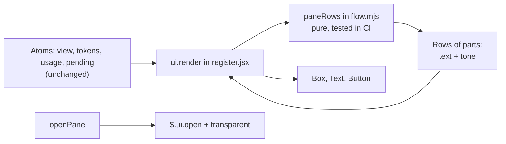

# Design: akili-panel-polish — make the Akili pane easier to read and nicer to look at

## 1. Document Control

| Field | Value |
|---|---|
| Spec Path | `changes/akili-panel-polish` |
| Status | **Design / tasks approved by JC (Juan Carlos Cadavid), 2026-11-06:** «Continue: apruebo requirements, design y tasks de akili-panel-polish». The time was not relayed. Approval Mode stays `gated`. Earlier at this gate: «Review Design: corre judgment-day sobre akili-panel-polish» (2026-11-06 10:01 AM America/Bogota) and «Fix only: corrige J-1 y W-2…W-8 sin re-juzgar» (10:17 AM). `judgment.md` closes `fixed, not re-judged`, not `JUDGMENT: APPROVED`; W-1 and I-1 … I-13 stay `info` |
| Requirements | `requirements.md` |
| Visual reference | `mockup/pane-polish.png` (sketch from the proposal) |
| API authority | `types/claude-code.d.ts` of the bundled `plugin-authoring` skill, build 2.1.319, cited as `types:<line>`. Also read in 2.1.318 |
| Verified at | `c14e344` |
| Design skill | `impeccable-bridge`: skill source `vendored (4.8.0)`, engine `ready (location 4, engine 0.1.18)` |
| Format source | `docs/specs/archive/2026-11-06-changes--akili-panel/design.md`, the parent, archived at `b7d1738` |
| Probe | `probe/`: the mod, `run.sh` and captures behind P-1, P-2, P-6, P-7, P-9, P-10. Evidence only, not shipped |

## 2. Executive Summary

Two files change: `flow.mjs` turns the view into **rows of coloured parts**, and `register.jsx` draws those parts and asks for a transparent pane. All decisions stay in the pure module, so `node --test` covers them in CI.

**Two findings from this phase shape the plan:**

| Finding | Effect |
|---|---|
| Transparent works. A probe (`probe/`) on 2.1.319 and on 2.1.318 lost the gray and kept the colours (P-1, P-2) | Option A stands. The main proposal risk is settled for the terminal |
| Under `dark-ansi`, colours come from the terminal palette, and JC's looks very pale: Next's bright blue paints as `#EEF8F8` (P-3) | **On JC's own terminal, state colours may look close to white.** T1 checks this with his eyes before any code |

## 3. Architecture Overview



No hook, atom, refresh path or press path changes.

## 4. Extended Directory Structure

```text
.claude/skills/akili-panel/
  hooks/flow.mjs              EDIT  row builders, tone table, bars, narrow ladder
  hooks/register.jsx          EDIT  ui.render, two $.ui.open arguments
  tests/panel.test.tsx        EDIT  all four surfaces, chip, press
  README.md                   EDIT  row table
test/akili-panel-flow.test.js      EDIT  pinned formats, new rows and widths
test/akili-panel-contract.test.js  EDIT  no raw colour, transparent, one draw path
docs/plugins/akili-panel.md        EDIT  row table
CHANGELOG.md                       EDIT  Unreleased plugin entry
docs/specs/changes/akili-panel-polish/probe/   evidence and T1's tool, not shipped
```

`types/index.d.ts` does not change: no atom is added.

## 5. Data Model

No stored data changes. One new in-memory shape, inside `flow.mjs` only:

| Shape | Fields |
|---|---|
| Row | `id`, `parts` |
| Part | `text`, optional `tone` (a theme key), optional `bold`, optional `dim` |

The plain text of a row is its parts joined. Tests pin both the text and the tones.

## 6. API Design

None. The only host call that changes is `$.ui.open`, which gains `backgroundColor: 'transparent'` (`types:7837`). It also gains `rows` (DD-P12). It has one call site.

## 7. Backend Module Design

None: no task is a backend task, so no `Backend route:` line applies.

## 8. Frontend / UX Component Architecture

**Environment and direction** (`impeccable-bridge` → `design-routing.md`): **ENV-2**, established world. Evidence: the pane is drawn only with the host's element table and theme keys (`types:4007-4009`, `types:13841`). Page mode **Operate**. Direction: *Extend an existing surface*, a refinement that keeps content, order and the Claude Code feel. Colour encodes state and action only. Motion: none. Polish: `light`. Playbooks: `colorize`, `layout`, `adapt`, then `polish`.

**Design tokens:** the tokens are Claude Code's theme keys. This spec adds none.

| Role | Theme key |
|---|---|
| Primary text | default |
| Secondary text, not reached | `inactive` |
| Done | `success` |
| Current, accent, Next fill | `suggestion` |
| Blocked, context 80–94 | `warning` |
| Read failure, context 95+ | `error` |
| Rules, empty bar | `subtle` |
| Chip letters | `inverseText` |

**Tone table** (one data table in `flow.mjs`, DD-P3). It restates FR-2 cell for cell:

| State | Mark | Mark tone | Label tone |
|---|---|---|---|
| Done | `✓` | `success` | `inactive` |
| Current | `▶` | `suggestion`, bold | `suggestion`, bold |
| Current and blocked | `▶ (blocked)` | `warning`, bold | `warning`, bold |
| Current, no task status | `▶ (no task status)` | `warning`, bold | `warning`, bold |
| Not reached | `○` | `inactive` | `inactive` |
| Constitution, all present | `✓` | `success` | `inactive` |
| Constitution, some present | `▶ (k/13)` | `suggestion`, not bold | `inactive` |
| Constitution, none present | `○` | `inactive` | `inactive` |

`derivePhases` gives a phase one of `done`, `current` or `todo`, and a note of `null`, `blocked` or `no-task-status` on the current phase only (`flow.mjs:363-387`). The table covers every pair that can occur. `blocked` can sit on any current phase, not only execute.

**Layout**, top to bottom:

| Row | Content | Rules |
|---|---|---|
| Header 1 | `Akili` bold, two spaces, spec | Spec shortened in the middle to fit |
| Header 2 | Branch label `inactive`, then ` · archived`, then ` (n more active)` | Branch shortened in the middle; the tail is kept |
| Rule | `─` in `subtle`, length = the row width, or 40 with no width | Not drawn before the first refresh |
| Constitution | `01 Constitution`, then the mark at the mark column | Label `01 Constit…` at ladder step 6 |
| Cycle | `02 Cycle`, bar at the mark column, ` <done>/6` | Absent with no spec |
| Flow | Six phase rows, label indented 3, mark at the mark column | Replaced by the empty text when there is nothing to show |
| Errors | `error` tone, at most 3 | Text as today |
| Rule | As above | — |
| ctx | `ctx`, bar at the mark column, ` <p>%`, `  <used>/<window>` | `—` at the mark column, with no bar, when missing |
| session | `session`, value at the mark column | Value text as FR-5 |
| Next | Chip or native primary, one blank row above | None when `next` is null |

**Mark column.** It counts the characters before the mark: 17, the width of `01 Constitution` plus two spaces; 13 from ladder step 6, the width of the longest phase row label, `   validate`, plus two spaces.

**Assembly.** One pure function, `paneRows`, builds the whole pane in order: it owns the block order, the first-draw and empty states, the error rows and the blank row above Next. `register.jsx` only maps its rows to elements.

**Bars.** One vocabulary: `━` filled, `─` empty in `subtle`. Twelve cells, or six at ladder step 5. The cycle bar gives each phase an equal share, so a phase is 2 cells, or 1. A done share is `success`; the current share takes its mark's tone, so `warning` when blocked or with no task status. Both bars start at the mark column and line up.

**Ladder (FR-7).** One function walks the seven steps and returns the first at which the constitution, cycle, flow and token rows fit `bodyColumns`, or the last step when none fits. Steps are evaluated on the real text, not on fixed breakpoints, so a long figure moves the step correctly. Rows it does not govern (header, errors, Next) use the existing shorten and cut rules. With `bodyColumns` missing or not positive it returns step 1.

**Fit.** Every row passes one fit rule that cuts parts from the end and ends with `…`, so the joined length never passes `bodyColumns`, down to 1 column. With `bodyColumns` missing or not positive it cuts nothing, as `fitLine` does today. Width counts one cell per UTF-16 unit, as `fitLine` does today (`flow.mjs:479`). Every glyph this spec adds is one unit (P-7).

**Next.**

| State | Terminal | Other surfaces |
|---|---|---|
| Ready | `plain` Button holding one `Text`: `suggestion` fill, `inverseText`, bold, one space each end | `variant="primary"`, string child, as today |
| Pending | `plain` Button, `dimColor`, the Text with no fill | `variant="primary"`, `dimColor`, as today |
| No next step | Nothing | Nothing |

The label is cut to `bodyColumns` less 2 before the two spaces are added. `key="next"` stays, so the tests' selector and the press path hold (P-6).

**Empty and first-draw states:**

| State | Draws |
|---|---|
| No view yet | `Akili`, token block |
| `no-specs`, `no-active` | Header, rule, constitution, empty text, rule, token block, Next if any |
| Spec shown | Everything |
| Archived | Everything; cycle `6/6`; header 2 carries ` · archived` |

## 9. Shared Contracts or Package Extensions

| Contract | Owner | Readers |
|---|---|---|
| Row and part shape | `flow.mjs` | `register.jsx`, `test/akili-panel-flow.test.js` |
| `key="next"` | `register.jsx` | `tests/panel.test.tsx` |

## 10. Design Decisions

| ID | Decision | Rejected | Requirements |
|---|---|---|---|
| DD-P1 | Ask for `backgroundColor: 'transparent'` on the one `$.ui.open` call | A theme key for the fill: none is a background role, so it would not suit every theme. A raw colour: cannot follow the theme | FR-1 |
| DD-P2 | Colours are theme keys only. This narrows parent §8's "no custom colours" to "theme keys only, no raw colours" | Reading the theme through `$.config` and picking hex per theme: fragile, and it would need upkeep for every theme | NFR-1 |
| DD-P3 | Rows of parts built in `flow.mjs`, with the tone table as data; `register.jsx` only maps parts to `Text` | Tones inline in JSX: CI could not test them, as `claude plugin test` runs locally only (parent DD-2, DD-15) | FR-2 to FR-8 |
| DD-P4 | `formatHeader`, `formatConstitution`, `formatPhaseLines` and `formatTokens` are replaced by row builders; `fitLine`, `shortenMiddle`, `shortenCount`, `formatNext`, `errorLines` and `emptyStateText` stay. Their only consumers are `register.jsx` and `test/akili-panel-flow.test.js` (P-5) | Keeping the old string formatters beside the new ones: two sources for one row | FR-4, FR-5 |
| DD-P5 | Header in two rows | One row: spec and branch compete for width in every narrow pane | FR-4 |
| DD-P6 | Marks stay after their labels, in one mark column shared with the bars | Marks before labels: more change to approved rows for little gain | FR-4 |
| DD-P7 | `━` and `─` for bars | `█░`: too loud for Operate mode beside a filled chip. `▰▱`: weaker font coverage | FR-3, FR-5 |
| DD-P8 | Thresholds compare the rounded percent | Comparing the raw value: `79.6` would read `80%` in the normal tone | FR-5 |
| DD-P9 | Chip on the terminal only, by `e.surface`; native primary elsewhere | One look everywhere: a desktop draws its own button either way (`types:1140`) | FR-6 |
| DD-P10 | One ladder for the constitution, cycle, flow and token rows, with the mark column moving to 13 before the bars leave, so state words stay whole down to 24 columns (J-1) | Each row dropping parts alone: the order of FR-7 would depend on text lengths. A fixed mark column: state words are cut below 28 columns | FR-7 |
| DD-P12 | `$.ui.open` also asks for `rows` equal to the full layout's height, 16 rows (today's layout is 12). Read-failure rows may still scroll | Leaving it out: an inline pane opens at a third of the layout, and on a 40-row terminal Next, the last row, would sit below the visible body (reversion challenge) | FR-4 |
| DD-P11 | `subtle` for rules with no `dimColor` | `subtle` plus `dimColor`: on a terminal `dimColor` draws in the theme's dim colour (`types:13731`), so the key would stop deciding the look | FR-4 |

**Reversions (Step 2.3).** Five decisions take away something v1 ships: the host's default pane background (DD-P1), the bracketed primary button on the terminal (DD-P9), the `Tokens:` line (FR-5), the one-row header (DD-P5), and dim read-failure rows (FR-8). The challenge result is recorded in *Reversion challenge* below.

### Reversion challenge

One reviewer (`sonnet`), one question: "what does removing this break?" It named three items. Each was checked against the API text or a probe:

| Item | Result | Action |
|---|---|---|
| Taller layout with no `rows`: Next can fall below the visible body in an inline pane | **Confirmed** by `types:7848-7856`: 16 rows against a third of the layout | **Design fixed:** DD-P12, FR-4 scenario, T3, T5 |
| Keyboard focus could vanish on a filled chip | **Refuted on the terminal** by a probe: focus adds inverse (P-10) | None. T5 still looks at it |
| With no gray and one pane, no title is drawn, so only the first row says `Akili` | **Holds, and the design covers it:** the spec path is what shortens, so `Akili` stays at any width of 6 or more, and the host's `│` divider stays when docked (probe) | None. T5 looks at it |

The `Tokens:` line, the one-row header and dim failure rows: "none found" beyond the consumers already listed in P-5.

## 11. Premise Ledger

**Count:** 11 rows · 11 verified (P-3, P-4 settled in T1).

**Blast-radius triggers:** `live-path` fired (the design names `/akili-panel` and the Next press). `consumer` fired (exported formatters, the `key="next"` selector). `shared-state` not fired: no state, service or signal shared by more than one component changes; the atoms are read as today.

| # | Claim | Class | Citation (as run) | Verified at | If false | Settled by |
|---|---|---|---|---|---|---|
| P-1 | `backgroundColor: 'transparent'` removes the gray from the pane body on a terminal, on 2.1.319 and on 2.1.318 | `data-env` | `probe/run.sh`, `tmux` 170 columns, docked, `theme = dark-ansi`, saved in `probe/captures/`. Count of `\x1b[100m`: `gray.ansi` 73, pane rows included; `clear.ansi` 2, both on the chat's typed-command rows (lines 15 and 18, 1-indexed); `clear-2.1.318.ansi` 1, line 13, also a typed-command row | `c14e344` | **High:** DD-P1 falls, and Option B applies | — |
| P-2 | Colours and a filled `Text` draw on the transparent pane: `success` → `SGR 92`, `suggestion` → `94`, `warning` → `93`, chip → `30` on `104` | `data-env` | `probe/captures/clear.ansi`, 2.1.319: `\x1b[92mdone ✓`, `\x1b[0;1m\x1b[94mcurrent ▶`, `\x1b[0;1m\x1b[93mblocked ▶`, `\x1b[0;1m\x1b[30m\x1b[104m Next: chip ` | `c14e344` | **High:** FR-2 and FR-6 change | — |
| P-3 | On JC's Orca terminal under `dark-ansi`, the theme's state colours are far enough apart to read as different states | `data-env` | T1, Orca, Claude Code 2.1.319, `/probe-clear` in `dark-ansi` and in `light`: JC, 2026-11-06 7:39 PM America/Bogota: «1: se lee bien en ambos temas, sigue con T2» | `e627f9c` | **High:** colour would add little on his terminal, so JC decides: accept marks and weight, or change his theme or palette | T1, JC's eyes. Evidence for doubt: the probe shows primary = `SGR 94`, and JC's screenshot paints Next at peak `#EEF8F8`; the only tinted chat text is pale, `#99CECF` |
| P-4 | Light themes read well on the transparent pane | `data-env` | T1, Orca, Claude Code 2.1.319, `/probe-clear` in `dark-ansi` and in `light`: JC, 2026-11-06 7:39 PM America/Bogota: «1: se lee bien en ambos temas, sigue con T2» | `e627f9c` | **Low:** a tone adjusts; the approach stands | T1, JC's eyes |
| P-5 | The formatters DD-P4 replaces have no reader beyond `flow.mjs`, `register.jsx` and `test/akili-panel-flow.test.js` | `consumer` | `git grep -n -E "formatTokens\|formatHeader\|formatPhaseLines\|formatConstitution\|formatNext\|errorLines\|emptyStateText\|fitLine\|shortenMiddle\|branchLabel\|shortenCount" -- . ':!docs/specs'` → `flow.mjs` 20 hits, `register.jsx` 11, `test/akili-panel-flow.test.js` 50, no other file. Text readers of the old formats: `git grep -n -E 'Tokens: \|ctx —\|Akili · ' -- . ':!docs/specs' ':!CHANGELOG.md'` → also plugin `README.md:30,35`, `docs/plugins/akili-panel.md:33,38` | `c14e344` | **Low:** the task's consumer list grows | — |
| P-6 | Tests reach the button by `key: 'next'`, and a `plain` Button holding a `Text` keeps its text and takes a press on every surface | `consumer` | `git grep -n "key: 'next'" -- .claude/skills/akili-panel test` → `tests/panel.test.tsx:69,154,166,168,173,184,187,200,204,209,214`. `claude plugin test docs/specs/changes/akili-panel-polish/probe/mod` on 2.1.319, saved as `probe/captures/kit-2.1.319.txt`: `terminal`, `desktop`, `vscode`, `mobile` each return `" Next: chip "`, and the test's press resolves | `c14e344` | **Low:** the chip's markup adjusts | — |
| P-7 | `━`, `─` and `…` are single UTF-16 units, so `fitLine`'s length rule still equals cells | `data-env` | `flow.mjs:479-483`; U+2501, U+2500 and U+2026 are in the BMP. Terminal width: `probe/captures/clear.txt` line 4 draws `02 Cycle  ━━━━━━────── 2/6` on one row, intact | `c14e344` | **Low:** the fit rule adjusts | — |
| P-8 | The pane is opened in one place, by `/akili-panel` | `live-path` | `/akili-panel` typed → `command.run` hook, `register.jsx:171` → `openPane` at `:150` → `$.ui.open` at `:152`. `grep -c '\$\.ui\.open(' register.jsx` → `1`. No branch point | `c14e344` | **Low:** every call site gets the argument | — |
| P-9 | A press reaches `press($, v.next)` only through the Button's `onPress`, whatever the Button's look | `live-path` | `register.jsx:231` `onPress={() => press($, v.next)}`; `:132` `press`. One branch point in this design: `e.surface` picks the look, and both branches pass the same handler. The `probe/mod` kit test pressed the `plain` form on four surfaces | `c14e344` | **High:** FR-6's press scenario fails | — |
| P-10 | On a terminal, keyboard focus on the chip is visible | `data-env` | `probe/run.sh`, 2.1.319, `/probe-focus`, then `Tab` to the chip. `probe/captures/focus-before.ansi:10`: `\x1b[1m\x1b[30m\x1b[104m Next: chip `. `focus-on-chip.ansi:10`: `\x1b[1;7m\x1b[30m\x1b[104m Next: chip ` (inverse added) | `c14e344` | **Low:** the chip's fill adjusts | — |
| P-11 | With no `rows`, an inline pane opens at a third of the layout, and `rows` is honoured up to what the layout spares; the dock ignores it. The prop exists in 2.1.318 | `data-env` | `types:7848-7856`: "left out, a third", "the dock ignores it"; 2.1.318 types `:7821-7828`. Not exercised live | `c14e344` | **Low:** DD-P12 adjusts; the pane scrolls instead | — |

Standing rules this design obeys, cited from `AGENTS.md`: *Scope only grows through approval*, *Keep installer behavior safe* (no installer edit). The parent's D5 and D7 stand.

**Hand-off.** P-3 and P-4 are T1's first step. P-5 and P-6 sit in the `Consumers` field of T2 and T3. P-11 is exercised by T5. A refuted premise goes to the Pivot Protocol.

**Active Lessons applied:** KZ-changes--leader-brief-contract-2 (the probes above ran before these rows were written), KZ-bugfix--init-ctrlc-abort-2 (tests budgeted per clause, §12), KZ-changes--archify-diagrams-1 (tests read plugin files and fixtures only), KZ-changes--kaizen-loop-closure-2 and KZ-002 (T4's sweep is keyed on the claim), KZ-changes--gate-falsifiability-2 (the tone table is restated cell for cell).

## 12. Budget

| Measure | Estimate |
|---|---|
| Tasks | 5 |
| LOC | ~650: code ~200, tests ~420 (one assertion per clause), docs ~30 |
| Review rounds | 7: T2 2, T3 2, T4 2, T5 1. T1 is JC's check |

**Depth check (Step 2.4).** The proposal expected Lite. Five tasks and ~650 LOC is past Lite's one task, so the depth is **Standard**. No split is needed: one surface, two code files.

A tripwire, not a target: `/akili-execute` stops and escalates past these numbers.

## 13. Risk And Rollback

| Risk | Handling | Rollback |
|---|---|---|
| Colours look alike on JC's terminal (P-3) | T1 before code; JC decides | Marks, weight and bars still carry the state |
| The parent spec is not closed when this starts | Closed: the parent was archived at `b7d1738` before execute began (D2) | — |
| The chip disturbs focus or press | T5 repeats the press check | Fall back to `variant="primary"` on the terminal, a one-branch change |
| A look nobody likes | Commits are per task and stay local until JC's check | Revert this spec's commits; the v1 look returns |
