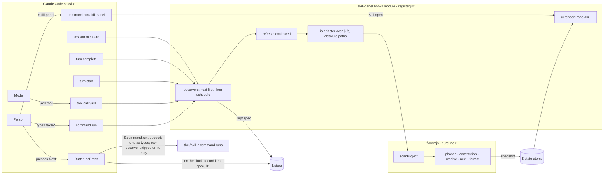
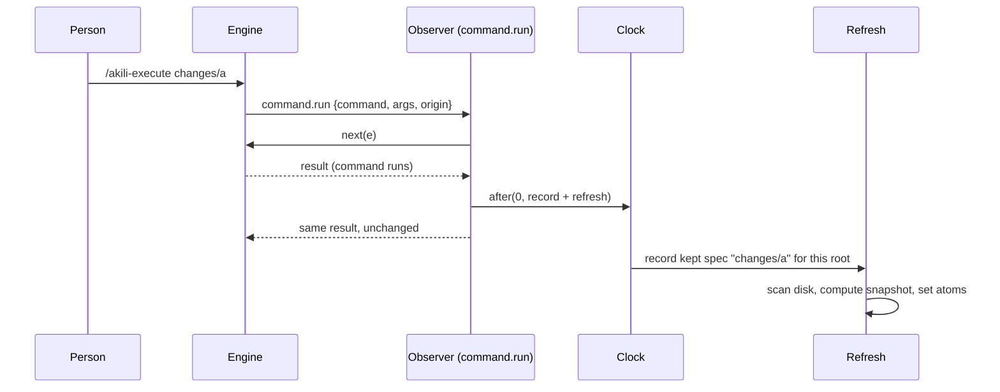

# Design: akili-panel — a Claude Code side pane for the AKILI flow

## 1. Document Control

| Field | Value |
|---|---|
| Spec Path | `changes/akili-panel` |
| Depth | Standard (see `requirements.md` → Document Control) |
| Status | **Design / tasks approved by JC (Juan Carlos Cadavid), 2026-11-05 ~20:27 America/Bogota:** «Apruebo diseño y tasks, sigue con /akili-execute changes/akili-panel». Approval Mode stays `gated`. **Amended after the T1 Pivot** (A1, B1, C1, D1) on JC's decision, 2026-11-05 ~20:50 America/Bogota: «Apruebo A1, B1, C1 y D1, incluida la prueba en ~/.claude/skills/akili-probe/» (`execution.md` → *Pivot Record: T1*). **Judgment-day closed `fixed, not re-judged`**: round 1 fixed J-1 … J-5; on JC's «Fix only» (2026-11-05 ~20:07 America/Bogota) the same pass fixed the suspects A-1, A-2 and the warnings both judges raised (W-1 … W-13). No round 2 (`judgment.md`) |
| Date | 2026-11-05 |
| Requirements | `requirements.md` (FR-1 … FR-16, NFR-1 … NFR-7) |
| Format source | `docs/specs/archive/2026-11-02-changes--go-backend-routing--backend-skill-routing/design.md` (no `docs/specs/general-setup/` in this repo) |
| Verified at | `7a697ba`. Runtime probes on Claude Code **2.1.318**, macOS, headless `claude -p`, model `claude-haiku-5-5`, probe plugin in `/tmp/akili-probe.liHM` (throwaway, outside the repo) |
| API authority | `types/claude-code.d.ts` of the bundled `plugin-authoring` skill, build 2.1.318 (`$TMPDIR/claude-501/bundled-skills/2.1.318/…/plugin-authoring/`). Cited below as `types:<line>` and `reference.md:<line>` |
| Skills applied | `software-architect` (decision spine, lite sizing), `diagram-design` (inline Mermaid), `impeccable-bridge` → `design-routing.md` (pane direction, §8), `cognitive-doc-design` |
| Active Lessons applied | KZ-004 (§7.3 walks every branch the plugin entry lands in), KZ-002 (one install test per target), KZ-changes--archify-diagrams-1 (fixtures, never the live spec), KZ-bugfix--init-ctrlc-abort-2 (test LOC budgeted per clause), KZ-changes--leader-brief-contract-2 (falsifiers observed or marked predicted) |

## 2. Executive Summary

Two parts, one predicate:

1. **The plugin** at `.claude/skills/akili-panel/`: a hooks module that registers `/akili-panel`, draws a pane from a cached snapshot, watches `/akili-*` runs (typed, and through the Skill tool), and offers one Next button. All the logic that decides marks, spec choice and the next command sits in a **pure module** that takes an injected file reader, so it is tested under `node --test` in CI with fixture trees.
2. **The installer** learns one predicate, `isPluginEntry(dir)` (has `.claude-plugin/plugin.json`, has no `SKILL.md`). Install skips plugin entries silently for every tool but Claude; `list` prints them under `Plugins:`; `doctor` checks them for Claude only, by manifest; `update` inherits install.

Nothing in `.claude/commands/` changes.

## 3. Architecture Overview



Rules of the shape:

- **Disk is the truth; atoms are a cache.** A refresh recomputes the whole snapshot from disk. Losing the atoms (reload, new session) costs one refresh, never a wrong pane.
- **Render reads, never fetches** (NFR-1). `ui.render` reads atoms only.
- **Observers never wait on the plugin's own work.** They call `next(e)` first, return its result unchanged, and schedule the refresh outside the dispatch with a zero-delay `$.clock.after` (`reference.md:204-212`: work meant to outlive a dispatch belongs on the clock).



## 4. Extended Directory Structure

```text
.claude-plugin/
  marketplace.json                 NEW  FR-14 (repo root; not packed)
.claude/skills/akili-panel/        NEW  plugin entry (no SKILL.md)
  .claude-plugin/
    plugin.json                    name, version, description, author, license
    types/                         engine-written; gitignored, unpacked, uncopied (FR-15)
  hooks/
    hooks.json                     modules: ["./register.jsx"]
    register.jsx                   wiring: hooks, atoms, io adapter, pane tree, Next
    flow.mjs                       pure rules + English strings (no $, no Node imports)
  types/
    index.d.ts                     PluginState declaration for the atoms
  tests/
    panel.test.tsx                 `claude plugin test` (engine kit; local only)
  README.md                        what, install, Claude Code ≥ 2.1.318, use
bin/akili.js                       EDIT  isPluginEntry, listSkills/listPlugins, install skip, leaked-copy removal, list, doctor
bin/install-compare.js             EDIT  compareEntry ignore option (W-2)
package.json                       EDIT  files: exclude .claude/skills/*/.claude-plugin/types
.gitignore                         EDIT  .claude/skills/*/.claude-plugin/types/
test/
  akili-panel-flow.test.js         NEW  pure rules (`import(pathToFileURL(…))` of flow.mjs, so Windows drive-letter paths load, W-14)
  akili-panel-contract.test.js     NEW  static contract over register.jsx / plugin files
  install-akili-panel.test.js      NEW  per-target install, list, doctor, update, pack
  fixtures/akili-panel/            NEW  spec trees (one folder per scenario)
  install-cursor.test.js           EDIT counts exclude plugin entries
  install-grokbot.test.js          EDIT SKILL_NAMES exclude plugin entries
  install-grokbot-edge.test.js     EDIT same
  docs-overview.test.js            EDIT inventory() excludes plugin entries
  install-compare.test.js          EDIT ignore option case (W-2)
docs/
  plugins/akili-panel.md           NEW  user page (DD-12)
  skills/governance.md             EDIT carve-out
  cli.md                           EDIT list / doctor / install targets
README.md, AGENTS.md, CHANGELOG.md EDIT short mentions; CHANGELOG under [Unreleased] with the upgrade note (DD-18)
docs/release-checklist.md          EDIT one step: bump the plugin's version when its files changed (W-7)
scripts/ci/install-layout-regression.js   consumer, no edit expected (W-6, P-9)
```

## 5. Data Model

### 5.1 Kept spec (`$.store`, across sessions)

`$.store` is one store per plugin, not per project (`types:3490-3520`), so the key carries the project root.

| Key | Value | Written | Bound |
|---|---|---|---|
| `spec:<absolute project root>` | `{ path, at }`: the spec named by the last observed spec-taking command (FR-5 step 1: the first argument as written; for `akili-propose` only a path containing `/` or a hyphenated kebab slug mapped to `changes/<slug>`), and its time | After a spec-taking command or Skill-tool run whose resolved spec passes the safe-path rule (FR-5) | At most 50 keys; the oldest `at` is dropped past that |

The value is kept even when the folder does not exist yet (`/akili-propose add-remember-me` is observed before the command creates `changes/add-remember-me/`). Resolution step 1 checks existence on every refresh. A `/akili-propose` whose first token is neither form (a sentence, a one-word slug) keeps nothing, so it can never overwrite a valid kept spec with a path that will not exist (J-1, P-30).

### 5.2 Session atoms (`$.state`, plugin `akili-panel`)

| Atom | Shape tag | Holds | Written by |
|---|---|---|---|
| `view` | `view-1` | The snapshot: `status` (`ok`, `no-specs`, `no-active`), displayed spec path, `archived`, `moreActive`, constitution `{ present, total: 13 }`, six phase marks, `blocked`, branch `{ kind: branch \| detached \| none, name, sha }`, `next { command, args } \| null`, `errors[]` (path + reason), `refreshedAt` | refresh |
| `tokens` | `tokens-1` | `{ in, out }` summed from `turn.complete` | `turn.complete`; reset on `session.end` with reason `clear` or `resume` (W-12, P-38) |
| `usage` | `usage-1` | `{ ctxPercent?, ctxTokens?, ctxWindow, usd? }` | `session.start` (`$.session.usage()`), `session.measure`; cleared with `tokens` and re-read by the next measure (W-12) |
| `opened` | — | whether `/akili-panel` placed the pane in this session; cleared when `$.ui.panes()` no longer lists `akili` (W-10, P-37) | `/akili-panel` hook; the refresh scheduler |
| `pending` | — | `{ since, command }` (the command the press queued) while a Next run is queued and not yet resolved (FR-7 double press) | press handler, through an atomic `update` that acts only when it flips the value from unset to set (`reference.md:154`); reset at `session.start`; cleared when the press's `$.command.run` settles (resolve or reject; observed at dequeue, just before the command's turn starts, T1), or by the first main-loop `turn.start` after `since` whose `text` names `/<command>` (a promise dropped by a hot reload). No fixed time bound: a run queued behind a long turn stays guarded for the whole turn (A1, W-5) |

Atoms survive a hot reload; a shape tag change makes old values read as initial (`reference.md:154`).

### 5.3 Snapshot derivation (pure, `flow.mjs`)

| Input (via injected io) | Rule | Requirement |
|---|---|---|
| Listing of `docs/specs/` down to 4 levels | A folder is a **spec** when it holds a spec file and is not a carve-out; a folder whose only spec-like file is `family.md` is a family container (recurse into it); top-level carve-outs are never entered | FR-5, FR-6, NFR-2 |
| Spec file presence and `mtimeMs` from the listing entries (`FsEntry.mtimeMs`, `types:5150-5160`) | Recency = max `mtimeMs` of a spec's spec files | FR-5 step 3 |
| `tasks.md` text of the **displayed** spec only | Lines split on `\r?\n`; the `## Document Control` section skipped; a token counts only when it leads, after optional backticks, one of the four places in the requirements glossary (a `Status` table cell, a list item, a `**Status:**` value, a task heading's end); zero tokens → `(no task status)` | FR-6 (J-4, P-17) |
| `docs/specs/archive/` listing, only when the kept spec's folder is missing | Archived when a child is named `YYYY-MM-DD-<path with / → -->` | FR-6 archive row |
| 13 baseline paths + 2 legacy alternates (`exists`) | Count present; legacy path counts for its row | FR-6 constitution |
| `.git` at or above the root (`exists` per ancestor, ≤ 20), then a `.git` file's `gitdir:` (`read`), then `HEAD` (`read`) | `ref: refs/heads/<name>` → branch; a 40- or 64-hex id → `detached @<7>`; none → `(no git)`. Ancestor paths are cut as strings, `/` and `\` both accepted, so Windows paths work | FR-11 (J-3) |

The phase table, the Next table and every English string live in `flow.mjs` as data, so tests pin them in one place (DD-15).

## 6. API Design

### 6.1 Plugin surface (Claude Code hooks, build 2.1.318)

| Hook / call | Matcher | Behaviour | Fail mode | Cite |
|---|---|---|---|---|
| `session.start` | — | `next(e)` first; then register `/akili-panel`, reset `pending`, seed `usage`, start the 30 s timer (a tick refreshes only when the pane is up, DD-5). No process is started at any point (DD-17) | Hook skipped → no command this session; nothing else breaks | `types:3220-3234`; `reference.md:204-212` |
| `command.run` | `{ command: 'akili-panel' }` | `$.ui.open({ id: 'akili', title: 'Akili' })`; when it resolves `isPlaced: true`, set `opened`, schedule refresh, answer `{ text: 'Akili pane opened.' }`; when `isPlaced: false`, answer `Akili pane not shown: <reason>` (W-10, P-37); never reads `next` (validate reports it as *answers its own command*) | — | `reference.md:66`; example `pane.tsx` |
| `command.run` | `{ command: /^akili-(?!panel$)/ }` (every `/akili-*` but the plugin's own) | `await next(e)`; schedule record (spec-taking commands only) + refresh; return the result as received. `.catch` answers `next(e)` (replays if already called, runs it if not) | Fail open | `types:1828-1855`; matchers take RegExp `types:6044`; P-18 |
| `tool.call` | `{ tool: 'Skill' }`, `e.skill` starting `akili-` checked in the body | Same as above, reading `e.skill` / `e.args` | Fail open, same `.catch` | P-19 |
| `turn.start` | — | `next(e)` first, result returned unchanged; then, on a main-loop turn (no `agentId`) while `pending` is set and the turn's `text` names `/<pending command>`, schedule clearing `pending` (A1 fallback) | Skipped hook → `pending` clears on settle as usual | `types:14600-14640` (`TurnStartInput`: `text`, `turnId`, `agentId`); `text` observed as `<command-message>…</command-message>\n<command-name>/<command>…` in T1 |
| `turn.complete` | — | `next(e)` first, result returned unchanged; then schedule: add `usage` to `tokens` (main and subagent turns), and on main-loop turns (no `agentId`) a refresh when the pane is up | Skipped hook → a missed count | `types:14502-14548`, `types:14908` |
| `session.measure` | — | `next(e)` first, result returned unchanged; then schedule the copy of context and cost into `usage` | — | `types:12033-12060` |
| `session.end` | reason `clear` or `resume` | `next(e)` first, result returned unchanged; then reset `tokens` and `usage` | — | `reference.md:27`; reasons `types:5043`, `:11955` (P-38) |
| `ui.render` | `{ component: 'Pane', requestId: 'akili' }` | Read `view`, `tokens`, `usage`, `pending`; build the tree from `$.ui.resolve(e)`; size to `e.props.bodyColumns` | A tree the surface refuses is skipped, the pane closes (`reference.md:166`) | `types:2422-2436` |
| Next `onPress` | — | Atomic `update` on `pending`: only the press that flips it from unset runs `$.command.run({ command, args })`, stores `pending = { since, command }`, and schedules on the clock the kept-spec record for `(command, args)` with FR-5 step 1 and the safe-path rule, because Claude Code does not pass a plugin's own run through that plugin's `command.run` observer (re-entry, T1; B1). `pending` clears when the call resolves or rejects, or by the `turn.start` fallback (A1); on rejection `$.ui.toast` with the reason | Rejection → toast, pane unchanged | `types:3207-3219`; dispatch and timing observed in T1 (P-34) |

**Every hook passes the event on first** (W-4): each `command.run` observer, `tool.call`, `turn.start`, `turn.complete`, `session.measure`, `session.end` and `session.start` hook calls `next(e)` with the event unchanged, returns what it resolved to, and does its own work afterwards on the clock. No hook passes a rewritten event (`next({ … })`). The only hook that answers without `next` is the one for `/akili-panel`. The contract test (T5) asserts all of this.

Hooks the plugin does **not** use, with the reason:

| Not used | Why |
|---|---|
| `skill.prompt` | Bypassed by the built-in `cc-plugin-sec-default` in the probe (P-20) |
| `$.ui.open` at `session.start` | FR-8: never open unasked |
| `$.fs.write`, `$.fs` mutations, `$.prompt.*`, `$.session.append` | FR-10, FR-9 |
| `$.process.run` / `$.process.spawn` | The branch comes from `.git` files (DD-17): zero processes, no exit-code ambiguity, and `$.process` is CLI only (`types:3639`) |
| `$.command.run` inside any observer | It rejects inside a hook the turn waits on (`types:3207-3219`), and would be interference |

### 6.2 io adapter (register.jsx → flow.mjs)

`flow.mjs` receives `{ list(path), exists(path), read(path) }`, all async, and is given the project root once per refresh. Every path it passes is **absolute**: the root joined with the relative part. `$.fs` resolves a relative path against the session's working directory, not the root (`types:3378`, `:3392`, `:3423`; P-32), and a timer reads the session's directory, so the plugin reads `await $.session.root()` (`types:2884-2888`) at the start of each refresh and never passes a relative path (J-5). In the plugin the io wraps `$.fs.list`, `$.fs.exists`, `$.fs.read`; in `node --test` it wraps `node:fs` over a fixture folder. A failing call is caught per path and recorded in `errors[]` (FR-16), never thrown out of the refresh.

**Branch (DD-17):** no process. Walk from the root up, at most 20 levels, to the first folder holding `.git`. A `.git` folder → read `.git/HEAD`. A `.git` file → read its `gitdir: <dir>` line, resolve `<dir>` against the file's folder when relative, read `<dir>/HEAD`. `ref: refs/heads/<name>` → `<name>`; a commit id → `detached @<first 7>`; nothing found or unreadable → `(no git)`. Verified on this worktree: `.git` holds `gitdir: /Users/jcadavid/Development/sdd-jc-methodology/.git/worktrees/akili-panel`, whose `HEAD` holds `ref: refs/heads/JuankCadavid/akili-panel` (P-33).

### 6.3 CLI (`bin/akili.js`)

| Command | Change |
|---|---|
| `install`, `update` | For every tool but `claude`, plugin entries are skipped with no output line and no count, and a **leaked** copy found in that tool's skills dirs is removed (§7.4, DD-18). For `claude`, they are copied like a skill, minus any `.claude-plugin/types/` folder |
| `list` | New `Plugins:` heading after `Skills:`; `Skills:` lists skills only; summary `… \| <n> skills \| <p> plugin(s) \| …` |
| `doctor` | Skills loop over skills only. New plugin check in the Claude section only: present when `.claude-plugin/plugin.json` exists in a Claude skills dir; DIFFERS compares the entry ignoring `.claude-plugin/types/` and is reported, never written; `--fix` restores a **missing** plugin only, as for skills (`bin/akili.js:1666`, `:1677-1679`; J-2, P-31). Every other tool: a leaked copy is reported `LEAKED akili-panel` and `--fix` removes it (§7.4) |

## 7. Backend Module Design (installer)

Not a backend task in the `backend-routing.md` sense (a local CLI, no server, API contract or error model; `backend-routing.md:87`), so no `Backend route:` line.

### 7.1 Predicate and listings

| Function | Contract |
|---|---|
| `isPluginEntry(dir)` | True when `<dir>/.claude-plugin/plugin.json` is a file and `<dir>/SKILL.md` does not exist |
| `listSkills()` | Every directory under `SOURCE_SKILLS` **for which `isPluginEntry` is false** (today: every directory, `bin/akili.js:508-509`) |
| `listPlugins()` | Every directory under `SOURCE_SKILLS` for which it is true |

### 7.2 Install skip

The copy at `bin/akili.js:1259` passes every source entry through an optional `policy(name, targetPath)` (`:1018-1030`). The change composes a **plugin policy** in front of any existing one (Grok Bot's `makeImpeccableForeignPolicy`, `:880-943`):

- every tool → plugin entries get a new **silent-skip** verdict at `:1259`: no line printed, nothing counted, nothing written to Grok Bot's ownership record;
- every other name → the inner policy's verdict, with its `.detail`, `.finish` and `.restore` members forwarded unchanged (they are read at `:889-940` and `:1050-1055`), so Grok Bot's foreign-folder handling is untouched.

For `claude` only, plugin entries are then copied by a **dedicated plugin copy** that follows the same skip-existing / `--force` rules and output lines as a skill, walks the tree itself, and skips any `.claude-plugin/types` directory (W-2). `copyTreeSync` and `copyDirectoryContents` stay unchanged. The doctor plugin compare calls `compareEntry` (`bin/install-compare.js:38`) with a new optional ignore list that `walkSource` (`:23`) applies to relative paths, so a `types/` folder on the source side is not compared. Target-only files are already never visited (the file's header comment), so a `types/` folder on the installed side needs no rule (P-40).

### 7.3 Where the new folder role lands in each scan (KZ-004)

Every place that reads `SOURCE_SKILLS` or `listSkills()` (10 hits, P-2) and what a plugin entry does there:

| Site | Today | With the change |
|---|---|---|
| `listSkills` `:508` | every dir | skills only |
| install copy `:1259` | copied for every tool | Claude: copied; others: silent skip |
| `runList` `:1611` | under `Skills:` | under `Plugins:` |
| `doctorTool` loop `:1777` | `hasInstalledSkill` → MISSING (no `SKILL.md`) | not in the skills loop |
| Grok Bot owned-entry restore/compare `:1780`, `:1781` | would restore/compare it | never reached (Grok Bot has no plugin check) |
| DIFFERS compare `:1799` | — | plugin check uses its own compare, ignoring `types/` |
| `--fix` restore `:1805` | copied into every skills dir when missing | plugin check restores a missing plugin into the Claude skills dir only; a differing one is never written |
| `isToolInstalled` `:575` (`SKILL.md` probe for command-skills) | unaffected | unaffected: it probes command-skill names, not source entries |
| `cleanupLegacyFiles` `:1103-1162` | names in `LEGACY_SKILLS` only | unaffected; leaked-copy removal is a sibling step (§7.4) |
| Grok Bot ownership record `recordOwned` `:741-747` | records every copied folder | never records a plugin entry; a leaked one already recorded is dropped (§7.4, P-39) |

### 7.4 Leaked copies from an old `update` (A-1, DD-18)

`akili update` runs `npm install -g akili-specs@latest` and then calls `runInstall` **in the process that is already running**, so the reinstall uses the old installer's code (`bin/akili.js:1467-1478`; the comment at `:1481` says "The running process still has the old code loaded"; P-35). The first update from 2.42.0 or earlier therefore copies `akili-panel/` into every target's skills dirs, and records it as owned for Grok Bot. Nothing in this change can stop that run. The new code cleans up after it:

| Where | Rule |
|---|---|
| Identification | A folder named `akili-panel` in a **non-Claude** skills dir, holding `.claude-plugin/plugin.json` whose `name` is `akili-panel`, and no `SKILL.md`. Any other folder of that name is left alone, as foreign |
| `install --tool <t>`, `t` ≠ `claude` (and `update`'s reinstall on the new code) | Removes each identified copy in `t`'s skills dirs and prints `REMOVED akili-panel (Claude Code plugin, not used by <t>)`. Runs even with `--skills-only`; not with `--commands-only` |
| `doctor --tool <t>`, `t` ≠ `claude` | Reports `LEAKED akili-panel` per copy and counts it as a problem; with `--fix`, removes it as above |
| Grok Bot | Removal also drops `akili-panel` from the ownership record's `folders` |
| Codex and Cursor | They share one skills root: either tool's run removes the copy once |
| Upgrade note | `CHANGELOG.md` tells users to run `akili install --tool all` (and `--tool grokbot` where used) once after updating, or `akili doctor --tool <t> --fix` |

## 8. Frontend / UX Component Architecture

**Environment and direction** (`impeccable-bridge` → `design-routing.md` → *Environment classification*): **ENV-2**, established world. Evidence: the pane is drawn only with the host's element table (`Box`, `Text`, `Button` on every surface, `types:3976-4064`) and the host theme; there is no web page or token layer of ours. Page mode **Operate** (a status readout with one action). Direction: *Extend an existing surface* — look like Claude Code's own panels: no custom colours, `dimColor` for secondary text, `bold` for the current phase, `variant="primary"` for Next only. Motion: none.

Layout, top to bottom, sized to `bodyColumns`:

| Row | Content | Rules |
|---|---|---|
| Header | `Akili · <spec> · ⎇ <branch>` + ` (n more active)` | Spec path shortened in the middle with `…` to fit; branch shortened the same way after it |
| Constitution | `01 Constitution  ✓` / `▶ (k/13)` / `○` | — |
| Flow | `02 propose  ✓`, then `specify`, `execute`, `test`, `validate`, `archive`, each with its mark; current phase bold; `(blocked)` after `▶`; an archived spec adds `archived` to the header | Labels padded to one column |
| Errors | one dim line per entry of `errors[]`, at most 3 | — |
| Tokens | `Tokens: ctx …` (FR-12) | Parts dropped right to left when narrow: `$`, then `session` |
| Next | `<Button key="next" variant="primary">Next: /… </Button>` or none when `next` is null | Disabled look (`dimColor`) while `pending` |
| Empty state | `No docs/specs/ folder yet.` or `No active spec.` replaces the flow block | FR-16 |

Every line is cut to `bodyColumns`; no line wraps. Layout defects have no automated gate (requirements D-6): T9's human check covers them at two widths.

## 9. Shared Contracts or Package Extensions

| Contract | Owner | Readers |
|---|---|---|
| `isPluginEntry` | `bin/akili.js` | install, list, doctor; the four test files that enumerate skills (they apply the same rule, re-implemented in the test from the two file checks, so a broken predicate cannot pass by agreeing with itself) |
| `flow.mjs` exports | the plugin | `register.jsx`; `test/akili-panel-flow.test.js` |
| `plugin.json` `name: "akili-panel"` | the plugin | Claude Code; `marketplace.json`; README install line |
| Strings table in `flow.mjs` | the plugin | the pane; the flow tests; `docs/plugins/akili-panel.md` |
| Atoms `akili-panel.*` | the plugin | the plugin only (declared in `types/index.d.ts`) |

## 10. Design Decisions

| ID | Decision | Alternatives rejected | Requirements |
|---|---|---|---|
| DD-1 | **Option A**: the plugin is an entry under `.claude/skills/`, told apart by `isPluginEntry`. It reaches users through `akili install --tool claude` / `update`, and loads from `~/.claude/skills/akili-panel` | B: a new `plugins/` source tree (new install category, more code); C: marketplace only (misses "arrives on install/update"). **Depends on P-24** (High), verified in T1 for both `~/.claude/skills/<name>` and the project's `.claude/skills/<name>`; the project folder loads only after workspace trust, and the user folder was observed in a trusted workspace only | FR-1, FR-2 |
| DD-2 | All decisions in a **pure module** with injected io; the hooks module only wires | Logic inside the hooks module: testable only by `claude plugin test`, which CI cannot run and whose environment has no fs (header `types:29-32`) | D-1, NFR-7 |
| DD-3 | **JavaScript** (`.jsx`, `.mjs`), not TypeScript. A recorded **deviation** from the proposal's `register.tsx` (W-9) | `.tsx`: the repo has no TypeScript toolchain, so type errors would have no gate (a compiler-only defect class with no command). `claude plugin validate` is the engine's own check; `types/index.d.ts` stays for editors | D-5 |
| DD-4 | Observe through **`command.run`** (typed) and **`tool.call` on `Skill`** (model-run); `next` first, work scheduled after, `.catch` answers `next(e)` | `skill.prompt` (bypassed, P-20); `command.run` alone (misses Skill-tool runs, P-19); refreshing inside the dispatch (delays the command) | FR-9, NFR-4 |
| DD-5 | Disk is the truth; atoms cache a full snapshot; refresh is **coalesced** (one in flight, one queued) and triggered by observed runs, main-loop `turn.complete`, `/akili-panel`, and a 30 s timer. **Only while the pane is up**: `opened` is set and `$.ui.panes()` lists `akili`; otherwise no disk read happens. Recording the kept spec and summing tokens run whether or not the pane is up (W-10) | Incremental updates from events (wrong after any edit made outside the session); refreshing on every `ui.render` (fs calls while drawing, NFR-1) | NFR-1, NFR-2, NFR-3 |
| DD-6 | The kept spec is stored per project root in `$.store`, raw, and checked for existence at each refresh | Keeping it in `$.state` only (lost in a new session, D3 says persisted) | FR-5 |
| DD-7 | Never open the pane unasked | Opening at `session.start` (needs ≥ 144 columns unasked; surprises users of every Claude session) | FR-8 |
| DD-8 | Next runs through `$.command.run` from the press handler, with an atomic `pending` guard and a toast on rejection. `pending` clears on settle, or by the first main-loop `turn.start` naming the command; it is reset at `session.start`, with no fixed bound (A1). The press handler records the kept spec itself, because the plugin's own run skips the plugin's own observer (B1). P-34 verified in T1: the command runs as typed, and the promise settles at dequeue. **Amended after T1** on JC's decision (Pivot Record: T1) | Filling the prompt with `$.prompt.fill` (one more keystroke; the brief asks for a button that runs) | FR-7 |
| DD-9 | Session tokens sum **every** `turn.complete`, subagents included; reset on `/clear` and on resume. A resumed session's sum starts at 0, while `$` is Claude Code's own total counted from the first launch (`SessionUsage.startedAt`, `types:12642-12660`) (W-12) | Main loop only (hides the subagent spend AKILI cares about). Double-count risk P-25: verified in T1 as no double count, for background and foreground subagents, so DD-9 stands unamended | FR-12, D-9 |
| DD-10 | Install skip is a **silent policy verdict** composed in front of existing policies, forwarding their members; Claude gets a dedicated plugin copy that skips `types/`; doctor's plugin compare passes an ignore list to `compareEntry` (§7.2, W-2) | Filtering inside `copyDirectoryContents` (touches every copy); printing a "skipped" line (changes every target's output and the counted lines tests pin) | FR-1, FR-4, FR-15 |
| DD-11 | `list` gets a `Plugins:` heading and a plugin count in the summary: `1 plugin`, or `<n> plugins` (W-9) | Listing the plugin under `Skills:` (wrong count, FR-13) | FR-3 |
| DD-12 | The user page lives at `docs/plugins/akili-panel.md`, **not** `docs/skills/akili-panel.md` as the proposal said | Following the proposal: `docs/skills/` is the skill inventory, and the carve-out says a plugin is not a skill. Recorded as a deviation from the proposal | FR-13 |
| DD-13 | Root `.claude-plugin/marketplace.json`, source `./.claude/skills/akili-panel`; not in the npm `files` list | Writing the marketplace beside `plugin.json` inside the plugin (would be copied to every Claude user) | FR-14 |
| DD-14 | `plugin.json`: `name`, own `version` starting `1.0.0` (not the npm version), `description`, `author` JC, `license: "MIT"`. `docs/release-checklist.md` gains one step: bump this `version` in any release whose diff touches `.claude/skills/akili-panel/`, because marketplace installs pick up a change only as a new version or commit through `claude plugin update` (`reference.md:76`) (W-7) | Mirroring the npm version (the release script would need a change for no user gain; installs copy files regardless). Validate requires license and README (P-28) | FR-14 |
| DD-15 | English strings and the phase/Next tables are data in `flow.mjs` | Strings inline in JSX (unpinnable by CI tests) | FR-16, D7 |
| DD-17 | Read the branch from `.git` files; run **no** process (J-3) | `git rev-parse` through `$.process.run`: two processes when detached (one call cannot return both, P-22), exit 128 also covers an unborn or untrusted repo, and `$.process` is CLI only (`types:3639`) | FR-11, NFR-2 |
| DD-16 | Generated `types/` excluded three ways: `.gitignore`, a `files` negation in `package.json` (glob verified, P-36), and the installer skip | Relying on the engine's own `.gitignore` inside `types/` (npm's handling of nested ignore files under a `files` whitelist is not something this spec has verified) | FR-15 |
| DD-18 | The new installer and `doctor --fix` **remove leaked copies** from non-Claude targets, identified strictly (§7.4) (A-1) | Re-executing the freshly installed binary from `update` (changes `update` for every user and cannot help the first, old-code run); leaving the copies (FR-1/FR-2 stay false for upgraders) | FR-1, FR-2, FR-4 |
| DD-19 | One delivery route per machine. The README and `docs/plugins/akili-panel.md` say to use either `akili install --tool claude` or the marketplace, not both. They also say that in this repo the dogfood copy loads too. A duplicate load is not detected in v1 (W-8) | Detecting duplicates in the plugin (no verified API names another plugin's load) | FR-14 |

### Reversion challenges (Step 2.3)

**Not triggered.** No decision removes, disables or inverts shipped behaviour: every existing skill keeps its install, `list`, `doctor` and `update` path (the predicate is false for all 32 at `7a697ba`, none holds `.claude-plugin/`, P-7); the `list` summary gains a field and loses none.

## 11. Premise Ledger

**Count:** 40 rows · 2 withdrawn (P-21, P-22, round 1) · 36 verified (P-24, P-25, P-34 settled in T1) · 1 refuted (P-26, Low, T1; DD-16 stays as a guard) · 1 `UNVERIFIED` (P-27, Low, settled at T9).
**Blast-radius triggers:** `live-path` — the design names user actions (`akili install --tool claude`, `akili update`, typing `/akili-*`, a Skill-tool run, pressing Next): P-1, P-18, P-19, P-24, P-34, P-35. `shared-state` — `SOURCE_SKILLS` / `listSkills()` are read by install, list and doctor for all six tools: P-2. `consumer` — the change alters `akili list` output, the skill count, and which folders each target receives: P-9, P-10, P-29.

| # | Claim | Class | Citation (as run) | Verified at | If false | Settled by |
|---|---|---|---|---|---|---|
| P-1 | Install copies the whole `SOURCE_SKILLS` folder per tool through `copyDirectoryContents`, not through `listSkills()`; dispatch `install` → `runInstall` → `installTool` → `:1259` | live-path | `grep -n "listSkills\|SOURCE_SKILLS" bin/akili.js` → 10 hits incl. `:1259 add(copyDirectoryContents(SOURCE_SKILLS, targetSkills, args, skillsPolicy))`; dispatch `main` `:3094` `install` → `runInstall` `:1530-1532` → `installTool` `:1164-1309` | `7a697ba` | DD-10 placement (High) | — |
| P-2 | Every reader of the source skills set: `:508-509` (`listSkills`), `:1259` (install), `:1611` (`runList`), `:1777` (doctor loop), `:1780`, `:1781` (Grok Bot restore/compare), `:1799` (DIFFERS), `:1805` (`--fix`); definition `:74` | shared-state | `grep -n "listSkills\|SOURCE_SKILLS" bin/akili.js` → 10 hits: `:74`, `:508`, `:509`, `:1259`, `:1611`, `:1777`, `:1780`, `:1781`, `:1799`, `:1805`; `ls -d .claude/skills/*/` → 32 dirs, `ls -d .claude/skills/*/.claude-plugin` → none | `7a697ba` | §7.3 misses a branch; a plugin shows MISSING somewhere (High) | — |
| P-3 | `doctor` reports a skill present only when `<dir>/<skill>/SKILL.md` exists | location | `bin/akili.js:1643-1650` `hasInstalledSkill`; Grok Bot `checkOwnedEntry` `:1701-1724` requires `SKILL.md` at `:1708` | `7a697ba` | FR-4 needs no plugin check (Low) | — |
| P-4 | `update` reinstalls through `runInstall` with `force` | location | `bin/akili.js:1477-1478` `args.force = true; runInstall(args);` | `7a697ba` | FR-2 needs its own change (High) | — |
| P-5 | Per-tool skills dirs: claude `<root>/skills` (`:161`), opencode `<root>/skills` (`:167`), antigravity three dirs (`:177-181`), codex and cursor share `roots.skillsRoot` (`:189`, `:200`; default `~/.agents/skills` `:128`, `:140`), grokbot `roots.skillsRoot` (`:214`) with an ownership record (`:220`); `--tool all` is the five desktop tools without grokbot (`:512-516`) | data-env | `bin/akili.js` `TOOL_REGISTRY` `:158-222`; `selectedTools` `:512-516` | `7a697ba` | Install tests target wrong dirs (Low) | — |
| P-6 | `copyDirectoryContents` has no skip list; its only filter is the optional `policy(name, targetPath)` returning `foreign` or `blocked` | existence | `bin/akili.js:997-1077`, policy branch `:1018-1030` | `7a697ba` | DD-10 seam differs (Low) | — |
| P-7 | No plugin concept exists in the installer or tests, and no `.claude-plugin` folder exists in the repo; no skill folder holds `.claude-plugin/` | existence | `grep -n -i plugin bin/akili.js` → 1 hit `:84` `"gsap-plugins",`; `grep -rn -i plugin bin` (other files) → 0; `find . -name .claude-plugin -not -path "*/node_modules/*"` → 0 | `7a697ba` | A predicate collision with an existing folder (High) | — |
| P-8 | The npm `files` list includes `.claude/skills` and not the root `.claude-plugin/` | data-env | `package.json` `files`: `[".claude/commands", ".claude/skills", ".claude/templates", ".mcp.json.example", "assets", "bin", "CHANGELOG.md", "docs", "!docs/specs", "LICENSE", "README.md", "scripts/gsc_verify.py", "scripts/parse_tests.js"]` | `7a697ba` | DD-13/DD-16 `files` edits change (Low) | — |
| P-9 | Tests that enumerate source skill dirs and break when a plugin entry is added or excluded: `install-cursor.test.js` `:224-256` (`SKILL_FILE_COUNT` literal `:250`), `:225-227`, `:239`, `:307-311`, `:322-326`, `:352-356`, `:409-413`, `:639-644`, `:768-781`, `:917-935`; `install-grokbot.test.js` `:105-108`, `:236-240`, `:244`, `:331`, `:422`, `:764-771`; `install-grokbot-edge.test.js` `:117-125`, `:167`, `:215`, `:359`; `docs-overview.test.js` `:30-34`, (a) `:213-250`, (c) `:270-280`, (d) `:284-303`; `install-stale-skills.test.js:218-223`; `test/fixtures/doctor-codex-baseline.txt` (pins every skill name, e.g. `:45 OK product-manager-toolkit`; read at `install-cursor.test.js:883` and `install-grokbot.test.js:885`); `test/backend-skill-routing-coverage.test.js:270` (skill roots); outside `test/`: `scripts/ci/install-layout-regression.js:190-194`, `:290` (mirrors `SOURCE_SKILLS`, "keep in sync"; run by `.github/workflows/ci.yml:113`) (W-6) | consumer | `grep -rn "SKILL_DIR_COUNT\|SKILL_NAMES\|listSkills" test` → 19 hits; `grep -rn readdirSync test \| grep -i skill` → 23 hits; `grep -rln '\.claude/skills\|"\.claude", "skills"' test` → 36 files, each read; scope `test/` whole, fixtures included; member-name sweep `grep -rln "product-manager-toolkit" test scripts` and `grep -n "SOURCE_SKILLS\|claude/skills\|keep in sync" scripts/ci/install-layout-regression.js` | `7a697ba` | T2 closes red (High) | — |
| P-10 | Docs state "32 packaged skills": `docs/cli.md:327`, `:339`, `:360`, `:377`; `docs-overview` (d) pins the count | consumer | `grep -n "32 packaged skills\|the 32 packaged" docs/cli.md` → 4 hits; `test/docs-overview.test.js:284-303` | `7a697ba` | FR-13 count wording (Low) | — |
| P-11 | Governance requires `metadata.binding` in each skill's `SKILL.md` and a five-item acceptance checklist; no test loops over every skill to assert it | other | `docs/skills/governance.md:9`, `:112-120`; per-skill tests only (e.g. `test/security-audit-skill.test.js:73-82`); `docs-overview` (a) reads `binding` via `skillBinding` `:123-127` | `7a697ba` | FR-13 needs a test change (Low) | — |
| P-12 | `/akili-constitution`'s baseline list is 14 files, `CLAUDE.md` optional, `docs/infrastructure.md` included | location | `.claude/commands/akili-constitution.md:46-61` | `7a697ba` | FR-6 constitution set (High) | — |
| P-13 | Legacy baseline paths `docs/system-design/design.md`, `docs/detailed-design/detailed-design.md` | location | `.claude/commands/akili-specify.md:96-97` | `7a697ba` | FR-6 legacy row (Low) | — |
| P-14 | `/akili-resume` derives phase from file presence and maps phase → next command | location | `.claude/commands/akili-resume.md:30-38`, `:44`, `:47`, `:135-140` | `7a697ba` | FR-6 / FR-7 tables (High) | — |
| P-15 | Non-spec carve-outs: `archive/`, `general-setup/`, `quick/`, `kaizen/`, `audits/`, `reviews/`, family containers | location | `.claude/commands/akili-resume.md:30` | `7a697ba` | Discovery rule (Low) | — |
| P-16 | Archive moves a spec to `docs/specs/archive/YYYY-MM-DD-$SAFE_NAME/`, `$SAFE_NAME` = path with `/` → `--` | location | `.claude/commands/akili-archive.md:44`, `:47`, `:175`; `ls docs/specs/archive \| tail -1` → `2026-11-02-changes--go-backend-routing--backend-skill-routing` | `7a697ba` | FR-6 archive rule (Low) | — |
| P-17 | Real `tasks.md` files write task status in four places — a `Status` table cell (251 `` `[x]` ``, 14 bare `[x]`, others with trailing text such as `[x] PASS attempt`), a `**Status:**` value, a heading's end, a list item — and one archived spec writes none; `## Document Control` `Status` cells hold words, not tokens | data-env | `.claude/commands/akili-execute.md:41`; `ls docs/specs/archive/*/tasks.md \| wc -l` → 47; value-cell scan `grep -hE "^\| *\**Status\**:? *\**? *\|" docs/specs/archive/*/tasks.md \| awk -F'\|' '{print $3}' \| cut -c1-14 \| sort \| uniq -c` → 251 `` `[x]` ``, 14 `[x]`, 8 `**Approved** —`, 7 `Draft — Phase`, 6 `[x] complete (`, 5 `[x] PASS attem`, …; `**Status:** [` in 2 files, heading-end token in 1, list item in 1; files with no token in any of the four places: `2026-10-30-changes--impeccable-design/tasks.md` only; CRLF files: 0 (J-4) | `7a697ba` | Token parser (High) | — |
| P-18 | `command.run` fires for a project markdown command, carrying `command` and `args` — observed under `-p` (`origin: sdk`) and, in T1, interactively: `command.run akili-probe args="x" origin={"kind":"composer"}` (2.1.318) (W-11) | live-path | Probe, Claude Code 2.1.318 `-p`, macOS, from `/tmp/akili-probe.liHM/proj`: `claude -p "/akili-probe changes/demo-spec" --model haiku --max-turns 1 --plugin-dir /tmp/akili-probe.liHM/proj/.claude/skills/probe-panel` → log `command.run akili-probe args="changes/demo-spec" origin={"kind":"sdk"}` | `7a697ba` | DD-4 (High) | — |
| P-19 | A Skill-tool run raises no `command.run`, but `tool.call` with `tool: "Skill"`, `skill`, `args` — observed under `-p`, and interactively in T1: `tool.call Skill input={"skill":"akili-probe","args":"y"}`, no `command.run` (W-11) | live-path | Probe: `claude -p "Invoke the Skill tool now with skill name 'akili-probe' and args 'changes/via-skill'. Then stop." --model haiku --max-turns 3 --plugin-dir …/probe-panel` → log `tool.call Skill input={"skill":"akili-probe","args":"changes/via-skill","tool":"Skill",…}`, no `command.run` line | `7a697ba` | DD-4 (High) | — |
| P-20 | A plugin's `skill.prompt` hook is passed by the built-in `cc-plugin-sec-default` — observed under `-p`, and interactively in T1: `skill.prompt bypassed by cc-plugin-sec-default (tier user); beneath runs` (W-11) | data-env | Probe stderr of the P-18 command: `probe-panel: its skill.prompt hook was skipped. "cc-plugin-sec-default" runs first and sent the event on past it.` | `7a697ba` | DD-4 could use it (Low) | — |
| P-21 | **Withdrawn in round 1 (J-3):** no decision depends on it since DD-17 runs no process. Was: `$.process.run(['git','rev-parse','--abbrev-ref','HEAD'])` runs with no prompt and returns the branch | data-env | Probe (`-p`): log `git 0 feat/probe-branch`. Interactive sessions not probed; the `.git/HEAD` fallback covers a refusal | `7a697ba` | FR-11 fallback becomes primary (Low) | — |
| P-22 | **Withdrawn as a dependency in round 1 (J-3):** kept as the reason DD-17 rejects `git rev-parse`. Was: One `git rev-parse` call cannot return both branch and short sha | data-env | git 2.38.0: `git rev-parse --abbrev-ref HEAD --short HEAD` → branch twice; `git rev-parse --short HEAD --abbrev-ref HEAD` → `fatal: Needed a single revision` | `7a697ba` | NFR-2 two-process allowance (Low) | — |
| P-23 | `$.session.usage()` gives `context.window` always, `tokens`/`percent` only after a response, `cost.usd`; `turn.complete` carries `usage` and `agentId` on subagent turns | data-env | Probe: `usage {"startedAt":…,"context":{"window":1000000},"rateLimits":[],"cost":{"usd":0}}`; `turn.complete agent=main usage={"input_tokens":2,"output_tokens":178,"cache_read_input_tokens":15778,"cache_creation_input_tokens":19167,"model":"claude-haiku-5-5"}`; `types:12642-12672`, `types:14502-14548` | `7a697ba` | FR-12 parts (Low) | — |
| P-24 | Claude Code adopts a plugin placed in `~/.claude/skills/<name>` (and the project's `.claude/skills/<name>`) in an **interactive** session | existence | **Verified in T1, both placements** (interactive, Claude Code 2.1.318, `--model haiku`, no `-p`, `--plugin-dir` or `CLAUDE_CODE_PLUGIN_DIRS`). (a) Project folder, after the trust dialog: `post-trust: re-discover project @skills-dir plugins`, then `hooks module akili-probe@skills-dir loaded (worker, environment 2, tier user)` and `plugin.register: akili-probe (user, akili-probe@skills-dir), judged by cc-plugin-sec-default: admitted`; before trust, `hooks modules not loaded until workspace trust is accepted`. (b) `~/.claude/skills/akili-probe` (JC's OK, 2026-11-05 ~20:50; removed after): `Read hooks.json for plugin akili-probe (enabled=true): /Users/jcadavid/.claude/skills/akili-probe/hooks/hooks.json`, the same `loaded … tier user` and `admitted` lines, active at `session.start`. That workspace was already trusted (attempt 1's entry, reused), so a user-folder plugin's behaviour in an **untrusted** workspace is unobserved. Falsifier, both placements: with `plugin.json` removed, no log file and `grep -c 'hooks module akili-probe'` = 0; the `Read hooks.json` line still appears, so it is not adoption evidence. Before T1: `reference.md:72` names both folders. Negative observation: `claude -p "/akili-probe x" --model haiku --max-turns 1 --debug`, run in the untrusted temp project `/tmp/akili-probe.liHM/proj` with **no** `--plugin-dir`, did not adopt `.claude/skills/probe-panel` (no `events.log` was written; the debug log has `Loading skills from: … project=[…/proj/.claude/skills]` and no adoption line). A project-folder plugin needs the project to be trusted, which the README states (W-13) | 2026-11-05 (T1) | DD-1 falls; Pivot to marketplace or `CLAUDE_CODE_PLUGIN_DIRS` (**High**) | T1, first step |
| P-25 | A main-loop `turn.complete` `usage` does not include its subagents' usage, so summing every turn does not double-count | data-env | **Verified in T1** for both subagent shapes, interactive, 2.1.318, haiku. **Background** (the default; parent turn completes first): spawning main turn output 167 / cache-creation 1142, while the subagent turn had 295 / 41892 (repeated in C1: 365 / 869 vs 292 / 42514). **Foreground** (`CLAUDE_CODE_DISABLE_BACKGROUND_TASKS=1`; `tool_dispatch_end tool=Agent … durationMs=6329`; subagent `turn.complete` `1793930551709` before the parent's `1793930554562`): parent output 358 / cache-creation 56155 (≈ the cold-prompt baseline of 55481) vs subagent 525 / 46299. Folding would give the parent ≥ 525 output and ~100k cache-creation. Inference: per-request usage inside a turn is not visible, so a small contribution cannot be excluded. `$.session.usage().cost` was not reconciled and is no claim here. `types:14540-14548` ("its real requests' token counts") | 2026-11-05 (T1) | DD-9 sums main only, or labels the figure (Low) | T1 |
| P-26 | The engine writes `.claude-plugin/types/` into a skills-folder plugin it loads | data-env | **Refuted for this session (T1):** `find …/akili-probe/.claude-plugin -maxdepth 3`, mid-session and after exit, listed `plugin.json` only. `reference.md:41-53` still says the engine lays types in hot-reloaded folders, so DD-16's exclusion stays as a guard | 2026-11-05 (T1) | DD-16 is cheaper than needed, still harmless (Low) | T1 |
| P-27 | Cursor reads `.claude/skills` as a skill root, at project scope and possibly the user's `~/.claude/skills` too, and ignores a folder without `SKILL.md` | data-env | `UNVERIFIED — confirm at source before relying on it`. `.claude/commands/akili-constitution.md:1039` says Cursor reads `.claude/skills`; which scopes, and how it treats a folder with no `SKILL.md`, are not settled here (W-13) | — | A Claude install, global or `--local`, shows an odd entry in Cursor (Low) | T9 |
| P-28 | `claude plugin validate` passes a hooks-module plugin and flags missing README / license / author; `claude plugin test` runs `*.test.ts`/`*.test.tsx` | data-env | Probe: `claude plugin validate …/probe-panel` → `✔ Validation passed with warnings`, `README_MISSING`, `LICENSE_MISSING`, `author: No author information provided`; `claude plugin test --help` → "Runs every *.test.ts and *.test.tsx under dir" | `7a697ba` | DD-14 fields (Low) | — |
| P-29 | `akili list` prints `Commands:`, `Skills:`, `Resources:`, `Summary: 14 commands \| 32 skills \| 8 resources (…)`; no test pins the summary line; `verify:cli` runs `list`; `diagram-design.test.js:494-498` asserts `diagram-design` appears | consumer | `bin/akili.js:1609-1626`; `grep -rn "Summary: " test/*.js` → 0; `package.json` `"verify:cli": "node bin/akili.js list"`; scope `test/` whole | `7a697ba` | FR-3 breaks a pinned output (Low) | — |
| P-30 | `/akili-propose` resolves a bare kebab-case first token to `changes/<name>`, takes a token containing `/` as the literal path, and derives a slug from a sentence; `/akili-specify` … `/akili-archive` take the first token as the path | location | `.claude/commands/akili-propose.md:32-38` (resolution rules); the other commands' *Arguments* sections | `7a697ba` | FR-5 step 1 records paths that never exist (High) | — |
| P-31 | `doctor --fix` writes only absent entries; a present entry whose bytes differ is reported `DIFFERS` and never written | location | `bin/akili.js:1666` ("`--fix` writes only absent entries and owned entries missing SKILL.md"), `:1677-1679` ("a present entry whose bytes differ … --fix never writes it") | `7a697ba` | FR-4 `--fix` contract (Low) | — |
| P-32 | `$.fs.list` / `exists` / `read` resolve a relative path against the session's working directory, not the project root | data-env | `types:3378`, `:3392`, `:3423` ("@param path relative to the working directory, or absolute") | `7a697ba` | §6.2 absolute-path rule unnecessary (Low) | — |
| P-33 | A worktree's `.git` is a file `gitdir: <dir>` and `<dir>/HEAD` holds `ref: refs/heads/<branch>` | data-env | `cat .git` → `gitdir: /Users/jcadavid/Development/sdd-jc-methodology/.git/worktrees/akili-panel`; `cat <that>/HEAD` → `ref: refs/heads/JuankCadavid/akili-panel` | `7a697ba` | DD-17 parser (Low) | — |
| P-34 | A plugin's `$.command.run({ command, args })` runs a project **markdown** command as if typed. Its promise settles when the command is **dequeued**, just before the command's turn starts, so the wait is bounded only by the turn already running. The plugin's own `command.run` observer is **skipped** for its own call (re-entry) | live-path | T1, interactive, Claude Code 2.1.318, from a `$.clock.after` timer: idle call `RESOLVED after 487ms value={}`, then the command's `turn.start` 14 ms later. A call made mid-turn settled 1815 ms later, 459 ms after that turn's `turn.complete`, and 3 ms before its own run's `turn.start`. Both ran the markdown command (answer `PONG`), with no rejection. Debug: `$.command.run (akili-probe): 39 chars queued`; `command.run skipped: re-entry (the plugin's own code raised it; origin akili-probe)`. Called from a timer, not a Button: the live button is T9 | 2026-11-05 (T1) | Next falls back to `$.prompt.fill`; `pending` rule wrong (**High**) | T9 (live button) |
| P-35 | `akili update` reinstalls through the **old, already-loaded** installer after `npm install -g` replaces the package on disk | live-path | `bin/akili.js:1467-1478` (`execCliSync(install.pm, updateArgs…)`, then `args.force = true; runInstall(args);`); `:1481` comment "The running process still has the old code loaded" | `7a697ba` | DD-18 unnecessary (High) | — |
| P-36 | A `files` negation glob `!.claude/skills/*/.claude-plugin/types` keeps that folder out of the npm package | data-env | Temp copy of `bin/ .claude/ package.json …`, a fake `.claude/skills/zz-p/.claude-plugin/types/claude-code/index.d.ts` added: with the negation `npm pack --dry-run` lists `plugin.json` and `hooks.json` only; with it removed it also lists `…/types/claude-code/index.d.ts`. npm 10.9.9 (Node 22.23.4); T2's pack test re-runs it on the CI matrix (Node 18 and 22) (W-3) | `7a697ba` | DD-16 negation ineffective (Low) | — |
| P-37 | `$.ui.open` resolves `{ isPlaced: false, reason }` when it cannot draw, and `$.ui.panes()` lists the plugin's open panes | data-env | `types:2525-2538` (`isPlaced`, example `if (!opened.isPlaced) …`); `types:2567` `panes: () => Promise<readonly UiPane[]>` with example `(await $.ui.panes()).some(pane => pane.id === "clock")` | `7a697ba` | DD-5 gating and the `/akili-panel` reply (Low) | — |
| P-38 | `session.end` reasons include `clear` and `resume` | data-env | `types:11955` `SessionEndReason = ClassicHookInputs['SessionEnd']['reason']`; `types:5043` `type ExitReason = 'clear' \| 'resume' \| 'logout' \| 'prompt_input_exit' \| 'other'` | `7a697ba` | DD-9 reset rule (Low) | — |
| P-39 | Grok Bot's ownership record is a JSON `{ version: 1, folders: [...] }` written by `recordOwned` | location | `bin/akili.js:741-747` | `7a697ba` | §7.4 record cleanup (Low) | — |
| P-40 | `compareEntry` walks the **source** tree only (`walkSource`), so target-only files are never compared | location | `bin/install-compare.js:23` `walkSource`, `:38` `compareEntry`, `:67` exports; header comment says extra target-only files are never visited | `7a697ba` | W-2 needs a target-side ignore too (Low) | — |

## 12. Budget (Step 2.4)

| Measure | Estimate | Basis |
|---|---|---|
| Tasks | **9** (T1–T9, `tasks.md`) | §4 files grouped by gate; installer split into install (T2) and list/doctor (T3); rules text split per file (T7 governance, T8 docs with `AGENTS.md`) |
| LOC | **~2,100**: code ~740 (installer ~160 incl. leaked-copy removal and the compare option, `flow.mjs` ~260, `register.jsx` ~260, manifests/types ~60), tests ~1,140 (flow ~380, install ~410 incl. leaked-copy cases, plugin test ~200, contract ~90, existing-test edits ~60; per-clause budgeting, KZ-bugfix--init-ctrlc-abort-2), docs ~220 | — |
| Review rounds | **15** (T1 1, T2 2, T3 2, T4 2, T5 2, T6 1, T7 2, T8 2, T9 1) | Rules-document tasks (T7 `governance.md`, T8 `AGENTS.md`) at two rounds each |

**Depth check:** Standard holds. Nine tasks and ~2.1k LOC is a normal feature; the installer risk is carried by per-target tests and §13, not by a deeper document set.

## 13. Risks, Rollback, Observability

| Risk | Mitigation | Rollback |
|---|---|---|
| P-24 false: no auto-load from a skills folder | T1 settles it before any build; Pivot if refuted | Nothing built yet |
| A plugin error in a user's session | Fail-open observers; a broken hook is skipped alone with a dim transcript line (`reference.md:78-80`) | User deletes `~/.claude/skills/akili-panel/`; `doctor` reports it missing, harmless |
| First `akili update` from ≤ 2.42.0 leaks the plugin into every target (old installer in the running process, P-35) | DD-18 removes identified copies on the next install, and `doctor --fix` removes them; CHANGELOG upgrade note | Copies are inert for the other tools; `doctor` names them |
| The plugin loaded twice (install route + marketplace, or the dogfood copy) | DD-19: one route, documented | Remove one copy |
| Installer regression on another target | One test per target + existing suites | Revert the `bin/akili.js` commit; the plugin folder alone is inert for other tools once excluded |
| Dogfooding: this repo's own sessions load the plugin under development (if P-24 holds for project folders) | T2 ships a minimal valid module first; `claude plugin validate` before each save | Remove the folder |
| API drift after 2.1.318 | README pin; re-validate on upgrade | — |

Observability: Claude Code's debug log (`claude --debug`) names skipped hooks and refused trees (`reference.md:78-80`, `:166`). The plugin adds no logging of its own beyond `errors[]` in the pane.
