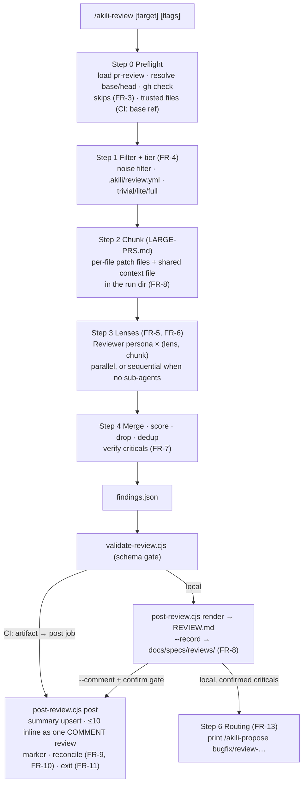
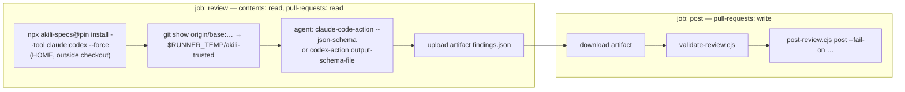

# Design: `/akili-review` — spec-aware pull-request review, local and CI

## 1. Document Control

| Field | Value |
|---|---|
| Spec Path | `changes/akili-review` |
| Depth | Standard |
| Type | Change |
| Deliverable | `software` |
| Approval Mode | See `requirements.md` §1. The design gate is resolved as **Review Design** (judgment-day) by user mandate, 2026-10-25 |
| Status | Draft, before judgment-day |
| Date | 2026-10-25 |
| Verified at | Repository reads at `708020e`, the requirements commit `d470096` (which differs only in this spec folder); external reads at the commit each row names. Every reading below was executed in this session and is quoted, except the rows marked `UNVERIFIED` |
| Scratch evidence | `$SCRATCH` is this session's scratchpad. `pkg/` is a package copy at `708020e` plus a stub `akili-review.md` and a stub `pr-review/SKILL.md`. `ci-probe/` holds real `install --local` runs. `ext/` holds `action.yml`, examples and source files fetched with `gh api` (untrusted, read only) |
| Delegation | None. Exploration was done inline |

## 2. Executive Summary

The change adds one command file, one skill directory (`SKILL.md`, `NOTICE`, 3 references, a schema, 2 scripts), two CI templates plus a README under `docs/ci/`, four new test files, count and fixture updates for the 8 existing tests that the new files turn red, one-token carve-out edits in 5 files, and docs. **No installer, routing, template or dependency change.**

The guarantees an attacker or a model could otherwise erode live **in code**, not in prose:

- `validate-review.cjs` gates the schema;
- `post-review.cjs` owns rendering, the inline cap, the marker, reconciliation, the `COMMENT`-only review event and the exit code;
- in CI, the agent runs in a job whose token cannot write to the PR.

The command and skill own the judgment: target, tier, lenses, spec mapping, scoring and verification. The lenses are the existing Reviewer persona in single-lens mode.

## 3. Architecture Overview





The agent never runs in the job that holds the write token (DD-4). The install lands in the runner's HOME, which the PR cannot reach, so it survives `claude-code-action`'s restore of `.claude/` (DD-5, P-3).

## 4. Extended Directory Structure

```text
.claude/commands/akili-review.md                 NEW  ≤ 230 lines (NFR-4)
.claude/skills/pr-review/
  SKILL.md                                       NEW  ≤ 250 lines; method spine + AKILI-SPECS Integration
  NOTICE                                         NEW  Apache-2.0 + MIT notices of adapted sources (DD-11)
  references/lenses.md                           NEW  per-lens what-to-flag / what-not-to-flag, finding line format
  references/large-prs.md                        NEW  filtering, tiers, chunking, shared context file
  references/ci.md                               NEW  --ci contract, trusted files, structured output, posting rules
  review-schema.json                             NEW  JSON Schema of the review document (§5)
  validate-review.cjs                            NEW  schema + semantic checks; CLI `validate <file>`
  post-review.cjs                                NEW  CLI `render <file>` | `post <file> --pr <n> --repo <o/r> --fail-on <x>`
docs/ci/akili-review.claude.yml                  NEW  claude-code-action template (FR-12)
docs/ci/akili-review.codex.yml                   NEW  codex-action template (FR-12)
docs/ci/README.md                                NEW  setup, secrets, pilot, --fail-on, residual risk
docs/commands/akili-review.md                    NEW
docs/skills/pr-review.md                         NEW
test/pr-review-scripts.test.js                   NEW  validator + renderer + poster against a fake gh
test/akili-review-command.test.js                NEW  command and skill text contract + persona drift guard + restatements
test/akili-review-ci.test.js                     NEW  YAML text contract for both templates
test/fixtures/pr-review/*.json, fake-gh.js       NEW  valid / invalid / injection / reconcile fixtures
EDIT  counts, lists, carve-outs, docs (§9.1), test/install-cursor.test.js, test/fixtures/doctor-codex-baseline.txt
```

## 5. Data Model

### 5.1 Review document (`findings.json`, `review-schema.json`)

| Field | Type | Notes |
|---|---|---|
| `schema_version` | `"1"` | |
| `target` | object | `kind` (`pr`, `range` or `staged`), `pr` (int or null), `repo` (`owner/name` or null), `base_sha`, `head_sha` (40 hex), `spec_paths` (string[]) |
| `tier` | `trivial`, `lite` or `full` | |
| `host_mode` | `parallel` or `sequential` | FR-5 fallback |
| `lenses` | string[] | the lenses that ran |
| `coverage` | array | one row per spec: `spec`, `fr`, `status` (`met`, `missing`, `partial` or `not-claimed`), `evidence` |
| `unspecified_changes` | string[] | file paths |
| `skipped_files` | array | `{file, reason}` |
| `recommend_security` | string[] | sensitive paths (FR-4) |
| `findings` | array | §5.2 |
| `notes` | string[] | e.g. "Unspecified PR", "criticals unconfirmed: sequential host" |

**Strict-mode shape.** The schema is written in the strict subset that both runtimes' structured-output modes accept: every property listed in `required`, `additionalProperties: false`, and optional values expressed as nullable. P-5 records that this is unverified; T1 settles it.

### 5.2 Finding

| Field | Type | Rule |
|---|---|---|
| `id` | `F-<n>` | unique in the document |
| `lens` | enum of the six lenses | |
| `severity` | `critical`, `warning` or `suggestion` | |
| `suspect` | boolean | true ⇒ `severity` ≠ `critical` (validator semantic check) |
| `confidence` | integer 0–100 | must be ≥ the threshold recorded in `notes`/config; the validator rejects a value below 80 (the default) unless the document records an override |
| `file` | repo-relative path | no `..`, not absolute |
| `line_start`, `line_end` | integer ≥ 1, start ≤ end | |
| `side` | `RIGHT` or `LEFT` | |
| `evidence` | string, 1–1,200 characters | quoted diff lines |
| `why` | string, 1–800 characters | |
| `fix` | string or null, ≤ 800 characters | |
| `fingerprint` | 16 hex characters | DD-7 |

### 5.3 Marker (inside the summary comment)

```text
<!-- akili-review:v1 {"head":"<40-hex>","posted":["<fp>",…],"run":<k>} -->
```

There is exactly one marker per summary. It is written only by `post-review.cjs`, and on read it is parsed only from a comment whose author is the posting identity (P-15).

### 5.4 Status of a previous finding (every state the reconcile reads)

| Previous state (marker plus thread) | Present now? | Action |
|---|---|---|
| posted, thread open | no | fixed: listed under "Fixed since last review"; the thread is resolved (P-16) or the summary marks it fixed |
| posted, thread open | yes | unfixed: kept, not re-posted |
| posted, thread resolved by a human | yes, same or lower severity | respected: summary only |
| posted, thread resolved by a human | yes, higher severity | worse: re-posted inline under the cap |
| posted, thread deleted or not found | yes | treated as new |
| not posted (summary only) | yes | eligible for inline under the cap |
| marker absent, or unparsable | — | first review: everything is new; an unparsable marker is reported in the job log, never trusted |

### 5.5 `docs/specs/reviews/review-<…>.md` (opt-in)

The file is rendered by `post-review.cjs render --history` with the same allowlist as FR-8. The command writes it. A `README.md` holding one line ("Opt-in `/akili-review` history; not specs") is created with the directory.

## 6. API Design

These are the CLIs of the two scripts. Both use Node ≥ 18 with no dependencies and no `O_NOFOLLOW` (NFR-2):

| Invocation | Effect | Exit |
|---|---|---|
| `node validate-review.cjs <file>` | Schema check plus semantic checks (suspect ⇒ not critical, line order, unique ids and fingerprints, path safety) | 0 valid · 1 invalid (errors name the index and field) · 2 usage |
| `node post-review.cjs render <file> [--history]` | Prints `REVIEW.md` (or the history file) to stdout. Validates first | 0 · 1 invalid |
| `node post-review.cjs post <file> --repo <o/r> --pr <n> [--fail-on none\|critical\|warning] [--labels <csv>] [--dry-run]` | Validate → read the previous summary and marker through `gh api` → reconcile → upsert the summary → one `COMMENT` review with ≤ 10 comments → print the plan or the result | §FR-11 table; `--dry-run` prints the API calls and posts nothing |

GitHub calls go through `gh api` only: listing issue comments, create/update issue comment, `POST /repos/{o}/{r}/pulls/{n}/reviews` with `event: "COMMENT"` and `comments[]`, and the GraphQL `reviewThreads` / `resolveReviewThread`. The review endpoint's comment fields are UNVERIFIED (P-14) and settled in T3.

## 7. Backend Module Design

### 7.1 Command (`.claude/commands/akili-review.md`)

| Section | Content | FR |
|---|---|---|
| Frontmatter + Usage | invocation table; "no Approval Mode"; data rule for the parent | FR-2 |
| Step 0 Preflight | model checkpoint (coordinator T1, lens reviewers and judges T3 per persona); load `pr-review` + provenance check; resolve target and base (pins); `gh` check; author ≠ auditor note; skips; in `--ci`, trusted files from `$RUNNER_TEMP/akili-trusted` | FR-2, FR-3, FR-12 |
| Step 1 Filter + tier | points to `large-prs.md`; `/akili-security` recommendation | FR-4 |
| Step 2 Chunk | the run directory rule; chunk files | FR-8 |
| Step 3 Lenses | persona resolution table; the verbatim addendum (canonical copy); sub-agent capability question answered from own tools (the `/akili-security` Step 0.4 pattern) | FR-5, FR-6, FR-12 |
| Step 4 Merge and verify | threshold, drop list, dedup, tier verification, downgrade rules | FR-7 |
| Step 5 Output | write `findings.json` → validator → local: render `REVIEW.md`, `--record`, `--comment` gate. `--ci`: emit the review document as the final structured output, post nothing | FR-8, FR-9 |
| Step 6 Routing | local only | FR-13 |
| Error Handling, Verification Checklist (FR ids), Authorship | | — |

### 7.2 Skill (`pr-review`)

| File | Owns | Source |
|---|---|---|
| `SKILL.md` | the pipeline spine, the finding contract summary, the standalone line, the Integration table | AKILI-authored; `inspired-by` Cloudflare's "Orchestrating AI Code Review at scale" (architecture, no text), obra/superpowers `requesting-code-review` (MIT, pattern), the Anthropic `code-review` plugin README (pattern only, **not adapted**, DD-11) |
| `references/lenses.md` | the six lenses, each with what-to-flag and what-not-to-flag; the spec lens procedure (FR-6); the finding line format | Correctness, performance and maintainability checklist **adapted from** `anthropics/knowledge-work-plugins` `engineering/skills/code-review/SKILL.md` @ `33d3dea` (Apache-2.0). Security what-not-to-flag rules **adapted from** `anthropics/claude-code-security-review` `claudecode/findings_filter.py` hard-exclusion rules @ `0c6a49f` (MIT). Spec lens AKILI-authored |
| `references/large-prs.md` | the noise filter, tier thresholds, security-sensitive globs, chunking under a per-chunk budget, the shared context file | AKILI-authored (Cloudflare architecture credited) |
| `references/ci.md` | `--ci` contract, trusted-file rule, structured-output mapping for both runtimes, posting via scripts only | AKILI-authored |

### 7.3 Lens spawn (DD-2)

The brief for each (lens, chunk) names `reviewer.md` single-lens mode, the lens's section in `lenses.md`, the chunk file paths, the shared context file, and the addendum. The lens reviewer returns its standard contract. Each `ISSUES` item has one line `FINDING | <severity> | <confidence> | <file>:<a>-<b> | <side>`, followed by `Evidence:`, `Why:` and `Fix:` lines. The coordinator parses those lines. An item it cannot parse is dropped and counted in `notes`, never guessed.

**Chunk size.** A chunk is sized so that a lens's findings fit the persona's ~600-word report. Overflow goes to the persona's overflow-file path when the reviewer has a write tool, and to re-chunking otherwise.

### 7.4 Fingerprint (DD-7)

The fingerprint is the first 16 hex characters of sha256 over `lens | file | normalized evidence first line | why first 60 chars, lowercased and with whitespace collapsed`. Line numbers are excluded, so a finding keeps its identity when code above it moves.

### 7.5 Rendering

`post-review.cjs` renders the summary from fixed templates:

1. verdict line;
2. counts;
3. spec coverage table;
4. inline findings (links only);
5. summary-only findings;
6. fixed since last review;
7. skipped files;
8. `/akili-security` recommendation;
9. notes;
10. footer naming the package version and the advisory status.

Agent text is neutralized before it enters any template:

- `<!--` and `-->` are escaped;
- `@` before a word character becomes `@` followed by U+200B;
- triple backticks are fenced safely;
- each field is truncated to its schema maximum.

## 8. Frontend / UX Component Architecture

There is no UI. The surfaces are the `--comment` confirmation gate (Post / Edit selection / Cancel), the routing offer, the summary comment and the inline comments.

## 9. Shared Contracts or Package Extensions

| Contract | Change |
|---|---|
| Packaged command set | +1 (`akili-review`): consumers P-6, P-7, P-8; live path P-1 |
| Packaged skill set | +1 (`pr-review`, `core`): same consumers; `.cjs` files ship as in `security-audit` (P-2) |
| `docs/specs/` carve-outs | +`reviews/` at 5 sites (P-9) |
| Package `files` | `docs` is already included (`!docs/specs` excluded), so `docs/ci/` ships with no `package.json` edit (P-10) |
| Reviewer persona | Referenced by section id (`lenses`, `review-output`); not edited (P-11) |

### 9.1 Enumerating sites: per-site decision (P-7, P-8)

| Site | Decision |
|---|---|
| `README.md:122` command table (new row after `/akili-marketing`) | Edit |
| `AGENTS.md:64` *Skill Usage* (new `pr-review` line) | Edit |
| `docs/README.md:43` (new row) | Edit |
| `docs/overview.md:38` commands table, `:96` skills-by-purpose row, `:159` anytime glossary, `:204` task table | Edit |
| `docs/flow.md:21` "Six" → "Seven" plus the list; `:195` artifacts table (run directory, `docs/specs/reviews/`); new `### 2d. Pull-Request Review (/akili-review)` after `:445`; `:640` core-binding list; `:680` lifecycle bullets | Edit |
| `docs/commands/README.md:21`, `:37`, `:55` | Edit |
| `docs/skills/README.md:38` (new row), `docs/skills/governance.md` core list | Edit |
| `docs/cli.md:326, 327, 338, 339, 360, 377` (13 → 14, 28 → 29) | Edit |
| `test/akili-marketing-docs.test.js:100` (pins the line starting `Six anytime commands`) | Edit to `Seven anytime commands` in the same task as `docs/flow.md:21` |
| `.claude/skills/judgment-day/SKILL.md:75` Integration table | Edit (one row) |
| `docs/flow.md:7`, `README.md` figure alt text; `assets/akili-flow.svg` / `.png` | **Not edited.** Known debt, as in `changes/akili-marketing` DD-12 (the alt text already lists five commands) |
| `.claude/templates/model-routing.section.md`, `docs/model-routing.md` | Not edited (DD-14) |

## 10. Design Decisions

| DD | Decision | Why / rejected alternative | Lesson |
|---|---|---|---|
| DD-1 | One spec (proposal Option A) | Approved 2026-10-25 | — |
| DD-2 | **No new persona.** Lenses are `reviewer.md` single-lens spawns. Findings travel as structured lines inside the persona's existing `ISSUES` list; the coordinator parses them | Owner decision 2026-10-25. The persona already has the lens mode and the read-only stance; its report contract is kept, so `akili doctor --agents` drift states are untouched. Rejected: a `pr-reviewer.md` persona (a fifth persona to keep in sync), and asking lens reviewers to write JSON files (a Step 8E wrapper may give the Reviewer no write tool, P-11) | KZ-005 (reference by name) |
| DD-3 | Caps, marker, rendering, the review event and the exit code live in `post-review.cjs`; the schema lives in `validate-review.cjs`. The command text points to them and restates none of their numbers except the cap, which a restatement test pins | A prompt-level cap is a request, not a guarantee, and the noise research makes the cap the main trust lever. Rejected: letting the agent post through the inline-comment MCP tool (the cap would hold only if the model complied) | KZ-changes--kaizen-loop-closure-2 |
| DD-4 | The CI agent runs in a `review` job with `pull-requests: read`; posting runs in a separate `post` job with `pull-requests: write`, from the uploaded artifact | Injected PR text cannot post, edit or approve anything, because the token in the agent's job cannot. Rejected: one job with a restricted tool list (the token would still be in that job's environment) | — |
| DD-5 | CI installs globally into the runner's HOME (`install --tool claude\|codex --force`); the prompt names the command file by absolute path (`$HOME/.claude/commands/akili-review.md`, `$HOME/.agents/skills/akili-review/SKILL.md`) | `claude-code-action` deletes and restores `.claude/` from base on PRs (P-3), so a `--local` install is wiped; HOME is outside the PR's reach. The absolute path removes the dependence on user-level discovery (P-12). `--force` makes the pinned version win on a reused self-hosted runner. **Supersedes** the proposal's §7 install line | — |
| DD-6 | A workflow step copies trusted files from `origin/<base>` into `$RUNNER_TEMP/akili-trusted/`; `--ci` reads conventions, persona and config only from there | `AGENTS.md` and `.agents/` are PR-controlled and are not in the action's restore list (P-3). Rejected: having the agent run `git show` (one more Bash permission inside the injectable job) | — |
| DD-7 | Re-review state lives in the summary comment's marker (Q3 default), together with a line-independent fingerprint | Artifacts expire; the marker is co-located with what it describes. A marker is trusted only from the posting identity's comment (P-15) | — |
| DD-8 | Inline comments are posted as one PR review with `event: "COMMENT"`, hard-coded | One API call; and no input path can produce `APPROVE` or `REQUEST_CHANGES` (FR-2 boundary) | — |
| DD-9 | Without independent sub-agents, criticals are downgraded to suspect warnings, and `--fail-on critical` cannot fire | AKILI never lets the finder confirm its own finding (the `/akili-security` FR-9 stance). Codex CI sub-agent support is unverified (P-13), so the Codex template documents that it may run sequential | — |
| DD-10 | History is opt-in under `docs/specs/reviews/`, and `reviews/` joins the carve-out lists at all 5 sites in one task. That task edits several rules documents, but each edit is the same one token, so the split rule's risk (a reviewer stopping before later sites) does not apply; recorded as a deliberate exception | Owner decision D4 names the path; an un-carved folder would be scanned as a spec (KZ-004) | KZ-004 |
| DD-11 | Attribution follows the governance *original-authorship variant* (`author` AKILI, `inspired-by` list) plus `NOTICE` and per-file `Adapted from` lines for the two adapted permissive sources. **Clean room:** no task opens files from `anthropics/claude-code` or a locally installed copy of its `code-review` plugin; the pattern comes from the analysis's description only | The proprietary license forbids copying (P-17). An implementer who reads it while writing risks contamination | — |
| DD-12 | The figure and its alt text are not edited (known debt, CHANGELOG states it) | Same as the marketing DD-12; regenerating the SVG is out of scope | KZ-002 |
| DD-13 | Four test files: scripts (`tdd`, red first, fake `gh`), command and skill text contract plus persona drift guard plus restatements, CI YAML text contract, and the existing count/fixture updates. All read through a CRLF-normalizing reader. No shipped file references `docs/specs/changes/akili-review/` | The product is mostly agent-instruction text (the `test/akili-security-command.test.js` precedent); test LOC is budgeted per clause | KZ-bugfix--init-ctrlc-abort-2, KZ-changes--archify-diagrams-1 |
| DD-14 | No model-routing registry row; the command's model checkpoint states the tiers | Editing the routing section template makes `akili routing` refuse existing fences (pending bug) | — |
| DD-15 | Tier thresholds, sensitive globs and the noise list are defaults in `large-prs.md`, overridable by the base-ref `.akili/review.yml` | Teams differ; overrides read from the base cannot be weakened by the PR | — |

**Reversion challenge (Step 2.3).** No DD removes, disables or inverts delivered behavior; every change is additive. DD-5 supersedes a proposal line, not shipped behavior. The challenge was not run.

## 11. Budget (Step 2.4: tripwire for `/akili-execute`)

| Measure | Estimate | Basis |
|---|---|---|
| Tasks | **13** | `tasks.md` |
| LOC authored | **~4,100**, broken down as: schema ~130; validator ~180; `post-review.cjs` ~380; script tests and fixtures ~750; references ~600; `SKILL.md` + `NOTICE` ~300; command ~230; command and skill contract test ~640 (40 clauses incl. the FR-9 additions × ~14 lines, plus the drift guard and restatements; precedent 673 lines for a 187-line command); CI templates ~220 + README ~120; CI contract test ~180; counts/fixtures ~30; docs ~330; carve-outs ~10; CHANGELOG ~25 | §4, §7, KZ-bugfix--init-ctrlc-abort-2 |
| Review rounds | **20**: 2 × rules-text or logic tasks (T3, T4, T5, T6, T8, T10b) = 12, plus 1 × the others (T1, T2, T7, T9, T10a, T11, T12) = 7, plus 1 margin | Step 2.4 rules-document rule |

**Depth check.** Standard fits: the work is additive and the CI boundary is reviewed by judgment-day. The LOC is above `changes/akili-marketing` (~2,600) because two real scripts ship. The estimate lands **above** the ~400 LOC single-PR line, so the PR strategy is recommended at the tasks gate. `/akili-execute` stops and escalates past **15 tasks, ~5,000 LOC, or 24 rounds**.

## 12. Premise Ledger

**Count:** 18 rows: 13 verified, 5 `UNVERIFIED` (1 High, 4 Low).
**Blast-radius triggers:**

- `live-path`: the design names the user action `/akili-review`, which loads `pr-review` and reaches the persona on six install targets and in two CI runtimes (P-1, P-3, P-12).
- `shared-state`: the design changes the carve-out condition that four commands and one doc read (P-9), and adds files under `docs/` that `/akili-constitution` reads generically (P-18).
- `consumer`: the packaged command and skill sets and the anytime count are enumerated by tests, a fixture and docs; searched by count **and** by an existing member's name, `akili-marketing` (P-6, P-7, P-8).

| # | Claim | Class | Citation (as run) | Verified at | If false | Settled by |
|---|---|---|---|---|---|---|
| P-1 | `/akili-review` reaches its command text on all six targets, and the text's skill load resolves `pr-review` from the same host's skill root | live-path | Enumeration `bin/akili.js:504` (`entry.isFile() && entry.name.endsWith(".md")`); the tree copy `copyDirectoryContents` `bin/akili.js:907`; command-as-skill targets `commandsAsSkills: true` at `bin/akili.js:183, 191, 202, 216`. Executed: `CI=true node bin/akili.js install --tool claude --local </dev/null` in an empty dir → exit 0, 49 files (13 commands, 28 skills, resources); `--tool codex --local` → `.agents/skills/akili-*` and `.codex/akili/{scripts,templates}`. Host-side name resolution at runtime was not re-run | `708020e` | An installer task is added (High) | — |
| P-2 | Skill directories with `.cjs` scripts ship and install as trees | location | `.claude/skills/security-audit/validate-findings.cjs` ships today (`ls .claude/skills/security-audit`); the same `copyDirectoryContents` path as P-1 | `708020e` | Scripts relocated (Low) | — |
| P-3 | On PR events, `claude-code-action` deletes `.claude`, `.mcp.json`, `.claude.json`, `.gitmodules`, `.ripgreprc`, `CLAUDE.md`, `CLAUDE.local.md`, `.husky` from cwd and restores them from `origin/<base>` before the CLI reads them; `AGENTS.md` and `.agents/` are not in the list | other | `gh api repos/anthropics/claude-code-action/contents/src/github/operations/restore-config.ts` → `SENSITIVE_PATHS` (lines 26–35 of the fetched file), `rmSync` loop then `git checkout origin/${baseBranch} -- p`; `src/entrypoints/run.ts` (the `isEntityContext(context) && context.isPR` branch calling `restoreConfigFromBase`) | action HEAD `925afb53` (tag `v1.0.262`) | DD-5/DD-6 rationale changes; the global install still works (Low) — but if a future version also restores HOME, the template breaks (watched in T12) | — |
| P-4 | `claude-code-action` exposes `structured_output` when `--json-schema` is passed in `claude_args`; `codex-action` accepts `output-schema-file` and writes the final message to `output-file` | other | Fetched `action.yml`: claude `outputs.structured_output` ("when --json-schema is provided in claude_args"), `docs/usage.md:213-225`; codex `inputs.output-schema-file`, `inputs.output-file`, `outputs.final-message` | claude `925afb53`; codex `c05cfd74` (tag `v1.13`) | DD-4 needs another hand-off channel (High) | — |
| P-5 | One JSON Schema in the strict subset (all properties required, `additionalProperties: false`, nullable optionals) is accepted by both runtimes' structured-output modes | data-env | `UNVERIFIED — confirm at source before relying on it` | — | Two schema files, or a non-strict schema (Low) | T1 first step: check both actions' docs and examples for strictness rules; record the URLs |
| P-6 | Adding one command and one skill directory turns exactly these 8 tests red: `docs-overview.test.js` (a)–(d) ×5, `install-cursor.test.js` skill-file count (`expected 236 … counted 237`), and the Codex-doctor baseline comparisons in `install-cursor.test.js` and `install-grokbot.test.js` (`test/fixtures/doctor-codex-baseline.txt`) | consumer | `npm test` in `$SCRATCH/pkg` (Node 22.12.0): baseline at the repo `# tests 844 · pass 844`; with stubs `# pass 836 · fail 8` (`not ok 375–379`, `394`, `404`, `449`). Pinned literals: `install-cursor.test.js:228` (`13 + 236 = 249`), `:246-247` (`236`). The real skill adds 9 files, not 1, so T9 recomputes. `test/akili-marketing-docs.test.js:100` pins `Six anytime commands` (goes red at the docs edit, not with stubs) | `708020e` | More consumers found in T9/T10 (Low) | — |
| P-7 | Docs state the 13/28 totals at exactly these sites | consumer | `grep -rnE "\b(13\|28)\b (packaged )?(commands\|skills)" README.md docs AGENTS.md --include='*.md' \| grep -v docs/specs/` → `docs/cli.md:326, 327, 338, 339, 360, 377` (as run). `docs-overview.test.js` (d) derives totals for every `<N> commands\|skills` claim | `708020e` | T10b list grows (Low) | — |
| P-8 | Lists that enumerate commands or core skills, found by an existing member's name | consumer | `grep -rln 'akili-marketing' . --include='*.md' --include='*.js' --include='*.json' --include='*.txt' --include='*.yml' --include='*.svg' \| grep -vE 'node_modules\|docs/specs/\|\.codegraph\|^./releases'` → `README.md`, `CHANGELOG.md`, `AGENTS.md`, `docs/{README,overview,flow}.md`, `docs/commands/{README,akili-marketing}.md`, `docs/skills/{README,social-marketing}.md`, 6 test files, `test/fixtures/doctor-codex-baseline.txt`, and marketing-owned skill files. Per-site lines: §9.1 | `708020e` | T10b list grows (Low) | — |
| P-9 | Exactly 5 files carry the non-spec carve-out list | shared-state | `grep -rln "never a spec and are never read as one\|never a spec and never read as one" . --include='*.md' --include='*.js' \| grep -vE "node_modules\|docs/specs/"` → `.claude/commands/akili-{audit,resume,specify,propose}.md`, `docs/commands/akili-resume.md` (as run). No test pins the list: `grep -rln "never a spec" test` → none | `708020e` | T11 site list grows (Low) | — |
| P-10 | The package ships `docs/` except `docs/specs` | location | `node -e 'console.log(JSON.stringify(require("./package.json").files))'` → `[…,"docs","!docs/specs",…]` | `708020e` | `package.json` edit needed (Low) | — |
| P-11 | `reviewer.md` has sections `lenses` (with the single-named-lens mode) and `review-output` (the `STATUS:` first line, ~600 words, overflow to a file the Leader reads); its read-only role says a wrapper may give it no write tools | location | `grep -n "id=lenses\|id=review-output\|single named lens\|600 words" .claude/templates/reviewer.md` → `:49`, `:57`, `:81`, `:84`; the read-only role text in section `read-only-role` | `708020e` | DD-2 needs a persona edit (High) | — |
| P-12 | Under `claude-code-action`, the CLI can read `$HOME/.claude/commands/akili-review.md` and load `pr-review` from `$HOME/.claude/skills/`, i.e. the action does not override HOME or `CLAUDE_CONFIG_DIR` away from the runner's HOME | live-path | `UNVERIFIED — confirm at source before relying on it` | — | DD-5 changes: pass `--claude-target` to the dir the action uses (High) | T12 pilot (owner T12): on a scratch repo, the job log shows the command file read and the skill loaded; before that, T8 greps the action source for `HOME` / `CLAUDE_CONFIG_DIR` overrides and records the hits |
| P-13 | `codex exec` under `codex-action` can spawn independent sub-agents | data-env | `UNVERIFIED — confirm at source before relying on it` | — | Codex CI runs sequential with downgraded criticals, which the design already allows (DD-9) (Low) | T12 pilot (Codex leg, if a key is available), else stays documented as sequential |
| P-14 | `POST /repos/{o}/{r}/pulls/{n}/reviews` accepts `event: "COMMENT"` with `comments[]` items `{path, line, side, start_line, start_side, body}`; GraphQL `resolveReviewThread` works with `pull-requests: write` | data-env | `UNVERIFIED — confirm at source before relying on it` | — | `post-review.cjs` request shape changes (Low) | T3 first step: GitHub REST and GraphQL docs, URLs recorded; the fake `gh` asserts the recorded shape |
| P-15 | A comment's author login is available from the issue comments API, so the marker can be trusted only from the posting identity (`github-actions[bot]` in CI, the `gh` user locally) | data-env | `UNVERIFIED — confirm at source before relying on it` | — | Marker trust needs another key (Low) | T3, same docs check |
| P-16 | The default sub-agent capability question and the run-directory two-way rule exist in `/akili-security` and can be referenced by name | location | `.claude/commands/akili-security.md` Step 0 item 4 ("Sub-agent capability"), Step 1 "Run directory rules" | `708020e` | The command restates them (Low) | — |
| P-17 | `anthropics/claude-code` is all rights reserved; `knowledge-work-plugins` is Apache-2.0; `claude-code-security-review` and `obra/superpowers` are MIT | other | `gh api repos/anthropics/claude-code/contents/LICENSE.md` → "© Anthropic PBC. All rights reserved."; `gh api repos/<r>/license --jq .license.spdx_id` → `Apache-2.0` (`knowledge-work-plugins` @ `33d3dea`), `MIT` (`claude-code-security-review` @ `0c6a49f`, `obra/superpowers` @ `2ce8aa1`) | as named | DD-11 changes, or the proposal reopens (High) | — |
| P-18 | `/akili-constitution` reads product docs anywhere under `docs/`, so it may read `docs/ci/` and opt-in `docs/specs/reviews/` | shared-state | `.claude/commands/akili-constitution.md:99` (P-16 of `changes/akili-marketing`, same line at `708020e`: `sed -n 99p` → "Any architecture, infrastructure, setup, or product docs already present under `docs/`") | `708020e` | Accepted: CI docs are legitimate setup context; reviews are carved out of spec scans, not of constitution reads (Low) | — |
