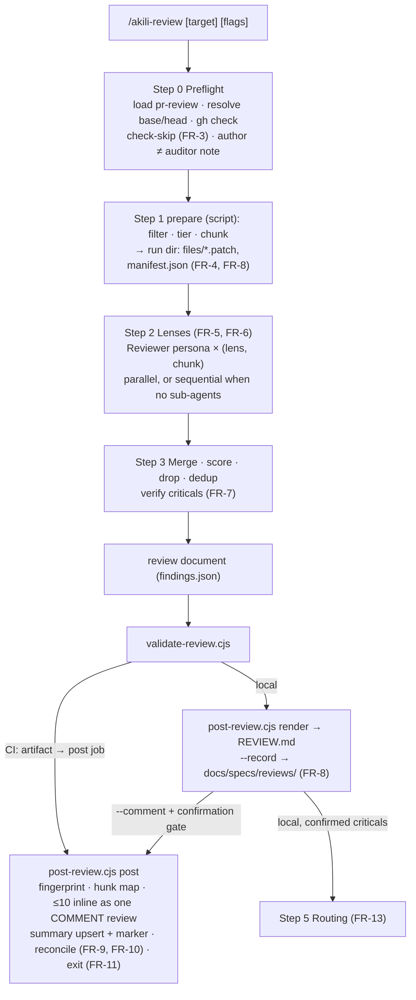
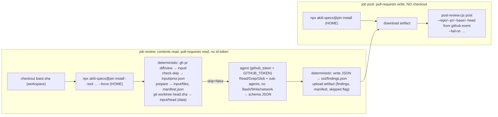

# Design: `/akili-review` — spec-aware pull-request review, local and CI

## 1. Document Control

| Field | Value |
|---|---|
| Spec Path | `changes/akili-review` |
| Depth | Standard |
| Type | Change |
| Deliverable | `software` |
| Approval Mode | See `requirements.md` §1. The design gate is resolved as **Review Design** (judgment-day) by user mandate, 2026-10-25 |
| Status | **Round-1 correction applied** (W-1 to W-5, `judgment.md`; the user chose **Fix and Re-judge**, 2026-10-25). Awaiting scoped re-judgment |
| Date | 2026-10-25 |
| Verified at | Repository reads at `708020e`; the spec-only commits `d470096`, `1b7ae87` and `a7f4f6a` differ from it only in this folder. External reads at the commit each row names. Every reading was executed in this session and quoted, except the rows marked `UNVERIFIED` |
| Scratch evidence | `$SCRATCH` is this session's scratchpad. `pkg/` is a package copy at `708020e` plus a stub command and a stub skill. `ci-probe/` holds real `install --local` runs. `ext/` holds `action.yml` files, examples and source files fetched with `gh api` (untrusted, read only) |
| Delegation | Exploration was done inline. Judgment-day judges A and B ran on Sonnet |
| Owner decisions at the design gate | Figure: **keep as known debt** (DD-12; amends proposal §13's "the figure included"; user, 2026-10-25) |

## 2. Executive Summary

The change adds:

- one command file;
- one skill directory with 8 files: `SKILL.md`, `NOTICE`, 3 references, a schema, and 2 scripts;
- two CI templates plus a README under `docs/ci/`;
- three new test files and their fixtures;
- count and fixture updates for the existing tests the new files turn red (§9.1);
- a one-token carve-out edit at 6 sites;
- docs.

There is **no installer, routing, template or dependency change**.

**Deterministic code owns every guarantee an attacker or a model could otherwise erode.** `post-review.cjs` has four subcommands:

- `prepare`: filter, tier and chunk;
- `check-skip`: identity-checked skip;
- `render`;
- `post`: fingerprints, line mapping, the inline cap, the marker, reconciliation, the `COMMENT`-only review and the exit code.

`validate-review.cjs` checks schema and semantics.

**In CI, the agent runs on the base SHA with no Bash, no write tool and no network.** It reads a deterministic input directory and returns schema-shaped JSON. A separate job, which checks out nothing, posts that JSON.

The command and skill own the judgment: lenses, spec mapping, scoring and verification. The lenses are the existing Reviewer persona in single-lens mode.

## 3. Architecture Overview





## 4. Extended Directory Structure

```text
.claude/commands/akili-review.md                 NEW  ≤ 200 lines target, 230 hard cap (NFR-4)
.claude/skills/pr-review/                        NEW  8 files
  SKILL.md                                       ≤ 250 lines; pipeline spine + AKILI-SPECS Integration
  NOTICE                                         Apache-2.0 + MIT notices of adapted sources (DD-11)
  references/lenses.md                           per-lens what-to-flag / what-not-to-flag; finding line format; spec lens
  references/large-prs.md                        filter defaults, tier thresholds, sensitive globs, chunk budget
  references/ci.md                               --ci contract, input directory, structured output, posting rules
  review-schema.json                             structured-output schema (strict subset, §5.1)
  validate-review.cjs                            CLI `validate`
  post-review.cjs                                CLI `prepare | check-skip | render | post`
docs/ci/akili-review.claude.yml                  NEW  (§7.6)
docs/ci/akili-review.codex.yml                   NEW  (§7.6)
docs/ci/README.md                                NEW  setup, secrets, pilot, --fail-on, residual risk
docs/commands/akili-review.md                    NEW
docs/skills/pr-review.md                         NEW
test/pr-review-scripts.test.js                   NEW  validator + prepare + check-skip + render + post vs a fake gh
test/akili-review-command.test.js                NEW  command/skill text contract + persona drift guard + restatements
test/akili-review-ci.test.js                     NEW  YAML text contract, both templates
test/fixtures/pr-review/                         NEW  diffs, review docs (valid, invalid, injection, reconcile), fake-gh.js
EDIT  §9.1 sites, test/install-cursor.test.js, test/fixtures/doctor-codex-baseline.txt, two docs-pinning tests
```

**Fake `gh`.** The scripts resolve the GitHub CLI from the environment variable `AKILI_GH_BIN`, else `gh` on `PATH`. Tests set `AKILI_GH_BIN` to `node <fixtures>/fake-gh.js` and invoke it through `process.execPath` with the script as an argument, so no shim is needed on native Windows (S-5).

## 5. Data Model

### 5.1 Review document (agent output: `findings.json`, `review-schema.json`)

**Strict structured-output subset** (C-4): every property is in `required`, `additionalProperties: false` everywhere, optional values are nullable, and only `type`, `enum`, `properties`, `required`, `items` and `additionalProperties` are used. There is no `minimum`, `maximum`, `minLength`, `maxLength`, `minItems` or `pattern`. Those bounds are enforced by `validate-review.cjs` (§6). P-5 records the remaining strictness question for OpenAI.

| Field | Type | Notes |
|---|---|---|
| `schema_version` | `"1"` (enum) | |
| `target` | object | `kind` (`pr`, `range` or `staged`), `pr` (int or null), `repo` (string or null), `base_sha`, `head_sha` |
| `tier` | enum | copied from `manifest.json`; the validator rejects a mismatch |
| `host_mode` | `parallel` or `sequential` | |
| `lenses` | string[] | |
| `top_risks` | string[] | ≤ 3 (validator), for FR-8's "Top risks" (S-7) |
| `coverage` | array | `spec`, `fr`, `status` (`met`, `missing`, `partial` or `not-claimed`), `evidence` |
| `unspecified_changes` | string[] | file paths |
| `notes` | string[] | |
| `findings` | array | §5.2 |

`skipped_files`, `recommend_security`, the threshold and the tier come from `manifest.json` (written by `prepare`), not from the agent.

### 5.2 Finding (agent-supplied fields)

| Field | Validator rule |
|---|---|
| `id` | `F-<n>`, unique |
| `lens` | one of the six lenses |
| `severity` | `critical`, `warning` or `suggestion` |
| `suspect` | boolean; true ⇒ `severity` ≠ `critical` |
| `confidence` | integer 0–100, and ≥ the threshold given on the CLI (from the manifest locally; from the base-SHA config in the `post` job, §6) (C-11) |
| `file` | repo-relative; charset `[A-Za-z0-9._/@+-]`; no `..`, no leading `/`; must be a file in the diff |
| `line_start`, `line_end` | integers ≥ 1, start ≤ end |
| `side` | `RIGHT` or `LEFT` |
| `evidence` | 1–1,200 characters |
| `why` | 1–800 characters |
| `fix` | null, or ≤ 800 characters |

**The fingerprint is not agent-supplied** (S-4). `post-review.cjs` computes it as the first 16 hex characters of sha256 over `lens \| file \| normalized first evidence line`, where normalization means trimmed, whitespace collapsed and the leading `+`/`-` dropped. Line numbers and `why` prose are excluded, so the identity survives code moving and rewording. Two findings that share a fingerprint are merged.

### 5.3 Manifest (`manifest.json`, written by `prepare`)

| Field | Content |
|---|---|
| `target` | as resolved by the script (CI: from the event payload passed on the CLI) |
| `tier`, `threshold`, `lenses` | derived from the filtered diff plus config (FR-4) |
| `files` | per file: path, status, added and removed counts, patch-file path, chunk id |
| `skipped_files` | `{file, reason}` |
| `recommend_security` | sensitive paths matched |
| `chunks` | id, files, estimated tokens |
| `config_source` | `default`, or `.akili/review.yml@<base_sha>` |

### 5.4 Marker and per-comment tag

```text
summary:  <!-- akili-review:v1 {"head":"<40-hex>","run":<k>,"findings":[{"fp":"<16-hex>","sev":"warning","inline":true},…]} -->
inline:   <!-- akili-review:fp=<16-hex> sev=<critical|warning> -->
```

- **Writer.** Only `post-review.cjs` writes either form. Agent text is neutralized before rendering (§7.5), so it cannot produce a live comment of either form.
- **Marker trust.** A marker is trusted only from a comment whose `user.login` is in the posting allowlist: `github-actions[bot]` plus `trusted_posters` from the base-SHA `.akili/review.yml` (FR-9; P-15).
- **Inline tags.** They are trusted only on review comments whose author is in the same allowlist.

### 5.5 Reconcile (every state the reconcile reads; C-3)

Threads come from GraphQL `pullRequest.reviewThreads { isResolved, resolvedBy { login }, comments { author { login }, body } }`, matched by inline tag.

| Previous (marker entry + thread) | Now | Action |
|---|---|---|
| inline, thread open | absent | fixed: listed as fixed; thread resolved by the script (P-14) |
| inline, thread open | present | unfixed: summary lists it open; not re-posted |
| inline, thread resolved by an allowlisted identity (the script) | present | treated as **open again**: re-posted under the cap |
| inline, thread resolved by anyone else (a human) | present, `sev` ≤ previous | respected: summary only |
| inline, thread resolved by a human | present, `sev` > previous | worse: re-posted under the cap |
| inline, thread not found (deleted, outdated) | present | treated as new |
| summary-only | present | eligible for inline under the cap |
| any | absent, never inline | dropped from the summary |
| no trusted marker, or an unparsable one | — | first review; an unparsable marker is reported in the job log, never trusted |

### 5.6 History file (opt-in)

`post-review.cjs render --history` produces `docs/specs/reviews/review-<…>.md` with the FR-8 allowlist. The command writes it and creates `README.md` with one line ("Opt-in `/akili-review` history; not specs").

## 6. API Design

These are the script CLIs: Node ≥ 18, no dependencies, no `O_NOFOLLOW` (NFR-2).

| Invocation | Effect | Exit |
|---|---|---|
| `node validate-review.cjs <doc> [--manifest <m>] [--threshold <n>]` | Schema + semantic checks (§5.2, the tier matches the manifest, every file is in the manifest) | 0 valid · 1 invalid (index + field named) · 2 usage |
| `node post-review.cjs prepare --diff <file> --out <dir> [--config <yml>] [--base <sha> --head <sha> --repo <o/r> --pr <n>]` | Filter, tier and chunk; writes `files/*.patch`, `context.md`, `manifest.json`. The YAML reader supports only the flat keys `large-prs.md` documents (no YAML library; unknown keys are an error) | 0 · 2 usage/config error |
| `node post-review.cjs check-skip --repo <o/r> --pr <n> --head <sha> [--force] [--config <yml>]` | Reads PR state and labels and the trusted marker through `gh api`; writes `prior.json`; prints `skip=<true\|false> reason=<…>` | 0 always (a skip is not a failure) |
| `node post-review.cjs render <doc> --manifest <m> [--history]` | Validates, then prints `REVIEW.md` (or the history file) | 0 · 1 invalid |
| `node post-review.cjs post <doc> --manifest <m> --repo <o/r> --pr <n> --base <sha> --head <sha> [--fail-on none\|critical\|warning] [--dry-run]` | (1) Re-checks that the PR's current head is `--head` and the document's `target` matches the CLI; mismatch → post nothing. (2) Loads the threshold and allowlist from `.akili/review.yml` at `--base` through `gh api …/contents?ref=` (absent → defaults). (3) Validates. (4) Fingerprints. (5) Maps lines against the PR diff hunks (`gh api …/pulls/{n}/files` patches). (6) Reconciles. (7) Posts one `COMMENT` review with ≤ 10 inline comments; on rejection, retries with none. (8) Then upserts the summary with its marker. (9) Resolves fixed threads. `--dry-run` prints the planned calls | per FR-11: `none` → 0 after any completed or failed attempt (the failure is printed); `critical`/`warning` → 1 when matched or when validation failed; a skipped-run artifact (`skipped.json`) → 0 and nothing is posted (C-9) |

Each GitHub call goes through the resolved `gh` (`AKILI_GH_BIN`) as `gh api`, with JSON bodies on stdin (`--input -`). The review event is the literal `"COMMENT"` in code, with no input path to it (DD-8). Request shapes are UNVERIFIED (P-14) and settled in T3.

## 7. Backend Module Design

### 7.1 Command (`.claude/commands/akili-review.md`)

| Section | Content | FR |
|---|---|---|
| Frontmatter + Usage | invocation table; "no Approval Mode"; the parent treats target content as data | FR-2 |
| Step 0 Preflight | model checkpoint (coordinator T1; lens reviewers and judges T3 per persona); load `pr-review` + provenance check (`author` and `version` match the package); resolve target and base (pins); `gh` check; author ≠ auditor note. Local: run `check-skip` when the target is a PR. `--ci`: read `$AKILI_REVIEW_INPUT` (prior.json, manifest) and never call `gh` | FR-2, FR-3, FR-12 |
| Step 1 Prepare | local: `gh pr diff` or `git diff` → `prepare` into the run directory (run-directory rule, referenced by name from `/akili-security` Step 1). `--ci`: already prepared | FR-4, FR-8 |
| Step 2 Lenses | persona resolution table; the verbatim addendum (canonical copy); the sub-agent capability question (the `/akili-security` Step 0 item 4 pattern) | FR-5, FR-6, FR-12 |
| Step 3 Merge and verify | threshold from the manifest, drop list, dedup, tier verification, downgrade rules | FR-7 |
| Step 4 Output | local: write the document → validate → render `REVIEW.md` → `--record` → `--comment` gate (Post / Edit selection / Cancel) → `post`. `--ci`: return the document as the final structured output; write and post nothing | FR-8, FR-9 |
| Step 5 Routing | local only | FR-13 |
| Error Handling, Verification Checklist (FR ids), Authorship | | — |

### 7.2 Skill (`pr-review`)

| File | Owns | Source |
|---|---|---|
| `SKILL.md` | the pipeline spine, the finding contract summary, the standalone line, the Integration table | AKILI-authored; `inspired-by`: Cloudflare "Orchestrating AI Code Review at scale" (architecture, no text); obra/superpowers `requesting-code-review` @ `2ce8aa1` (MIT, pattern); the Anthropic `code-review` plugin (pattern only, **not adapted**, DD-11) |
| `references/lenses.md` | six lenses with what-to-flag and what-not-to-flag; the spec-lens procedure (FR-6); the finding line format | Correctness, performance and maintainability checklist **adapted from** `anthropics/knowledge-work-plugins` `engineering/skills/code-review/SKILL.md` @ `33d3dea` (Apache-2.0). Security hard-exclusion rules **adapted from** `anthropics/claude-code-security-review` `claudecode/findings_filter.py` @ `0c6a49f` (MIT). The spec lens is AKILI-authored |
| `references/large-prs.md` | the defaults `prepare` implements (noise globs, tiers, sensitive globs, chunk budget) and the `.akili/review.yml` key list | AKILI-authored (Cloudflare credited) |
| `references/ci.md` | the `--ci` contract, the input directory, the structured-output mapping per runtime, posting through the scripts only | AKILI-authored |

### 7.3 Lens spawn (DD-2)

The brief for each (lens, chunk) names:

- `reviewer.md` single-lens mode;
- the lens's section in `lenses.md`;
- the chunk's patch files and `context.md`;
- the addendum.

The lens reviewer returns its standard contract. Each `ISSUES` item opens with a line `FINDING | <severity> | <confidence> | <file>:<a>-<b> | <side>`, followed by `Evidence:`, `Why:` and `Fix:` lines. The coordinator parses those lines. An item it cannot parse is dropped and counted in `notes`, never guessed.

**Chunk size.** `prepare` sizes a chunk so that a lens's findings fit the persona's ~600-word report. In `full`, a chunk that still overflows is re-split by the coordinator, never truncated.

### 7.4 Spec mapping inputs

| Context | Spec mapping inputs |
|---|---|
| Local | `git log --format=%s <base>..<head>` and the working tree |
| CI | commit subjects from `gh pr view --json commits` (written into the input directory) and the spec files under `input/head/docs/specs/`. Both are read as data |

### 7.5 Rendering (`post-review.cjs render`/`post`)

**Summary order follows FR-8** (S-7):

1. verdict + counts;
2. top risks;
3. spec coverage;
4. inline findings (links);
5. summary-only findings;
6. fixed since last review;
7. skipped files;
8. `/akili-security` recommendation;
9. tier, lenses and host mode;
10. footer (package version, advisory status, "advisory forced by label" when it applies).

**Neutralization of every agent string:**

- escape `<` and `>` (so no HTML, no comment, no `--!>`);
- `@` before a word character → `@` + U+200B;
- `#<digits>` → `#` + U+200B + digits;
- Markdown links and images whose URL is not `https://github.com/<repo>/blob/<head>/…` are rendered as inert text (`[text](url)` → `text (url)` with the URL in code);
- backtick runs longer than 2 are collapsed;
- each field is truncated to its validator maximum.

**Size caps.** The summary is capped at 60,000 characters, truncating the summary-only sections first with a count line. Each inline body is capped at 4,000 characters.

### 7.6 CI template content (C-6, S-1, S-3, S-6, C-12)

| Item | Claude template | Codex template |
|---|---|---|
| Trigger + gating | `on: pull_request` types `opened, synchronize, ready_for_review, reopened`; job `if:` not draft, `head.repo.full_name == github.repository`, no `akili-review:skip` label | same |
| `review` job permissions | `contents: read`, `pull-requests: read`; no `id-token` | same |
| Checkout | `actions/checkout@<sha>` with `ref: ${{ github.event.pull_request.base.sha }}`, `fetch-depth: 0`, `persist-credentials: false` | same |
| Install | `npx -y akili-specs@<pin> install --tool claude --force` | `… --tool codex --force` |
| Input step | env-passed values only (no `${{ }}` inside `run:` scripts except via `env:`): `gh pr diff`/`gh pr view --json title,body,commits,labels,author` → `input/`; `post-review.cjs check-skip` → `skip` output; `post-review.cjs prepare`; `git fetch origin <head.sha>` + `git worktree add input/head <head.sha>` | same |
| Agent step (`if: skip != 'true'`) | `anthropics/claude-code-action@<sha> # v1.0.x` with `github_token: ${{ secrets.GITHUB_TOKEN }}`, `anthropic_api_key`, `prompt:` "Follow `$HOME/.claude/commands/akili-review.md` with arguments `<pr> --ci`; input in `$AKILI_REVIEW_INPUT`", `claude_args:` `--json-schema` (the schema file read into a step output) `--max-turns 40 --allowedTools "Read,Grep,Glob,Task,Skill" --disallowedTools "Bash,Write,Edit,WebFetch,WebSearch,NotebookEdit" --add-dir $HOME/.claude --add-dir $RUNNER_TEMP/akili-input` | `openai/codex-action@<sha> # v1.13` with `openai-api-key`, `prompt-file` (generated: follow `$HOME/.agents/skills/akili-review/SKILL.md` …), `output-schema-file: $HOME/.agents/skills/pr-review/review-schema.json`, `output-file: out/findings.json`, `sandbox: read-only`, `safety-strategy: drop-sudo` |
| Output step | `env: OUT: ${{ steps.agent.outputs.structured_output }}` → `printf '%s' "$OUT" > out/findings.json` | already in `output-file` |
| Artifact | `actions/upload-artifact@<sha>`: `out/findings.json`, `input/manifest.json`, `input/skipped.json` (when skipped) | same |
| `post` job | `needs: review`, `if: always() && needs.review.result == 'success'`, `pull-requests: write`, **no checkout**, `actions/setup-node`, install the pinned package, `download-artifact`, `node $HOME/.claude/skills/pr-review/post-review.cjs post …` with `--repo/--pr/--base/--head` from `github.event` via `env:` | same, with the path under `$HOME/.agents/skills/` |
| Cost | `concurrency: akili-review-${{ github.event.pull_request.number }}`, `cancel-in-progress: true`; `timeout-minutes: 20` (review), `5` (post); commented `paths-ignore` | same (no turn flag; timeout only) |
| Advisory | `--fail-on none` + commented `--fail-on critical` | same |
| Header comment | residual prompt-injection risk; "Require approval for all external contributors"; the action pins are commit SHAs, updated deliberately | same |

**Pin policy.** Every third-party action is pinned by full commit SHA with its tag in a trailing comment. The `akili-specs` package is pinned to the exact release version. T8 fills the SHAs from `gh api` and records them.

## 8. Frontend / UX Component Architecture

There is no UI. The surfaces are the `--comment` confirmation gate (Post / Edit selection / Cancel), the routing offer, the summary comment and the inline comments.

## 9. Shared Contracts or Package Extensions

| Contract | Change |
|---|---|
| Packaged command set | +1 (`akili-review`): consumers P-6, P-7, P-8; live path P-1 |
| Packaged skill set | +1 (`pr-review`, `core`, 8 files): same consumers; `.cjs` files ship (P-2) |
| `docs/specs/` carve-outs | +`reviews/` at 6 sites (P-9) |
| Package `files` | `docs` already included (P-10) |
| Reviewer persona | referenced by section id (`lenses`, `review-output`), not edited (P-11) |

### 9.1 Enumerating sites: per-site decision (P-6, P-7, P-8, P-9)

| Site | Decision |
|---|---|
| `README.md:122` command table | Edit (new row) |
| `AGENTS.md:64` *Skill Usage* | Edit (new `pr-review` line) |
| `docs/README.md:43` | Edit (new row) |
| `docs/overview.md:38`, `:96`, `:159`, `:204` | Edit |
| `docs/flow.md:21` "Six" → "Seven" + list; `:195` artifacts table; new `### 2d. Pull-Request Review (/akili-review)` after `:445`; `:640` core-binding list; `:680` lifecycle bullets | Edit |
| `docs/commands/README.md:21`, `:37`, `:55` | Edit |
| `docs/skills/README.md:38` (new row), `docs/skills/governance.md` core list | Edit |
| `docs/cli.md:247, 326, 327, 338, 339, 360, 377` (13 → 14, 28 → 29) | Edit |
| `test/akili-marketing-docs.test.js:100` (`Six anytime commands`), `:114-115` (`(the 13 commands, installed as skills`, `(the 28 packaged skills`) | Edit (in the docs task that changes those lines) |
| `test/diagram-design.test.js:417` (`/28 packaged skills/`) | Edit (same task) |
| `test/install-cursor.test.js:228, 246-247, 250, 341, 388` (13/236/249/28 literals); `test/fixtures/doctor-codex-baseline.txt` | Edit (T9; 236 + 8 = 244 skill files, 14 commands, 29 skill directories, recomputed at T9 from the shipped tree) |
| `.claude/skills/judgment-day/SKILL.md:75` Integration table | Edit (one row) |
| Carve-outs: `.claude/commands/akili-{audit,resume,specify,propose}.md`, `docs/commands/akili-{audit,resume}.md` | Edit (`reviews/` added) |
| `docs/flow.md:7`, `README.md` figure alt text; `assets/akili-flow.svg`/`.png` | **Not edited**: known debt (DD-12, owner decision 2026-10-25) |
| `.claude/templates/model-routing.section.md`, `docs/model-routing.md` | Not edited (DD-14) |

## 10. Design Decisions

| DD | Decision | Why / rejected alternative | Lesson |
|---|---|---|---|
| DD-1 | One spec (proposal Option A) | Approved 2026-10-25 | — |
| DD-2 | **No new persona.** Lenses are `reviewer.md` single-lens spawns; findings travel as structured lines inside the persona's existing `ISSUES` list | Owner decision 2026-10-25. The persona's lens mode and report contract are kept, so drift states are untouched. Rejected: a fifth persona; lens reviewers writing JSON files (a Step 8E wrapper may give the Reviewer no write tool, P-11) | KZ-005 |
| DD-3 | Every safety number and decision that can be code is code: filter, tier, chunk (`prepare`); skip (`check-skip`); fingerprint, hunk map, cap, marker, reconcile, review event, exit code (`post`). The command text restates only the cap, which a restatement test pins | A prompt-level rule is a request; the noise research makes the cap the main trust lever. Rejected: the agent posting through the inline-comment MCP tool | KZ-changes--kaizen-loop-closure-2 |
| DD-4 | Job split. The `review` job is read-only, passes `GITHUB_TOKEN` explicitly and declares no `id-token`. The `post` job holds the write token, **checks out nothing**, runs the scripts from the pinned HOME install, and binds the target to `github.event`, refusing a mismatching artifact | Without `github_token`, the action exchanges OIDC for a write-capable App token (P-19, S-1). A checkout in `post` would run PR code with the write token (C-2). The artifact is agent-influenced, so its `target` is checked, never trusted | — |
| DD-5 | CI installs globally into HOME (`--force`); prompts name the command file by absolute path | `claude-code-action` restores `.claude/` from base, so `--local` is wiped (P-3); HOME is outside the PR's reach; the absolute path removes reliance on user-level discovery (P-12). Supersedes the proposal's §7 line | — |
| DD-6 | **The agent runs on the base SHA.** The workspace is a base checkout, so everything a host auto-loads from cwd (`CLAUDE.md` + imports, `AGENTS.md`, `.agents/`, `.claude/`) is trusted. The PR head is materialized at `input/head` (a `git worktree` outside the workspace) and read as data. **Supersedes** the round-0 "trusted files copied to `akili-trusted/`" step | A copied trusted dir does not stop the **host** from auto-loading the head's `AGENTS.md` (S-3: Codex reads `AGENTS.md` from cwd; this repo's `CLAUDE.md` is `@AGENTS.md`). Rejected: `--setting-sources user` (Claude only, and it does not cover Codex) | — |
| DD-7 | Re-review state: marker entries `{fp, sev, inline}` plus a per-comment tag; the script computes fingerprints; trust comes from the allowlisted identity | C-3 and S-4: the agent cannot hash, and agent-chosen fingerprints could suppress findings; a thread needs its own tag to be matched; the resolver login separates bot-resolved from human-resolved threads | — |
| DD-8 | Inline comments go in one PR review, event hard-coded `COMMENT`; posted before the summary, so the marker never records a post that failed | One call, no `APPROVE`/`REQUEST_CHANGES` path (FR-2) | — |
| DD-9 | Without independent sub-agents, criticals are downgraded to suspect warnings, so `--fail-on critical` cannot fire. The Claude template allows `Task` so the parallel path exists; Codex may run sequential (P-13) | The finder never confirms its own finding (`/akili-security` FR-9 stance) | — |
| DD-10 | History is opt-in under `docs/specs/reviews/`; `reviews/` is added at **6** carve-out sites in one task. A deliberate exception to the per-file split rule: each edit is the same one token, so the risk the rule addresses (a reviewer stopping before later sites) does not apply | Owner decision D4; an un-carved folder would be scanned as a spec | KZ-004 |
| DD-11 | Attribution follows the governance original-authorship variant plus `NOTICE` and per-file `Adapted from` lines for the two adapted permissive sources. **Clean room:** no task opens files from `anthropics/claude-code` or any local copy of its `code-review` plugin | Proprietary license (P-17) | — |
| DD-12 | The figure and its alt text are not edited; CHANGELOG states the debt. **Owner-approved 2026-10-25**, amending proposal §13 | Same as marketing DD-12 | KZ-002 |
| DD-13 | Three new test files (scripts with `tdd`, red first; command/skill contract + persona drift guard + restatements; CI YAML contract) plus the edits in §9.1. All use a CRLF-normalizing reader. No shipped file references the active spec path | Precedent `test/akili-security-command.test.js`; test LOC budgeted per clause | KZ-bugfix--init-ctrlc-abort-2, KZ-changes--archify-diagrams-1 |
| DD-14 | No model-routing registry row; the command's model checkpoint states the tiers | Template edit refuses existing fences (pending bug) | — |
| DD-15 | Defaults live in `large-prs.md` and in `prepare`; overrides come from the base `.akili/review.yml` (flat keys, parsed without a YAML library) | The PR cannot weaken a base-ref config; no new dependency (NFR-1) | — |
| DD-16 | Local and CI summaries: one summary per PR. A local `--comment` that finds a trusted summary it cannot edit posts nothing and says CI owns it (C-8) | GitHub lets a user edit only their own comments; a second summary would break FR-9 | — |

**Reversion challenge (Step 2.3).** No DD removes or inverts shipped behavior. DD-5 and DD-6 supersede proposal and draft lines, not delivered code. The challenge was not run.

## 11. Budget (Step 2.4: tripwire for `/akili-execute`)

| Measure | Estimate | Basis |
|---|---|---|
| Tasks | **13** | `tasks.md` |
| LOC authored | **~4,600**, broken down as: schema ~110; validator ~200; `post-review.cjs` ~620 (prepare ~150, check-skip ~60, render + neutralize ~150, post + reconcile ~260); script tests and fixtures ~950; references ~600; `SKILL.md` + `NOTICE` ~300; command ~200; command contract test ~650 (44 clauses × ~14 lines plus the drift guard and restatements; precedent 673 lines for a 187-line command); CI templates ~280 + README ~130; CI contract test ~220; counts/fixtures ~40; docs ~330; carve-outs ~12; CHANGELOG ~25 | §4, §6, §7; KZ-bugfix--init-ctrlc-abort-2 |
| Review rounds | **21**: 2 × (T2, T3, T4, T5, T6, T8, T10b) = 14, plus 1 × (T1, T7, T9, T10a, T11, T12) = 6, plus 1 margin | rules-document rule |

**Depth check.** Standard fits. The work is additive, and judgment-day already attacked the CI boundary. The estimate is far above the ~400 LOC single-PR line, so a PR split is recommended at the tasks gate. `/akili-execute` stops and escalates past **15 tasks, ~5,500 LOC, or 25 rounds**.

## 12. Premise Ledger

**Count:** 21 rows: 14 verified, 7 `UNVERIFIED` (1 High, 6 Low).
**Blast-radius triggers:**

- `live-path`: `/akili-review` loads `pr-review` and reaches the persona on six targets and two CI runtimes (P-1, P-3, P-12, P-20).
- `shared-state`: the carve-out condition read by four commands and two docs (P-9); files under `docs/` read generically by `/akili-constitution` (P-18).
- `consumer`: the packaged command/skill sets and the anytime and total counts, searched by count across `docs/` **and** `test/`, and by an existing member's name (P-6, P-7, P-8).

| # | Claim | Class | Citation (as run) | Verified at | If false | Settled by |
|---|---|---|---|---|---|---|
| P-1 | `/akili-review` reaches its command text on all six targets, and the skill load resolves `pr-review` from the same host's skill root | live-path | `bin/akili.js:504` (`entry.isFile() && entry.name.endsWith(".md")`); `copyDirectoryContents` `:907`; `commandsAsSkills: true` at `:183, 191, 202, 216`. Executed: `CI=true node bin/akili.js install --tool claude --local </dev/null` in an empty dir → exit 0, "installed 49" (the Install Summary's operation count: 13 command files, 28 skill directories, 8 resource files); `--tool codex --local` → `.agents/skills/akili-*`, `.codex/akili/{scripts,templates}`. Host-side name resolution was not re-run | `708020e` | Installer task added (High) | — |
| P-2 | Skill directories with `.cjs` scripts ship and install as trees | location | `ls .claude/skills/security-audit` → `validate-findings.cjs`, `validate-coverage-ledger.cjs`; P-1's tree copy | `708020e` | Scripts relocated (Low) | — |
| P-3 | On PR events, `claude-code-action` deletes `.claude`, `.mcp.json`, `.claude.json`, `.gitmodules`, `.ripgreprc`, `CLAUDE.md`, `CLAUDE.local.md`, `.husky` from cwd and restores them from `origin/<base>` before the CLI reads them; `AGENTS.md` and `.agents/` are not restored | other | `src/github/operations/restore-config.ts` `SENSITIVE_PATHS` (lines 26–35 of the fetched file), `rmSync` loop then `git checkout origin/${baseBranch} -- p`; `src/entrypoints/run.ts:263-274` (`isEntityContext(context) && context.isPR`). Both judges re-ran it | action `925afb53` (tag `v1.0.262`) | DD-5 rationale changes (Low) | — |
| P-4 | `claude-code-action` exposes `structured_output` when `--json-schema` is in `claude_args`; `codex-action` accepts `output-schema-file` and writes the final message to `output-file` | other | Fetched `action.yml`: claude `outputs.structured_output`, `docs/usage.md:213-225`; codex `inputs.output-schema-file`, `inputs.output-file`, `outputs.final-message`. **Pin corrected (C-5):** codex `main` HEAD is `c05cfd74`; tag `v1.13` → tag object `83eeca4` → commit `bdf19a4` (`gh api repos/openai/codex-action/git/ref/tags/v1.13`, then `…/git/tags/83eeca4…`). The inputs were read at `main` HEAD; T8 re-reads them at the pinned commit | claude `925afb53`; codex `c05cfd74` (`main`) | DD-4 needs another hand-off (High) | — |
| P-5 | The §5.1 strict subset (no numeric, length, item-count or pattern keywords) is accepted by both runtimes. **Refuted for the round-0 schema** (C-4: Anthropic rejects `minimum`/`maximum`/`minLength`/`maxLength`, per both judges); the restated subset is unverified for OpenAI strict mode | data-env | `UNVERIFIED — confirm at source before relying on it` | — | Two schema files (Low) | T1 first step: Anthropic and OpenAI structured-output docs, URLs recorded |
| P-6 | Existing tests that pin the packaged sets or counts: red at once on adding files (`docs-overview.test.js` (a)–(d) ×5; `install-cursor.test.js` count `:246-247`; the Codex-doctor baseline in `install-cursor` and `install-grokbot`), and red at the docs edit (`akili-marketing-docs.test.js:100`, `:114-115`; `diagram-design.test.js:417`; `install-cursor.test.js:250` `COMMAND_COUNT, 13` at the real command add) | consumer | Stub run in `$SCRATCH/pkg` (Node 22.12.0): `# pass 836 · fail 8` (`not ok 375–379, 394, 404, 449`; baseline 844/844). **Widened after judgment-day S-2:** `grep -rnE "\b(13\|28)\b[^\|]{0,40}(commands?\|skills?)" docs README.md AGENTS.md test` → the lines above plus `install-cursor.test.js:341, 388` (comments) | `708020e` | More consumers in T9/T10b (Low) | — |
| P-7 | Docs state the 13/28 totals at exactly `docs/cli.md:247, 326, 327, 338, 339, 360, 377` | consumer | The P-6 grep over `docs README.md AGENTS.md` (corrected after S-2; the round-0 grep missed `:247`) | `708020e` | T10b list grows (Low) | — |
| P-8 | Lists that enumerate commands or core skills, found by an existing member's name | consumer | `grep -rln 'akili-marketing' . --include='*.md' --include='*.js' --include='*.json' --include='*.txt' --include='*.yml' --include='*.svg' \| grep -vE 'node_modules\|docs/specs/\|\.codegraph\|^./releases'` → `README.md`, `CHANGELOG.md`, `AGENTS.md`, `docs/{README,overview,flow}.md`, `docs/commands/{README,akili-marketing}.md`, `docs/skills/{README,social-marketing}.md`, 6 test files, `test/fixtures/doctor-codex-baseline.txt`, marketing-owned skill files. Per-site lines: §9.1 | `708020e` | T10b list grows (Low) | — |
| P-9 | Exactly **6** files carry the non-spec carve-out list | shared-state | **Corrected (C-1):** `grep -rlE "quick/.{0,6}, .{0,3}kaizen/" .claude docs --include='*.md' \| grep -v docs/specs/` → `.claude/commands/akili-{resume,audit,specify,propose}.md`, `docs/commands/akili-{audit,resume}.md` (as run). The round-0 grep keyed on one phrasing and missed `docs/commands/akili-audit.md:15` | `a7f4f6a` | T11 list grows (Low) | — |
| P-10 | The package ships `docs/` except `docs/specs` | location | `package.json` `files` → `[…,"docs","!docs/specs",…]` | `708020e` | `package.json` edit (Low) | — |
| P-11 | `reviewer.md` has sections `lenses` (single-named-lens mode) and `review-output` (`STATUS:` first line, ~600 words, overflow to a file); its read-only role allows a wrapper with no write tools | location | `.claude/templates/reviewer.md:49, 57, 81, 84`; section `read-only-role` `:13` | `708020e` | DD-2 needs a persona edit (High) | — |
| P-12 | Under `claude-code-action`, the CLI reads `$HOME/.claude/commands/akili-review.md` and loads `pr-review` from `$HOME/.claude/skills/` | live-path | `UNVERIFIED — confirm at source before relying on it`. Narrowed by both judges: at `925afb53` the action sets no `HOME` or `CLAUDE_CONFIG_DIR` override (`homedir` is used only for the binary path, `~/.claude/settings.json` and `~/.ssh`), and `settingSources` defaults to all | — | DD-5 changes to `--claude-target` (High) | T12 pilot: the job log shows the command file read and the skill loaded |
| P-13 | `codex exec` under `codex-action` can spawn independent sub-agents | data-env | `UNVERIFIED — confirm at source before relying on it`. Both judges found nothing in `action.yml` or the README | — | Codex CI runs sequential (DD-9 already allows it) (Low) | T12 pilot (Codex leg, if a key is available), else documented as sequential |
| P-14 | REST `POST …/pulls/{n}/reviews` with `event: "COMMENT"` and `comments[]` `{path, line, side, start_line, start_side, body}` rejects the whole request (422) when any comment's line is not in the diff; GraphQL `reviewThreads`/`resolveReviewThread` work with `pull-requests: write` | data-env | `UNVERIFIED — confirm at source before relying on it` | — | `post` request shape changes (Low) | T3 first step: GitHub REST + GraphQL docs, URLs recorded; the fake `gh` asserts the recorded shape |
| P-15 | Issue comments, review comments and thread resolvers expose the author/resolver login, so marker, tag and resolver trust can key on identity | data-env | `UNVERIFIED — confirm at source before relying on it` | — | Trust needs another key (Low) | T3, same docs check |
| P-16 | `/akili-security` defines the sub-agent capability question (Step 0 item 4) and the two-way run-directory rule (Step 1), referable by name | location | `.claude/commands/akili-security.md:44` (Step 0 item 4), `:63` (Run directory rules), confirmed by judge B | `708020e` | The command restates them (Low) | — |
| P-17 | `anthropics/claude-code` is all rights reserved; `knowledge-work-plugins` is Apache-2.0; `claude-code-security-review` and `obra/superpowers` are MIT | other | `gh api repos/anthropics/claude-code/contents/LICENSE.md` → "© Anthropic PBC. All rights reserved."; `gh api repos/<r>/license --jq .license.spdx_id` → `Apache-2.0` (`33d3dea`), `MIT` (`0c6a49f`, `2ce8aa1`); judge B re-ran it | as named | DD-11 changes or the proposal reopens (High) | — |
| P-18 | `/akili-constitution` reads product docs anywhere under `docs/` | shared-state | `.claude/commands/akili-constitution.md:99` ("8. Any architecture, infrastructure, setup, or product docs already present under `docs/`") | `708020e` | Accepted: CI docs are setup context; reviews are carved out of spec scans, not of constitution reads (Low) | — |
| P-19 | Without a `github_token` input, `claude-code-action` exchanges OIDC for an App token with `contents: write`, `pull_requests: write` and needs `id-token: write`; an explicit token sets `OVERRIDE_GITHUB_TOKEN` | other | `gh api 'repos/anthropics/claude-code-action/contents/src/github/token.ts?ref=925afb5…'` → `:64` ("Could not fetch an OIDC token … `id-token: write`"), `:69-71` (`DEFAULT_PERMISSIONS = { contents: "write", pull_requests: "write", …`), `:160` (`process.env.OVERRIDE_GITHUB_TOKEN`). Found by judge A (S-1), re-run by the parent | `925afb53` | DD-4's token rule changes (High) | — |
| P-20 | Neither host auto-loads instruction files (`CLAUDE.md`, `AGENTS.md`) from an added or read directory outside cwd (`--add-dir`, `input/head`) | live-path | `UNVERIFIED — confirm at source before relying on it` | — | DD-6 needs the head materialized as a diff only, not a tree (Low) | T8 first step: Claude Code `--add-dir` docs (memory loading from additional directories) and Codex `AGENTS.md` discovery docs, URLs recorded; T12 pilot confirms |
| P-21 | `claude-code-action` in agent mode (a `prompt` is given, `track_progress` off) runs with a read-only `GITHUB_TOKEN` and does not need to write a tracking comment | data-env | `UNVERIFIED — confirm at source before relying on it` | — | The review job needs `pull-requests: write` scoped to the action, and DD-4's split weakens (Low) | T8: read `src/modes/agent` at the pinned SHA; T12 pilot |
