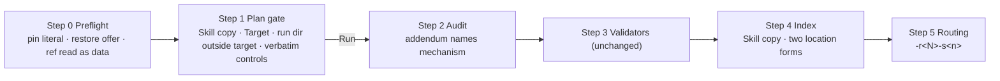

# Design: `/akili-security` follow-up — pin literal, five safety advisories, Windows decision

## 1. Document Control

| Field | Value |
|---|---|
| Spec Path | `changes/akili-security-followup` |
| Depth | Standard (compact) |
| Type | Change |
| Approval Mode | `gated` — presented with requirements and tasks at one specify gate (user instruction 2026-10-19) |
| Status | **Approved** at the specify gate, 2026-10-19 (Juan Carlos Cadavid), after judgment-day APPROVED (round 2) and gate adjustments GA-1…GA-7 (`judgment.md`) |
| Date | 2026-10-19 |
| Verified at | `5c944d0` — every citation below was run in this session against that commit |
| Requirements | `requirements.md` FR-1…FR-10, NFR-1…NFR-4 |

## 2. Executive Summary

The whole change is agent-instruction text plus the tests that pin it. The command keeps its six-step shape (Steps 0–5). It gains one pin literal, two plan fields (*Skill copy*, plus a richer *Target*), a verbatim upstream control list, a mechanism slot in the addendum, and a run-numbered slug. It loses the `--force` offer, both `git` invocations, and the in-target run-directory option. Docs and the `SKILL.md` AKILI section follow. Windows gets a documented lift gate and an upstream request draft, no code.

## 3. Architecture Overview

No step before **Run**, and neither Step 4 nor Step 5, launches `git` or any other target-configured program (FR-6). After Run, the skill's own phases may (accepted risk R-A).

## 4. Extended Directory Structure

| Path | Change |
|---|---|
| `.claude/commands/akili-security.md` | Steps 0–5, Error Handling, Verification Checklist (T1, T2) |
| `.claude/skills/security-audit/SKILL.md` | `## AKILI-SPECS Integration` slug row only (T3) |
| `docs/skills/security-audit.md` | Integration slug row, *Platform support*, *Re-sync procedure* (T3) |
| `docs/commands/akili-security.md`, `docs/flow.md`, `README.md`, `docs/commands/README.md` | Restatements (T4) |
| `test/akili-security-command.test.js` | Changed sentences re-pinned; new cases (T1, T2) |
| `test/security-audit-skill.test.js` | Pin-sync case (T1) |
| `CHANGELOG.md` | `[Unreleased]` entry (T5) |
| `docs/specs/changes/akili-security-followup/upstream-request.md` | Draft for the user to file; not packaged (`package.json` `files` has `!docs/specs`) (T3) |

## 5. Data Model

### 5.1 Plan fields (Step 1 table)

| Field | Before | After |
|---|---|---|
| Target | Root, source ref + dirty flag | Root (nearest ancestor of the cwd holding `.git`); branch from `HEAD`, or the commit itself for a detached `HEAD`; commit when it resolves, else `not determined`; dirty state asked of the user, `not determined` when declined |
| Skill copy | — | `pinned`, or `foreign — <resolved path>, commit <found>` |
| Run directory | default or `--out` (in-target if ignored) | default or `--out`; neither inside the target nor containing it |
| Disclosure | "outside the target or in the ignored directory chosen below" (`:56`) | "outside the target" only |

### 5.2 Index header (Step 4)

Adds `Skill copy: pinned | foreign — continued by <approver>`; the source-ref field may read `not determined` for commit or dirty. Run-path forms shrink to two: `~/…` and `<external>/run-<N>`.

### 5.3 `run-metadata.json`

`source_ref` carries the same values as the plan, `not determined` included (FR-6 AND IT MUST). No new key.

## 6. API Design

Not applicable — no runtime interface. The command's "interface" is its invocation line (unchanged) and the printed routing command (FR-8).

## 7. Backend Module Design — command text by step

| Step | Edit | FR |
|---|---|---|
| 0.1 | State the 40-char pin; compare `source` with it; a commit mismatch is a foreign copy and the offer names the path, the commit found and the pin. Offer: **continue with that copy**, **restore the pinned copy**, or **stop**. Restore only when the skills-root entry, its resolved path and the destination are each neither inside the target nor an ancestor of it (FR-7's two-way rule): move the entry itself — the symlink when it is one, never its target — to a fresh `~/security-audit-skill/foreign-copy-<YYYY-MM-DD>-<n>/`; re-run the `akili install` that owns that root with `--skills-only`, no `--force`, no `npx` command — name the root's flag (`--tool claude` for `~/.claude/skills`, `--tool codex --codex-skills-target <dir>` for `~/.agents/skills` (without `--tool codex` the flag is ignored and the install targets `~/.claude` — judgment G-8), `--claude-target <dir>` for another Claude root) or ask the user which install owns it; then end the command and tell the user to re-run `/akili-security` in a fresh session (the foreign body is already loaded, so no in-session re-check is trusted); if the install exits non-zero, report the exit code and where the moved entry now is, then end. Otherwise **continue** or **stop** only | FR-1, FR-2 |
| 0.3 | Replace `git status --porcelain` with: target root = nearest ancestor of the cwd holding `.git`; `.git` must be a real directory (not a symlink, not a `gitdir:` file — a linked worktree or submodule reads `not determined` for branch and commit); read files as **untrusted data**, each one only when its real path (every component resolved) is inside the real path of `<target>/.git` and it is a regular file within the cap (64 KiB; `packed-refs` 1 MiB); `HEAD`: 40/64 lower-case hex → that commit (detached); `ref: refs/heads/<b>` with `<b>` in a safe charset and no `..` component → the loose ref file, else the exact `packed-refs` line for it; anything else (reftable stub, tag ref, symlink, oversize, path leaving `.git`) → `not determined`. Only values passing the hex or charset check reach the plan, metadata or index. Dirty state is asked at the plan gate. Repo name from the directory name. Add: "Never run git in the target before **Run**, and never in Steps 4 and 5" | FR-6 |
| 1 table | *Target*, *Disclosure*, and new *Skill copy* rows (§5.1) | FR-3, FR-6, FR-7 |
| 1 run dir | Accept only a run directory whose real path (of the nearest existing ancestor, symlinks resolved) is neither inside the target's real path nor an ancestor of it; refuse the default when HOME is inside the target; remove the `git check-ignore` sentence, the in-target branch, and the "An in-target run directory is never under `docs/specs/`" clause | FR-7 |
| 1 exec gate | Replace the paraphrase with upstream's lead clause ("an OS-enforced sandbox that provides all of these controls", `SKILL.md:41`) and its four bullets verbatim (`:43-46`), plus a requirement that the mechanism also honours the exposure rule of `:48` | FR-4 |
| 2 addendum | `Execution policy for this run: <static-only \| sandboxed-approved via <mechanism>>` | FR-5 |
| 2 metadata | `source_ref` carries `not determined` values as such (§5.3) | FR-6 |
| 4 | Header gains *Skill copy*; location table drops the in-target row (two forms) | FR-3, FR-7 |
| 5 | Slug `bugfix/security-<YYYY-MM-DD>-r<N>-s<n>` at both sites (`:129` routed row, `:132` printed command); construction rule (`:135`) names date, `N`, `S-n` | FR-8 |
| Error Handling | Foreign-copy row names the restore offer; `--out` row reads "inside the target or containing it (ignored or not), or under `docs/specs/`" | FR-2, FR-7 |
| Checklist | The command checklist's own IDs (from `changes/akili-security`, not this spec's): FR-2 (pin literal, restore without `--force`, command ends after restore), FR-4 (quoted controls), FR-6 (outside target only), FR-8 (two forms), FR-10 (`-r<N>`) items reworded; add "no git command ran in the target before Run or in Steps 4–5" (no backticks, so the shared grep reads 0 hits) | FR-1…FR-8 |

Line budget: 174 today, ~+20 → ~194 ≤ 230 (NFR-1).

## 8. Frontend / UX Component Architecture

Not applicable — no UI.

## 9. Shared Contracts or Package Extensions

| Contract | Change |
|---|---|
| Routing slug (read by `/akili-propose` as a path) | New shape `-r<N>-s<n>`; still `[a-z0-9-]`, still a `bugfix/` path — no reader change. Earlier routed paths stay valid |
| Re-sync procedure (`docs/skills/security-audit.md`) | Step 4 adds "the command's Step 0.1 pin"; new step: *Windows gate* — after re-sync, if the validators no longer require `O_NOFOLLOW`/`O_NONBLOCK`, keep the preflight stop; push a candidate branch that removes the `win32` short-circuit from `NO_FOLLOW_UNAVAILABLE` (`test/security-audit-skill.test.js:93-96`); only when its non-fallback cases pass on both Windows CI legs (Node 18 and 22) remove the stop, in the change that merges that branch |

## 10. Design Decisions

| ID | Decision | Rejected | Why |
|---|---|---|---|
| DD-1 | Pin literal in Step 0.1 **and** a pin-sync test in `test/security-audit-skill.test.js` reading the command, `SKILL.md` and `UPSTREAM_SHA` | Literal only | A literal without a test drifts at the next re-sync, the exact W-2 case (KZ-002 class) |
| DD-2 | Restore = move the skills-root entry (the link itself if a link) to `~/security-audit-skill/foreign-copy-<date>-<n>/`, then skip-existing `--skills-only` install, then end the command (fresh session re-checks); not offered when the entry or its resolved path is inside the target | `--force`; a new `--skill` CLI flag; moving the link target; moving within the skills root | `--force` overwrites everything (A-7); a flag is installer scope (NFR-3); moving a link target leaves a dangling link that the install skips (judgment J-2); a copy left inside a skills root keeps `name: security-audit` and may still load; moving a copy inside the target modifies the target |
| DD-3 | Index records `foreign — continued by <approver>`, never the path | Path in the index | Step 4 forbids absolute/home paths |
| DD-4 | Quote the four upstream bullets verbatim | Paraphrase; pointer only | Paraphrase is how A-5 happened; a pointer alone leaves the gate list unreadable at the gate |
| DD-5 | No `git` in the target before Run or in Steps 4–5; ref read as untrusted data, admitted only through the hex/charset filter (P-13); dirty state asked at the gate (approved deviation from `SKILL.md:60`) | `-c core.fsmonitor=false`; config denylist; `git` after Run | P-2: `check-ignore` launches fsmonitor too; filters and other launchers remain; after Run is still target-controlled execution under static-only |
| DD-6 | Run directory outside the target only (Q-1, approved) | `check-ignore` after Run; parse `.gitignore` | Both rejected at approval: first runs `git` in the target, second is incomplete. Stricter than upstream `SKILL.md:59`, which AKILI may tighten (`SKILL.md:212`, "never relax"); the containment check is two-way (judgment J-14) |
| DD-7 | `-r<N>` in slug | Time suffix | Deterministic, already in the run path |
| DD-8 | Windows: no wrapper; re-sync gate + upstream draft | Shim (option b) | P-11: upstream states no race-safe fallback exists; approved at proposal |

### Reversion challenges (Step 2.3)

Three DDs take away delivered behaviour. The question "what does removing this break?" was put to both judgment-day judges (`judgment.md`); their answers, consolidated:

| DD | Removes | What the removal breaks | What reverting the DD would break | Addressed by |
|---|---|---|---|---|
| DD-2 | `akili install --force` offer | The one-line full refresh | Re-opens A-7 (every file on every root overwritten); dropping the move makes restore a no-op (skip-existing keeps the foreign files) | The user may still run `--force` themselves; the move is load-bearing and now handles links |
| DD-5 | `git status` dirty detection | Automatic dirty flag (`SKILL.md:60`) | Re-opens the pre-gate fsmonitor launch (P-2) | Dirty state asked at the gate; `not determined` recorded honestly (approved deviation) |
| DD-6 | In-target ignored run directory | Hosts with no writable path outside the target | Needs `git check-ignore` (P-2) or an incomplete `.gitignore` parser; re-introduces the repo-relative form and tests `:207-209`, `:272-275` | `--out` to any external path; tests re-pinned in T1/T2 |

## 11. Budget (Step 2.4 — tripwire for `/akili-execute`)

| Measure | Estimate | Escalate past |
|---|---|---|
| Tasks | 5 | 6 |
| LOC authored | ~270 (command ~55 changed, tests ~100, docs ~50, draft ~50, CHANGELOG ~15 = 270; closure text excluded) | ~350 |
| Review rounds | 12 (T1, T2 `lenses`: 3 each; T3–T5: 2 each) | 14 |

Depth check: five tasks at ~270 LOC matches Standard (compact); no level change.

## 12. Premise Ledger

Count: 18 verified · 0 `UNVERIFIED`.
Blast-radius triggers: `consumer` fires (the slug, run-path forms and control list are contracts read by docs and tests); `live-path` none — no user-action dispatch code, the change is instruction text; `shared-state` none — no state, service or lifecycle shared by components.

| # | Claim | Class | Citation (as run) | Verified at | If false | Settled by |
|---|---|---|---|---|---|---|
| P-1 | The command never states the pin | existence | `grep -c c1c8a8c .claude/commands/akili-security.md` → `0` | 5c944d0 | W-2 already fixed → FR-1 drops to the test only (Low) | — |
| P-2 | `git status` **and** `git check-ignore` launch a `core.fsmonitor` program from the repo's `.git/config` | data-env | Scratch repo, `git config core.fsmonitor <script that touches FSM_RAN>`; `git status --porcelain` → `FSM_RAN` created; removed, then `git check-ignore -q out` (exit 1) → `FSM_RAN` created again. git 2.38.0, darwin | 5c944d0 | If `check-ignore` were safe, Q-1 could have kept in-target dirs — DD-6 already approved on other grounds (Low) | — |
| P-3 | A skip-existing `--skills-only` install restores a moved-aside skill directory and preserves every other existing file | data-env | `HOME=$T node bin/akili.js install --tool claude --claude-target $T/c --skills-only` → exit 0; wrote `marker` into `$T/c/skills/tdd/SKILL.md`; `mv $T/c/skills/security-audit $T/moved`; same install → exit 0, "26 existing file(s) were preserved", `security-audit` has 19 files, `diff -r` against `.claude/skills/security-audit` → identical, `tdd/SKILL.md` still `marker`. Node v22.12.0 | 5c944d0 | DD-2 restore path fails → needs another mechanism (High) | — |
| P-4 | In a main checkout `HEAD` and the branch commit can be read as files inside `.git`; a linked worktree's `.git` is a `gitdir:` file pointing outside it (so it reads `not determined` under DD-5) | data-env | Main checkout `/Users/jcadavid/Development/sdd-jc-methodology`: `test -d .git` → dir; `cat .git/HEAD` → `ref: refs/heads/master`; loose ref (it wins over `packed-refs`, whose `master` line is stale here) → `3ed88ce70f62…` = `git -C … rev-parse --short HEAD` → `3ed88ce`. This worktree: `cat .git` → `gitdir: /Users/jcadavid/Development/sdd-jc-methodology/.git/worktrees/security-followup` (outside the worktree) | 5c944d0 | DD-5 ref resolution text wrong (Low) | — |
| P-5 | No per-skill install flag exists | existence | `node bin/akili.js` help text `bin/akili.js:216-250`: `--skills-only` (`:233`) is the narrowest filter; no `--skill` | 5c944d0 | DD-2 could use the flag instead (Low) | — |
| P-6 | Consumers of the slug, run-path forms, control list and `--force` offer, outside spec folders | consumer | `grep -rn -E "s<n>\|ignored in-target\|ignored directory inside\|inside the target\|check-ignore\|Repo-relative\|repo-relative\|akili install --force\|four (upstream )?controls" README.md docs .claude test CHANGELOG.md \| grep -v "^docs/specs/"` → `README.md:800`, `docs/flow.md:154,292`, `docs/commands/akili-security.md:28,39,48,60`, `docs/skills/security-audit.md:28`, `SKILL.md:59,207`, command `:37,59,61,118,129,132,150,160,164`, `test/akili-security-command.test.js:77,78,145,146,203,204,205,211,275,308,310,311`, `CHANGELOG.md:50,126,305`; plus `grep -rn -E "outside the target by default\|\(outside the target" README.md docs .claude test` → `README.md:589,800`, `docs/flow.md:154,292`, `docs/commands/README.md:20` | 5c944d0 | A missed restatement ships the old rule (High — owned by FR-10 sweep) | — |
| P-7 | Of P-6's hits, these are **not** edited: `SKILL.md:59` (upstream body, NFR-2 — AKILI tightens it at the command); `CHANGELOG.md:50` (released 2.33.0 entry); `CHANGELOG.md:126,305` (unrelated: persona and installer entries) | other | `sed -n 126p CHANGELOG.md`, `sed -n 305p CHANGELOG.md` read; `CHANGELOG.md:50` sits under `## [2.33.0]` (`grep -n "^## " CHANGELOG.md` → `:46`) | 5c944d0 | An edit to a released entry or upstream body (Low) | — |
| P-8 | `SKILL.md`'s AKILI section allows tightening and forbids relaxing | other | `SKILL.md:212` "AKILI gates wrap the upstream workflow and never relax its safety rules" (`:211` is blank — corrected at judgment J-8) | 5c944d0 | DD-6 would need upstream-fidelity review (Low) | — |
| P-9 | Upstream asks for dirty state in `source_ref`; no validator reads `run-metadata.json` | data-env | `SKILL.md:60` "the reviewed commit and whether the worktree is dirty"; `SKILL.md:94` field list; `grep -n "run-metadata" .claude/skills/security-audit/validate-*.cjs` → 0 hits | 5c944d0 | A `not determined` value would fail a validator (Low) | — |
| P-10 | Upstream states Node has no race-safe fallback for no-follow reads | other | `validate-coverage-ledger.cjs:724` "Node exposes no race-safe fallback on these platforms, so reject all inputs." | 5c944d0 | Option (b) reconsidered — out of this spec (Low) | — |
| P-11 | Command is 174 lines; cap 230 | data-env | `wc -l .claude/commands/akili-security.md` → `174`; `test/akili-security-command.test.js:396` `lines <= 230` | 5c944d0 | NFR-1 at risk (Low) | — |
| P-12 | P-3's restore behaviour holds on the CI matrix's other Node majors | data-env | P-3's exact sequence re-run with `~/.nvm/versions/node/v18.20.8/bin/node` and `v22.23.3`: each → exit 0, 19 files, `diff -r` identical, `tdd/SKILL.md` still `marker` | 5c944d0 | DD-2 offer wrong on one Node (Low) | — |
| P-13 | Reading `HEAD`'s ref as a path without a filter follows `..` out of the git directory and returns any file's content | data-env | Scratch: `mkdir -p t/.git/refs/heads`; `secret.txt` ("SECRET_TOKEN=abc") beside `t`; `t/.git/HEAD` = `ref: refs/heads/../../../../secret.txt`; from the parent, `cat "t/.git/$(sed 's/^ref: //' t/.git/HEAD)"` → `SECRET_TOKEN=abc` (first reproduced by judge B; re-run 2026-10-19 with the `mkdir` step — without it `No such file or directory`) | 5c944d0 | F-1 filter unnecessary (Low) — the filter stays as defence in depth | — |
| P-14 | No test checks the vendored files byte for byte | existence | `grep -n "^test(" test/security-audit-skill.test.js` → 6 tests at `:65,:73,:85,:99,:110,:116` (file set, frontmatter, LICENSE, two smokes, install); `git diff --quiet 5c944d0 -- .claude/skills/security-audit ':!*SKILL.md'` → exit 0 (the NFR-2 gate works locally) | 5c944d0 | NFR-2 gate redundant (Low) | — |
| P-15 | Further consumers of removed text: test `:207-209` pins "An in-target run directory is never under `docs/specs/`"; test `:272` is titled "three location forms"; command `:56` *Disclosure* says "or in the ignored directory chosen below" | consumer | `sed -n 207,209p test/akili-security-command.test.js`; `sed -n 272p …`; `sed -n 56p .claude/commands/akili-security.md` | 5c944d0 | A stale test or row ships (High — owned by T1/T2 Consumers) | — |
| P-16 | `NO_FOLLOW_UNAVAILABLE` short-circuits on `win32` regardless of the constants | location | `test/security-audit-skill.test.js:93-96` | 5c944d0 | Windows gate could test in place (Low) | — |
| P-17 | The skill itself may use `git` after Run (remote for repo name, history hunting) | other | `SKILL.md:58` "from the directory or local Git remote"; `ATTACK-CLASSES.md:103` "anything interesting in the git history?" | 5c944d0 | FR-6 could cover all steps (Low) — scoped to before Run + Steps 4–5; R-A | — |
| P-18 | Moving a symlinked skills-root entry (the link itself) and re-running the `--skills-only` install restores a real, identical copy and leaves the link's target untouched | data-env | Scratch: copy moved to `$T/agents/skills/`, `ln -s` it at `$T/c/skills/security-audit`, `foreign` appended to its `SKILL.md`; `mv` the **link** to `$T/fc/`; `HOME=$T node bin/akili.js install --tool claude --claude-target $T/c --skills-only` → exit 0, entry is not a link, `diff -r` against `.claude/skills/security-audit` identical, link target's `SKILL.md` still ends `foreign`. Node v22.12.0 | 5c944d0 | DD-2 link path wrong (High) | — |
