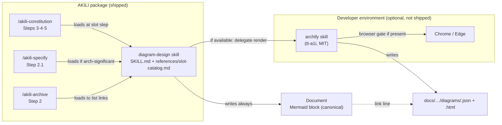

# Design: `diagram-design` — Interactive Methodology Diagrams via Archify

## 1. Document Control

| Field | Value |
|---|---|
| Spec Path | `changes/archify-diagrams` |
| Depth | Standard (re-checked in §11) |
| Status | Draft — awaiting the specify approval gate |
| Date | 2026-10-18 |
| Requirements | `requirements.md` (FR-1 … FR-10, NFR-1 … NFR-5) |
| Verified at | `854547f` (AKILI) · `208acba` (Archify v3.2.0) |
| Skills applied | `brainstorming`, `cognitive-doc-design`; `software-architect` not loaded — no new module, integration, or NFR impact on a running system (the change is rules text plus one skill) |

## 2. Executive Summary

One AKILI-authored skill sits between the commands and Archify. Commands know *that* a step has diagram slots; the skill knows *which* slots, *where* their files live, and *how* to degrade; Archify alone knows *how* to render. Mermaid stays inline as the source of truth, so every document is complete on every host.

## 3. Architecture Overview



Legend: solid boxes in *AKILI* ship in the npm package; boxes in *Developer environment* are never shipped; the dotted edge is the one-line link written under the Mermaid block.

## 4. Extended Directory Structure

```text
.claude/skills/diagram-design/
├── SKILL.md                    # contract: when to load, availability check, Mermaid rule, render+fallback, guard-rails
└── references/
    └── slot-catalog.md         # FR-2 table: document · section · slot · condition · Archify type · Mermaid type · question
docs/skills/diagram-design.md   # human-facing page
```

Target-project layout the skill produces (not in this repo):

```text
docs/diagrams/<doc>-<slot>.json|.html            # baseline: prd-, ux-, trd-
docs/specs/<spec-path>/diagrams/<slot>.json|.html
docs/**/diagrams/.gitignore → *.finalize.json, *.finalize-summary.json, *.delivery.json, *.browser-check.json
```

## 5. Data Model

### 5.1 Slot catalog row

| Field | Example |
|---|---|
| Document · section | `docs/trd/trd.md` · Architecture Overview & Decisions |
| Slot id | `trd-c4-container` (kebab, stable — it is the file stem) |
| Condition | `always` · or a testable predicate (FR-2 table) |
| Archify type | `architecture` |
| Mermaid type | `flowchart` (C4 shapes via subgraphs + legend) |
| Question answered | "What runs separately, and how do the parts talk?" |

Type mapping used by the catalog (Archify ↔ Mermaid, from Archify `SKILL.md:77–84`): `architecture`/`workflow` ↔ `flowchart`; `sequence` ↔ `sequenceDiagram`; `lifecycle` ↔ `stateDiagram-v2`; `erd` ↔ `erDiagram`; `tree` ↔ `flowchart TD`.

### 5.2 Link line (FR-4)

One line directly under the Mermaid block: `Interactive view: [<slot title>](<relative path>.html) — rendered with Archify (tt-a1i, MIT)` plus, when the browser gate was skipped, the suffix ` · browser check not run`. Fixed wording so FR-6's removal and any audit can find it with one grep (`Interactive view:`).

### 5.3 Availability check (FR-4, NFR-3)

Available = the host lists an `archify` skill in the session, **or** an `archify/SKILL.md` exists under one of: `.claude/skills/`, `~/.claude/skills/`, `.agents/skills/`, `~/.agents/skills/`, `.opencode/skills/`, `~/.config/opencode/skills/` (Archify's documented roots, `README_EN.md:443–445`). Checked once per command run. Antigravity has no documented root → Mermaid only.

## 6. Interfaces (Command ↔ Skill ↔ Archify)

| Boundary | Contract |
|---|---|
| Command → skill | One conditional line: "load `diagram-design` and fill the <step> slots whose condition holds". The command never names a slot type, path, or Archify |
| Skill → Archify | "Follow the `archify` skill's own authoring and delivery procedure for type T, with Mermaid block M as input, writing to path P." No CLI flag, gate name, or repair rule restated (FR-7, R7) |
| Archify → skill (outcome) | Three outcomes read from Archify's report: all gates passed → link; browser check skipped → link + suffix; failed after Archify's repair limit → delete partial output, no link (FR-5) |
| Skill → command report | One line listing slots left Mermaid-only and why |

## 7. Skill Module Design (`SKILL.md` sections)

| # | Section | Content | FR |
|---|---|---|---|
| 1 | When to load | The five wired steps; never outside them | FR-8 |
| 2 | Slots | Read `references/slot-catalog.md`; fill only slots whose condition holds | FR-2 |
| 3 | Mermaid first | Inline block + legend in the slot's section, always | FR-3 |
| 4 | Interactive view | Availability check; delegate to Archify; paths; link line; `.gitignore` for receipts; reuse slot paths | FR-4 |
| 5 | Outcomes & fallback | Three outcomes; never block; report line | FR-5 |
| 6 | Keep in sync | Mermaid changed → re-render, or remove link + files | FR-6 |
| 7 | Guard-rails | Explainer, install/update, notice once, brand marks, no flags | FR-7 |
| 8 | Credit | Archify by tt-a1i, MIT, repository URL; optional install is the user's choice | FR-1, FR-9 |

## 8. Shared Contracts / Package Extensions

| Surface | Change |
|---|---|
| `.claude/commands/akili-constitution.md` | +1 line in Step 3, Step 4, Step 5 |
| `.claude/commands/akili-specify.md` | +1 line in Step 2.1, beside the UI/animation conditional lines |
| `.claude/commands/akili-archive.md` | Step 2 summary list gains item 11 "Diagrams" (links + stale baseline slots as follow-ups) |
| `.claude/skills/software-architect/references/views-documentation.md:14` | Sentence extended with the pointer to `diagram-design` |
| `docs/skills/governance.md` | `conditional` row + env-provided example |
| `docs/skills/README.md`, `docs/skills/diagram-design.md`, `README.md`, `docs/cli.md` | Inventory row, page, install note, 24→25 |
| `test/install-cursor.test.js` | 199 → real count; comments 210/24/35 → real counts |
| `CHANGELOG.md` | `[Unreleased]` entry (patch or minor decided at release, not here) |

## 9. Design Decisions

| ID | Decision | Rationale | Rejected |
|---|---|---|---|
| DD-1 | Binding `conditional`, original authorship | Loaded only at diagram steps; no upstream file adapted (P-3) | `core` — the PRD/UX slots are themselves conditional; `stack` — commands must name the slots |
| DD-2 | Slot catalog in `references/`, not in command text | Keeps commands tool-agnostic and one line each; NFR-2 | Inline tables in three commands (duplicated, drifts) |
| DD-3 | Commit `.json` + `.html`, ignore receipts | The HTML is the shareable artifact (proposal Q1, default chosen here; **user may overrule at this gate**); receipts are ~90 KB per render and reproducible (P-8) | Gitignore HTML — interactive views would never reach teammates |
| DD-4 | Fixed `Interactive view:` link line | One grep finds every view for FR-6 sync and future audit | Free-form link prose |
| DD-5 | Skill names outcomes, never Archify flags | Archify ships ~daily (PR #1002); restated flags go stale (R7) | Copy `finalize` command lines |
| DD-6 | **No `/akili-archive` Step 3 write.** Stale baseline slots are listed in the summary's follow-ups (Step 2) | Step 3 items 2–4 must emit a typed pending item off the apply-capable branch; the `Kind` set is closed (P-10) and `trd-adr` allocates an ADR number. Adding a `Kind` walks every kaizen consumer — out of proportion here. **Deviation from proposal §5 row "TRD sync refreshes the affected baseline diagram"** — recorded in the proposal | New `Kind: diagram-sync`; folding into `trd-adr` |
| DD-7 | Availability by host skill list **or** known roots (§5.3) | Hosts differ in whether skills are listed; file check is cheap and read-only | Running Archify's `doctor` (Archify itself says not to before a candidate, `SKILL.md:37`) |
| DD-8 | Explainer mode suppressed inside AKILI | It writes to global rules files (Archify `SKILL.md:137`); AKILI never edits a user's global config | Allow with confirmation |

**Reversion challenge (Step 2.3):** no DD removes, disables, or inverts delivered behaviour — Mermaid stays the default (`views-documentation.md:14` is extended, not replaced). Challenge not triggered.

Active Lessons applied: **KZ-002** → FR-9 CHANGELOG quote-check and T6 Disqualifier; **KZ-changes--gate-falsifiability-2** → coverage map at clause level (tasks.md §3); **KZ-changes--kaizen-loop-closure-2** → phrase-family sweep of "24 packaged" in T6; **KZ-changes--leader-brief-contract-2** → every count below was run, not predicted.

## 10. Premise Ledger

Count: 12 verified · 1 `UNVERIFIED` (High 0 · Low 1).
Blast-radius triggers: `consumer` fires (the packaged skill count and the archive summary list are read elsewhere); `live-path` none apply — the design names no runtime user action in code, only command prose steps; `shared-state` none apply — no state, service, or lifecycle is changed.

| # | Claim | Class | Citation (as run) | Verified at | If false | Settled by |
|---|---|---|---|---|---|---|
| P-1 | The TRD's only required diagram is "C4 Context + Container with legends" | location | `.claude/commands/akili-constitution.md:256` | `854547f` | FR-2 TRD rows re-based — Low | — |
| P-2 | No command mentions diagram, flowchart, or mermaid | existence | `grep -rn -i "diagram\|flowchart\|mermaid" .claude/commands` → 0 hits | `854547f` | T2–T4 would edit existing lines instead of adding — Low | — |
| P-3 | Governance forbids vendoring a tool-served skill; original-authorship variant uses `inspired-by` | other | `docs/skills/governance.md:17`, `:23`, original-authorship paragraph | `854547f` | DD-1 frontmatter changes — Low | — |
| P-4 | Installer copies each skill directory recursively to every target | data-env | `bin/akili.js:50` `copyTreeSync`, recursion `:66`, call `:670` | `854547f` | An installer task is needed — High | — |
| P-5 | Packaged skill count is pinned by a test and by docs | consumer | `grep -rnE "\b(24\|199\|210\|35)\b.{0,40}(skill\|files)" README.md docs/*.md docs/skills/*.md test/*.js bin/*.js .claude/commands/*.md AGENTS.md` → `test/install-cursor.test.js:216,232,246,340,387`; `docs/cli.md:183,195,216`; literal assert at `test/install-cursor.test.js:245` | `854547f` | `npm test` red; doc counts false — High | — |
| P-6 | Archify without a browser still writes the HTML, reports `browser-check:skipped`, exits 2; with Chrome all four gates pass, exit 0 | data-env | Scratch run, Node v22.12.0, macOS, Archify `208acba`: `ARCHIFY_CHROME=/nonexistent node bin/archify.mjs finalize workflow cand.json out/wf.html --quality showcase` → `gates validate:pass deliver:pass check:pass browser-check:skipped`, exit 2; same without the override → `browser-check:pass`, exit 0. Not exercised by AKILI CI (matrix Node 18/22 runs no Archify) | `208acba` | FR-4 browser-skipped scenario re-worded — Low | — |
| P-7 | Archify lets the caller name the output location | data-env | Archify `SKILL.md:14` "Unless the user names another location…" | `208acba` | DD-3 paths unenforceable; slots live under `.archify/` — High | — |
| P-8 | Receipts are four sidecar JSONs beside the HTML; HTML ≈ 812 KB | data-env | `ls out2/` in the P-6 run → `wf.browser-check.json`, `wf.delivery.json`, `wf.finalize-summary.json`, `wf.finalize.json`, `wf.html` (830 859 B) | `208acba` | `.gitignore` patterns in FR-4 change — Low | — |
| P-9 | Archify reads Mermaid as input and re-authors fresh JSON | data-env | Archify `SKILL.md:77–84` "## Mermaid input" | `208acba` | DD-5 needs an explicit JSON-authoring step — Low | — |
| P-10 | Archive Step 3 items 2–4 must emit typed pending items off the apply-capable branch, from a closed `Kind` set | other | `.claude/commands/akili-archive.md:131`; `.claude/skills/kaizen/SKILL.md:196–203` | `854547f` | DD-6 could write in Step 3 — Low | — |
| P-11 | `/akili-specify` Step 2.1 hosts the conditional skill lines (UI, animation) | location | `.claude/commands/akili-specify.md:213–220` | `854547f` | T3 site moves — Low | — |
| P-12 | Archive summary is a numbered list 1–10; no other command or test parses it | consumer | `.claude/commands/akili-archive.md:114–123`; `grep -rn "archive-summary" .claude/commands .claude/skills .claude/templates bin test` → only `akili-archive.md:109`, `:201` | `854547f` | Item 11 breaks a reader — Low | — |
| P-13 | A host-listed skill name `archify` is how Archify is detected in Claude Code/Codex/OpenCode/Cursor sessions | data-env | `UNVERIFIED — confirm at source before relying on it` | — | §5.3 falls back to the root check only — Low | T7 step 1 (executed walkthrough in Claude Code with Archify installed in a scratch `.claude/skills/`) |

`consumer` rows P-5 and P-12 are copied into the `Consumers` field of T6 and T4.

## 11. Budget (Step 2.4)

| Measure | Estimate |
|---|---|
| Tasks | 7 |
| LOC | ≈ 300 (skill ≈ 180, wiring ≈ 15, docs/governance ≈ 80, test + CHANGELOG ≈ 25) |
| Review rounds | 12 (2 per rules-text task T1–T4, T6; 1 for T5; 1 for T7) |

Depth check: 7 tasks / ~300 LOC fits **Standard**. No change.
