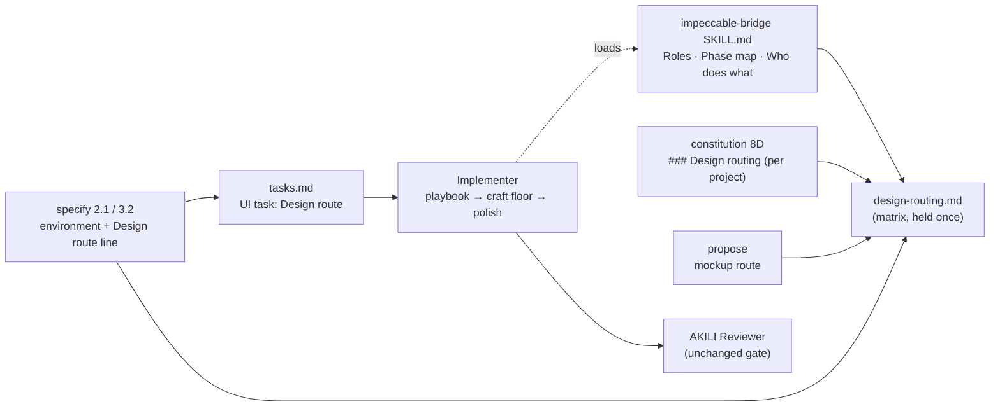

# Design: Design Skill Routing — Impeccable builds, and every design skill has a stated job

## 1. Document Control

| Field | Value |
|---|---|
| Spec Path | `changes/design-skill-routing` |
| Depth | Standard (re-checked in §12) |
| Type / Deliverable | Change / `software` |
| Approval Mode | `gated` |
| Status | Draft 2026-11-01, written ahead of the Phase 1 gate on the relay instruction (see `requirements.md` §1). **Phase 2 gate: pending JC.** Judgment-day ran on this draft — `judgment.md` |
| Requirements | `requirements.md` (FR-1 – FR-14, NFR-1 – NFR-7), Phase 1 gate pending JC |
| Verified at | `883dfa9` |
| Skills applied | `brainstorming`, `cognitive-doc-design`, `impeccable-bridge` (read as the subject), `software-architect` not loaded — no runtime, data or topology change; `diagram-design` — one diagram slot (§13) |

## 2. Executive Summary

One new shipped file — `.claude/skills/impeccable-bridge/references/design-routing.md` — holds the **Design Routing Matrix**, the **expertise cards**, the **environment classification**, the **build route**, the **polish depth**, the **motion split** and the **mockup route**. Everything else points at it:

- The bridge's *Roles*, *Who does what in each state* and *Phase map* change their build rows from "craft floor" to "playbook → craft floor → polish", and point at the reference.
- `/akili-specify` classifies the environment per screen and writes a **`Design route:` line** into every UI task's Scope. That line is how the build route reaches the Implementer — no persona is edited.
- `/akili-propose`, `/akili-seo` and `/akili-constitution` Step 8D change one rule each.
- Repo `AGENTS.md` gets `## Design Skills`; docs, three adapted skills and the CHANGELOG follow; one contract test file guards it all.

## 3. Architecture Overview

Delivery path of the build route (the live path, P-13): `tasks.md` UI task → its skill list names `impeccable-bridge` and its Scope carries `Design route:` → Leader passes skills (overridable, `leader.md` *Delegation Discipline*) and the task scope → Implementer loads the bridge → bridge *Phase map* build row → matrix *Build route* → the named playbook. Because the Leader may narrow a task's skills, the `Design route:` line also lives in the task's Scope and Done criteria, which the Leader does not edit and the Reviewer checks.

## 4. Extended Directory Structure

| Path | Change |
|---|---|
| `.claude/skills/impeccable-bridge/references/design-routing.md` | **New.** The matrix (§8) |
| `.claude/skills/impeccable-bridge/SKILL.md` | *Roles* (pointer, `gsap-animation` row, stack layers line), *Who does what* `/akili-execute` row, *Phase map* build row, description trigger words |
| `.claude/commands/akili-specify.md` | Step 2.1 (environment class; animation rule), Step 3.2 (skill inventory sentence; Preferred UI/UX skill rule) |
| `.claude/commands/akili-propose.md` | Mockup Fallback bullets |
| `.claude/commands/akili-seo.md` | Skill preference for UX/UI recommendations |
| `.claude/commands/akili-constitution.md` | Step 8D item 4 |
| `.claude/skills/ui-ux-pro-max/SKILL.md`, `gsap-animation/SKILL.md`, `frontend-design/SKILL.md` | AKILI integration sections point at the matrix |
| `AGENTS.md` | `## Design Skills` replaces the two UI/animation bullets of `## Skill Usage` |
| `docs/flow.md` §9, `docs/overview.md` (skill rows), `docs/skills/{impeccable-bridge,frontend-design,stitch-design,ui-ux-pro-max,gsap-animation}.md`, `docs/commands/{akili-constitution,akili-propose,akili-specify}.md` | Match the matrix |
| `CHANGELOG.md` | `Unreleased` entry |
| `test/design-skill-routing.test.js` | **New** contract tests (§7.3) |

Not touched: `.claude/skills/impeccable/**` (NFR-2), `.claude/templates/*.md` personas (NFR-6), `bin/`, `scripts/`.

## 5. Data Model

### 5.1 `Design route:` line (one per UI task, in Scope)

| Field | Values | Source |
|---|---|---|
| Playbook(s) | One or more Impeccable commands from the build/refine/enhance/fix families; `frontend-design` when E0 | `design.md` of the spec |
| Environment | `E0` · `E1` · `E2` · `E3` | Step 2.1 classification |
| Page mode | Persuade · Operate · Read · Experience | existing page-mode record |
| Polish | `full` (Persuade, Experience) · `light` (Operate, Read) | derived from page mode (D2) |
| Motion | `none` · `animate → CSS/WAAPI` · `animate → <project library>` · `animate → gsap-animation` | motion split (§8.5) |

Done criteria of the task carry: *`execution.md` records the playbook(s) run, the polish depth and its result, and — when a playbook ran a finish review — its disposition and whether it ran as a subagent or inline.*

### 5.2 `### Design routing` block (project `AGENTS.md`, under `## Skill Map`)

Fields: environment class(es) with evidence · design lead (`impeccable` via `impeccable-bridge`, or the E0 fallback) · implementation layers (the Skill Map stack skills that implement UI) · motion library (detected or `none`) · mockup route (picker first; Stitch on request; MCP availability is per developer) · one line pointing at the matrix by name. No matrix rows.

## 6. API Design

None — no CLI, flag or file-format change.

## 7. Backend Module Design (rules text and tests)

### 7.1 Environment classification (FR-2)

Evidence ladder, first match wins, per screen:

| Order | Evidence | Class |
|---|---|---|
| 1 | Bridge Step 0 skill source is `missing` | E0 |
| 2 | Screen platform is iOS, Android or adaptive (Impeccable's native references exist: `ios.md`, `android.md`, `adapt.native.md`, `audit.native.md`) | E3 |
| 3 | `docs/ux-ui/design.md` defines tokens/components, **or** the code has a component library or token layer forming a coherent identity (Impeccable's *Established world*) | E2 |
| 4 | None of the above | E1 |

A missing `DESIGN.md` is never evidence for E1 (FR-2). Recorded in the spec's `design.md` next to the page-mode inventory, with the evidence path.

### 7.2 Enumerated-value walk (new value sets)

The design adds two enumerations — environment class and polish depth — and widens one existing table (bridge *Who does what in each state*). Consumers of the bridge tables, each with what changes:

| Consumer (`grep -ln impeccable-bridge`) | Reads | Effect of this design |
|---|---|---|
| `akili-constitution` Step 4 | Step 0, Phase map `init`/`document` row | none; Step 8D gains the routing block (separate step) |
| `akili-specify` Step 2.1 / 3.2 | Phase map `shape` row; Who-does-what Step 2.1 row | records environment class; writes `Design route:` |
| `akili-propose` Visual Reference | Who-does-what propose row | picker first (row text unchanged; command order changes) |
| `akili-execute` (via task skill list) | Who-does-what execute row; Phase map build row | **changed**: playbook → craft floor → polish |
| `akili-test` detector suite | Who-does-what test row | none |
| `akili-validate` design gate | Who-does-what validate row | none — the validate critique/audit still runs after build-time polish |
| `akili-audit design` | Who-does-what audit row | none |
| `ui-ux-pro-max`, `frontend-design` SKILL | Roles | pointer to the matrix |

E0 and the existing three skill-source values: E0 is defined as `missing`; `vendored` and `user-installed` both map to E1–E3. No skill-source value falls through.

### 7.3 Tests — `test/design-skill-routing.test.js`

| Test | Asserts | Falsifier (input that turns it red) |
|---|---|---|
| Held once | Each matrix row signature (`\| **<activity>** \|` for the eight activities) appears in `design-routing.md` and in no other file under `.claude/`, `docs/` (excluding `docs/specs/`), `AGENTS.md`, `README.md` | Paste one matrix row into `akili-specify.md` |
| Skill set | The packaged design skills (fixed list of eight, cross-checked against `readdirSync('.claude/skills')`) = the expertise-card set = the `AGENTS.md` `## Design Skills` set | Remove `stitch-design`'s card |
| Card evidence | Each card's evidence `file → heading` resolves: file exists, heading present | Rename a cited heading in the card |
| No line pointers | Matrix and the new command text contain no `:<digits>` file-line pointers (KZ-005) | Write `animate.md:66` in a card |
| Stale phrasing sweep | Same walk as `impeccable-bridge.test.js` FR-11/FR-14; patterns: `Implementer loads Impeccable's craft floor`, `Craft floor before UI edits`, `Use \`frontend-design\`, \`ui-ux-pro-max\``, `Recommend generating the mockup with the \`stitch-design\``, `\`ui-ux-pro-max\` if available`, `load \`gsap-animation\` and read the reference file matching the task` | Restore any one of them |
| Wiring | `akili-specify` names `design-routing` and `Design route:`; bridge *Phase map* and execute row name the matrix; `akili-propose` places the picker before Stitch; `akili-seo` names `impeccable-bridge`; `akili-constitution` Step 8D names `### Design routing` | Revert any one edit |
| Governance | The new `Design route` rule paragraph in `akili-specify` and the Step 8D item name no stack skill except under a Skill Map deferral | Write `use shadcn-ui` in the rule |

Existing tests that must stay green and why: `impeccable-bridge.test.js` (bridge still names `ui-ux-pro-max`, `frontend-design`, `docs/ux-ui/design.md`; commands keep `impeccable-bridge`; `frontend-design` SKILL keeps `impeccable-bridge`), `impeccable-vendor.test.js` (no vendored byte changes), `diagram-design.test.js` (governance `conditional` row still starts with `ui-ux-pro-max` — this design does not edit governance), `docs-overview.test.js` (no skill added; overview rows kept in their inventory form).

## 8. Frontend / UX — the matrix content (`design-routing.md`)

### 8.1 Decision rule (top of the file, five lines)

1. **Impeccable decides what and why; the stack decides how.** Direction, composition, hierarchy, type, color, motion intent and copy come from Impeccable. Tokens and components are written in the project's stack, through the Skill Map's stack skills.
2. **One lead per activity.** Supporting skills give inputs; they do not give rules.
3. **The environment picks the column, the activity picks the row** (§8.2, §8.3).
4. **Direction is settled before execute**; execute builds against it.
5. **Every UI task ends with `polish`**; the AKILI Reviewer stays the gate.

### 8.2 Matrix (activity × environment)

| Activity | AKILI phase | E1 no established world | E2 established world | E3 native | E0 skill `missing` |
|---|---|---|---|---|---|
| **foundation** | constitution Step 4 | Impeccable `init` → derived `PRODUCT.md`/`DESIGN.md` from the authority | Impeccable `document` (capture the incumbent system), then `init` | `init`, platform recorded | `ui-ux-pro-max` options + `frontend-design` direction |
| **direction** | propose, specify 2.1 | `shape` → `new-work` direction (picker) | `shape`; inherit the world (no replacement unless the spec is a redesign) | `shape` with platform reference | `frontend-design` thinking phase |
| **mockup** | propose | Impeccable picker (comp-led asks for image credit); Stitch on request | picker anchored on a screenshot of the incumbent; Stitch on request | picker; Stitch on request | `stitch-design` → Claude Design → HTML sketch |
| **build-new** | execute | `new-work` build path against the recorded direction | `new-work` *Extend an existing surface* | `new-work` + platform reference | `frontend-design` |
| **build-within-system** | execute | — (no system yet; use build-new) | named refine/enhance playbook(s) (`layout`, `typeset`, `colorize`, `clarify`, `adapt`, `harden`, `onboard`, `distill`, `optimize`); `extract` only when the task says so | same, with platform references | `frontend-design` |
| **refine** | execute, validate fixes | `bolder` / `quieter` / `delight` / `overdrive` as the design names | same; `polish` never redesigns | same | `frontend-design` |
| **motion** | specify design, execute | `animate` → §8.5 | `animate` → project library | `animate` → platform motion | `gsap-animation` or CSS by its own criteria |
| **evaluate** | test, validate, audit | unchanged (bridge detector gate, critique/audit) | unchanged | `audit.native` | checklist review (`ui-ux-pro-max` + `frontend-design`) |

Supporting in every non-E0 cell: `ui-ux-pro-max` (catalog options only), the Skill Map stack skills (implementation layer), `gsap-animation` when §8.5 selects it.

### 8.3 Expertise cards

| Skill | Expert at | Supports | Must not decide | Evidence |
|---|---|---|---|---|
| `impeccable` | Direction, page mode, craft floor, build/refine playbooks, critique, audit, polish, detector | — (lead) | Framework-specific implementation details the stack owns | `impeccable/SKILL.md` → *Commands*, *Modes* |
| `impeccable-bridge` | Which skill leads, gates, consent, source of truth | All phases | Design rules (it teaches none) | `impeccable-bridge/SKILL.md` → *Roles* |
| `ui-ux-pro-max` | Catalog: palettes, font pairings, styles, chart types by industry | direction, foundation | The style (never the authority) | `ui-ux-pro-max/SKILL.md` → *AKILI-SPECS Integration* |
| `frontend-design` | Direction + craft when Impeccable is missing (DFII) | E0 only | Anything while Impeccable is present | `frontend-design/SKILL.md` → *8. Integration With Other Skills* |
| `stitch-design` | Hi-fi multi-screen generation via Stitch MCP, `.stitch/DESIGN.md` | mockup on request; E0 mockup | The design authority (`.stitch/DESIGN.md` folds into `docs/ux-ui/design.md`) | `stitch-design/SKILL.md` → *Core Responsibilities* |
| `gsap-animation` | Timelines, scroll-driven, runtime control, SVG morphing in GSAP | motion implementation | Whether motion exists or its purpose | `gsap-animation/SKILL.md` → *Prefer GSAP over CSS animations when you need* |
| `tailwind-design-system` (stack) | Tailwind v4 tokens, CSS-first theming, component variants | implementation layer | The aesthetic | `tailwind-design-system/SKILL.md` → *When to Use This Skill* |
| `shadcn-ui` (stack) | shadcn/ui primitives, forms, theming in React | implementation layer | The aesthetic | `shadcn-ui/SKILL.md` → *When to Use* |

### 8.4 Build route and polish depth (FR-4, FR-5, FR-6)

1. Impeccable Setup (bridge Step 0 gate unchanged — no launcher before `ready`/`installed (consented)`; otherwise *Launcher unavailable*).
2. Load **only** the playbook reference(s) the `Design route:` line names (NFR-4).
3. Build against the direction in the spec's `design.md`. **No new direction round:** no decision page, no dealt structures, no replacement `DESIGN.md`; Impeccable's own rule already skips the deal "for a local extension or a precisely specified narrow request". A direction the design does not settle → Pivot Protocol.
4. Read the craft floor immediately before UI edits (upstream Setup step 3).
5. If the playbook calls for Impeccable's finish reviewer: AKILI does not ship that agent (P-2). Run Impeccable's degraded inline pass (`reference/degraded/finish-reviewer.md`) and disclose it, or a fresh subagent with that file's instructions where the host lets the Implementer spawn one. Its disposition is evidence; it never replaces or waives the AKILI Reviewer.
6. `polish` at the line's depth:

   | Depth | Pages | Covers | Fixes | Reports, does not fix |
   |---|---|---|---|---|
   | full | Persuade, Experience | the whole screen in task scope | every drift class of `polish` *Establish the system*; a missing token is added to the design authority only when the spec's approved design covers it | conceptual mismatches outside scope |
   | light | Operate, Read | the task's changed surface | local defects, one-off implementations | missing tokens, conceptual mismatches |

7. Record in `execution.md`: playbook(s), finish-review disposition and mode, polish depth and result.

### 8.5 Motion split (FR-7)

| Concern | Owner |
|---|---|
| Whether motion exists, its purpose, choreography, reduced-motion | Impeccable `animate` (mode-aware: Persuade/Experience may carry voice; Operate/Read feedback only) |
| Library | The project's existing motion library (upstream `animate` → *use the project's existing motion library*). No library: CSS / Web Animations API, unless the design records a need from `gsap-animation`'s own list (timeline sequencing, runtime control, scroll-driven, many coordinated elements, SVG morphing) — then `gsap-animation` and the decision is a DD in the spec |
| Native (E3) | Platform motion per Impeccable's platform references; `gsap-animation` not loaded |

### 8.6 Mockup route (FR-8, D3)

Skill source `vendored`/`user-installed`: offer the Impeccable direction picker first (comp-led needs the image-credit yes; code-led does not). Name Stitch as available on request; generate with `stitch-design` only when the user asks. Skill source `missing`: today's order — `stitch-design`, Claude Design, self-contained HTML sketch. The Visual Reference *Source* values are unchanged.

## 9. Shared Contracts or Package Extensions

- `design-routing.md` ships to all six targets through the existing skill-folder copy (P-8). No installer change.
- `impeccable-bridge` frontmatter `version` → `2.1`; description gains the trigger words *build, design routing*.

## 10. Design Decisions

| ID | Decision | Covers | Rejected alternative (why) |
|---|---|---|---|
| DD-1 | Matrix in `impeccable-bridge/references/design-routing.md` | FR-1, NFR-1, NFR-5 | In bridge `SKILL.md` (every detector-only phase would load it — NFR-4); in repo `AGENTS.md` (does not ship to projects); a new skill (governance: no new skill, and it would compete with the bridge as router) |
| DD-2 | Build route reaches the Implementer through the task (`Design route:` in Scope + Done criteria) and the bridge it loads; no persona edit | FR-4, NFR-6 | Implementer persona rule (persona section + `digests.json` churn for a rule only UI tasks need); `/akili-execute` step (commands stay design-agnostic; the Leader already passes task scope) |
| DD-3 | Evidence ladder for environment, first match wins, per screen | FR-2 | Per project only (mixed web/native projects mis-route) |
| DD-4 | Direction frozen at specify; no direction round in execute | FR-4 | Let `new-work` run its full deal in execute (re-opens an approved design inside a task; second approval point the spec gate already owns) |
| DD-5 | Finish review = Impeccable's degraded inline pass (or a fresh subagent where the host allows), evidence only | FR-6 | Ship `impeccable-finish-reviewer` as an agent (installer change, outside the vendored build, six hosts); skip it (drops upstream's own quality step) |
| DD-6 | Polish full/light by page mode | FR-5, D2 | One depth (light is too weak for Persuade; full on every admin table is token-expensive and risks redesign drift) |
| DD-7 | Motion: purpose to Impeccable, library to the project, GSAP by its own criteria | FR-7 | Keep "any animation → `gsap-animation`" (adds a dependency where CSS suffices; contradicts `animate`) |
| DD-8 | Mockup: picker first, Stitch on request | FR-8, D3 | Keep Stitch first (records no page mode or direction in the authority) |
| DD-9 | Stack skills named in the matrix only illustratively, with Skill Map deferral | FR-9, NFR-3 | Name them as leads per stack (violates governance stack rule) |
| DD-10 | Project `### Design routing` block under `## Skill Map` | FR-10 | A separate `## Design` section (two places agents must read; the map is already the stack's home) |
| DD-11 | Repo `AGENTS.md` `## Design Skills`: decision rule + one-line roles + pointer; no rows | FR-13 | Full matrix copy (drift) |
| DD-12 | One new test file; existing tests untouched | Defect classes §8 of requirements | Extend `impeccable-bridge.test.js` (already 175 lines over another spec's FRs) |

### Reversion challenges (Step 2.3)

| Reverted behavior | What removing it breaks | Answer |
|---|---|---|
| Stitch as first mockup recommendation (`akili-propose`) | Users without Impeccable lose Stitch-first | Not affected: `missing` keeps today's order. Users who prefer Stitch ask for it. No test pins the phrase (`grep -rn "Recommend generating" test/` → no hits) |
| "Any animation → `gsap-animation`" (`akili-specify` 2.1) | GSAP projects stop getting the skill | Not affected: GSAP as the project library selects it. New projects needing timelines/scroll select it through the design DD |
| `frontend-design`, `ui-ux-pro-max` as general UI options (`AGENTS.md`, `akili-seo`) | SEO UX recommendations without Impeccable | Not affected: the bridge fallback names the same pair when `missing` |
| Craft floor as the whole build rule (bridge execute row) | Token cost per UI task rises | Accepted: NFR-4 bounds it to named references; budget records it |

## 11. Premise Ledger

**Count:** 15 rows · 14 verified · 1 `UNVERIFIED` (High: 0, Low: 1).
**Blast-radius triggers:** `live-path` (the design names the path by which a UI task reaches the Implementer — P-13), `shared-state` (it changes bridge tables read by seven command steps — P-15), `consumer` (it changes phrasings that tests and docs pin — P-10, P-11).

| # | Claim | Class | Citation (as run) | Verified at | If false | Settled by |
|---|---|---|---|---|---|---|
| P-1 | At build time the Implementer gets only Impeccable's craft floor | location | `grep -n "Craft floor before UI edits" .claude/skills/impeccable-bridge/SKILL.md` → `146`; bridge `:120` (execute row); `akili-specify.md:462` | `883dfa9` | Spec unnecessary for G1 (High) | — |
| P-2 | AKILI ships no `impeccable-finish-reviewer` agent; a degraded inline version ships | existence | `grep -rl impeccable-finish-reviewer .claude bin docs scripts` (minus `docs/specs`) → only `.claude/skills/impeccable/reference/new-work.md`; `ls -d .claude/agents` → no such directory; `ls .claude/skills/impeccable/reference/degraded` → `finish-reviewer.md` among 4 | `883dfa9` | DD-5 unnecessary (Low) | — |
| P-3 | `new-work` spawns the finish reviewer and allows an in-thread substitute only for "a harness with no subagent capability at all" | location | `.claude/skills/impeccable/reference/new-work.md` → paragraph beginning "Then spawn the shipped finish reviewer" (`grep -n "Then spawn the shipped finish reviewer"` → `144`) | `883dfa9` | DD-5 wording (Low) | — |
| P-4 | Running the degraded pass when the agent is **not installed** (host has subagents) is consistent with upstream intent; and the AKILI Implementer, itself a subagent, may not be able to spawn one | other | `UNVERIFIED — confirm at source before relying on it` | — | DD-5 changes to "skip finish review, rely on `polish` + AKILI Reviewer" (Low: the approach stands) | judgment-day; then the T-walkthrough task as its first step; owner: maintainer for upstream intent |
| P-5 | Impeccable implements motion with the Web Animations API or the project's existing motion library | data-env | `grep -n "existing motion library" .claude/skills/impeccable/reference/animate.md` → `66` | `883dfa9` | DD-7 library rule (High) | — |
| P-6 | `gsap-animation` states its own criteria for preferring GSAP over CSS | data-env | `grep -n "Prefer GSAP over CSS" .claude/skills/gsap-animation/SKILL.md` → `26` (list on `27`) | `883dfa9` | §8.5 criterion source (Low) | — |
| P-7 | Impeccable inherits an established world, and a missing `DESIGN.md` does not erase it | location | `grep -n "Established world" .claude/skills/impeccable/reference/new-work.md` → `12` | `883dfa9` | DD-3 ladder step 3 and FR-2 BUT clause (High) | — |
| P-8 | Bridge `references/` files ship to every install target | live-path | `node bin/akili.js install --tool all --dry-run 2>&1 \| grep -c design-evaluation` → `7` | `883dfa9` | DD-1 needs an installer change (High) | — |
| P-9 | Governance forbids load-directing stack skills in command text, with three carve-outs | other | `docs/skills/governance.md` → *Rules of thumb*, `stack` bullet | `883dfa9` | DD-9 (Low) | — |
| P-10 | Shipped files carrying the superseded phrasings | consumer | `grep -rn -i "craft floor" .claude docs README.md AGENTS.md test bin` (minus `docs/specs`, vendored) → bridge `22`,`120`,`146`, `akili-specify.md:462`, `docs/skills/impeccable.md:9`; `grep -rn gsap-animation .claude/commands .claude/templates docs/flow.md docs/overview.md README.md AGENTS.md` → `akili-specify.md:235`,`:426`, `leader.md:25`, `AGENTS.md:52`, `flow.md:656`, `overview.md:64`; `grep -rn stitch-design .claude/commands docs/flow.md docs/overview.md README.md docs/commands` → `akili-specify.md:102`,`:464`, `akili-propose.md:132`,`:133`,`:197`, `flow.md:656`, `overview.md:69`, `docs/commands/akili-constitution.md:121`, `docs/commands/akili-propose.md:96`; `AGENTS.md:51`; `akili-seo.md:158` | `883dfa9` | A consumer keeps old routing (High, caught by the sweep test) | — |
| P-11 | Tests pinning design-skill text | consumer | `grep -rln -E "craft floor\|for UI work\|stitch-design\|frontend-design\|ui-ux-pro-max\|gsap-animation" test/` → `impeccable-bridge.test.js`, `diagram-design.test.js`, `install-cursor.test.js`, `fixtures/doctor-codex-baseline.txt`; read: `impeccable-bridge.test.js:53` (bridge names `ui-ux-pro-max`, `frontend-design`), `:87-109` (commands load `impeccable-bridge`, no launcher strings), `:122-124` (`frontend-design` SKILL names `impeccable-bridge`), `:143-175` (sweep); `diagram-design.test.js:393-394` (governance `conditional` row) | `883dfa9` | Hidden red tests (Low; KZ-002) | — |
| P-12 | Impeccable carries native references for E3 | existence | `ls .claude/skills/impeccable/reference \| grep -E "ios\|android\|native"` → `adapt.native.md`, `android.md`, `audit.native.md`, `ios.md` | `883dfa9` | E3 column (Low) | — |
| P-13 | UI tasks reach the Implementer with `impeccable-bridge` in their skill list, and the Leader may narrow task skills | live-path | `akili-specify.md:462` (rule lists the bridge on UI tasks); `akili-execute.md:191` (Leader selects skills); `.claude/templates/leader.md:25` ("defaults you may augment, narrow, or override") | `883dfa9` | DD-2 needs a persona rule (High) | — |
| P-14 | `polish` is refinement, never concealed redesign, and classifies drift before fixing | location | `grep -n "never concealed redesign" .claude/skills/impeccable/reference/polish.md` → `3`; *1. Establish the system* drift classes | `883dfa9` | §8.4 light/full split (Low) | — |
| P-15 | Bridge tables are read by seven command steps and two adapted skills | shared-state | `grep -ln impeccable-bridge .claude/commands/*.md .claude/templates/*.md .claude/skills/*/SKILL.md` → `akili-{constitution,audit,propose,specify,test,validate}.md`, `frontend-design`, `impeccable-bridge`, `ui-ux-pro-max`; `akili-execute` reaches it only through task skill lists (P-13); per-consumer effect in §7.2 | `883dfa9` | A consumer misreads the changed row (High) | — |

## 12. Budget (Step 2.4)

| Measure | Estimate |
|---|---|
| Tasks | 9 — matrix reference; bridge `SKILL.md`; `akili-specify`; `akili-propose` + `akili-seo`; `akili-constitution` 8D; adapted skills (3); `AGENTS.md` + docs + CHANGELOG; contract tests; held-out walkthrough |
| LOC | ~650 — ~350 prose (matrix ~160) + ~300 tests (KZ-bugfix--init-ctrlc-abort-2: text-contract tests ship ~3× a naive estimate) |
| Review rounds | ~18 (two per rules-document task) |

Depth check: Standard holds — 9 tasks, rules text only, no data/API/auth. Each command edit is one file per task (task-splitting rule: ≤ ~8 sites, one rules document per task).

## 13. Diagrams

§3 carries the one diagram this change alters (routing delivery path). No TRD diagram changes.
