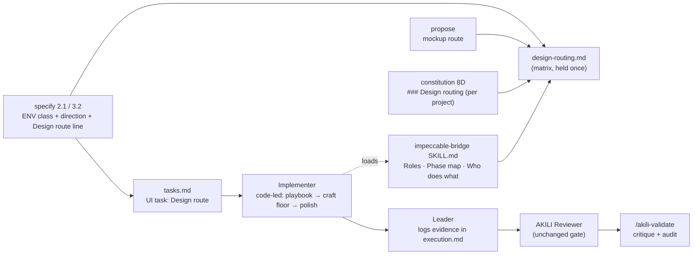

# Design: Design Skill Routing — Impeccable builds, and every design skill has a stated job

## 1. Document Control

| Field | Value |
|---|---|
| Spec Path | `changes/design-skill-routing` |
| Depth | Standard (re-checked in §12) |
| Type / Deliverable | Change / `software` |
| Approval Mode | `pre-approved (JC, 2026-11-01 10:04 UTC-5, via Grok Bot)` — routine gates only (see `requirements.md` §1) |
| Status | **Revision 2**, 2026-11-01. Revision 1 (`0f5e22d`) went through judgment-day round 1 (`judgment.md`); JC ordered "Corrige J-1 a J-5 y las advertencias sin volver a juzgar" (10:04 UTC-5, via Grok Bot). This revision is **fixed, not re-judged**. At the findings menu JC chose **Fix only** and ordered specify to continue to `tasks.md` ("Luego termina specify (tasks.md)"); no separate design approval was given. Phase 3 runs under `pre-approved` |
| Requirements | `requirements.md` revision 2 (Phase 1 approved by JC, 10:04 UTC-5) |
| Verified at | `883dfa9` (rev. 1 rows); rev. 2 rows at `a026208` — no shipped file changed between them |
| Skills applied | `brainstorming`, `cognitive-doc-design`, `impeccable-bridge` (subject); `software-architect` not loaded — no runtime, data or topology change; `diagram-design` — one slot (§13) |

## 2. Executive Summary

One new shipped file — `.claude/skills/impeccable-bridge/references/design-routing.md` — holds the **Design Routing Matrix**, the **expertise cards**, the **environment classification**, the **build route**, the **polish limit**, the **motion split** and the **mockup route**. Everything else points at it:

- The bridge's *Roles*, *Who does what in each state* and *Phase map* change their build rows from "craft floor" to "playbook → craft floor → polish" and point at the reference. The bridge Phase map stays the single owner of *which AKILI phase* runs an activity; the matrix owns *which skill leads it*.
- `/akili-specify` classifies each screen's environment and writes a self-sufficient **`Design route:` line** into every UI task's Scope.
- Execute builds **code-led**, against the direction settled at specify; Impeccable's finish review is not run there (`/akili-validate` critiques the result).
- `/akili-propose`, `/akili-seo`, `/akili-constitution` Step 8D change one rule each; the Leader and Tester skill **examples** stop contradicting the matrix.
- Repo `AGENTS.md` gets `## Design Skills`; docs, three adapted skills, governance prose and the CHANGELOG follow; one new contract test file plus two updated assertions guard it.

## 3. Architecture Overview

**Live path (P-13).** `tasks.md` UI task → Scope carries `Design route: load impeccable-bridge; …` and its skill list names `impeccable-bridge` → the Leader passes the task scope verbatim and selects skills (it may narrow them; the persona example now points UI at `impeccable-bridge`) → the Implementer loads the bridge → bridge *Phase map* build row → matrix *Build route* → the named playbook. The `Design route:` line names the bridge itself, so dropping the skill from the list does not drop the route; the Done criteria and the Reviewer brief carry the evidence check.

## 4. Extended Directory Structure

| Path | Change |
|---|---|
| `.claude/skills/impeccable-bridge/references/design-routing.md` | **New.** The matrix (§8) |
| `.claude/skills/impeccable-bridge/SKILL.md` | *Roles* (pointer, `gsap-animation` row, implementation-layer line), *Who does what* `/akili-execute` row, *Phase map* build row, frontmatter `version` 2.1, description trigger words |
| `.claude/commands/akili-specify.md` | Step 2.1 (environment class; direction settled; animation rule), Step 3.2 (skill-inventory sentence; Preferred UI/UX skill rule → `Design route:` rule) |
| `.claude/commands/akili-propose.md` | Mockup Fallback bullets |
| `.claude/commands/akili-seo.md` | Skill preference for UX/UI recommendations |
| `.claude/commands/akili-constitution.md` | Step 8D item 4 |
| `.claude/templates/leader.md` | *primary-instructions* section, the swap-examples parenthesis only |
| `.claude/templates/tester.md` | *context-alignment* section, the Skill Loading example only |
| `.claude/skills/ui-ux-pro-max/SKILL.md`, `gsap-animation/SKILL.md`, `frontend-design/SKILL.md` | AKILI integration sections point at the matrix |
| `AGENTS.md` | `## Design Skills` replaces the UI and animation bullets of `## Skill Usage` |
| `docs/flow.md` §9; `docs/overview.md` skill rows; `docs/skills/{README,governance,impeccable,impeccable-bridge,frontend-design,stitch-design,ui-ux-pro-max,gsap-animation}.md`; `docs/commands/{akili-constitution,akili-propose,akili-specify,akili-test,akili-audit}.md` | Match the matrix (W-4) |
| `CHANGELOG.md` | `Unreleased` entry, incl. the `--force` note for existing installs (B-17) |
| `test/design-skill-routing.test.js` | **New** contract tests (§7.3) |
| `test/impeccable-bridge.test.js` | Two assertions updated: bridge `version` 2.1; bridge `.md` file list gains `references/design-routing.md` (J-4) |

Not touched: `.claude/skills/impeccable/**` (NFR-2), `.claude/commands/akili-execute.md`, `akili-validate.md` (its fallback line is an ENV-0 statement and stays), `bin/`, `scripts/`, `.claude/templates/digests.json` (written by `release.js` at release).

## 5. Data Model

### 5.1 `Design route:` line (one per UI task, in Scope)

Form: `Design route: load impeccable-bridge → design-routing.md; playbook <cmd>[, <cmd>]; ENV-<n>; mode <mode>; polish <full|light>; motion <value>`.

| Field | Values | Source |
|---|---|---|
| Playbook(s) | Impeccable build/refine/enhance/fix commands; `frontend-design` when ENV-0 | spec `design.md` |
| Environment | `ENV-0` · `ENV-1` · `ENV-2` · `ENV-3` | Step 2.1 classification (§7.1) |
| Page mode | Persuade · Operate · Read · Experience | existing page-mode record |
| Polish | `full` (Persuade, Experience) · `light` (Operate, Read) | page mode (D2) |
| Motion | `none` · `animate → CSS/WAAPI` · `animate → <project library>` · `animate → gsap-animation` | §8.5 |

**Done criteria** carry: *the completion report names the playbook(s) run, the polish depth and its result, and `finish review: not run (AKILI execute)` when the playbook calls for one — or, at ENV-0, `skill source missing — frontend-design`; the Leader logs it in `execution.md` and names that entry in the Reviewer brief* (W-5, B-18).

**Sizing note (W-6).** A UI task covers one screen or one component family, so Setup + playbook + craft floor + `polish` fit the Implementer's tool-call bound; a larger surface is split at specify.

### 5.2 `### Design routing` block (project `AGENTS.md`, under `## Skill Map`)

Fields: environment class(es) with evidence · design lead (`impeccable` via `impeccable-bridge`, or the ENV-0 fallback) · implementation layers (the Skill Map stack skills that implement UI) · motion library (detected or `none`) · mockup route (picker first; Stitch on request; MCP availability per developer) · one line pointing at the matrix by name. No matrix rows.

## 6. API Design

None — no CLI, flag or file-format change.

## 7. Backend Module Design (rules text and tests)

### 7.1 Environment classification (FR-2)

Evidence ladder, first match wins, per screen:

| Order | Evidence | Class |
|---|---|---|
| 1 | Bridge Step 0 skill source is `missing` | ENV-0 |
| 2 | Screen platform is iOS, Android or adaptive (Impeccable ships `ios.md`, `android.md`, `adapt.native.md`, `audit.native.md`) | ENV-3 |
| 3 | `docs/ux-ui/design.md` defines tokens/components, **or** the code has a component library or token layer forming a coherent identity (Impeccable's *Established world*) | ENV-2 |
| 4 | None of the above | ENV-1 |

A missing `DESIGN.md` is never evidence for ENV-1. Recorded in the spec's `design.md` next to the page-mode inventory, with the evidence path.

### 7.2 Enumerated-value walk

The design adds two enumerations (environment class, polish limit) and changes one row of the bridge's *Who does what in each state*. **Six commands** read the bridge (`grep -ln impeccable-bridge .claude/commands/*.md`); `/akili-execute` reaches it only through task skill lists (W-2).

| Consumer | Reads | Effect |
|---|---|---|
| `akili-constitution` Step 4 / 8D | Step 0, Phase map `init`/`document` | Step 8D gains the routing block |
| `akili-specify` 2.1 / 3.2 | Phase map `shape`; Step 2.1 row | records ENV class + direction; writes `Design route:` |
| `akili-propose` Visual Reference | propose row | picker first (row text unchanged) |
| `/akili-execute` (via task lists) | execute row; Phase map build row | **changed**: code-led playbook → craft floor → polish |
| `akili-test`, `akili-validate`, `akili-audit` | their rows | none |
| `ui-ux-pro-max`, `frontend-design` SKILL | Roles | pointer to the matrix |

Skill-source values: `missing` → ENV-0; `vendored` and `user-installed` → ENV-1 – ENV-3 by the ladder. No value falls through.

### 7.3 Tests

**New — `test/design-skill-routing.test.js`:**

| Test | Asserts | Falsifier |
|---|---|---|
| Held once | Each matrix row signature (`\| **<activity>** \|`, eight activities) **and** each card signature (`\| \`<skill>\` \|` rows of the cards table, matched by their *Expert at* cell) appear in `design-routing.md` and in no other file under `.claude/`, `docs/` (minus `docs/specs/`), `AGENTS.md`, `README.md` (B-16) | Paste one row or card into `akili-specify.md` |
| Skill set | The eight design skills each exist as a folder under `.claude/skills/`; the card set = those eight + the generic *other stack skills* card; `AGENTS.md` `## Design Skills` names the same eight (A-14) | Remove `stitch-design`'s card |
| One lead per cell | Every matrix cell holds exactly one lead (no `+` joining two skills, no `—`) (W-1) | Write `ui-ux-pro-max + frontend-design` in a cell |
| Card evidence | Each card's evidence `file → heading` resolves | Rename a cited heading |
| No line pointers | Matrix and the new command/persona text contain no `\.(md\|js):\d+` pointer (A-15b) | Write `animate.md:66` in a card |
| Stale phrasing sweep | Walk as `impeccable-bridge.test.js` FR-11/FR-14 (`.claude/` incl. `templates/`, `docs/` minus `docs/specs/`, `README.md`, `AGENTS.md`; vendored folder excluded). Patterns: `Implementer loads Impeccable's craft floor`, `Craft floor before UI edits`, `Use \`frontend-design\`, \`ui-ux-pro-max\``, `Recommend generating the mockup with the \`stitch-design\``, `\`ui-ux-pro-max\` if available`, `load \`gsap-animation\` and read the reference file matching the task`, `UI → \`ui-ux-pro-max\``, `animation → \`gsap-animation\``, `Use \`gsap-animation\` for animation work` | Restore any one |
| Wiring | `akili-specify` names `design-routing` and `Design route:`; bridge Phase map and execute row name the matrix; `akili-propose` places the picker before Stitch; `akili-seo` names `impeccable-bridge`; Step 8D names `### Design routing`; `leader.md` UI example names `impeccable-bridge` | Revert any one edit |
| Governance | The `Design route:` rule paragraph and the Step 8D item name no stack skill outside a Skill Map deferral | Write `use shadcn-ui` in the rule |
| Execute boundary | The matrix *Build route* says code-led, answers from `design.md` else Pivot, and `finish review: not run (AKILI execute)` | Delete the code-led sentence |

**Updated — `test/impeccable-bridge.test.js` (J-4):** the `version` assertion → `2\.1`; the bridge `.md` file list → `SKILL.md`, `references/design-evaluation.md`, `references/design-routing.md`.

**Must stay green unchanged:** `impeccable-vendor.test.js`; `diagram-design.test.js` (governance `conditional` row still starts `| \`conditional\` | \`ui-ux-pro-max\``); `docs-overview.test.js` (no skill added); `persona-digests.test.js` and `agents-doctor.test.js` (sections keep ids and markers; only bodies change); the rest of `impeccable-bridge.test.js`.

## 8. The matrix content (`design-routing.md`)

### 8.1 Decision rule (top of the file)

1. **Impeccable decides what and why; the stack decides how.** Direction, composition, hierarchy, type, color, motion intent and copy come from Impeccable; tokens and components are written in the project's stack through the Skill Map's stack skills.
2. **One lead per activity.** Supporting skills give inputs, not rules.
3. **The environment picks the column, the activity picks the row.** Which AKILI phase runs an activity is the bridge *Phase map*'s job, not this file's (A-11).
4. **Direction is settled before execute; execute builds code-led against it.**
5. **Every UI task ends with `polish`; the AKILI Reviewer stays the gate.**
6. If a reference this file names is absent from the Impeccable copy found (a `user-installed` version), use Impeccable's *Commands* table to pick the nearest command, report it, and continue (B-17).

### 8.2 Matrix (activity × environment)

| Activity | ENV-1 no established world | ENV-2 established world | ENV-3 native | ENV-0 skill `missing` |
|---|---|---|---|---|
| **foundation** | `impeccable` `init` (derived context from the authority) | `impeccable` `document`, then `init` | `impeccable` `init`, platform recorded | `frontend-design` |
| **direction** | `impeccable` `shape` → `new-work` *Create or replace the visual world* (the roll runs here) | `impeccable` `shape` → `new-work` *Create a whole surface inside an established world* or *Extend an existing surface* | `impeccable` `shape` + platform reference | `frontend-design` |
| **mockup** | `impeccable` direction picker | `impeccable` picker anchored on the incumbent | `impeccable` picker | `stitch-design` |
| **build-new** | `impeccable` `new-work`, code-led, against the recorded direction | `impeccable` `new-work`, code-led, the surface tier the direction recorded | `impeccable` `new-work` + platform reference | `frontend-design` |
| **build-within-system** | use **build-new** (no system yet) | `impeccable` named playbook(s): `layout`, `typeset`, `colorize`, `clarify`, `adapt`, `harden`, `onboard`, `distill`, `optimize`; `extract` only when the task says so | `impeccable` playbook + platform reference | `frontend-design` |
| **refine** | `impeccable` `bolder` / `quieter` / `delight` / `overdrive` as the design names | same; `polish` never redesigns | same | `frontend-design` |
| **motion** | `impeccable` `animate` → §8.5 | `impeccable` `animate` → project library | `impeccable` `animate` → platform motion | `frontend-design` (+ `gsap-animation` by §8.5) |
| **evaluate** | `impeccable` (bridge detector gate, critique/audit) | `impeccable` (same) | `impeccable` `audit` native variant | `frontend-design` checklist review |

**Supporting line** (every cell, never a lead): `ui-ux-pro-max` (catalog options), the Skill Map stack skills (implementation layer), `gsap-animation` when §8.5 selects it, `stitch-design` when the user asks for Stitch.

### 8.3 Expertise cards

| Skill | Expert at | Supports | Must not decide | Evidence |
|---|---|---|---|---|
| `impeccable` | Direction, page mode, craft floor, build/refine playbooks, critique, audit, polish, detector | — (lead) | Framework-specific implementation the stack owns | `impeccable/SKILL.md` → *Commands*, *Modes* |
| `impeccable-bridge` | Which skill leads, gates, consent, source of truth | All phases | Design rules (it teaches none) | `impeccable-bridge/SKILL.md` → *Roles* |
| `ui-ux-pro-max` | Catalog: palettes, font pairings, styles, chart types by industry | direction, foundation; ENV-0 checklist | The style | `ui-ux-pro-max/SKILL.md` → *AKILI-SPECS Integration* |
| `frontend-design` | Direction + craft when Impeccable is missing (DFII) | ENV-0 lead only | Anything while Impeccable is present | `frontend-design/SKILL.md` → *8. Integration With Other Skills* |
| `stitch-design` | Hi-fi multi-screen generation via Stitch MCP, `.stitch/DESIGN.md` | mockup on request; ENV-0 mockup lead | The design authority | `stitch-design/SKILL.md` → *Core Responsibilities* |
| `gsap-animation` | Timelines, scroll-driven, runtime control, SVG morphing in GSAP | motion implementation | Whether motion exists, or its purpose | `gsap-animation/SKILL.md` → *Prefer GSAP over CSS animations when you need* |
| `tailwind-design-system` (stack) | Tailwind v4 tokens, CSS-first theming, component variants | implementation layer | The aesthetic | `tailwind-design-system/SKILL.md` → *When to Use This Skill* |
| `shadcn-ui` (stack) | shadcn/ui primitives, forms, theming in React | implementation layer | The aesthetic | `shadcn-ui/SKILL.md` → *When to Use* |
| other UI stack skills (e.g. `angular-developer`, `vercel-react-best-practices`, `react-doctor`, via the Skill Map) | Framework idioms, performance, correctness | implementation layer | The aesthetic | `docs/skills/governance.md` → *Current assignment* (`stack` row) |

### 8.4 Build route and polish limit (FR-4, FR-5, FR-6)

1. Impeccable Setup — bridge Step 0 gate unchanged (no launcher before `ready`/`installed (consented)`; otherwise *Launcher unavailable*).
2. Load only the playbook reference(s) the `Design route:` line names (NFR-4).
3. **Code-led, against the recorded direction (J-5).** The roll, the dealt structures and any comp were settled at specify (`shape` + `new-work` direction, per bridge Step 0) and recorded in the spec's `design.md` (direction contract and, when one was locked, the comp or sketch the build matches). In execute: no decision page, no `concept-seed`, no comp round, no image generation, no documenter (the authority is `docs/ux-ui/design.md`; `PRODUCT.md`/`DESIGN.md` stay derived). The questions `new-work` asks before building ("Ask what will change the work") are answered from `design.md`; a question it does not answer is a spec gap → Pivot Protocol. Impeccable's own guard ("Never run the script for a local extension or a precisely specified narrow request") is consistent with this.
4. Read the craft floor immediately before UI edits (upstream Setup step 3).
5. **Finish review: not run (AKILI execute) (J-1).** Upstream forbids it inside the build thread and its packet needs a roll and screenshots execute does not produce; `/akili-validate`'s design gate runs critique and audit on the built result.
6. `polish` within the AKILI scope limit (upstream rules apply inside it):

   | Limit | Pages | Covers | Fixes | Reports, does not fix |
   |---|---|---|---|---|
   | full | Persuade, Experience | the whole screen in task scope | every drift class of `polish` *Establish the system*; a missing token is added to the authority only when the spec's approved design covers it | conceptual mismatches outside scope |
   | light | Operate, Read | the task's changed surface | local defects, one-off implementations | missing tokens, conceptual mismatches |

7. Completion report: playbook(s), polish limit and result, finish-review line; the Leader logs it (§5.1).

### 8.5 Motion split (FR-7)

| Concern | Owner |
|---|---|
| Whether motion exists, purpose, choreography, reduced-motion | Impeccable `animate` (mode-aware) |
| Library | The project's existing motion library (`animate`: "the project's existing motion library"). None: CSS / Web Animations API; `gsap-animation` only when CSS or WAAPI cannot express the effect cleanly — judged against `gsap-animation`'s own list — and the spec records it as a DD (A-13) |
| Native (ENV-3) | Platform motion per Impeccable's platform references; `gsap-animation` not loaded |

### 8.6 Mockup route (FR-8, D3)

Skill source `vendored`/`user-installed`: offer the Impeccable direction picker first (comp-led needs the image-credit yes; code-led does not); name Stitch as available on request and generate with `stitch-design` only when the user asks. The picker's result is a **Visual Reference** that `/akili-specify`'s `shape` consumes, not a second direction round; Impeccable's own routing runs `init` first when `PRODUCT.md` is missing (B-14). Skill source `missing`: today's order — `stitch-design`, Claude Design, self-contained HTML sketch.

## 9. Shared Contracts or Package Extensions

- `design-routing.md` ships to all six targets through the existing whole-folder skill copy (P-8). Existing installs that already hold a different `impeccable-bridge` folder keep it until `install --force` (installer skip policy) — CHANGELOG note (B-17).
- `impeccable-bridge` frontmatter `version` → `2.1`; description gains *build, design routing*.

## 10. Design Decisions

| ID | Decision | Covers | Rejected alternative (why) |
|---|---|---|---|
| DD-1 | Matrix in `impeccable-bridge/references/design-routing.md` | FR-1, NFR-1, NFR-5 | In bridge `SKILL.md` (detector-only phases would load it); repo `AGENTS.md` (does not ship); a new skill (governance; competes with the bridge) |
| DD-2 | Build route reaches the Implementer through a self-sufficient `Design route:` line + the bridge; personas change only their skill examples | FR-4, NFR-6 | New persona rule (section churn for a UI-only rule); an `/akili-execute` step (commands stay design-agnostic) |
| DD-3 | Evidence ladder for environment, per screen | FR-2 | Per project only (mixed web/native mis-route) |
| DD-4 | Direction (incl. roll/comp) settled at specify; execute is code-led; questions answered from `design.md`, else Pivot; no documenter in execute | FR-4, J-5 | Full `new-work` in execute (needs user Q&A, consent and a second approval point inside a task) |
| DD-5 | Finish review not run in execute | FR-6, J-1 | Inline in the Implementer (upstream forbids); Leader-run fresh pass (packet needs roll + screenshots execute lacks — S-1; validate already critiques) |
| DD-6 | Polish full/light by page mode, as an AKILI scope limit | FR-5, D2 | One depth |
| DD-7 | Motion: purpose to Impeccable, library to the project, GSAP when CSS/WAAPI cannot express it | FR-7 | "Any animation → GSAP" |
| DD-8 | Mockup: picker first, Stitch on request | FR-8, D3 | Stitch first |
| DD-9 | Stack skills named only on the supporting line and cards, with Skill Map deferral | FR-9, NFR-3 | Stack-specific leads |
| DD-10 | Project `### Design routing` under `## Skill Map` | FR-10 | A separate `## Design` section |
| DD-11 | Repo `AGENTS.md` `## Design Skills`: decision rule + one-line roles + pointer | FR-13 | Full matrix copy |
| DD-12 | One new test file; two existing assertions updated | §8 defect classes, J-4 | Extend `impeccable-bridge.test.js` further |
| DD-13 | `ENV-0`–`ENV-3` labels | B-8 | `E0`–`E3` (collide with `design-evaluation.md` steps) |
| DD-14 | Matrix has no AKILI-phase column; the bridge Phase map owns phase ownership | A-11 | Duplicate column |

### Reversion challenges (Step 2.3)

| Reverted behavior | What removing it breaks | Answer |
|---|---|---|
| Stitch as first mockup recommendation | Users without Impeccable lose Stitch-first | Not affected: `missing` keeps today's order; Stitch on request otherwise. No test pins the phrase (`grep -rn "Recommend generating" test/` → no hits) |
| "Any animation → `gsap-animation`" (specify, Leader example) | GSAP projects stop getting it | Not affected: GSAP as project library selects it |
| `frontend-design`, `ui-ux-pro-max` as general UI options (`AGENTS.md`, `akili-seo`, Leader/Tester examples) | UX advice without Impeccable | Not affected: ENV-0 names the same pair |
| Craft floor as the whole build rule | Token cost per UI task rises | Bounded by NFR-4 and the one-screen sizing note |
| Comp-led builds for Persuade screens in execute | Comp fidelity checks at build time | The comp, when locked at specify, is the composition the code-led build matches; `/akili-validate` critiques the result |

## 11. Premise Ledger

**Count:** 19 rows · 19 verified · 0 `UNVERIFIED` (P-4 settled: refuted; P-19 added at execute, E-1).
**Blast-radius triggers:** `live-path` (the path by which a UI task reaches the Implementer — P-13, P-16; skill delivery — P-8), `shared-state` (bridge tables read by six commands — P-15), `consumer` (phrasings that tests, docs and personas pin — P-10, P-11, P-18).

| # | Claim | Class | Citation (as run) | Verified at | If false | Settled by |
|---|---|---|---|---|---|---|
| P-1 | At build time the Implementer gets only Impeccable's craft floor | location | `grep -n "Craft floor before UI edits" .claude/skills/impeccable-bridge/SKILL.md` → `146`; bridge `:120`; `akili-specify.md:462` | `883dfa9` | Spec unnecessary for G1 (High) | — |
| P-2 | AKILI ships no `impeccable-finish-reviewer` agent; a degraded version ships | existence | `grep -rl impeccable-finish-reviewer .claude bin docs scripts` (minus `docs/specs`) → only `new-work.md`; `ls -d .claude/agents` → none; `ls …/reference/degraded` → `finish-reviewer.md` among 4 | `883dfa9` | DD-5 (Low) | — |
| P-3 | `new-work` spawns the finish reviewer, "never runs inside the build thread", inline substitute only for "a harness with no subagent capability at all" | location | `.claude/skills/impeccable/reference/new-work.md:144` | `883dfa9` | DD-5 (High) | — |
| P-4 | ~~Inline degraded pass in the Implementer is consistent with upstream~~ | other | **Refuted** by P-3 (judges A-1, B-2) | `a026208` | DD-5 rewritten | judgment-day (settled) |
| P-5 | Impeccable implements motion with WAAPI or the project's existing motion library | data-env | `grep -n "existing motion library" …/animate.md` → `66` | `883dfa9` | DD-7 (High) | — |
| P-6 | `gsap-animation` states its own criteria for preferring GSAP over CSS | data-env | `grep -n "Prefer GSAP over CSS" …/gsap-animation/SKILL.md` → `26` | `883dfa9` | §8.5 (Low) | — |
| P-7 | Impeccable inherits an established world; a missing `DESIGN.md` does not erase it | location | `grep -n "Established world" …/new-work.md` → `12` | `883dfa9` | DD-3 (High) | — |
| P-8 | Bridge `references/` ship to every target (whole skill folder copied) | live-path | `HOME=$(mktemp -d) node bin/akili.js install --tool all --dry-run 2>&1 \| grep -c impeccable-bridge` → `7` (directory entries; `.agents` serves Codex and Cursor); the same run `\| grep -c design-evaluation` → `0` (files are not listed individually) | `a026208` | DD-1 needs an installer change (High) | — (re-cited, J-2) |
| P-9 | Governance forbids load-directing stack skills in command text, three carve-outs | other | `docs/skills/governance.md` → *Current assignment*, the *Rules of thumb* list, `stack` bullet | `883dfa9` | DD-9 (Low) | — |
| P-10 | Shipped files carrying superseded phrasings | consumer | rev. 1 greps (bridge `22`,`120`,`146`; `akili-specify.md:235`,`:426`,`:462`,`:464`; `akili-propose.md:132-136`; `akili-seo.md:158`; `AGENTS.md:51-52`; `flow.md:656`; `overview.md:63-71`; `docs/commands/akili-constitution.md:121`; `docs/commands/akili-propose.md:96`; `docs/skills/impeccable.md:9`) **plus** rev. 2: `grep -rn "gsap-animation\|stitch-design\|ui-ux-pro-max\|frontend-design" docs/skills/README.md docs/skills/governance.md docs/commands/akili-test.md docs/commands/akili-audit.md` (W-4) — each hit handled in its task or recorded as an ENV-0 statement | `a026208` | Old routing survives (High; sweep test) | — |
| P-11 | Tests pinning design-skill text | consumer | `impeccable-bridge.test.js:33` (`version "2\.0"`), `:37` (bridge file list), `:53`, `:87-109`, `:122-124`, `:143-175`; `diagram-design.test.js:393-394` | `a026208` | Hidden red tests (High; J-4) | — |
| P-12 | Impeccable carries native references | existence | `ls …/impeccable/reference \| grep -E "ios\|android\|native"` → 4 files | `883dfa9` | ENV-3 column (Low) | — |
| P-13 | UI tasks reach the Implementer with the task scope; the Leader selects skills and its persona example swaps UI → `ui-ux-pro-max`, animation → `gsap-animation` | live-path | `akili-specify.md:462`; `akili-execute.md:191`; `sed -n 25p .claude/templates/leader.md` (full line read: "swap in the better match (UI → `ui-ux-pro-max`, animation → `gsap-animation`, …)") | `a026208` | DD-2 (High; J-3) | — |
| P-14 | `polish` is refinement, never concealed redesign; one depth upstream | location | `…/polish.md:3`; *1. Establish the system* | `883dfa9` | DD-6 labelled an AKILI limit (Low) | — |
| P-15 | Six commands read the bridge; execute only through task skill lists | shared-state | `grep -ln impeccable-bridge .claude/commands/*.md` → `akili-{audit,constitution,propose,specify,test,validate}.md` (6) | `a026208` | A consumer misreads the changed row (High) | — |
| P-16 | `new-work` asks the user before building, makes Persuade comp-led when image generation exists, requires `concept-seed` before code on a new world, and writes `DESIGN.md` at finish via the documenter | live-path | `new-work.md:18-20` (*Ask what will change the work*), `:48` (`concept-seed --scope direction`, "No substitute, no skip"), `:55` (comp-led/code-led contract), `:79` (DESIGN.md written at finish by the documenter) | `a026208` | DD-4 (High; J-5) | — |
| P-17 | Only the Leader appends to `execution.md`; the Reviewer reads only brief-named entries | other | `akili-execute.md:37` (audit entry), `:161` (Leader appends FAIL findings); `.claude/templates/reviewer.md:26` | `a026208` | §5.1 evidence path (Low; W-5) | — |
| P-18 | Tester persona skill example names `ui-ux-pro-max` | consumer | `.claude/templates/tester.md:38` | `a026208` | J-3 fix incomplete (Low) | — |
| P-19 | `test/install-cursor.test.js` pins the packaged skill-file count (308 = 247 + 58 + 3), so any new file under `.claude/skills/` turns it red | consumer | `npm test` at `d460f50` → "expected 308 (247 + 58 upstream + 3 LICENSE/NOTICE/UPSTREAM.md) packaged skill files under .claude/skills; counted 309 instead"; `grep -n "SKILL_FILE_EXPECTED = 247 + 58 + 3" test/install-cursor.test.js` → `247` | `d460f50` | T2 cannot close green (High) | Missed at specify, found at T1 (Escalation E-1). Amendment to T2 approved by JC, 2026-11-01 10:41 AM UTC-5, vía Grok Bot: "Sí, aprueba la corrección del conteo a 309 y que siga hasta el archive" |

## 12. Budget (Step 2.4)

| Measure | Estimate |
|---|---|
| Tasks | 11 — matrix reference; bridge `SKILL.md`; `akili-specify`; `akili-propose` + `akili-seo`; `akili-constitution` 8D; persona examples; adapted skills (3); `AGENTS.md` + CHANGELOG; docs; contract tests; held-out walkthrough (the AGENTS.md/docs split was made at Phase 3 by the task-splitting rule) |
| LOC | ~650 — ~350 prose (matrix ~160) + ~300 tests (KZ-bugfix--init-ctrlc-abort-2) — JC's budget |
| Review rounds | ~22 (two per task) |

Depth: Standard holds. Each rules task edits one document (task-splitting rule).

## 13. Diagrams

§3 carries the one diagram this change alters (routing delivery path).
