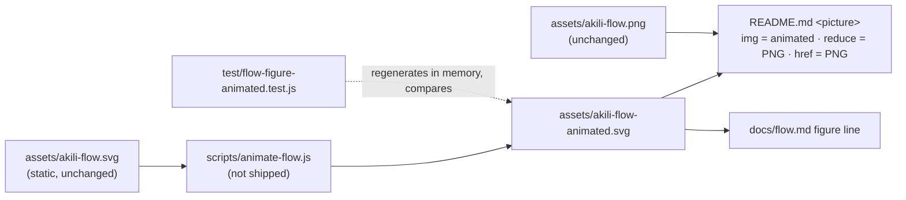

# Design: animated AKILI flow figure

> **Answer first.** A Node script, `scripts/animate-flow.js`, reads the static SVG and makes three kinds of edit. It deletes the 48 unapplied `@keyframes` blocks. It inserts two overlay groups beneath the edge labels: edge traces right after the last static edge path, node glows right after the last node group. It inserts one `<style>` before `</svg>`. The traces redraw loop edges `e1`–`e8` as highlight strokes (`pathLength="1"`) and the Bug Track edges as a soft pulse. The glows outline the eight loop nodes. Every overlay element is `opacity="0"` by attribute. A 9 s CSS cycle, staggered per element, runs **three times and then rests on the static figure**. A reduced-motion rule turns every overlay animation off. Nothing else in the file changes, so with motion off it renders the static figure exactly: 0 px differ in the spike. The README wraps the image in a `<picture>`; `docs/flow.md` points its Markdown image at the new file. Budget: 4 tasks, about 360 LOC, about 7 review rounds.

## 1. Document Control

| Field | Value |
|---|---|
| Spec Path | `changes/flow-diagram-animated` |
| Depth | Standard (checked in §8) |
| Approval Mode | `pre-approved (Juan Carlos Cadavid, 2026-10-27)` (see `requirements.md`) |
| Inputs | `proposal.md`, `requirements.md`, `assets/akili-flow.svg` at `4ff00a9`, probes in the session scratchpad (`probe/run.js`, `run2.js`, `run3.js`) |
| Skills | `cognitive-doc-design`, `diagram-design` (figure conventions only), `tdd` (generator) |
| Status | Round-1 fixes applied 2026-10-27 (`judgment.md` F-1..F-14; the user chose **Fix and re-judge** and **3 cycles, then rest**). Scoped re-judgment approved; round-2 warnings applied as info. Phase 2 gate: `auto-approved (pre-approved mode)`, 2026-10-27 |

## 2. Architecture Overview

| Layer | Mechanism | Covers |
|---|---|---|
| Asset | Overlay hidden by attribute; CSS animates it; in-SVG reduced-motion rule | FR-1, FR-2, FR-3 |
| Embed | README `<picture>` reduced-motion source → PNG | FR-2 BUT, FR-4 |
| Process | Generator + staleness test | FR-6 |

## 3. Extended Directory Structure

| Path | Change | FR |
|---|---|---|
| `scripts/animate-flow.js` | New. Exports the transform, plus a CLI that writes the asset | FR-6 |
| `assets/akili-flow-animated.svg` | New, generated | FR-1–FR-3 |
| `test/flow-figure-animated.test.js` | New | FR-1 (structure), FR-2 (attributes), FR-3, FR-6 |
| `README.md` | Figure block only | FR-4 |
| `docs/flow.md` | Line 7 target only | FR-5 |
| `test/docs-overview-contract.test.js` | FR-4 test: `<picture>` shape | FR-4 |
| `test/docs-overview.test.js` | FR-5 figure presence: PNG may sit in `src` or `srcset` | FR-4 |
| `test/flow-figure-contract.test.js` | FR-3 and FR-4 regexes follow the new embeds | FR-4, FR-5 |
| `test/flow-figure.test.js` | `<desc>` test reads the new flow line | FR-5 |
| `CHANGELOG.md` | `[Unreleased]` notes | FR-7 |

## 4. Data Model

The only data is the SVG. The generator relies on the hooks below. If one is missing, it throws (FR-6 BUT).

| Hook | Where | Used for |
|---|---|---|
| `<path data-edge-id="eN" … d="…" style="--step: K;">`, N = 1–8 | Loop edges | Overlay trace path: same `d`, slot K. The last static edge path marks where the trace group is inserted |
| `<rect … data-animate="node" style="--step: K; …">` inside `<g id="node-X">` for X in the loop (constitution, propose, specify, execute, test, validate, archive, kaizen) | Loop nodes | Overlay outline: same `x`, `y`, `width`, `height`, `rx` |
| `<path data-edge-id="s1">`, `<path data-edge-id="s2">` | Bug Track edges | Faint pulse once per cycle |
| First `<g data-edge-from=…>` (edge-label group), after the last `<g id="node-…">` | Label layer | The node-glow group is inserted just before it, so all labels paint over the overlay (F-2) |
| `--arrow-emphasis` custom property | Root theme rule | The only overlay colour, so no new brand colour enters |
| `@keyframes name { … }` with no `animation`/`animation-name` that uses `name` | `<style>` | Removed (12,686 B today) |

## 5. API Design

`n/a — no API.` The generator's interface:

| Surface | Contract |
|---|---|
| `require("../scripts/animate-flow.js").animate(svgText)` | Pure function, string → string. Throws an `Error` naming the missing hook |
| `node scripts/animate-flow.js` | Reads `assets/akili-flow.svg` and writes `assets/akili-flow-animated.svg`. Exits 1 with the error message, writing nothing, when `animate` throws |
| Idempotence | `animate(static)` is deterministic. Its output contains no timestamp, no random value, and no absolute path |

## 6. Backend Module Design

`n/a — no backend.`

## 7. Frontend / UX: motion design

**Timeline.** One cycle is 9 s. `animation-iteration-count: 3`, so the figure moves for about 27 s and then rests. `animation-fill-mode: none`, so after the last iteration the `opacity="0"` attribute applies again. One `@keyframes` per element kind. Each element's start is set by `animation-delay`, from a per-element `--d` custom property the generator writes (F-4, F-5).

| Element | Start (`--d`) | Within its run |
|---|---|---|
| Edge `e1`…`e8` (`--step` K = 0…7) | K × 0.9 s | Draws for 0.6 s (`stroke-dashoffset` 1 → 0 at opacity 0.9), then fades for 0.3 s; invisible for the rest of the cycle |
| Node glow, `constitution` | 0 s | Rises for 0.3 s to 0.9, falls for 0.5 s |
| Node glow, loop node with `--step` K = 1…7 (propose … kaizen) | (K − 1) × 0.9 + 0.6 s, the moment its inbound edge finishes drawing | Same rise and fall. Propose glows once, on `e1`; the `e8` arrival draws no glow (F-4) |
| `s1`, `s2` (Bug Track) | 7.4 s, both | One pulse: 0.4 s rise to opacity 0.5, 0.6 s fall |
| — | 8.4–9.0 s | Rest |

| Rule | Value |
|---|---|
| Colour | `stroke: var(--arrow-emphasis)` (#059669 in the light theme), **set in the overlay `<style>`, never in a presentation attribute** (F-9) |
| Trace stroke | `stroke-width: 3`, `stroke-dasharray: 1`, `stroke-dashoffset: 1` at rest, `stroke-linecap: butt`, `fill: none` (F-8) |
| Node outline | `stroke-width: 2.5`, `fill: none`, same `x`/`y`/`width`/`height`/`rx` as the node's `data-animate="node"` rect |
| Opacity ceiling | Loop 0.9, Bug Track 0.5 |
| Flash bound | Each element rises once and falls once per 9 s cycle, each ≥ 300 ms. That is far below 3 flashes per second |
| Draw order (F-2) | The trace group goes right after the last static edge path, so nodes and labels paint over it. The glow group goes right before the first edge-label group, so labels paint over it. Both groups carry `class="akili-motion"`, `aria-hidden="true"` and `pointer-events="none"` |
| Isolation (F-7) | The two groups carry `class="akili-motion"`. Overlay elements inside them carry only `class` values prefixed `mo-`, plus `d`/geometry, `pathLength`, `opacity` and a `style="--d:…"`. No static class, `data-edge-*`, `data-node-*` or `data-animate`, so no static selector restyles them |
| Motion off | Every overlay element carries `opacity="0"` by attribute, and CSS animation raises it only while running. `@media (prefers-reduced-motion: reduce) { .akili-motion, .akili-motion * { animation: none } }`. A renderer that ignores `<style>` keeps the attribute: invisible. Spike result: 0 px differ (P-12) |

**README block (FR-4):** `
` › `<a href="PNG">` › `<picture>` › `<source media="(prefers-reduced-motion: reduce)" srcset="PNG">` + ``. PNG and ANIMATED are the `master` raw URLs.

**Flow line (FR-5):** ``. Reduced motion on this page relies on the in-SVG rule. GitHub renders a Markdown image as a plain ``, so there is no page-level fallback there; see P-6 and R-2. The 3-cycle stop bounds the exposure.

## 8. Budget (Step 2.4)

| Number | Estimate | Basis |
|---|---|---|
| Tasks | 4 | T1 generator + asset + test, T2 rendered evidence, T3 embeds + test updates, T4 CHANGELOG |
| LOC | ~360 | Generator ~130; new test ~160 (one assertion per scenario clause, per KZ-bugfix--init-ctrlc-abort-2); test edits ~40; README/flow ~12; CHANGELOG ~15. Sum 357 (F-6). The T2 harness stays in the scratchpad (~80, not counted), and the generated asset is not counted |
| Review rounds | ~7 | T1 2, T2 1, T3 2, T4 2 (CHANGELOG quote-checks have needed a second round, per KZ-002) |

Depth check: this lands at the Standard level. It is not Lite: four tasks, a new script, and a rendered-evidence task.

**Size cap re-measured (Step 2.4):** the spike (`probe/spike.svg`: overlay and style, keyframes **not** removed) is 147,454 B. Minus 12,686 B of keyframes, the estimate is about 134.8 KB against the 153,600 B cap. T1 measures the real file.

## 9. Shared Contracts or Package Extensions

- `package.json` `files` is unchanged. `assets` already ships the new file. `scripts/animate-flow.js` is not listed, so it does not ship (P-9).
- Tests may `require` the generator: `test/` is not shipped either.

## 10. Design Decisions

| ID | Decision | Rejected alternative | Premise / lesson |
|---|---|---|---|
| DD-1 | A generated overlay; the static figure stays the only layout source | Re-exporting Archify's own animation (option B): its keyframes read `var(--flow-len, 0px)`, with no value anywhere in the file, so they would run at length 0 in an ``; a re-export risks layout drift | P-1, P-2, P-13 |
| DD-2 | CSS animation only, no SMIL | SMIL: a CSS media query cannot turn it off | FR-2 |
| DD-3 | Overlay hidden by the `opacity="0"` attribute; CSS raises it only while animating | Hiding by CSS only: a CSS-less renderer would draw black strokes | FR-2, P-12 |
| DD-4 | `pathLength="1"` for traces | Measuring path lengths in the generator: more code; Archify's `--flow-len` route needs script | P-1, P-12 |
| DD-5 | Remove only the unapplied keyframes; leave the rest of the bytes alone | Minifying or re-serialising the SVG: it breaks the byte-subsequence test that proves nothing static changed | FR-3 |
| DD-6 | README `<picture>` with a reduced-motion PNG source, plus the in-SVG rule | The in-SVG rule alone: probe P-5 shows page-level emulation does not reach it | P-5, P-6 |
| DD-7 | `docs/flow.md` keeps Markdown image syntax and changes only the target. The proposal's extra sentence pointing to the static SVG is **dropped on purpose**: FR-5 allows one changed line, and the static SVG stays reachable in `assets/` (F-12) | A `<picture>` with relative `srcset` in `docs/flow.md`: GitHub's rewriting of relative `srcset` is unverified, and a broken reduce source would show a broken image to exactly the readers who asked for less motion | P-6 |
| DD-8 | A staleness test regenerates in memory | A CI step that writes the asset: CI has no write-back, and the repo's gate is `npm test` | FR-6, KZ-changes--leader-brief-contract-2 (falsifiers executed) |
| DD-9 | The new test names no spec folder | — | KZ-changes--archify-diagrams-1 |
| DD-10 | Overlay in two groups under the label layer, not one group painted last | Painting last strikes the `s1` pulse through "confirmed finding → Bug Track" (F-2) | P-1 |
| DD-11 | Three cycles, then rest | Infinite loop: WCAG 2.2.2 exposure with no pause control in an `` (user decision, F-11) | — |

**Reversion challenge (Step 2.3).** Two decisions take away shipped behaviour. **DD-6** replaces the README ``, PNG → animated SVG. **DD-7** replaces the `docs/flow.md` image target, static SVG → animated SVG. The question "what does removing it break?" was put to both judgment-day judges, and their answers are recorded in `judgment.md`. The author's answer:

- The PNG stays as the link and the reduced-motion source.
- An engine that ignores the in-SVG rule still gets the README's `<picture>`.
- The open risk is npm: if npm drops SVG images, the npm README loses its figure. P-7 makes that a High row owned by T2's first step, and a refutation goes to the Pivot Protocol.

## 11. Premise Ledger

**Execute-time settlement (T2, 2026-10-27; annotation only, no claim's meaning changed; evidence in `execution.md` T2):**

| Row | Outcome |
|---|---|
| P-14 | Confirmed: 0 px at 30 s in Chromium and WebKit; frames show motion in cycles 1–3 and none at 27.3 s |
| P-11 | Confirmed for a same-host `raw.githubusercontent.com` URL. Correction: such a URL is **not** proxied (camo is used for third-party hosts only), so "through its image proxy" does not apply |
| P-7 | Not refuted on its High-impact claim: npm keeps the SVG ``, proxied through camo. npm moves the fallback `` out of `<picture>`, so reduced-motion source switching does not work on npm and only the in-SVG rule applies there (design §12 R-2's "covered by `<picture>`" holds on GitHub only). "Still animates on npm": `UNVERIFIED`, owner the user after the 2.37.2 publish |
| P-6 | Still `UNVERIFIED`: headless Firefox hung at launch three times. Owner: the user's Firefox at validation |
| P-12 | The `rsvg-convert` 0 is **vacuous**: rsvg does not resolve `var()`. The CSS-less case is evidenced at T2 by renders with `<style>` stripped (0 in rsvg and in Chromium) plus a falsifier and a control |

Count: 14 rows. At specify: 10 verified, 4 `UNVERIFIED` (High 2: P-7, P-11; Low 2: P-6, P-14). **After T2 (validation correction, 2026-10-27):** 12 verified or settled (P-11, P-14 confirmed); 2 still `UNVERIFIED`, both owned by the user: P-6 (Firefox) and P-7's "still animates on npm" clause.
Blast-radius triggers: `consumer` fires (the README figure block and the `docs/flow.md` figure line are pinned by tests) → P-8. `live-path` fires (the user action "a reader opens the README") → P-11 (GitHub) and P-7 (npm). `shared-state`: none applies — no state, service or lifecycle hook is shared; the static SVG is read, not changed.

| # | Claim | Class | Citation (as run) | Verified at | If false | Settled by |
|---|---|---|---|---|---|---|
| P-1 | The static SVG has loop edges `e1`–`e8` at `--step` 0–7, Bug Track edges `s1`/`s2` at 8–9, and a `data-animate="node"` rect with `x`/`y`/`width`/`height` on each of the 15 nodes | existence | `node -e` attribute dump over `assets/akili-flow.svg`, run 2026-10-27: 10 edge rows, 15 node rows (e.g. specify `--step: 2`, `x="253" y="280" width="148" height="52"`); `grep -c 'data-animate="node"'` → 15 | `4ff00a9` | DD-1, DD-4 change: the overlay needs other anchors (High) | — |
| P-2 | No element applies any of the 48 `@keyframes` (12,686 B) | existence | `grep -o "@keyframes [a-zA-Z0-9_-]*"` → 48 names; `grep -o "animation[^;{}]*"`, excluding `animation-timing`, matches only the root `data-animation="trace"` attribute and the rule `svg[data-animation="trace"] { … }`, which sets custom properties only; brace-matching byte scan → 12,686 | `4ff00a9` | DD-5 changes: some keyframes must stay (Low) | — |
| P-3 | `raw.githubusercontent.com` serves the SVG as `image/svg+xml` with `content-security-policy: default-src 'none'; style-src 'unsafe-inline'; sandbox`, so inline `<style>` is allowed | data-env | `curl -sI https://raw.githubusercontent.com/JuankCadavid/akili-specs/master/assets/akili-flow.svg`, run 2026-10-27 | `4ff00a9` | DD-1, DD-2 change: the overlay could not use `<style>` (High) | — |
| P-4 | CSS `@keyframes` inside an SVG loaded as `` animates in Chromium 149.0.7827.55 and WebKit 26.5, with the P-3 headers | data-env | scratchpad `probe/run.js` (Chromium, executable `chromium-1228`) and `probe/run3.js` (WebKit 2327): the centre pixel of four frames 230 ms apart → four different colours in each engine | `4ff00a9` | FR-1 cannot hold; the spec is moot (High) | — |
| P-5 | Playwright `reducedMotion: 'reduce'` emulation does not reach the SVG's own media query (Chromium and WebKit kept animating), but does select `<picture><source media="(prefers-reduced-motion: reduce)">` (`currentSrc` = the reduce source). Chromium's `--force-prefers-reduced-motion` flag does stop the in-SVG animation (three frames all `srgb(255,0,0)`) | data-env | scratchpad `probe/run.js`, `run2.js`, `run3.js`, run 2026-10-27 on the versions in P-4 | `4ff00a9` | DD-6, and the T2 method change (Low) | — |
| P-6 | Firefox runs the animation inside `` and honours the in-SVG reduced-motion rule | data-env | `UNVERIFIED — confirm at source before relying on it`. Headless Firefox 1534 hung at launch twice (killed after 45 s) | — | `docs/flow.md` readers on Firefox with reduced motion would see motion: a residual gap (Low) | T2 retries headless Firefox once; otherwise the user's own Firefox at the validation HITL step (Juan Carlos Cadavid) |
| P-7 | npmjs.com renders an `` whose `src` is a `raw.githubusercontent.com` SVG, animated, and keeps or harmlessly drops `<picture>`/`<source>` | live-path | `UNVERIFIED — confirm at source before relying on it`. `curl` of the package page returns a Cloudflare challenge (5,492 B "Just a moment…") | — | DD-6 changes: the npm README would need the PNG as `` (High) | T2, first step: open an npm package page whose README embeds a raw-URL SVG (and one with a `<picture>`) in the user's Chrome (claude-in-chrome), and inspect the rendered DOM. Refuted → Pivot Protocol |
| P-8 | Five tests pin the two embeds: `test/docs-overview-contract.test.js:143-160` (FR-4), `test/docs-overview.test.js:454-456`, `test/flow-figure-contract.test.js:87` and `:93`, `test/flow-figure.test.js:58` | consumer | `grep -rn "akili-flow" test/` → hits in `flow-figure-contract.test.js` (18, 77, 81, 87, 93), `flow-figure.test.js` (5, 19, 58), `docs-overview-contract.test.js:147` and `docs-overview.test.js:455-456`; lines 18, 19, 77 and 81 read the static assets, which do not change | `4ff00a9` | T3 scope grows (Low) | — |
| P-9 | `package.json` `files` ships `assets` and only two named scripts (`scripts/gsc_verify.py`, `scripts/parse_tests.js`) | data-env | `package.json` `files` array, read 2026-10-27 | `4ff00a9` | NFR-2 changes: the generator would ship (Low) | — |
| P-10 | The `docs/flow.md` alt text equals the static SVG `<desc>` byte for byte, and a test pins it | other | `test/flow-figure.test.js:57-61` (passes on HEAD) | `4ff00a9` | FR-5 AND changes (Low) | — |
| P-12 | The overlay mechanisms work inside an `` served with the P-3 headers: CSS animation overrides `opacity="0"`; `pathLength="1"` with `stroke-dasharray`/`stroke-dashoffset`; `calc()` delays; a `var(--arrow-emphasis)` stroke set in CSS. With motion off, the render equals the static figure | data-env | Scratchpad `probe/spike.js` builds the overlay on the real figure, and `probe/render.js` and `render2.js` render it. Motion on (`render.js`: both images on one page, `compare -metric AE -fuzz 2%`; same-page baseline with motion off is 1,167 px in Chromium): Chromium 149.0.7827.55, 7 frames from 0.6 to 8.8 s → 2,226–4,037 px; WebKit 26.5 → 474–2,268 px. WebKit's 0 at 7.9 s falls inside the spike's faint 0.5-opacity Bug Track pulse, which the 2 % fuzz can hide, so it is not evidence either way (RB-2). Motion off (`render2.js`: each image alone on a page, **no fuzz**): Chromium with `--force-prefers-reduced-motion` → AE 0. `rsvg-convert` 2.62.0 → AE 0 | `4ff00a9` | DD-3, DD-4 change (High) | — |
| P-14 | With `animation-iteration-count: 3` and `fill-mode: none`, every overlay element returns to its `opacity="0"` attribute after its third run, so the figure rests on the static pixels | data-env | `UNVERIFIED — confirm at source before relying on it`. The spike ran `infinite` (RA-3, RB-3) | — | DD-11 needs another rest mechanism (Low) | T2: a frame captured after 30 s, compared with the static render at 0 px (no fuzz, image alone on a page) |
| P-13 | Archify's keyframes depend on `--flow-len`, which has no value in the file | other | `grep -o "flow-len" assets/akili-flow.svg` → 17 hits, all in `var(--flow-len, 0px)` forms (judgment F-13) | `4ff00a9` | DD-1's rejection of option B weakens (Low) | — |
| P-11 | GitHub renders an absolute `raw.githubusercontent.com` SVG in a README ``/`<picture>` with its CSS animation running, through its image proxy | live-path | `UNVERIFIED — confirm at source before relying on it`. P-4 covers the engines; GitHub's proxy (camo) and its `<picture>` handling are not run | — | The goal fails on GitHub, with the static figure as the visible fallback (High for the goal, Low for breakage) | T2, first step: open a public GitHub README that embeds an animated SVG by raw URL in the user's Chrome and observe frames. The live check of this repository is the user's, after `master` updates |

## 12. Risks

| # | Risk | Response |
|---|---|---|
| R-1 | P-7 refuted (npm drops SVG images) | Pivot. The likely amendment is an `` = PNG fallback for npm only, which a single README cannot do. It would need a user decision |
| R-2 | Firefox, or Safari under the real OS setting, ignores the in-SVG rule (P-6; P-5 proves it only in Chromium, F-10) | It affects `docs/flow.md` and the **npm** README; the GitHub README is covered by `<picture>` (T2: npm moves the `` out of `<picture>`, so the switch never applies there). The 3-cycle stop bounds the exposure. Recorded as an accepted gap (validation correction, 2026-10-27) |
| R-3 | A future Archify export renames the hooks | The generator throws and names the missing hook; the staleness test goes red |
| R-4 | `dev` branch views of the README show a broken image until `master` has the asset | It does not affect the default-branch page (`master`), where the README and the asset arrive in the same merge. FR-7's "once `master` updates" clause covers it |
| R-5 | WCAG 2.2.2: an `` has no pause control | DD-11: three cycles, about 27 s, then the static figure (F-11) |
