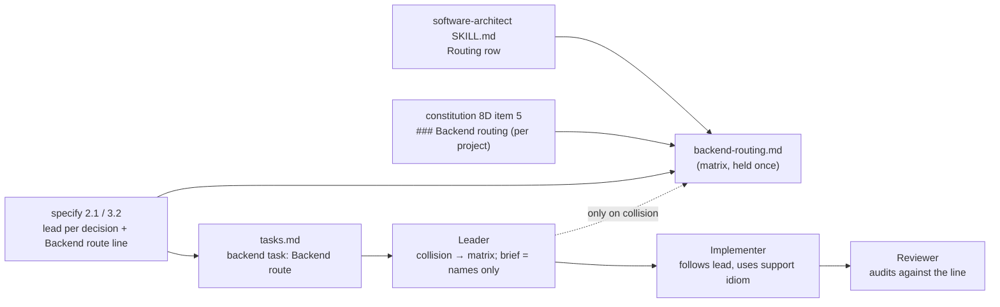

# Design: Backend Skill Routing — one owner per backend decision

## 1. Document Control

| Field | Value |
|---|---|
| Spec Path | `changes/go-backend-routing/backend-skill-routing` |
| Depth | Standard (re-checked in §12) |
| Type / Deliverable | Change / `software` |
| Approval Mode | `gated` — every gate stops for JC; no push, PR or merge in this cycle |
| Status | **Revision 2**, Phase 2. Revision 1 (`c5d8eb7`) went through judgment-day round 1 (`judgment.md`); JC chose **Fix only** (2026-11-02: "Corrige el alcance recomendado sin re-juzgar") for C-1 – C-7, B-J-5, B-J-6, B-J-10. This revision is **fixed, not re-judged**. **Approved by JC 2026-11-02** ("Sí, aprueba el diseño y sigue a la fase 3 (tasks.md)") |
| Requirements | `requirements.md` revision 2, approved by JC 2026-11-02 (commit `9cecfd6`) |
| Verified at | `9cecfd6` (rev. 1 rows); rev. 2 rows at `95ef44d` — no shipped file differs from `d8a9744`, `origin/dev` |
| Schema source | `.claude/skills/impeccable-bridge/references/design-routing.md` and its archived spec `docs/specs/archive/2026-11-01-changes--design-skill-routing/design.md` |
| Skills applied | `brainstorming`, `cognitive-doc-design`, `software-architect` (subject; the change is not architecturally significant: no runtime, data or topology change), `diagram-design` (one slot, §3) |
| Amendment | **A-1** to `requirements.md` Glossary *Lead* (§10 DD-4) — **approved by JC 2026-11-02**, with DD-7 ("Aprueba A-1 y DD-7, y corre judgment-day"); applied to `requirements.md` |

## 2. Executive Summary

One new shipped file, `.claude/skills/software-architect/references/backend-routing.md`, holds the **Backend Routing Matrix**: decision rule, stack table, 19 rows (10 activities; `architecture`, `module-design` and `performance` split by the architecturally significant test, `framework-selection` by stack and significance, `implement` by stack), nine expertise cards, the `Backend route:` line and attribution. Everything else points at it:

- `software-architect/SKILL.md` *Routing* table gains one row (FR-9).
- `/akili-specify` Step 2.1 gets one pointer sentence; Step 3.2 gets a **Preferred backend skill rule** that writes a `Backend route:` line into every backend task (FR-6).
- The Leader persona item 3 gains one swap example: a collision resolves from the matrix, the brief carries names only, and a task with no line runs as today (FR-5).
- `/akili-constitution` Step 8D gains item 5, `### Backend routing`, plus one mode-policy bullet (FR-7).
- Repo `AGENTS.md` gets `## Backend Skills` (FR-8); ten docs files, the CHANGELOG, one new contract test file and one updated test (five count sites) follow.
- Where an install predates this change and has no `backend-routing.md`, specify and the Leader proceed as today and say so once (B-J-10).

## 3. Architecture Overview

**Live path (P-5, P-9).** `tasks.md` backend task → Scope carries `Backend route: stack <s>; <activity> lead <x> support <y>; …` and its skill list names the same backend skills → the Leader passes the scope verbatim (existing brief contract) and selects skills; it opens the matrix only when two assigned skills claim one decision → the Implementer reads the line, never the matrix. The matrix reaches every install target through the whole-folder skill copy (P-5).

## 4. Extended Directory Structure

| Path | Change | Task |
|---|---|---|
| `.claude/skills/software-architect/references/backend-routing.md` | **New.** The matrix (§8) | T1 |
| `test/install-cursor.test.js` | Packaged skill-file count `+ 1` at all five sites: `:228` comment (`14 + 317 = 331`), `:244` comment, `:249` constant, `:253` message, `:347` comment (P-6, C-6) | T1 |
| `.claude/skills/software-architect/SKILL.md` | *Routing* table: one row (no version bump: NFR-2 allows only the FR-9 row) | T2 |
| `.claude/commands/akili-specify.md` | Step 2.1 pointer sentence; Step 3.2 skill-inventory sentence; new *Preferred backend skill rule* placed **before** *Preferred UI/UX skill rule* (P-7) | T3 |
| `.claude/commands/akili-constitution.md` | Step 8D item 5; one *Mode-specific policy* bullet after the existing three | T4 |
| `.claude/templates/leader.md` | `primary-instructions` section, item 3: one swap example in the parenthesis plus one sentence after it (collision → matrix; names only; no line → as today; `tdd` switch; absent file → as today) | T5 |
| `AGENTS.md` | `## Backend Skills` between `## Design Skills` and `## CodeGraph` | T6 |
| `CHANGELOG.md` | `Unreleased` entry, incl. the `--force` note for installs that already hold `software-architect` | T6 |
| `docs/skills/software-architect.md`, `docs/skills/governance.md`, `docs/flow.md` §9 `stack` bullet, `docs/commands/akili-specify.md`, `docs/commands/akili-constitution.md` | Name the matrix (FR-8) | T7 |
| `docs/skills/{nestjs-expert,aws-serverless,ai-agent-development}.md`, `docs/overview.md` (`ai-agent-development` row), `docs/skills/README.md` (`ai-agent-development` row) | One clause each where the page states a role the matrix narrows (P-13, C-5); first-cell names and links unchanged (`docs-overview.test.js` keys on them, P-21) | T7 |
| `test/backend-skill-routing.test.js` | **New** contract tests (§7.2) | T8 |

`AGENTS.md` `## Skill Usage` lines on `software-architect` and domain skills stay as they are: they say when to use a skill, not who leads a decision, and `## Backend Skills` carries the pointer (C-5).

Not touched: the nine routed skills except `software-architect/SKILL.md` (NFR-2); `impeccable-bridge/**`, `design-routing.md`, `AGENTS.md` `## Design Skills`, Step 8D item 4 and its three policy bullets (NFR-4); `architecture-styles.md` (FR-9); `akili-execute.md`; `bin/`, `scripts/`; `.claude/templates/digests.json` (written by `release.js`).

## 5. Data Model

### 5.1 `Backend route:` line (one per backend task, in Scope)

Form: `Backend route: stack <stack>; <activity> lead <lead> support <support>[; <activity> lead <lead> support <support>]`

| Field | Values | Source |
|---|---|---|
| Stack | `Go` · `NestJS` · `AWS serverless` · `AI agent` · `other` (a project may hold several; the line names the stack of the code the task touches) | project `## Skill Map` / `### Backend routing` |
| Activity | the 10 activities of the requirements Glossary, only those the task touches. Tests: `test-first` only when the task's skills list `tdd`, else `test-suite` (C-3) | spec `design.md` |
| Lead | a skill name, or one of the two named sources (DD-4) | matrix row for (activity, context) |
| Support | skill name(s) or `none — project conventions` | matrix row + stack table |

A backend task is one whose scope touches server-side code, an API contract, an error model or backend tests. Its skill list names exactly the FR-1 backend skills the line names; other skills are unaffected.

**`tdd` ownership (C-3).** Specify only *recommends* `tdd` by listing it; the Leader decides (`leader.md` item 3). When the Leader adds `tdd`, the brief reads the line's `test-suite` entry as `test-first lead tdd`; when it drops `tdd`, `test-first` reads as `test-suite lead the spec's scenarios`. Either switch is the existing one-line deviation record in `execution.md`, so the line and the list never disagree silently.

### 5.2 `### Backend routing` block (project `AGENTS.md`, under `## Skill Map`)

Scaffolded only when the project has server-side code (any stack, packaged skill or not). Fields, one line each: stack(s) with evidence path · stack support skill per stack, named only from the Skill Map just built, or `none — project conventions` · one line pointing at the matrix by name. No matrix rows.

## 6. API Design

None — no CLI, flag or file-format change.

## 7. Backend Module Design (rules text and tests)

### 7.1 Enumerated-value walk

The design adds two enumerations (backend activity; stack) and one task-Scope line. Consumers of each:

| Consumer | Reads | Effect |
|---|---|---|
| `/akili-specify` Step 2.1 / 3.2 | activities, stacks, matrix rows | records lead per decision; writes `Backend route:` |
| Leader item 3 (`/akili-execute`) | the line; the matrix on collision | swap example; no line → runs as today; adding or dropping `tdd` switches the line's test activity (C-3) |
| Implementer, Reviewer | the line through the task scope | no persona change; the line is self-sufficient |
| `/akili-constitution` Step 8D | stacks | item 5 block |
| `/akili-test` Tester | task skill lists (existing) | none; the `test-suite` row names the Tester contract as source |
| `/akili-validate`, `/akili-audit` | none | none |

Stack value `other` falls through explicitly: its `implement` row leads with *existing design* and `framework-selection` uses the non-agent rows (KZ-004). A support idiom a stack does not have (a race detector outside Go, cold starts outside Lambda) is skipped, never substituted (B-J-6).

### 7.2 Tests

**New — `test/backend-skill-routing.test.js`:**

| Test | Asserts | Falsifier |
|---|---|---|
| Held once | Each matrix row signature (`\| **<activity>** \| <context> \|`) and each card signature (`\| \`<skill>\` \| <expert at> \|`) appears in `backend-routing.md` and in no other file under `.claude/`, `docs/` (minus `docs/specs/`), `AGENTS.md`, `README.md` | Paste one row into `akili-specify.md` |
| Skill set | The nine FR-1 skills each exist as a folder; the card set equals them; each of the nine is named in at least one *Matrix* row (C-4); `AGENTS.md` `## Backend Skills` names the same nine | Delete the `aws-serverless` card; delete the `implement` / `AWS serverless` row |
| Activities | Each of the 10 activities has ≥ 1 row; `architecture`, `module-design`, `performance` have both a `significant` and a `not significant` row; `implement` has one row per stack in the stack table | Delete the `performance` / `not significant` row |
| One lead | Every row's Lead cell holds one name (no `+`, `,`, ` or `, `/`) | Write `` `tdd` + `golang-pro` `` in a Lead cell |
| Stack lead closed | A Lead cell naming a stack skill (Glossary sense: `golang-pro`, `nestjs-expert`, `aws-serverless`, `ai-agent-development`, or *the agent's runtime skill*) appears only on `implement` and `framework-selection` rows | Put `golang-pro` as Lead of `test-first` |
| Card evidence | Each card's `file → heading` resolves to an existing heading of that file | Change one card's evidence to `tdd/SKILL.md` → *Seams* (the real heading is *Seams — where tests go*) |
| No line pointers | Matrix, the specify backend rule, Step 8D item 5, `## Backend Skills` hold no `\.(md\|js):\d+` | Write `SKILL.md:3` in a card |
| Wiring | specify Step 2.1 and 3.2 name `backend-routing.md` and `Backend route:`; 8D names `### Backend routing`; leader names `backend-routing.md` and keeps `UI → \`impeccable-bridge\``; software-architect *Routing* has the row; matrix names `project-structure.md`, which exists in `golang-pro/references/` | Revert any one edit |
| Governance | The specify backend rule and 8D item 5 name no `binding: stack` skill (computed from frontmatter, so `api-design-principles` and `error-handling-patterns` count) | Write `api-design-principles` in the rule |
| Legacy task | Leader item 3 states that a task with no `Backend route:` line runs as today | Delete the clause |
| Names only (FR-5 BUT) | Leader item 3 states the brief carries only the lead and support names, never the matrix | Delete the clause |
| `tdd` switch (C-3) | Leader item 3 and the specify backend rule both state that `test-first` appears only when `tdd` is listed and that the Leader's switch is a deviation record | Delete either clause |
| Absent file (B-J-10) | Specify Step 2.1 pointer and Leader item 3 each state that a missing `backend-routing.md` means "proceed as today and say so once" | Delete either clause |
| No install advice (FR-3, FR-7) | The specify backend rule, Step 8D item 5 and the matrix *Stack table* contain no `install` recommendation | Write "install `golang-pro`" in item 5 |

**Updated — `test/install-cursor.test.js`:** `SKILL_FILE_EXPECTED` gains `+ 1` (`backend-routing.md`); the message at `:253` and the comments at `:228`, `:244`, `:347` move from 317 / 331 to 318 / 332 (P-6, C-6). T1 greps the file for `317` and `331` after the edit and expects no hit.

**Must stay green unchanged:** `design-skill-routing.test.js` (slices in P-7), `design-skill-routing-coverage.test.js` (slices in P-19), `golang-skill.test.js` (hash lock; candidate-pool slices in P-19), `impeccable-bridge.test.js`, `diagram-design.test.js`, `docs-overview.test.js` (no skill added), `persona-digests.test.js`, `agents-doctor.test.js` (section ids and markers unchanged, only the body of `primary-instructions` changes).

## 8. The matrix content (`backend-routing.md`)

### 8.1 Decision rule (top of the file)

1. **The method skill decides what and why; the stack skill decides how in this language or framework.**
2. **One lead per activity and context.** Supporting skills give inputs, not rules.
3. **Context picks the row; the stack picks the support.** The architecturally significant test is `/akili-specify` Step 2.1's; Bug track sends diagnosis to `bug-diagnosis`; the stack comes from the project `## Skill Map`.
4. **Two named sources may lead** when no skill is loaded for the decision: *existing design* (the TRD and the nearest existing module) and *the spec's scenarios* (`requirements.md`, run through the `/akili-test` Tester contract) (DD-4).
5. **Decisions already in `design.md` bind the implement step.** A stack skill never reopens them; a conflict is a spec gap for the Pivot Protocol.
6. **Where two stack skills apply** (NestJS on AWS Lambda), the framework skill supports code inside the application and the platform skill supports the handler, event source and infrastructure; for `implement` the line names the one matching the code the task touches.
7. **A support idiom a stack lacks is skipped**, never substituted (a race detector outside Go).
8. **`tdd` is the Leader's to assign.** `test-first` applies only when the task's skills list `tdd`; otherwise `test-suite` applies.

### 8.2 Stack table

| Stack (Skill Map) | Stack skill | Idiom it supplies |
|---|---|---|
| Go | `golang-pro` | goroutines and channels, interfaces, generics, `%w` wrapping, table-driven tests with `-race`, pprof, module layout (`references/project-structure.md`); no framework-choice text |
| NestJS | `nestjs-expert` | modules and DI, controllers, guards, interceptors, pipes, exception filters, Jest/Supertest, TypeORM/Mongoose, Passport |
| AWS serverless | `aws-serverless` | Lambda handler shape, API Gateway and SQS integration, SAM templates, cold-start anti-patterns |
| AI agent | `ai-agent-development` (decisions) + the runtime skill the Skill Map lists for the agent's runtime (implementation) | framework and runtime selection, hosting choice, agent state, tools, memory and HITL inputs; it does not own SDK usage or deployment (its *Scope & Composition*) |
| other | none — project conventions | — (fall-through in §7.1) |

### 8.3 Matrix (activity × context)

| Activity | Context | Lead | Support | Row rule |
|---|---|---|---|---|
| **architecture** | significant | `software-architect` | stack skill (feasibility, idiom); AI agent: `ai-agent-development` (state, tools, memory, HITL inputs) | The stack skill picks no style, NFR target or ADR |
| **architecture** | not significant | existing design | stack skill (idiom) | No new style is introduced |
| **framework-selection** | AI agent | `ai-agent-development` | `software-architect` (`agentic-ai.md` *Component Decision Axes*, NFR fit) | Includes the agent's hosting choice; the system's compute tier is `architecture` |
| **framework-selection** | other stacks, significant | `software-architect` | stack skill (idiom fit) | No packaged Go, NestJS or AWS skill states framework-choice criteria (B-J-5); changing the stack itself is `architecture` |
| **framework-selection** | other stacks, not significant | existing design | stack skill (idiom fit) | Keep the framework already in use |
| **module-design** | significant | `software-architect` | stack skill (layout: Go → `golang-pro` `references/project-structure.md`; NestJS modules) | The stack skill adds no pattern the design does not name |
| **module-design** | not significant | existing design | stack skill (idiom) | Follow the nearest existing module |
| **api-contract** | any | `api-design-principles` | stack skill (transport: Go handlers, Nest controllers, API Gateway) | The stack skill picks no resource model, versioning, status-code or error-body policy; for gRPC, `api-design-principles` leads versioning and compatibility only and proto idiom follows project conventions (P-15) |
| **error-model** | any | `error-handling-patterns` | stack skill (Go `%w` and no panic, Nest exception filters, Lambda error handling) | `error-handling-patterns` owns the handling philosophy, the error categories and recovery (circuit breaker, aggregation, graceful degradation); status codes and error body belong to `api-contract`; its language sections yield to the stack skill's MUST rules |
| **implement** | Go | `golang-pro` | method skills as constraints already in `design.md` | No decision recorded in `design.md` is reopened |
| **implement** | NestJS | `nestjs-expert` | method skills as constraints already in `design.md` | No decision recorded in `design.md` is reopened |
| **implement** | AWS serverless | `aws-serverless` | method skills as constraints already in `design.md` | No decision recorded in `design.md` is reopened |
| **implement** | AI agent | the agent's runtime skill (from the Skill Map; none → project conventions) | `ai-agent-development` (agent behavior constraints) | `ai-agent-development` writes no SDK or deployment code (B-J-6) |
| **implement** | other | existing design | none — project conventions | No skill is recommended for install |
| **test-first** | task lists `tdd`, Leader keeps it | `tdd` | stack skill (table-driven, `-race`, Jest/Supertest) | Expected values and seams come from `requirements.md` and `design.md`; a stack coverage target never overrides them or the Done criteria |
| **test-suite** | `tdd` not listed, or dropped by the Leader | the spec's scenarios | stack skill (runner idiom, race detector, fuzzing) | A coverage target never replaces scenario coverage |
| **bug-diagnosis** | Bug track or any failure | `systematic-debugging` | stack skill (pprof, race detector, Nest DI graph, Lambda logs) | No fix before root cause; a stack skill's root-cause list is a hypothesis, not a diagnosis |
| **performance** | significant | `software-architect` | stack skill (profiling, benchmarks, allocation, cold start) | The stack skill sets no target; optimization starts from a measured baseline |
| **performance** | not significant | existing design | stack skill (profiling, benchmarks) | Targets come from the TRD; none is invented |

### 8.4 Expertise cards

| Skill | Expert at | Supports | Must not decide | Evidence |
|---|---|---|---|---|
| `software-architect` | Style, NFR scenarios, tactics, patterns, ADRs, robust-vs-lite sizing; agent patterns through its `agentic-ai.md` reference | framework-selection (AI agent) | Language or framework idiom | `software-architect/SKILL.md` → *The Decision Spine (the AKILI method)*; → *Routing — load the matching reference* |
| `api-design-principles` | REST and GraphQL resource model, versioning, pagination, error responses | error-model (wire format) | Transport implementation; framework | `api-design-principles/SKILL.md` → *3. API Versioning Strategies*; → *REST API Design Patterns* |
| `error-handling-patterns` | Error-handling philosophies, error categories, circuit breaker, error aggregation, graceful degradation | none (lead) | Language idiom where a stack skill is assigned; status codes and error body | `error-handling-patterns/SKILL.md` → *Core Concepts*; → *Universal Patterns* |
| `tdd` | Red → green loop, seams, test anti-patterns | none (lead) | Whether it is assigned (the Leader's call); expected values (`requirements.md`) | `tdd/SKILL.md` → *Rules of the loop*; → *Seams — where tests go*; → *Anti-patterns* |
| `systematic-debugging` | Root cause before fix, four phases | none (lead) | The fix's design beyond the root cause | `systematic-debugging/SKILL.md` → *The Iron Law*; → *The Four Phases* |
| `nestjs-expert` (stack) | Nest modules, DI, controllers, guards, testing with Jest/Supertest, TypeORM/Mongoose, Passport | every other row on NestJS (leads `implement`) | Architecture decisions, testing strategy, debugging method (its description claims them) | `nestjs-expert/SKILL.md` → *Domain Coverage* |
| `golang-pro` (stack) | Concurrency, interfaces, generics, error wrapping, profiling with pprof, table-driven tests with `-race`, module layout | every other row on Go (leads `implement`) | Architecture (its *Core Workflow* step 1), framework choice, coverage targets, error categories | `golang-pro/SKILL.md` → *Core Workflow*; → *MUST DO*; → *Reference Guide* |
| `aws-serverless` (stack) | Lambda handler, API Gateway, SQS patterns, serverless anti-patterns and sharp edges | every other row on AWS serverless (leads `implement`) | Whether the system is serverless (`architecture`); framework choice | `aws-serverless/SKILL.md` → *Patterns*; → *Anti-Patterns*; → *⚠️ Sharp Edges* |
| `ai-agent-development` (stack) | Agent framework and runtime selection, hosting choice, agent state, tools, memory, HITL | architecture (agent inputs), implement (agent behavior constraints); leads `framework-selection` for agents | Overall system style and NFRs (`software-architect`); SDK usage and deployment code | `ai-agent-development/SKILL.md` → *Scope & Composition* |

Stack skills reach agents only through the project `## Skill Map` and per-task skill lists; no command text load-directs one.

### 8.5 Other sections of the file

- **Backend route line** — the form in §5.1 with its field table. No Done-criteria sentence: the existing Done criteria and the Reviewer's audit of the scope already cover it (NFR-5).
- **Go layering** — Go package layering routes to `golang-pro` → `references/project-structure.md`; `architecture-styles.md` maps Node.js/TypeScript only, and a Go mapping there is a recorded follow-up (FR-9).
- **Absent file** — the specify and Leader pointers say: when `backend-routing.md` is absent (an install older than this change, kept by the skip policy, P-20), proceed as today and say so once (B-J-10).
- **Attribution** — original AKILI reference (MIT); it names the third-party skills' headings only and contains none of their text.

## 9. Shared Contracts or Package Extensions

- `backend-routing.md` ships to all six targets through the existing whole-folder copy (P-5). Installs that already hold `software-architect` keep the old folder until `install --force` (skip policy) — CHANGELOG note.
- The Leader's `primary-instructions` section body changes; `release.js` writes the new digest and `since=` at release; `doctor --agents --fix` upgrades deployed copies.

## 10. Design Decisions

| ID | Decision | Covers | Rejected alternative (why) |
|---|---|---|---|
| DD-1 | Matrix in `software-architect/references/backend-routing.md` | FR-1, NFR-1, NFR-6 | In `SKILL.md` (loads on every TRD); a new skill (governance; no new skill); repo `AGENTS.md` (does not ship) |
| DD-2 | The reference is read **without activating** `software-architect`: specify and the Leader open the file by path for any backend design, significant or not; the SKILL.md row says so | FR-3, FR-6, P-4 | Activate the skill for every backend task (its *Activation Contract* excludes non-significant work; token cost) |
| DD-3 | Rows keyed by (activity, context); three activities split on the significant test | FR-1, FR-3 | Contexts as columns (most cells would repeat the same method lead) |
| DD-4 | **Two named sources may lead**: *existing design* (non-significant architecture, module-design, performance) and *the spec's scenarios* (`test-suite`). **Amendment A-1 (approved)**: requirements Glossary *Lead* reads "The one skill whose rule wins"; A-1 makes it "The one skill — or, where no skill is loaded for the decision, the named source (*existing design*, *the spec's scenarios*) — whose rule wins" | FR-1 BUT (no row without a lead), FR-3 | Make `software-architect` lead non-significant rows (contradicts FR-3 "not loaded"); make `tdd` lead every test suite (makes a Leader-assigned skill blanket, against `leader.md` item 3) |
| DD-5 | The specify backend rule is placed **before** *Preferred UI/UX skill rule*, and both new command texts name no `binding: stack` skill. The Step 2.1 pointer goes after the fallback list, inside the `golang-skill.test.js` and coverage slices (P-19): it keeps the `- \`golang-pro\`` list line, names no `gsap-animation` and no stack skill | NFR-3, NFR-4, P-7, P-19 | After the UI rule (falls inside the design test's slice) |
| DD-6 | 8D item 5 plus **one new policy bullet** placed after the Safe Update bullet ("the `### Backend routing` block follows the same three policies"), not starting with `**Active AKILI-SPECS (Safe Update):**`. Item 5 sits between item 4 and `**Mode-specific policy`, so it falls inside the item-4 slices of both design tests and must name no `binding: stack` skill and no `file:line` (P-7, P-19) | FR-7, NFR-4 | Append clauses to the three design bullets (edits `### Design routing` text) |
| DD-7 | AI agent: `software-architect` leads agent pattern choice (its `agentic-ai.md` *Pattern Catalog*); `ai-agent-development` leads `framework-selection` (incl. hosting choice) and supports architecture with state, tools, memory and HITL inputs; `implement` is led by the agent's runtime skill (B-J-6). Approved by JC 2026-11-02 | FR-1 MUST (stack lead only implement, framework-selection), Q2 | `ai-agent-development` leads agent architecture (its *Scope & Composition* says "Owns … agent architecture", but FR-1 forbids a stack lead there) — **judgment target** |
| DD-8 | gRPC: `api-design-principles` leads versioning and compatibility only; proto and service idiom follow project conventions, since no packaged skill states gRPC idiom in its body (P-15, C-2) | FR-1, P-15 | `golang-pro` leads gRPC contracts (FR-1 forbids); no lead for gRPC (FR-1 BUT) |
| DD-9 | Error model split: philosophy, categories and recovery to `error-handling-patterns`; language idiom to the stack skill; status codes and error body to `api-contract` (`api-design-principles` *Pattern 3: Error Handling and Status Codes*) | FR-2, O4 | One lead for everything (`error-handling-patterns`' Go section would override `golang-pro`'s MUST rules) |
| DD-10 | Leader change is one swap example in item 3 plus one sentence after the parenthesis; no new persona item | FR-5, NFR-5 | A new persona item (section churn); an `/akili-execute` step (commands stay skill-agnostic) |
| DD-11 | `Backend route:` line with no Done-criteria sentence | FR-6, NFR-5 | Mirror the design line's evidence sentence (backend has no build report to cite) |
| DD-12 | Repo `AGENTS.md` `## Backend Skills`: rule + one-line roles for the nine + pointer | FR-8 | Full matrix copy (NFR-1) |
| DD-13 | One new test file; one count updated | §8 defect classes | Extend `design-skill-routing.test.js` (couples two specs' contracts) |
| DD-14 | `framework-selection` outside AI agents is led by `software-architect` (significant) or existing design (not), since no packaged Go, NestJS or AWS skill states framework-choice criteria | FR-1, B-J-5 | Stack skill leads every stack (a lead with no text behind it) |
| DD-15 | `implement` split per stack so every stack skill is named in a row | FR-1 "each skill appears in at least one row", C-4 | One generic `stack skill` row (names four skills nowhere in the matrix) |

### Reversion challenges (Step 2.3)

No DD removes, disables or inverts shipped behavior: every change adds a row, a sentence, a section or a file. The nearest case — `nestjs-expert`'s own description claiming "architecture decisions, testing strategies … debugging" — is overridden at routing time, not removed; its bytes stay (NFR-2). Challenge not triggered.

## 11. Premise Ledger

**Count:** 21 rows · 21 verified · 0 `UNVERIFIED` (0 High, 0 Low).
**Blast-radius triggers:** `live-path` (how a backend task reaches the Implementer — P-9; how the file reaches installs — P-5), `shared-state` (`akili-specify` Step 3.2 and Step 8D text that the design spec's tests also read — P-7), `consumer` (tests pinning file counts and wording — P-6, P-7, P-17, P-19, P-21; docs stating backend-skill roles — P-13); `live-path` also covers installs that predate the file (P-20).

| # | Claim | Class | Citation (as run) | Verified at | If false | Settled by |
|---|---|---|---|---|---|---|
| P-1 | Stack skills claim method decisions | location | `.claude/skills/nestjs-expert/SKILL.md:3` (description: "architecture decisions, testing strategies, performance optimization, or debugging"); `golang-pro/SKILL.md` *Core Workflow* 1 "Analyze architecture", 6 "80%+ coverage"; `error-handling-patterns/SKILL.md:340` `### Go Error Handling` | `9cecfd6` | Spec unnecessary (High) | — |
| P-2 | `software-architect` has a *Routing* table and maps layers for Node.js/TypeScript only | location | `grep -n "^## Routing" .claude/skills/software-architect/SKILL.md` → `58`; row at `:63` "incl. Node.js/TypeScript layer mapping" | `9cecfd6` | FR-9 row placement (Low) | — |
| P-3 | `golang-pro` ships `references/project-structure.md` | existence | `ls .claude/skills/golang-pro/references` → `concurrency.md generics.md interfaces.md project-structure.md testing.md` | `9cecfd6` | FR-9 route target (Low) | — |
| P-4 | `software-architect` activates only for significant work and excludes trivial and single-component changes | location | `software-architect/SKILL.md:22-28` (*Activation Contract*) | `9cecfd6` | DD-2 unnecessary (High) | — |
| P-5 | A new file under a skill folder ships to every target (whole folder copied) | live-path | `HOME=$(mktemp -d) node bin/akili.js install --tool all --dry-run 2>&1 \| grep -c software-architect` → `7` (directory entries; `.agents` serves Codex and Cursor) | `9cecfd6` | DD-1 needs an installer change (High) | — |
| P-6 | `install-cursor.test.js` pins the packaged skill-file count; a new file turns it red | consumer | `grep -n "SKILL_FILE_EXPECTED\s*=" test/*.js` → `test/install-cursor.test.js:249: const SKILL_FILE_EXPECTED = 247 + 58 + 3 + 1 + 8;`; `grep -n "317\|331" test/install-cursor.test.js` → `:228`, `:244`, `:347` (rev. 2, C-6) | `9cecfd6` | T1 cannot close green (High) | — |
| P-7 | `design-skill-routing.test.js` slices specify from `Preferred UI/UX skill rule:` to `#### Step 3.3` and Step 8D from item 4 to `**Mode-specific policy`, asserting no `binding: stack` skill and no `file:line` pointer there; it reads `leader.md` whole for pointers and asserts it contains ``UI → `impeccable-bridge` `` | shared-state | `test/design-skill-routing.test.js:139-141` (A-15b slices), `:149-150` (`leader.md` in the whole-file list), `:203` (UI example), `:212-213` (FR-3 slices) | `9cecfd6` | DD-5, DD-6 placement; red design tests (High) | — |
| P-8 | Governance forbids load-directing `stack` skills in command text, with three carve-outs; `api-design-principles` and `error-handling-patterns` carry `binding: stack` | other | `docs/skills/governance.md:76`; `grep -n "binding:" .claude/skills/{api-design-principles,error-handling-patterns}/SKILL.md` → `binding: stack` each | `9cecfd6` | DD-5 wording (Low) | — |
| P-9 | The Leader copies the task scope into the brief; item 3 lives in section `primary-instructions` and records skill deviations as a one-line reason in `execution.md` | live-path | `.claude/commands/akili-execute.md:186` ("the active task ID, title, and scope from `tasks.md` (copied — it is the work order)"); `.claude/templates/leader.md:13` (`akili:section id=primary-instructions since=v2.41.0`), `:25` ("When you deviate from the task's list, record a one-line reason in `execution.md`") | `9cecfd6` | FR-5 wiring (High) | — |
| P-10 | Specify Step 2.1 ends with the no-map fallback list; Step 3.2 carries the skill-inventory sentence and the UI rule | location | `.claude/commands/akili-specify.md:241` ("prefer the project's `## Skill Map` … otherwise pick from:"), `:427`, `:461` | `9cecfd6` | T3 sites (Low) | — |
| P-11 | Step 8D item 4 is the design block, followed by three mode-policy bullets | location | `.claude/commands/akili-constitution.md:751`, `:761` (`**Mode-specific policy`), `:763-771` (bullets) | `9cecfd6` | T4 sites (Low) | — |
| P-12 | Repo `AGENTS.md` has `## Design Skills` then `## CodeGraph`; the design test reads `## Design Skills` up to the next `##` | shared-state | `grep -n "^## " AGENTS.md` → `68 Design Skills`, `83 CodeGraph`; `test/design-skill-routing.test.js:26-32` (`section`) | `9cecfd6` | T6 placement (Low) | — |
| P-13 | Docs pages that state a role the matrix narrows: `docs/skills/nestjs-expert.md:5`, `aws-serverless.md:9`, `ai-agent-development.md:12`, `docs/overview.md:78`, `docs/skills/README.md:21`; no other page under `docs/`, `AGENTS.md` or `README.md` does; the matrix is named nowhere yet | consumer | rev. 2 (C-5): `grep -nE "agent architecture\|architecture decisions\|testing strateg\|Guides NestJS architecture\|serverless architecture" docs/*.md docs/commands/*.md docs/skills/*.md AGENTS.md README.md` → those five plus `docs/flow.md:184` (TRD content, not a skill role) and `aws-serverless.md:16` (constitution baseline use, consistent); rev. 1: `grep -niE 'architect\|routing\|lead' docs/skills/{nestjs-expert,golang-pro,aws-serverless,ai-agent-development,tdd}.md`; `grep -rn "backend-routing\|Backend route\|Backend routing\|Backend Skills" .claude docs/*.md docs/skills docs/commands AGENTS.md README.md test` → only `golang-skill` spec-path strings | `9cecfd6` | Docs contradict the matrix (Low; T7) | — |
| P-14 | Two AKILI skills claim agent architecture: `ai-agent-development` "Owns: framework and runtime selection; agent architecture …"; `software-architect` `references/agentic-ai.md` holds *Pattern Catalog* and *Component Decision Axes* | other | `ai-agent-development/SKILL.md:18-20` (*Scope & Composition*); `grep -n "^#" .claude/skills/software-architect/references/agentic-ai.md` → `5 Pattern Catalog`, `30 Component Decision Axes` | `9cecfd6` | DD-7 (High) | — |
| P-15 | `api-design-principles` covers REST and GraphQL and never mentions gRPC | data-env | `grep -ci grpc .claude/skills/api-design-principles/SKILL.md` → `0`; headings `### 1. RESTful Design Principles`, `### 2. GraphQL Design Principles`, `### 3. API Versioning Strategies` | `9cecfd6` | DD-8 (Low) | — |
| P-16 | Every heading the cards cite exists and states the card's claim | existence | `grep -n "^#\{1,3\} " .claude/skills/<skill>/SKILL.md` for the nine: *The Decision Spine (the AKILI method)* `:30`, *Routing — load the matching reference* `:58`, *3. API Versioning Strategies* `:63`, *REST API Design Patterns* `:84`, *Core Concepts* `:29`, *Universal Patterns* `:404`, *Rules of the loop* `:42`, *Seams — where tests go* `:26`, *Anti-patterns* `:34`, *The Iron Law* `:24`, *The Four Phases* `:54`, *Domain Coverage* `:36`, *Core Workflow* `:25`, *Reference Guide* `:34`, *MUST DO* `:96`, *Patterns* `:16`, *Anti-Patterns* `:301`, *⚠️ Sharp Edges* `:320`, *Scope & Composition* `:18`; claims re-read against each heading's body in rev. 2 (C-2) | `9cecfd6` | Card test red (Low) | — |
| P-17 | `golang-pro` is hash-locked; its four candidate pools are asserted | consumer | `test/golang-skill.test.js:86` (pinned blob SHA per file), `:126` (four candidate pools) | `9cecfd6` | NFR-2 breach is caught (Low) | — |
| P-18 | No kaizen Active Lesson forbids this shape; applied: KZ-changes--gate-falsifiability-2 (FR walk term by term), KZ-changes--leader-brief-contract-2 (falsifiers executed before written, at Phase 3), KZ-005 (no line pointers), KZ-002 (aggregate claims grepped), KZ-004 (`other` fall-through), KZ-changes--kaizen-loop-closure-2 (phrase sweep before Reviewer), KZ-bugfix--init-ctrlc-abort-2 (test budget) | other | `docs/specs/kaizen-log.md` `## Active Lessons`, 10 rows read | `9cecfd6` | Budget and test rules (Low) | — |
| P-19 | Two more tests slice the text T3/T4 edit: `design-skill-routing-coverage.test.js` slices specify Step 2.1 (every `gsap-animation` line there must carry the GSAP gate), Step 8D item 4 to `**Mode-specific policy`, the Step 8D policy block to `### Step 8E` split on `"\n- "` (finds the bullet starting `**Active AKILI-SPECS (Safe Update):**`) and the UI rule; `golang-skill.test.js` slices specify `Use additional stack skills as needed` to `#### Step 2.2` and asserts the `- \`golang-pro\`` line | consumer | `grep -n "between(\|section(" test/design-skill-routing-coverage.test.js` → `:69`, `:112`, `:120`, `:135`, `:151` (and matrix-only sections); `:136` (Safe Update split); `sed -n 126,137p test/golang-skill.test.js` | `95ef44d` | DD-5, DD-6 placement; red tests (High; C-1) | — |
| P-20 | An install that already holds the `software-architect` folder skips it without `--force`, so command and persona text may point at a missing `backend-routing.md` | live-path | `bin/akili.js:1039-1049` (`if (exists && !takeover && !args.force)` → `skip existing`) | `95ef44d` | §8.5 absent-file fallback (Low; B-J-10) | — |
| P-21 | `docs-overview.test.js` keys skill tables on first-cell names and links, not on the description cells T7 edits | consumer | `test/docs-overview.test.js:112-119` (`firstCellName`, `firstCellLink`) | `95ef44d` | T7 wording breaks a test (Low) | — |

## 12. Budget (Step 2.4)

| Measure | Estimate |
|---|---|
| Tasks | 9 — T1 matrix + count (five sites); T2 `software-architect` row; T3 `akili-specify`; T4 Step 8D; T5 Leader; T6 `AGENTS.md` + CHANGELOG; T7 docs; T8 contract tests; T9 held-out walkthrough (HITL) |
| LOC | ~650 — ~330 prose (matrix ~170, commands/persona/guide ~100, docs ~40, CHANGELOG ~20) + ~320 tests (KZ-bugfix--init-ctrlc-abort-2: text-contract tests ship near 3× a naive estimate) |
| Review rounds | ~18 (two per task; rules documents) |

Depth: Standard holds (proposal ~500 LOC; design resolves to ~650 across nine tasks, each one document).

**Cap check.** No requirement fixes a numeric cap on an artifact.

## 13. Diagrams

§3 carries the one diagram this change alters (backend routing delivery path).
