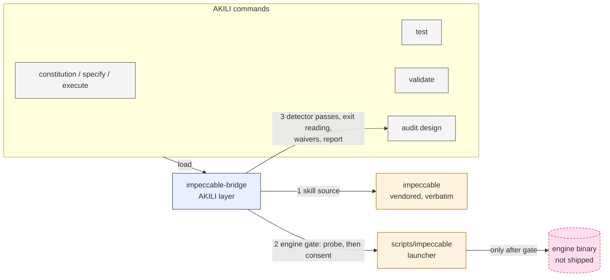

# Design: Ship Impeccable inside AKILI, and harden its design gates

## 1. Document Control

| Field | Value |
|---|---|
| Spec Path | `changes/impeccable-hardening` |
| Depth | Standard (upper end) |
| Status | **Approved** by Juan Carlos Cadavid, 2026-10-30 11:19 (UTC-5), without Review Design. Phase 3 in progress |
| Requirements | `requirements.md` revision 2, approved 2026-10-30 11:02 (UTC-5) |
| Verified at | AKILI `f548bc6`; upstream `pbakaus/impeccable` `df3a4ab` (read-only clone in the session scratchpad) |
| Skills applied | `software-architect` (vendoring is a new dependency and a supply-chain boundary), `impeccable-bridge` (the subject) |
| Lessons applied | KZ-changes--kaizen-loop-closure-2 (paraphrase sweep, DD-9), KZ-004 (enumerated-value walk, §7), KZ-005 (no line pointers), KZ-002 (counts grepped first, P-9), KZ-bugfix--init-ctrlc-abort-2 (test budget ×3, §12), KZ-changes--archify-diagrams-1 (no test reads `docs/specs/changes/`) |

## 2. Executive Summary

The change has two layers and one boundary:

| Layer | Folder | Owner | Changes when |
|---|---|---|---|
| **Impeccable** (upstream instructions, launcher, assets) | `.claude/skills/impeccable/` | Paul Bakaus, Apache-2.0, vendored byte-identical | A maintainer runs `scripts/sync-impeccable.js` against a new upstream pin |
| **AKILI layer** (phases, gates, consent, report, source of truth) | `.claude/skills/impeccable-bridge/` | AKILI, MIT | An AKILI spec changes it |

The **engine boundary** sits between them. The upstream launcher would download a native binary. AKILI never lets an AKILI step reach the launcher before the bridge's engine gate passes. Everything else — the gate passes, the waiver matching and the report fields — is prose in the bridge and its reference, read by the commands.

## 3. Architecture Overview



The order of a design step:

1. The command loads the bridge.
2. The bridge records the **skill source** (vendored / user-installed / missing).
3. The bridge runs the **engine probe** (no-download locations only).
4. If no engine answers, the bridge asks for **consent** once per session.
5. Only then may the agent follow Impeccable's Setup (`scripts/impeccable context`) or run the detector. Until then, Impeccable's own *Launcher unavailable* path applies.
6. Gate passes run per the scan matrix. Exits are read per FR-7, and findings are matched against waivers.

## 4. Extended Directory Structure

```text
.claude/skills/impeccable/              NEW — vendored (58 upstream files, byte-identical except SKILL.md frontmatter)
  SKILL.md                              upstream + AKILI metadata block (DD-3)
  reference/**.md                       upstream (46 + degraded/4)
  scripts/impeccable                    upstream launcher, mode 100755
  scripts/impeccable.cmd                upstream, CRLF (DD-6)
  scripts/*.js, data/*.json, VERSION, engine-checksums.txt, command-metadata.json
  LICENSE                               NEW (AKILI-provided copy of upstream Apache-2.0 text)
  NOTICE                                NEW (upstream NOTICE.md + AKILI modification statement)
  UPSTREAM.md                           NEW (pin + sha256 per upstream file)
.claude/skills/impeccable-bridge/
  SKILL.md                              REWRITTEN (DD-4, DD-5)
  references/design-evaluation.md       EXTENDED (E-steps, template)
scripts/sync-impeccable.js              NEW, not shipped (not in package.json "files")
test/impeccable-vendor.test.js          NEW
test/impeccable-bridge.test.js          AMENDED
.gitattributes                          + `.claude/skills/impeccable/** -text`
```

## 5. Data Model

### 5.1 `UPSTREAM.md`

| Section | Content |
|---|---|
| Header table | `Source` (`https://github.com/pbakaus/impeccable`), `Build` (`.claude/skills/impeccable/`), `Commit` (full SHA), `Skill version` (from upstream frontmatter), `Engine version` (from `scripts/VERSION`), `Vendored` (date), `Synced by` (`scripts/sync-impeccable.js`) |
| Modification | One line: "`SKILL.md`: AKILI `metadata` block inserted before the closing frontmatter fence; no other file modified" |
| Checksums | A fenced block, one line per upstream file: `<sha256>  <path relative to the skill folder>`, sorted by path. `SKILL.md`'s hash is of the **upstream** bytes |

### 5.2 Frontmatter block (DD-3)

Inserted as the last frontmatter key, immediately before the closing `---`:

| Key | Value |
|---|---|
| `metadata.author` | `Paul Bakaus` |
| `metadata.source` | `https://github.com/pbakaus/impeccable (<short commit>, .claude build)` |
| `metadata.adapted-by` | `Juan Carlos Cadavid — jcadavid.com` |
| `metadata.adapted-for` | `AKILI-SPECS (vendored verbatim; see UPSTREAM.md)` |
| `metadata.binding` | `conditional` |

Removing the lines from `metadata:` up to the closing fence restores upstream bytes exactly, because upstream's `.claude` build has no `metadata` key (P-11). The test relies on this property.

### 5.3 Design Waivers row (FR-12)

| Column | Content |
|---|---|
| Rule | Detector rule id |
| Scope | Selector, file glob or value |
| Reason | Why the pattern is intended |
| Approver | Name |
| Date | `YYYY-MM-DD` |

### 5.4 Report fields (FR-13)

These are added to the template in `design-evaluation.md` as header bullets: `Impeccable`, `Detector`, `Score source`, `Out of scope`, `Baseline`, `Performance`, `Proposed waivers`, `Report location`. There are also two new tables (*Scan matrix*, *Capture conditions*) and new `Waived?` values.

## 6. API Design

No CLI, installer or code API changes. One external contract is consumed: the upstream launcher's verbs (`engine-probe`, `context`, `detect`), its environment variables (`IMPECCABLE_BIN`, `IMPECCABLE_HOME`), and its exit codes (P-3, P-5, FR-7).

## 7. Backend Module Design (prose, tooling, tests)

### 7.1 Engine gate (bridge)

| Step | Rule |
|---|---|
| Probe | Try, in order: `IMPECCABLE_BIN` (executable) → `<skill-dir>/scripts/bin/<os>-<arch>/impeccable` → `~/.impeccable/bin/impeccable` → `${IMPECCABLE_HOME:-~/.impeccable}/bin/<VERSION>/impeccable` → `impeccable` on `PATH`. Each candidate is called directly with `engine-probe`, never through the launcher, so no download path is reachable during the probe. A candidate counts only if it prints `impeccable-engine <v>` and exits `0` |
| Ready | When a candidate answers, set `IMPECCABLE_BIN` to it for every launcher call in the phase, so the launcher execs it and never reaches its download block. Record `ready (<location>, engine <v>)` and note a version different from `VERSION` |
| Consent | When nothing answers and the platform is supported, ask once per session with the FR-5 fields. Yes → run `<launcher> engine-probe` (this is the download) → `installed (consented)` or `unavailable (<stderr line>)` |
| Declined | Do not call the launcher. Tell the agent to take Impeccable's *Launcher unavailable* path, and mark detector rows `Unevaluated (engine not installed)` |
| Pre-approved | Consent is never implied (FR-5); it is a stop like any outward-facing action |

### 7.2 Enumerated-value walk (KZ-004)

Engine and skill-source values are walked against every consumer step:

| Consumer step | `vendored` / `user-installed` | `missing` | `ready` / `installed (consented)` | `consent needed` | `declined` / `unavailable` |
|---|---|---|---|---|---|
| Constitution Step 4 (lead design skill) | Impeccable leads; `init`/`document` produce the derived `PRODUCT.md`/`DESIGN.md` | fallback chain | context loader may run | gate asks only if Impeccable's Setup is about to run | Impeccable's *Launcher unavailable* path |
| Specify Step 2.1 | Impeccable leads `shape` | fallback | — | same | same |
| Propose Visual Reference | the direction picker is offered | not offered | — | — | — |
| Execute UI tasks (via the task skill list) | the Implementer loads Impeccable's craft floor | `frontend-design` | — | asks on first launcher use | craft floor read directly |
| Test detector suite | the suite is planned | the suite is planned only if an engine exists | runs | asks before planning, or records `Unevaluated` | `Unevaluated (engine not installed)` |
| Validate design gate | critique/audit + detector + matrix + first-visit | checklist review + detector if an engine exists | gate active | asks | detector rows `Unevaluated`; the gate cannot `PASS` on them |
| Audit design | as validate, report-only | as validate | — | asks | `Unevaluated` rows |

The bridge holds this table once. A command states its row as one pointer line, or as a per-value consequence table when that is the only way to satisfy FR-4's per-value obligation; it never restates a bridge command string or a rule's wording (FR-14: point, don't restate) (amended 2026-10-30, approved by JC 12:13 UTC-5).

### 7.3 `scripts/sync-impeccable.js`

| Input | `--from <upstream checkout>` (required); `--commit <sha>` (must equal `HEAD` of the checkout) |
|---|---|
| Refuses | A dirty checkout; a HEAD that differs from `--commit`; a checkout with no `.claude/skills/impeccable/` build (amended 2026-10-30 at T1: the folder meant is the checkout's, since *Does* creates this repo's); any network use (the script imports no network module) |
| Does | Deletes `.claude/skills/impeccable/` in this repo; copies the build, preserving modes; inserts the frontmatter block; copies `LICENSE`; writes `NOTICE` (upstream `NOTICE.md` + AKILI statement); writes `UPSTREAM.md` |
| Prints | Old vs new pin, file count delta, size delta, and a reminder to update CHANGELOG and the counts tests |

### 7.4 Tests

| Test file | Asserts |
|---|---|
| `impeccable-vendor.test.js` (new) | Every `UPSTREAM.md` line hashes correctly, with `SKILL.md` checked after removing the block; no unlisted file exists besides the 3 AKILI files; no `scripts/bin/`; `LICENSE` starts with the Apache-2.0 header; `NOTICE` contains the ehmo credit, the commit and "not affiliated"; frontmatter keeps upstream keys and has `binding: conditional`; the launcher is mode `0755` (POSIX only, skipped on win32 with a reason); `impeccable.cmd` contains CRLF; `package.json` `files` does not ship `scripts/sync-impeccable.js`; the file count equals the `UPSTREAM.md` line count (NFR-4) |
| `impeccable-bridge.test.js` (amended) | The FR-4 values are present; the gate ordering ("before any launcher call"); the FR-7 table; the FR-8/FR-9 flags and `390x844`; the D-2 `WARN (unverified first visit)`; the D-3 header line; each consuming command names `impeccable-bridge` and an engine-state consequence; **negative** checks over `.claude/` + `docs/` (excluding `docs/specs/` and the vendored folder) for `npx impeccable detect`, `Unevaluated (Impeccable absent)`, `skill only`, and "never copies Impeccable" |
| Install test (inside the vendor test) | `install --tool <t> --local` into a temp dir for all six targets → `impeccable/SKILL.md`, `LICENSE`, `UPSTREAM.md` present; launcher executable (POSIX). Foreign `impeccable/` pre-seeded on Grok Bot and on Claude Code: bytes untouched and reported as foreign without `--force`; replaced whole with `--force` (amended 2026-10-30, Pivot P-7, Option A approved by JC 11:56 UTC-5) |
| Installer (T2b) | On a target with no ownership record, `installTool` gives `copyDirectoryContents(SOURCE_SKILLS, …)` a policy that judges only the `impeccable` entry: owned when the existing folder holds `UPSTREAM.md`, foreign otherwise (skipped whole, `skip foreign <path>` plus the version from its `SKILL.md` frontmatter when readable), takeover on `install --force` (moved aside, copied, then the aside copy deleted). Every other entry keeps today's behavior (amended 2026-10-30, Pivot P-7, Option A approved by JC 11:56 UTC-5) |
| Count consumers | `install-cursor.test.js` (files 247 → 247 + vendored count + 3; dirs 30 → 31); `akili-marketing-docs.test.js` (`cli.md` "30 packaged skills" → 31); `fixtures/doctor-codex-baseline.txt` (+ `OK impeccable`); `docs-overview.test.js` (inventory: the new row and page) |

## 8. Frontend / UX Component Architecture

n/a: there is no UI in this repository. The rules govern UI work in projects that install AKILI.

## 9. Shared Contracts or Package Extensions

| Surface | Change |
|---|---|
| Package contents | +1 skill folder (about 2.2 MB unpacked), shipped to all six targets |
| `.gitattributes` | `.claude/skills/impeccable/** -text`, so vendored bytes (including the CRLF `.cmd`) stay exact on Windows checkouts |
| Governance | New category *Vendored third-party (verbatim)*; Impeccable leaves *Environment-provided skills* |
| Release checklist | One step: check the upstream pin |

## 10. Design Decisions

| DD | Decision | Why | Rejected |
|---|---|---|---|
| DD-1 | Vendor upstream's **`.claude` build**, unmodified, for all six targets | AKILI's canonical source is `.claude/`; the build's Setup resolves paths from the skill's base directory, so it works wherever the folder lands (P-12) | Per-host builds (5 near-copies, ~11 MB, and an installer that would have to choose per target); rebuilding from `skill/SKILL.src.md` (needs upstream's bun toolchain) |
| DD-2 | **No engine binary in the package**; the bridge gate controls the launcher's download | 17 MB per platform × 5+ platforms; upstream already pins versions with checksums | Shipping binaries (size, signing, platform matrix); running the npm CLI via `npx` (an unstable cache, gap 10) |
| DD-3 | The only modification is a frontmatter `metadata` block, declared in `NOTICE` | Governance and the docs-overview test need `binding` (P-11). Appending a block keeps the upstream bytes recoverable for the hash test | A side-car metadata file (the governance tooling reads `SKILL.md` frontmatter only) |
| DD-4 | Keep `impeccable-bridge` (same name and binding); re-scope it to the AKILI layer | Deployed Skill Maps and `tasks.md` name it. AKILI rules must live in an MIT file AKILI owns | Merging into the vendored `SKILL.md` (proposal Option C); renaming it (churn in deployed projects) |
| DD-5 | The engine probe calls candidates **directly** with `engine-probe` and then pins `IMPECCABLE_BIN` | The launcher's own probe falls through to its download block; `IMPECCABLE_BIN` is exec'd first, so the download is unreachable once it is set (P-3) | `IMPECCABLE_LAUNCHER_PROBE=1 <launcher>`: refuses to download but also skips `PATH` and `~/.impeccable/bin/impeccable`, so it would report false negatives (P-3) |
| DD-6 | `.gitattributes` `-text` for the vendored tree | `impeccable.cmd` must stay CRLF (cmd.exe parses by byte offset), and hashes must match on Windows CI (P-8) | `eol=crlf` for `*.cmd` only (the other files would still be normalized on Windows) |
| DD-7 | Hash-lock in tests + maintainer sync script; no CI network check | Tests never touch the network; the release checklist covers freshness | Auto-sync in CI (an unreviewed supply-chain change) |
| DD-8 | The first-visit hit-test uses whatever browser automation the host has; Impeccable's `live-browser.js` is not used as AKILI's harness | `live-browser.js` is Impeccable's interactive tool, not a measurement contract; D-2 covers the case with no automation | Making Playwright a dependency |
| DD-9 | Commands point at the bridge: one pointer line, or a per-value consequence table when FR-4's per-value obligation needs it, never a restated bridge command string or rule wording (amended 2026-10-30, approved by JC 12:13 UTC-5); the old-phrasing sweep is keyed on the paraphrases listed in the negative test (KZ-changes--kaizen-loop-closure-2) | A rule restated in six places drifts | Restating the gate in each command (the v2.39.0 shape that let the `npx` string spread to 6 files) |
| DD-10 | `frontend-design` and `ui-ux-pro-max` keep their roles; only their "when Impeccable is installed/absent" wording changes to "when the Impeccable skill source is `missing`" | Out of scope to retire them (proposal §6) | — |

### Reversion challenges (Step 2.3)

| Reverted behavior | "What does removing this break?" | Resolution |
|---|---|---|
| The `npx --no-install impeccable` detector path (DD-2, DD-5) | A machine whose only engine is the npm CLI in the npx cache (the 2026-10-30 machine) goes from "detector ran" to `consent needed` | Accepted, because the npx cache is the unreliable location the brief asked to remove (gap 10). The consent question names the no-download alternative: set `IMPECCABLE_BIN` to an existing engine, or `npm i -g impeccable` (an install the user runs). Recorded in the docs |
| The three skill-presence states and the printed install route | Projects whose reports or Skill Maps read `installed`/`absent` | Reports are point-in-time documents and are not rewritten. Skill Maps name `impeccable-bridge`, which stays. The upstream route remains as optional advice |
| Governance rule "never vendored" for Impeccable | The other environment-provided skills could be read as now vendorable | The rule stays verbatim for them; the new category's rules are specific (verbatim, LICENSE/NOTICE/UPSTREAM, hash-lock) |

## 11. Premise Ledger

**Count:** 15 rows · 12 verified · 3 `UNVERIFIED` (High: 0, Low: 3).
**Blast-radius triggers:** `live-path` (the design names `akili install` and the command design steps), `consumer` (it adds a member to the packaged-skill set and changes the detector contract). `shared-state`: none apply — no shared runtime state; the prose rules are covered by the consumer rows.

| # | Claim | Class | Citation (as run) | Verified at | If false | Settled by |
|---|---|---|---|---|---|---|
| P-1 | `impeccable@4.8.0` on npm ships no skill text | existence | `package.json` `"files"` in `~/.npm/_npx/1a4eb60c8f6b0f89/node_modules/impeccable` → `cli/bin/`, `skill/scripts/engine-checksums.txt`, `LICENSE` | upstream 4.8.0 | DD-1 is still right, but the proposal's D3 argument weakens (High: the rationale) | — |
| P-2 | Upstream's `.claude` build is 58 files, 2.2 MB, with the launcher at mode 100755 | data-env | `find … -type f \| wc -l` → 58; `du -sh` → 2.2M; `git ls-files -s …/scripts/impeccable` → `100755` | `df3a4ab` | NFR-4 cap and test counts change (Low) | — |
| P-3 | The launcher order is `IMPECCABLE_BIN` → sibling bin → `~/.impeccable/bin/impeccable` → pinned cache → `PATH` → download; `IMPECCABLE_LAUNCHER_PROBE` skips home/`PATH` and refuses to download | location | `scripts/impeccable` header comment; `if [ -z "$probing" ] && [ -x "$home_bin" ]`; "Inside another launcher's probe: no download" | `df3a4ab` | DD-5 probe order is wrong (High) | — |
| P-4 | The skill's Setup runs `scripts/impeccable context` once per session and defines *Launcher unavailable* | existence | upstream `SKILL.md` → *Setup* step 1 and the **Launcher unavailable** paragraph | `df3a4ab` | FR-5's decline path has no upstream counterpart (High) | — |
| P-5 | The npm CLI is a valid engine for `engine-probe` (`impeccable-engine 0.1.18`) | data-env | `DO_NOT_TRACK=1 npx --no-install impeccable engine-probe` → `impeccable-engine 0.1.18`, exit 0 (macOS arm64, Node local) | 2026-10-30 | The consent question's `IMPECCABLE_BIN` advice is wrong (Low) | — |
| P-6 | The installer keeps exec bits on all six targets | live-path | `install --tool <t> --local` ×6 into scratch dirs → `-rwxr-xr-x` on `security-audit/validate-findings.cjs` in `.claude/skills`, `.config/opencode/skills`, `.gemini/{,config/,antigravity-cli/}skills`, `.agents/skills` (codex, cursor), `.grokbot/workflows` | `f548bc6` | The launcher is not executable after install; the design adds a chmod step (High) | — |
| P-7 | Skills reach every target through `copyDirectoryContents(SOURCE_SKILLS, …)` with the owned/foreign/takeover policy | live-path | `bin/akili.js`: `add(copyDirectoryContents(SOURCE_SKILLS, targetSkills, args, policy))`; the ownership-policy comment ("foreign: exists and is not listed: skip, never write") | `f548bc6` | FR-3's foreign protection needs installer code (High) | **False at T2 (2026-10-30)**: the policy is built only `if (paths.ownershipRecord)`, so it covers Grok Bot alone. Without a policy an existing folder is skipped whole as `skip existing`, and `--force` merges file by file. Settled by T2b (amended 2026-10-30, Pivot P-7, Option A approved by JC 11:56 UTC-5) |
| P-8 | `impeccable.cmd` is CRLF and upstream enforces `*.cmd text eol=crlf`; this repo's `.gitattributes` has no rule for skills | data-env | `file …/impeccable.cmd` → "with CRLF line terminators"; upstream `.gitattributes`; `cat .gitattributes` (only `test/fixtures/**` and the two SVGs) | `df3a4ab` / `f548bc6` | DD-6 is unnecessary (Low) | — |
| P-9 | Tests and docs that pin the skill set: `install-cursor.test.js` (247 files, 30 dirs), `akili-marketing-docs.test.js` (`cli.md` "30 packaged skills"), `docs/cli.md` (4 sentences), `fixtures/doctor-codex-baseline.txt` (`OK impeccable-bridge` list), `docs-overview.test.js` (readdir inventory vs `overview.md`/`skills/README.md`) | consumer | `grep -rn -E "\b(30\|247)\b" test/*.js`; `grep -rn -E "30 (packaged )?skills" README.md docs .claude`; `grep -rln impeccable-bridge test/`; `grep -n readdirSync test/docs-overview.test.js` | `f548bc6` | Hidden red tests at execute (Low; KZ-002) | — |
| P-10 | Files carrying Impeccable wording to update: `akili-{audit,validate,constitution,test,propose,specify}.md`, `ui-ux-pro-max/SKILL.md`, `frontend-design/SKILL.md`, the bridge and its reference, `docs/{overview,commands/akili-audit,skills/{impeccable-bridge,governance,README,ui-ux-pro-max,frontend-design}}.md`, `README.md` | consumer | `grep -rln -i impeccable .claude docs README.md \| grep -v docs/specs` → those 19 files | `f548bc6` | A consumer keeps old wording (High, caught by the negative test) | — |
| P-11 | Upstream's `.claude` `SKILL.md` frontmatter has no `metadata` key, and docs-overview reads `binding` as an indented key in frontmatter | data-env | upstream `SKILL.md` lines 1–8 (keys: `name`, `description`, `version`, `user-invocable`, `argument-hint`, `license`); `test/docs-overview.test.js` `skillBinding()` regex `^\s+binding:` | `df3a4ab` / `f548bc6` | The DD-3 hash restore breaks (High) | — |
| P-12 | On non-Claude hosts, the agent resolves the skill's commands from its base directory rather than the embedded `.claude/skills/impeccable/…` path | other | `UNVERIFIED — confirm at source before relying on it` | — | Impeccable commands fail on OpenCode/Codex/Cursor/Antigravity/Grok; DD-1 needs per-host builds (Low: the fallback is upstream's *Launcher unavailable*) | Accepted risk (requirements §8); first real run per host, owner: maintainer |
| P-13 | The engine's update check honors `DO_NOT_TRACK=1` | data-env | `UNVERIFIED — confirm at source before relying on it` | — | A network call without consent after install (Low: disclosure in the docs) | T7 (docs): a read of upstream `docs/` for telemetry/update-check, cited in the docs page. **Settled 2026-10-30 (T7): false.** Upstream `docs/CLI-CONTRACT.md` (`context.mjs -> impeccable context`, *Update cache* and *Env vars read*) skips the update check only for `IMPECCABLE_NO_UPDATE_CHECK` or `updateCheck: false`, and `DO_NOT_TRACK` is not among its switches. It is disclosed in `docs/skills/impeccable.md`. JC chose option (ii) at 12:13: every AKILI launcher run carries `IMPECCABLE_NO_UPDATE_CHECK=1` (FR-6 amended; task T3b) |
| P-14 | The engine binary is about 17 MB | data-env | `du -sh ~/.npm/_npx/…/@impeccable/cli-darwin-arm64` → `17M` (darwin-arm64 only) | 0.1.18 | The consent question's size is wrong on other platforms (Low) | T3: state "about 17 MB (darwin-arm64; other platforms similar)", or read sizes from the GitHub release page when the maintainer can |
| P-15 | Claude Code loads a skill whose frontmatter carries `user-invocable`, `argument-hint` and a `metadata` block | other | `UNVERIFIED — confirm at source before relying on it` (upstream ships the first two to Claude Code; AKILI skills carry `metadata`) | — | The vendored skill does not load in Claude Code (Low: both shapes ship today, separately) | T2: install into a scratch dir and list skills in a Claude Code session (HITL check at the T2 pause) |

## 12. Budget (Step 2.4)

| Measure | Estimate | Basis |
|---|---|---|
| Tasks | **11** (+T3b, P-13 option (ii), JC 12:13; was 10, before that 9; +T2b, (amended 2026-10-30, Pivot P-7, Option A approved by JC 11:56 UTC-5)) | T1 vendor + sync script + `.gitattributes`; T2 vendor/install test; T3 bridge rewrite; T4 design-evaluation reference; T5 validate/test/audit commands; T6 constitution/specify/propose + `ui-ux-pro-max`/`frontend-design` wording; T7 governance + docs + README + `cli.md` counts; T8 test amendments (bridge test, counts, fixture, negative sweep); T9 CHANGELOG + release checklist + full verification + re-walk |
| Authored LOC | **~1,365** (+~15 for T3b, JC 12:13; ~1,350 before, was ~1,250; +~100 for T2b code and tests, (amended 2026-10-30, Pivot P-7, Option A approved by JC 11:56 UTC-5)): ~550 rules prose (T3–T7), ~200 script (T1), **~500 tests** (first estimate ~170, ×3 per KZ-bugfix--init-ctrlc-abort-2) | Vendored files (58, about 2.2 MB) are copied by the script and not counted as authored |
| Review rounds | **~19** (+1 for T3b, JC 12:13; ~18 before, was ~16; +~2 for T2b, (amended 2026-10-30, Pivot P-7, Option A approved by JC 11:56 UTC-5)): 2 per rules-text task (T3–T7 = 10), 1 for each of T1/T2/T8, 2 for T9 (re-walk) | Rules documents: 2 rounds per task (Step 2.4) |

Depth check: this lands at the upper end of Standard, as declared. There are more than 400 LOC, so the tasks gate will propose 2 PRs (vendor first, then the AKILI layer).

## 13. Diagrams

The architecture slot is in §3 (inline Mermaid). No baseline doc slot changes, because this repository has no `docs/trd/`.
