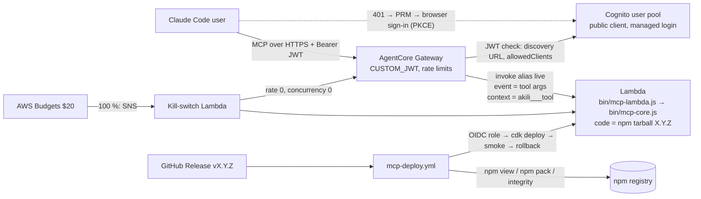

# Design: remote AKILI MCP on AgentCore Gateway + Lambda

> **Answer first.** Two new shipped modules, one new unshipped CDK app, one guard script and one workflow.
>
> - `bin/mcp-core.js` builds the catalog and implements the seven tools as pure functions.
> - `bin/mcp-lambda.js` adapts a Gateway Lambda-target call to the core.
> - `infra/mcp-gateway/` (own `package.json`) synthesizes two stacks: the service stack and the OIDC deploy-role stack. One `config.json` holds every D-3/D-4/D-7 value.
> - `scripts/mcp-deploy-guard.js` implements the npm-wait, integrity and smoke checks as testable functions. `.github/workflows/mcp-deploy.yml` only wires them to the CDK deploy.
>
> Two facts can only be settled in AWS, so they are open rows owned by the owner-run spike (T6): Claude Code's sign-in against Gateway + Cognito, and how Gateway maps the Lambda's JSON to the MCP tool result. Budget: **7 tasks, ~2,900 LOC, 12 review rounds.**

## 1. Document Control

| Field | Value |
|---|---|
| Spec Path | `changes/methodology-mcp/gateway-lambda` |
| Depth | Full (confirmed by the §10 budget) |
| Requirements | `requirements.md` FR-1..FR-8, NFR-1..NFR-9 |
| Evidence baseline | `138f531`, Node `v22.12.0` |
| Skills applied | `software-architect` (NFR scenarios, ADR-style DDs), `aws-serverless`, `aws-cdk`, `aws-auth` (domain knowledge only, no AWS call), `diagram-design` (inline Mermaid, no Archify), `error-handling-patterns` |
| Status | Phase 2 gate: `auto-approved (owner mandate: recommended option)`, 2026-10-27. The Step 2.5 recommendation for *Review Design* (High-impact open rows P-11, P-12) is recorded in §9; under the mandate the gate passes, and the High rows are owned by T6, which runs before any production resource exists |

## 2. Executive Summary

The design keeps every AKILI behavior in pure, locally testable Node code, and pushes only wiring into AWS. The Lambda's code asset is the unpacked npm tarball, so the handler and the content that run in AWS are the published bytes (DD-3). The CDK app and the workflow never ship. Every number the owner decided lives in one config file that both the stack and the docs test read (DD-8).

## 3. Architecture Overview

| Flow | Path |
|---|---|
| Sign-in | Claude Code calls the Gateway without a token → 401 with `resource_metadata` → protected-resource metadata → Cognito discovery → browser login → code + PKCE → tokens (proposal §10.2; end to end is P-11) |
| Tool call | `tools/call akili___get_command` → Gateway checks JWT and rate limits → Lambda alias `live` → core → JSON → Gateway → client (mapping is P-12) |
| Release sync | `release: published` → guards → `cdk deploy` (new Lambda version, `live` moves) → direct-invoke smoke → pass, or alias rollback and fail |
| Cost brake | Gateway per-user and global limits in real time; Budgets at 80 % emails and at 100 % fires the kill switch |

## 4. Extended Directory Structure

| Path | Shipped | Content |
|---|---|---|
| `bin/mcp-core.js` | yes | Catalog, frontmatter parser, renderer, pager, search index, tool definitions, `callTool` |
| `bin/mcp-lambda.js` | yes | `handler(event, context)`; strips the prefix, calls `callTool`, logs one line |
| `docs/mcp.md` | yes (`docs` is in `files`) | User setup and privacy page |
| `infra/mcp-gateway/package.json`, `package-lock.json` | no | `aws-cdk-lib`, `constructs`, `aws-cdk` (dev); scripts `synth`, `check` |
| `infra/mcp-gateway/config.json` | no | `callbackPort`, `rateLimits`, `reservedConcurrency`, `budgetUsd`, `alertThresholds`, `logRetentionDays`, `nodeRuntime`, `memoryMb`, `timeoutSeconds` |
| `infra/mcp-gateway/bin/app.js` | no | Reads context (`packageDir`, `version`, `stage`, `alertEmail`), builds the stacks |
| `infra/mcp-gateway/lib/service-stack.js` | no | Lambda + alias, logs, Cognito, Gateway, target, limits, budget, kill switch, tags |
| `infra/mcp-gateway/lib/deploy-role-stack.js` | no | GitHub OIDC deploy role |
| `infra/mcp-gateway/lib/kill-switch.js` | no | The kill-switch Lambda source (uses the SDK bundled in the runtime, P-16) |
| `infra/mcp-gateway/checks/*.check.js` | no | `node --test` synth assertions; the `.check.js` name keeps them out of root discovery (P-9) |
| `scripts/mcp-deploy-guard.js` | no (not in `files`) | `wait`, `verify`, `smoke` subcommands over injectable runners |
| `.github/workflows/mcp-deploy.yml` | no | The deploy job |
| `.github/workflows/ci.yml` | no | Adds a separate `infra` job and a `node --check` line for the new files |
| `test/mcp-core.test.js`, `test/mcp-lambda.test.js`, `test/mcp-deploy-guard.test.js`, `test/mcp-contract.test.js` | no | Root suite |
| `test/fixtures/mcp/` | no | Small package trees for hostile-path and frontmatter cases |

## 5. Data Model

**Catalog entry** (in memory, built once per process): `key`, `area`, absolute file path (never exposed), `size`. For commands and skills, also the parsed frontmatter `name`, `description` and, for `SKILL.md`, `metadata.binding`. Content is read on demand and memoized per key.

**Frontmatter rule:** the block between a first line `---` and the next line `---`. Keys are read one per line as `key: value`, where the value is plain or double-quoted on one line. Nested keys are read only for `metadata:` → `binding:`. All 43 command and skill `description` lines are single-line, plain or double-quoted (P-6).

**Result envelope** (every tool): `{ akiliVersion, …tool fields }`, or `{ akiliVersion, error: { code, message, …hints } }`. `code` ∈ `not_found`, `invalid_argument`, `unknown_tool`, `internal`. Hints: `valid` (names), `parts`, `files`.

**Paging:** `PART_CHARS = 30,000`, counted in UTF-16 code units as JavaScript's `length` counts them. A cut moves back to just after the last `\n` within the window; when a window has no `\n`, it cuts at 30,000, moved back one unit if that would split a surrogate pair. Parts are computed on the rendered text, so `get_command` parts depend on `arguments`.

## 6. API Design (tool definitions)

The tool definitions are a constant exported by the core and passed inline to the target by CDK, so the schema the Gateway serves is read from the same package version (DD-4). Types are only those the Lambda target schema documents (`string`, `integer`, `object`; P-5). Names are validated in the core instead of with `enum`, which the documented schema does not list.

| Tool | Description opens with | Required | Optional |
|---|---|---|---|
| `list_commands` | *"AKILI-SPECS methodology commands (akili-propose, akili-specify, akili-execute, …). Call this to see them; then call get_command."* | — | — |
| `get_command` | *"Run an AKILI-SPECS command. When the user asks to run an AKILI command or phase, call this and follow the returned text exactly; fetch every skill it names with get_skill."* | `name` | `arguments`, `part` |
| `list_skills` / `get_skill` | *"AKILI-SPECS methodology skills…"* | `name` (get) | `file`, `part` |
| `get_template` | *"AKILI-SPECS persona and routing templates…"* | `name` | `part` |
| `get_file` | *"Any other shipped AKILI-SPECS file by catalog path, e.g. scripts/parse_tests.js…"* | `path` | `part` |
| `search` | *"Search AKILI-SPECS commands, skills and templates…"* | `query` | `limit` |

Each description stays under 1,000 characters. Gateway's own description limit is P-14.

**`usage` block** (part 1 of `get_command`): five fixed lines covering the FR-2 *Command text rendered* obligations: follow the text; fetch the named skills; the path map; `npx -y akili-specs <cli>` needs Node; the text has `parts` parts, fetch the rest with `part`.

**Skill-name detection:** a packaged skill name counts as named when it appears in backticks, or as a whole word followed by "skill", in the rendered body. The matching runs against the catalog's skill names only.

**Search:** an inverted index built on first use: tokens are lowercased, split on non-alphanumerics, and must be at least 2 characters long. Weights are 5 for the name and path, 3 for the description, 2 for headings, 1 for body text. A file's score is the sum of the weights of the query tokens it contains. Sorting is by score, then key. No stemming and no fuzzy match, so results are deterministic (FR-2 *Search*).

## 7. Backend Module Design

### 7.1 `bin/mcp-core.js`

| Export | Behavior | FR |
|---|---|---|
| `createCore({ packageDir })` | Builds the catalog: walks the three `.claude/` areas with `lstat`, skips symlinks and dotfiles, and adds `scripts/` from a list equal to `RESOURCE_SCRIPTS`. Reads `version` from the package's `package.json` | FR-1 |
| `core.callTool(name, args)` | Validates `args` against the definition: types, required, no unknown keys. Dispatches, and catches any throw into `internal` with a generic message | FR-2 |
| `TOOL_DEFINITIONS` | The seven definitions (§6) | FR-2, FR-4 |
| `renderCommand`, `pageText`, `parseFrontmatter` | Pure helpers, exported for tests and for `local-stdio`'s reuse | FR-2 |

Lookups are `Map.get(key)` on exact strings; no input is ever joined onto a path (FR-1). The script list is duplicated from `bin/akili.js:76`, and a test pins the two lists as equal (DD-6).

### 7.2 `bin/mcp-lambda.js`

- Module scope: `const core = createCore({ packageDir: path.resolve(__dirname, "..") })`, so the catalog is built once per execution environment.
- `handler(event, context)`:
  1. Reads the tool name from `context.clientContext.custom.bedrockAgentCoreToolName`, accepting `Custom` as well (P-13).
  2. Strips everything up to and including the first `___`.
  3. Calls `core.callTool(tool, event ?? {})`.
  4. Returns the envelope object.
- **Logging:** one `console.log` JSON line per call: `tool`, `part`, `code` (`ok` or the error code), `ms`, `requestId` (`bedrockAgentCoreAwsRequestId`). It never logs the event or any text (FR-3).
- **Result shape:** the plain envelope object. If T6 shows that Gateway needs a different wrapper (for example MCP `content` items), one adapter function in this file changes; the core does not (DD-5, P-12).

### 7.3 `infra/mcp-gateway/` service stack (`stage` = `prod` | `spike`)

| Resource | Settings | FR / decision |
|---|---|---|
| Lambda `akili-mcp[-spike]-content` | `Code.fromAsset(packageDir)` unchanged; runtime from config (Node 22); 256 MB; 10 s; handler `bin/mcp-lambda.handler`; reserved concurrency 5; `currentVersion` + alias `live` | FR-4, D-3 |
| Log group | Explicit, 14 days | D-7 |
| Cognito user pool | Self sign-up on, sign-in alias email, auto-verify email, required attribute email only, Essentials plan, deletion protection on in `prod`, default Cognito email sender (P-17) | D-1, D-5 |
| Domain | Cognito prefix domain `akili-mcp[-spike]-<suffix>` with managed login | D-6 |
| App client | No secret; code grant; PKCE is used by the client: Cognito supports PKCE but does not enforce it for public clients (corrected 2026-10-27 at T3, P-15); the stack's enforceable controls are code grant only, no secret and `allowedClients`, and the client's PKCE use is checked at T6; `ExplicitAuthFlows` = `[ALLOW_REFRESH_TOKEN_AUTH]` only, so no SRP, password, custom or `ALLOW_USER_AUTH` sign-in bypasses managed login (S1, 2026-10-28; leaving the property unset would enable SRP and custom auth, and T6 confirms managed login still signs in); callback `http://localhost:<callbackPort>/callback`; scopes `openid`, `email`; access token 60 min, refresh 30 days | D-2 |
| Gateway | `protocolType MCP`; `CUSTOM_JWT` with `discoveryUrl` = the pool's `/.well-known/openid-configuration`, `allowedClients` = [client ID] | FR-4, DD-7 |
| Target `akili` | Lambda on the `live` alias; inline `TOOL_DEFINITIONS` read from `packageDir/bin/mcp-core.js` | DD-4 |
| Rate limits | 60/min keyed `$.context.jwt.sub`; 20/s global. Implemented as `AWS::BedrockAgentCore::GatewayRateLimit` (`CfnGatewayRateLimit`; settled at T3, P-10). The global limit is keyed on `targetName` = `akili`, because a rate limit needs a dimension key; whether it covers `tools/list` is checked at T6 | D-3 |
| Budget | `AWS::Budgets::Budget`, monthly COST $20, filter tag `user:project` = `akili-mcp` (format P-18); 80 % email to `alertEmail`; 100 % → SNS → kill switch + email | D-4 |
| Kill-switch Lambda | Sets Lambda reserved concurrency to 0 (`PutFunctionConcurrency`) and the Gateway global rate to 0 (same mechanism as the rate limits, P-10). Least-privilege role on those two resources only | FR-6 |
| Tags | `project=akili-mcp`, `stage=<stage>` on the stack | R-9 |
| Outputs | Gateway URL, client ID, Cognito domain. Read by the owner at T6/T7 and never committed except the public URL and client ID in `docs/mcp.md` | FR-7 |

**Synth inputs:** `packageDir` must hold a `package.json` whose `version` equals the `version` context, otherwise synth throws. `alertEmail` comes from the environment (`AKILI_MCP_ALERT_EMAIL`) and is never a default in code (NFR-7). The stack sets no `env.account`; the account comes from the deploying credentials only.

### 7.4 Deploy-role stack `akili-mcp-deploy-role`

- **Trust:** the GitHub OIDC provider for `token.actions.githubusercontent.com`. Context `oidcProvider=import|create`: import builds the ARN from `${AWS::AccountId}`, because an account allows one provider per URL and a paolachicue one may already exist (P-19). Conditions: `aud = sts.amazonaws.com`, `sub = repo:JuankCadavid/akili-specs:environment:aws-mcp`.
- **Permissions:**
  - `sts:AssumeRole` on the role pattern `iam::${AWS::AccountId}:role/cdk-hnb659fds-*-${AWS::AccountId}-us-east-1` (ARN prefix omitted here) (the bootstrap deploy, file-publishing and lookup roles; P-20);
  - `lambda:InvokeFunction`, `GetAlias`, `UpdateAlias`, `ListVersionsByFunction` on `function:akili-mcp-content*`.
  - Nothing else.
- **Deployment:** this stack is deployed once by the owner with the `docs/infrastructure.md` profile (D-8 ii). CI never deploys it, and the workflow's `cdk deploy` names only the service stack.

### 7.5 Kill switch and reset

| Action | Who | Effect |
|---|---|---|
| Automatic | Budget 100 % → SNS → kill-switch Lambda | Global rate 0 + Lambda concurrency 0 + email. Budget data lags (P-21), so this bounds a month, not a minute |
| Manual | Owner, one documented command pair (`docs/infrastructure.md`) | Same two settings; measured to block within 1 minute at T6 (FR-6) |
| Reset | Owner, documented | Restores `config.json` values, or redeploys the current version |

**Cost bound, stated honestly:**

| Case | Bound |
|---|---|
| One abusive user at 60/min | ≈ 2.6 M calls/month ≈ $13 (NFR-8) |
| Many accounts at the 20/s global limit | ≈ 51.8 M calls/month ≈ $259, i.e. ≈ $8.6/day |

The budget switch therefore caps a sustained global attack at about $20 plus the Budgets detection lag, one day or less (≈ $9; P-21). Whether rate-limited or 401 calls are billed is P-22. Recorded as R-8 in the proposal; accepted by the owner's D-4 choice of auto-block.

### 7.6 `scripts/mcp-deploy-guard.js`

| Subcommand | Logic | Exit |
|---|---|---|
| `check-version <v>` | `^\d+\.\d+\.\d+$` | 0 / 2 |
| `wait <v> --timeout 600 --interval 15` | Repeats `npm view akili-specs@<v> version --registry=https://registry.npmjs.org/` until stdout equals `<v>`, against an elapsed-time deadline on an injected clock: no sleep runs past the deadline (S1, 2026-10-28) | 0 / 1 after timeout |
| `verify <tgz> <v>` | Computes `sha512-` + base64 of the file; compares with `npm view … dist.integrity` | 0 / 1 |
| `smoke <result.json> <v>` | Parses the invoke payload; requires `akiliVersion === v`, `commands.length === 14`, no `error` | 0 / 1 |

Each subcommand is a pure function over injected `run(cmd, args)`, `sleep(ms)` and `readFile`. The CLI wrapper binds the real ones. `npm` is called through `execFileSync` with an argument array, never through a shell string (no injection from the version input).

### 7.7 `.github/workflows/mcp-deploy.yml`

1. **Trigger and guard.**
   - On `release: [published]` and `workflow_dispatch(version)`.
   - The job runs `if: github.event_name == 'workflow_dispatch' || !github.event.release.prerelease`.
   - It uses `environment: aws-mcp` and `concurrency: mcp-deploy` (no cancel).
   - Permissions are `id-token: write` and `contents: read`.
2. **Version.** Taken from `inputs.version`, or from `release.tag_name` with the leading `v` removed. It passes through an `env:` variable, never interpolated into `run:` text, and `check-version` validates it.
3. **Role gate.** If `vars.AWS_ROLE_ARN` is empty, the job writes *"MCP deploy skipped: no deploy role configured"* to the summary and stops green (FR-5).
4. **Fetch and verify.** `wait`, then `npm pack akili-specs@$V`, then `verify`, then untar to `$RUNNER_TEMP/pkg`. Then `npm ci --ignore-scripts` in `infra/mcp-gateway`, **before** any credentials exist, so no dependency script runs with deploy credentials (S1, 2026-10-28).
5. **Credentials.** `aws-actions/configure-aws-credentials` with `role-to-assume: ${{ vars.AWS_ROLE_ARN }}` and region `us-east-1`. No secret is used. Every `uses:` in this workflow is pinned to a full 40-hex commit SHA with the tag in a trailing comment (S1, 2026-10-28).
6. **Deploy.**
   - Record the current `live` version with `aws lambda get-alias`; it is empty on the first deploy.
   - Then run `cdk deploy akili-mcp-service --require-approval never` in `infra/mcp-gateway`, with `-c packageDir -c version -c stage=prod`.
7. **Smoke.** `aws lambda invoke` on the `live` alias, with a base64 client context naming `akili___list_commands`, then `smoke`.
   - Red with a recorded previous version: `aws lambda update-alias` back to it, then fail.
   - Red on the first deploy: fail with nothing to roll back.
8. **Report.** Version, Lambda version and outcome go to `$GITHUB_STEP_SUMMARY`.

**Decision on `release:status`:** it does not read this workflow. The checklist line plus the run summary are the record (DD-10).

### 7.8 CI additions

- **New job `infra`** on ubuntu, Node 22: `npm ci` and `npm run check` in `infra/mcp-gateway`. The check packs the checkout to a temp directory, runs synth for both stages and runs the assertions. It is not one of the six protected `CLI on …` checks, so branch protection is unchanged (P-23).
- **Existing `cli` job:** gains `node --check` lines for the three new JS files.

## 8. Frontend / UX Component Architecture

None. The only UI is Cognito's managed login, used as AWS ships it (proposal §8).

## 9. Design Decisions

| DD | Decision | Rejected alternative | Requirement |
|---|---|---|---|
| DD-1 | `gateway-lambda` owns the core as `bin/mcp-core.js`; `local-stdio` reuses it in its Adjust round (D-0 a) | Waiting on `local-stdio` | FR-1, FR-2 |
| DD-2 | Seven tools with plain JSON envelopes; errors are results, never throws | MCP `isError` set by the Lambda (the mapping is unknown, P-12) | FR-2 |
| DD-3 | Lambda asset = unpacked published tarball, unchanged | Bundle built from the checkout (could differ from npm) | FR-5 |
| DD-4 | The tool schema comes from the package's `TOOL_DEFINITIONS` at synth time | A schema file in `infra/` (two sources) | FR-2, FR-4 |
| DD-5 | One adapter seam in the handler for the Gateway result shape | Shaping inside the core | FR-3 |
| DD-6 | Duplicate `RESOURCE_SCRIPTS` in the core, pinned equal by a test, instead of requiring `bin/akili.js` | `require("./akili.js")` (runs the CLI module, which calls `main()` at load, `bin/akili.js:2941`) | FR-1 |
| DD-7 | `allowedClients` with one public client, not `allowedScopes` | DCR + scopes + WAF (deferred by D-2) | FR-4 |
| DD-8 | All owner numbers in `infra/mcp-gateway/config.json`; the stack and the docs test read it, and the synth checks pin the owner-decided values as literals, so a `config.json` edit that drifts from a decision goes red (amended 2026-10-27 at T3: T3 falsifier 1 requires it) | Constants spread over the stack and docs | FR-4, FR-7 |
| DD-9 | Infra checks named `*.check.js` in their own package and CI job | `infra/**/test/*.test.js`, which root `node --test` would discover and fail on | NFR-6 |
| DD-10 | `release:status` unchanged; the run summary and checklist line are the record | Querying the Actions API from `release:status` (new network and auth surface) | FR-5 |
| DD-11 | `stage=spike` is a separate stack with separate names, deployed and destroyed only by the owner | Spiking in the production stack | FR-8 |
| DD-12 | The kill switch uses two independent brakes: Gateway rate 0 and Lambda concurrency 0 | Rate 0 only (fails open, P-10); concurrency only (Gateway calls still billed, P-22) | FR-6 |

**Reversion challenge (Step 2.3):** no DD removes, disables or inverts delivered behavior. Every change is additive: new files, a new CI job, new doc rows. Not triggered.

**Review Design recommendation:** P-11 and P-12 are open with High impact. Under the owner mandate the gate passes, and both rows are settled by T6 before any production resource exists or any doc claims the service works.

## 10. Budget

| Measure | Estimate |
|---|---|
| Tasks | 7: 5 agent tasks + 2 owner-gated HITL tasks |
| LOC | ≈ 2,900: core 380 + handler 60 + root tests 950 (budgeted per clause, KZ-bugfix--init-ctrlc-abort-2) + CDK 420 + infra checks 320 + guard 150 + workflow 110 + CI 30 + docs 300 + test fixtures 180 |
| Review rounds | 12: T1 3, T2 3, T3 2, T4 2, T5 2. T6/T7 are owner checklists, with no Implementer review |
| Tripwire | Stop and escalate at **9 tasks**, **3,700 LOC**, or **3 rounds on any one task** |

The depth stays **Full**: the estimate is far above Lite/Standard, and auth, cost and deploy risk justify the alternatives, rollout and rollback content.

## 11. Rollout, Observability, Rollback

| Concern | Plan |
|---|---|
| Rollout | T6 spike, owner OK (i) → fixes, if any → PRs merged → release minor → T7: role (OK ii) → owner's first production deploy, or the first CI run after the role (OK iii) |
| Observability | One JSON log line per call (FR-3); Lambda and Gateway CloudWatch metrics; the Budgets email at 80 % |
| Rollback | Automatic alias rollback on a red smoke; manual `workflow_dispatch` with an older version; full removal is `cdk destroy`, owner only |

## 12. Premise Ledger

Verified 10 · `UNVERIFIED` 14 (High 2: P-11, P-12 · Low 12). Updated at T3 (2026-10-27): P-10, P-14, P-16 and P-18 (format) settled from sources; P-15 partly refuted. Still open: High P-11, P-12; Low P-13, P-17, P-19, P-20, P-21, P-22, P-24, and the P-16 client check.
Blast-radius triggers: `consumer` fires (adds shipped files to the tarball and rows to README and `docs/README.md` tables, P-7, P-8); `live-path` fires (the user action "call a tool through Gateway", P-12, P-13); `shared-state` fires (the AWS account is shared with the paolachicue stacks, P-19, P-20, P-24).

| # | Claim | Class | Citation (as run) | Verified at | If false | Settled by |
|---|---|---|---|---|---|---|
| P-1 | The package has no `dependencies`/`devDependencies` and ships `bin`, `docs` minus `docs/specs`, the three `.claude/` areas and the two scripts; `infra/` and other `scripts/` do not ship | data-env | `node -e` over `package.json` → `files` list, `deps`/`dev` undefined | `138f531` | DD-9 and the NFR-4 layout change (Low) | — |
| P-2 | Shipped content is 265 files, no symlinks, no dotfiles; largest `templates/digests.json` 453,378 chars, `commands/akili-constitution.md` 121,578 | data-env | Node walk over `.claude/{commands,skills,templates}` with `lstat`; `find .claude -type l` → none | `138f531` | Paging constants (Low) | — |
| P-3 | With 30,000-char parts, no first part of any shipped file serializes above 40,000 chars with `JSON.stringify` | data-env | Node loop over the 265 files: `JSON.stringify(s.slice(0,30000)).length > 40000` → no hits | `138f531` | `PART_CHARS` lowered in T1 (Low) | — |
| P-4 | `RESOURCE_SCRIPTS = ["gsc_verify.py", "parse_tests.js"]` | location | `bin/akili.js:76` | `138f531` | DD-6 list (Low) | — |
| P-5 | Lambda target input schemas support `string`, `number`, `integer`, `boolean`, `array`, `object`; `enum` is not listed; the event is the input properties map; the tool name arrives as `<target>___<tool>` in `bedrockAgentCoreToolName` | data-env | [AWS: Lambda function targets](https://docs.aws.amazon.com/bedrock-agentcore/latest/devguide/gateway-add-target-lambda.html), *Property schema definition*, *Lambda function input format*, read 2026-10-27 | `138f531` (doc read date 2026-10-27) | §6 schema and §7.2 (High) | — |
| P-6 | All 43 command and skill `description` frontmatter lines are single-line, plain or double-quoted; all 29 skills have `SKILL.md` with `metadata.binding` | data-env | `grep -h "^description:" .claude/skills/*/SKILL.md .claude/commands/*.md` (43 lines, first 16 chars inspected); loop `grep -q "binding:"` over 29 dirs → no misses | `138f531` | §5 parser scope (Low) | — |
| P-7 | Appending a README *Learn more* row and a `docs/README.md` *Start Here* link breaks no pin: tests pin only the first row/link and the presence of `skills/governance.md` | consumer | `grep -n "Learn more\|Start Here" test/*.js` → `test/docs-overview.test.js:311,458-470` only | `138f531` | T5 must append, not insert at the top (Low) | — |
| P-8 | Tests that read the pack list or count docs: `grep -ln "npm pack\|pack --dry-run" test/*.js` → `akili-marketing-docs`, `diagram-design`, `akili-review-contract-coverage`, `release-status`; none pins the total file count of the tarball | consumer | that grep; `grep -n "files.length\|total files" ` over the four → only `diagram-design.test.js:381` (`>= 11` commands) | `138f531` | T2/T5 sweep those files (Low) | — |
| P-9 | Root `npm test` (`node --test`, no args) discovers `test/**/*.js` but not `*.spec.js` or `*.check.js` outside `test/` | data-env | Node v22.12.0: temp tree with `x/a.spec.js`, `x/test/b.js`, `x/c.check.js`; `node --test` → `# tests 1` (only `b`). Node 18 not run locally | `138f531` | DD-9 naming (Low); Node 18 by CI on T3's PR | Node 18 leg: T3 PR CI |
| P-10 | The installed `aws-cdk-lib` exposes Gateway rate limits as a property, or the CloudFormation resource accepts them, or an SDK call can set them, and the same API can set the global rate to 0 | existence | **Verified at T3 (2026-10-27):** "Rate value range \| 0 to 10,000,000 (0 blocks all matching traffic)" ([Gateway rate limits](https://docs.aws.amazon.com/bedrock-agentcore/latest/devguide/gateway-rate-limits.html)); "Updates the entries of a gateway rate limit. The dimension keys are immutable after creation." ([UpdateGatewayRateLimit](https://docs.aws.amazon.com/bedrock-agentcore-control/latest/APIReference/API_UpdateGatewayRateLimit.html)). Resource `AWS::BedrockAgentCore::GatewayRateLimit`; throttling behavior stays with T6 | T3 | §7.3 rate-limit and kill-switch row (Low: a fallback mechanism exists) | T3 step 1 (CDK/CFN reference read); behavior at T6 |
| P-11 | Claude Code completes sign-in against Gateway `CUSTOM_JWT` + Cognito with no proxy (PRM → Cognito discovery → PKCE → token accepted, refresh works) | live-path | `UNVERIFIED — confirm at source before relying on it` (proposal §10.2 open row) | — | DD-7, FR-7 setup, the whole "nothing installed" promise (**High**) | T6, owner |
| P-12 | Gateway turns the Lambda's JSON return into a `tools/call` result whose text the client receives intact, under 50,000 chars per part | live-path | `UNVERIFIED — confirm at source before relying on it` (doc says only *"must return a valid JSON response that can be parsed by the gateway"*) | — | DD-2/DD-5 adapter and the paging limit (**High**) | T6, owner |
| P-13 | In the Node runtime, Gateway's context arrives at `context.clientContext.custom`, and a direct `aws lambda invoke --client-context` with `{"custom":{…}}` arrives at the same place | data-env | `UNVERIFIED — confirm at source before relying on it` (the AWS example is Python, `client_context.custom`) | — | §7.2 lookup and the §7.7 smoke (Low) | T6 |
| P-14 | Gateway accepts tool descriptions of the §6 length (< 1,000 chars) | data-env | **Not refuted at T3 (2026-10-27):** no per-description limit is documented; "Maximum inline schema size \| 1 MB" ([AgentCore quotas](https://docs.aws.amazon.com/bedrock-agentcore/latest/devguide/bedrock-agentcore-limits.html)); the seven definitions total ≈ 3 KB. Gateway acceptance stays with T6 | T3 | §6 descriptions shortened (Low) | T3 step 1 (API reference); T6 |
| P-15 | Cognito public app clients enforce PKCE for the code grant, and accept `http://localhost:<port>/callback` | data-env | **Partly refuted at T3 (2026-10-27):** localhost callback confirmed ("Amazon Cognito requires `HTTPS` over `HTTP` except for `http://localhost` for testing purposes only."); PKCE is recommended, not enforced ("…activate only the authorization-code grant OAuth flow, and implement Proof Key for Code Exchange (PKCE)…"), [Cognito: app clients](https://docs.aws.amazon.com/cognito/latest/developerguide/user-pool-settings-client-apps.html) | T3 | §7.3 client settings (Low) | T3 step 1; T6 |
| P-16 | The Lambda Node 22 runtime bundles AWS SDK v3, so the kill-switch Lambda needs no bundling | data-env | **Verified at T3 (2026-10-27):** "All supported Lambda Node.js runtimes include a specific minor version of the AWS SDK for JavaScript v3, not the latest version." ([Lambda Node.js](https://docs.aws.amazon.com/lambda/latest/dg/lambda-nodejs.html)). Whether that minor version includes `@aws-sdk/client-bedrock-agentcore-control` is `UNVERIFIED — confirm at source before relying on it` (T6: invoke the kill switch once in the spike) | T3 | §7.4 kill switch bundling (Low) | T3 step 1 |
| P-17 | The default Cognito email sender's daily limit is low (tens of emails), which caps sign-ups per day | data-env | `UNVERIFIED — confirm at source before relying on it` | — | A docs note, or SES later (Low) | T6 (read limits page) |
| P-18 | A budget cost filter on a user-defined tag works only after the tag is activated as a cost-allocation tag in Billing, and uses the form `user:project$akili-mcp` | data-env | **Format verified at T3 (2026-10-27):** "User-defined tag keys must use the `user:` prefix." ([Budgets filters](https://docs.aws.amazon.com/cost-management/latest/userguide/budgets-create-filters.html)); the CLI example uses `"TagKeyValue" : [ "user:Key$value1" , "user:Key$value2" ]` ([create-budget](https://docs.aws.amazon.com/cli/latest/reference/budgets/create-budget.html)). Activation stays with T7 | T3 (format) | §7.3 budget; without activation the budget never trips (Low, owner step in T7) | T3 step 1 (format); T7 owner (activation) |
| P-19 | The account already has a GitHub OIDC provider (paolachicue), so the role stack must import it | shared-state | `UNVERIFIED — confirm at source before relying on it` (`user-stated`: paolachicue deploys via OIDC, `docs/infrastructure.md:17`) | — | `oidcProvider` context value (Low) | T7, owner |
| P-20 | The account and region are CDK-bootstrapped with the default qualifier `hnb659fds` | shared-state | `UNVERIFIED — confirm at source before relying on it` (inferred from the paolachicue CDK stacks) | — | §7.4 role resource pattern; the owner bootstraps first (Low) | T7, owner |
| P-21 | AWS Budgets evaluates cost with a delay of hours, up to about a day | data-env | `UNVERIFIED — confirm at source before relying on it` | — | §7.5 cost bound wording (Low) | T5 (docs citation) |
| P-22 | Gateway bills rate-limited and unauthenticated calls | data-env | `UNVERIFIED — confirm at source before relying on it` | — | §7.5 bound and the kill-switch value (Low) | T7, owner (pricing FAQ/support) |
| P-23 | Branch protection requires only the six `CLI on <os> / Node <v>` checks, so a new `infra` job does not block or alter merges | other | `AGENTS.md` *Branch model* (standing rule); job name pattern `.github/workflows/ci.yml` `name: CLI on ${{ matrix.os }} / Node ${{ matrix.node }}` | `138f531` | §7.8 (Low) | — |
| P-24 | No paolachicue resource uses the `akili-mcp` name prefix or the `project=akili-mcp` tag | shared-state | `UNVERIFIED — confirm at source before relying on it` (the account is not read by agents) | — | R-9 isolation (Low) | T7, owner |

`bin/akili.js` calls `main()` at load (`bin/akili.js:2941`, verified in `local-stdio` P-7 at `48c28ba` and unchanged since: `git diff 48c28ba 138f531 -- bin/akili.js` → empty). That is what DD-6 rests on.

## 13. Shared Contracts

- `TOOL_DEFINITIONS` and the result envelope are the contract between the package and the Gateway target. A change to either is a tool-set change: it needs a minor release, and the next deploy updates the target.
- `local-stdio`, on resume, imports `createCore`, `renderCommand`, `pageText` and `parseFrontmatter`. Its own URI scheme and prompts stay in its own modules.
