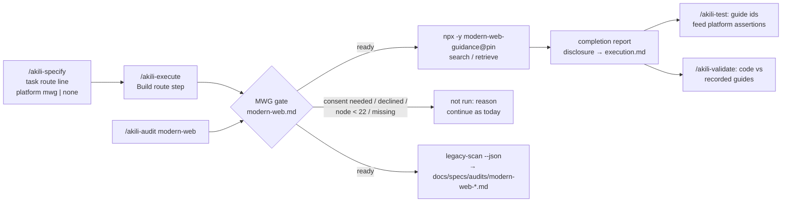

# Design: Modern Web Guidance for web UI work (`modern-web-guidance`)

> **Answer first.** All MWG rules live in **one new file**, `.claude/skills/impeccable-bridge/references/modern-web.md`: gate, pin, call forms, disclosure, the `/akili-audit` scan procedure and install routes. The design matrix gains a **supporting card**, a **sixth route-line field `platform`** (the selector) and one **Build route step**. Governance rule 4 gains that selector. Commands get pointer lines: `/akili-specify`, `/akili-test` and `/akili-validate` one line each, `/akili-audit` a new `modern-web` mode, and `/akili-constitution` Step 8D a row and a field. `/akili-execute` needs no edit: it reaches the Build route through the task skill list. No installer code changes; one packaged file is added. **Budget:** 9 tasks, ~280 LOC of rules and docs plus ~520 LOC of tests, ~18 review rounds.

## 1. Document Control

| Field | Value |
|---|---|
| Spec Path | `changes/modern-web-guidance` |
| Type / Deliverable / Depth | Change / software / Standard |
| Approval Mode | `gated` (quoted in `requirements.md`) |
| Source | `requirements.md` (Phase 1 approved by JC 2026-11-17), `proposal.md` (D1–D4) |
| Verified at | `f00195b` unless a row says otherwise |
| Upstream pin | `v1.0.1` = `64a6d708f5a43f2cd3fde5d4d7db3905ba1bdf65`; npm `modern-web-guidance@1.0.1` |
| Phase 2 gate | pending JC |

## 2. Executive Summary

MWG is an **environment-provided supporting skill** under the Impeccable lead. A web UI task's route line names it (`platform mwg`), and the bridge's new reference decides when a call may run (gate) and in what form (pin). It also decides where the result is written (disclosure). Every surface outside that file names it and does not restate it (NFR-3).

## 3. Architecture Overview

| Layer | Owner | MWG content |
|---|---|---|
| Category and selector rule | `docs/skills/governance.md` | Environment-provided; rule 4's second selector |
| Role | `design-routing.md` | Supporting card, supporting line, route field, Build route step |
| Behavior (gate, pin, calls, disclosure, scan, routes) | `references/modern-web.md` (new) | All of it, once |
| Entry | `impeccable-bridge/SKILL.md` | One *Roles* row pointing at the reference |
| Phase pointers | 5 command files | One line or one block each, naming the reference |

## 4. Extended Directory Structure

| Path | Change |
|---|---|
| `.claude/skills/impeccable-bridge/references/modern-web.md` | **New** (~110 lines) |
| `.claude/skills/impeccable-bridge/references/design-routing.md` | Card row, supporting-line clause, route field, Build route step, completion-report clause |
| `.claude/skills/impeccable-bridge/SKILL.md` | *Roles* row; `version` 2.1 → 2.2 |
| `docs/skills/governance.md` | Environment-provided paragraph + rule 4 |
| `.claude/commands/akili-specify.md` | One bullet in *Preferred UI/UX skill rule* |
| `.claude/commands/akili-test.md` | One bullet after the design-detector block |
| `.claude/commands/akili-validate.md` | One sentence in *UI design review* |
| `.claude/commands/akili-audit.md` | Usage line + *Modern Web Mode* section + checklist line |
| `.claude/commands/akili-constitution.md` | Step 8D item 3 example + item 4 field |
| `docs/skills/impeccable-bridge.md`, `docs/overview.md`, `docs/cli.md`, `docs/flow.md`, `docs/commands/akili-audit.md`, `AGENTS.md`, `CHANGELOG.md` | Docs (FR-11) |
| `test/modern-web-guidance.test.js` | **New** contract suite |
| `test/design-skill-routing.test.js`, `test/design-skill-routing-coverage.test.js`, `test/install-cursor.test.js` | Consumer updates (§11 P-12, P-13, P-14) |

## 5. Data Model

No data. The one persisted shape is the project Skill Map row (§8.4) and the audit report (§8.3).

## 6. API Design

No API. External interface consumed (not changed): the MWG CLI commands `search "<query>" [--skill-version <v>]`, `retrieve "<id>[,<id>]"`, `list`, `legacy-scan <path> --json` (upstream `SKILL.md` at the pin, P-7).

## 7. Backend Module Design

Not applicable. No runtime code. The backend route does not apply (`backend-routing.md` is not consulted: no backend decision).

## 8. Frontend / UX Component Architecture (rules content)

No screen is changed. This section defines the rules text, which is the deliverable.

### 8.1 `modern-web.md`: sections and content

| Section | Content (FR) |
|---|---|
| *Role* | Supporting skill for platform implementation of **web UI** tasks; Impeccable (or `frontend-design` at ENV-0) leads; never ENV-3 native, backend or non-UI (FR-3, FR-6 trigger containment: its upstream "MANDATORY … FIRST" description never loads it off a `platform mwg` route) |
| *Gate* | Five states, probe order skill → Node → consent; table below (FR-4) |
| *Pin* | AKILI default `1.0.1`; project override from the Skill Map row's `pin`; validity rule; precedence over upstream `@latest` (FR-5) |
| *Call forms* | `npx -y modern-web-guidance@<pin> <cmd>`, Windows `npx.cmd`, `pnpx modern-web-guidance@<pin>` when pnpm is the project's runner; `-y` only after consent; the `--skill-version` value is passed through from the installed `SKILL.md` unchanged (FR-5) |
| *In a task* | Before UI edits: one `search` per platform capability, `retrieve` the matches, then check the code against them (upstream *Step 3*); never `legacy-scan` in a task (FR-7) |
| *Disclosure* | Where it goes, where it never goes (FR-6) |
| *Audit scan* | Procedure for `/akili-audit modern-web` (FR-8, §8.3) |
| *Install routes* | Per host, verified at the pin (FR-10, §8.5) |
| *Privacy* | Consent is never implied by `pre-approved`; nothing installed; the network touch is the npm fetch; upstream says search and retrieve run offline once fetched (P-8) |

**Gate table** (held only here):

| State | Condition | Action | Report line |
|---|---|---|---|
| `missing` | No loadable `modern-web-guidance` skill, standalone or plugin-namespaced | Print install routes once per session; continue | `MWG: not run — skill not installed` |
| `node < 22` | `node --version` absent or major < 22 | Continue | `MWG: not run — Node <v> (needs ≥ 22)` |
| `consent needed` | Skill and Node present, no answer this session | Ask once: fetch `modern-web-guidance@<pin>` from npm (~16.7 MB unpacked) and run it locally; yes → `ready`, no → `declined` | — |
| `declined` | User said no | Continue | `MWG: not run — declined` |
| `ready` | All three pass | Pinned calls allowed | `MWG: ready — pin <v> (<default|skill-map>)` |

Probing never calls `npx` (no fetch before consent). Every non-`ready` state continues with the lead and stack skills, and never stops or fails a task, suite, validation or audit.

### 8.2 Design matrix edits (`design-routing.md`)

| Site | Edit |
|---|---|
| *Expertise cards* | New row: `modern-web-guidance` (environment-provided) · expert at native platform features and their fallbacks: dialog, popover, anchor positioning, container queries, forms, accessibility semantics, Core Web Vitals · supports build-new, build-within-system and evaluate on web UI · must not decide the aesthetic, page mode, direction or framework idiom · evidence `references/modern-web.md` → *Role* |
| *Supporting line* | Adds: `modern-web-guidance` when the route's `platform` field is `mwg` |
| *Design route line* | Form gains a sixth segment `; platform <mwg|none — <reason>>`; field table gains `Platform`: `mwg` for a browser-rendered surface at ENV-0, ENV-1 or ENV-2; `none — native` at ENV-3; `none — <reason>` otherwise |
| *Build route* | New step between 4 (craft floor) and 5: "**Platform guidance.** When the route says `platform mwg`, run `references/modern-web.md` → *Gate*, then *In a task*." |
| *Build route* step 7 | Completion report also carries the MWG report line and the disclosure (§8.1) |

The matrix rows (8 activities, one lead per cell) are unchanged: MWG is never a lead.

### 8.3 `/akili-audit modern-web [<path>]`

A third mode beside drift and `design`. **Opt-in** = the user types the mode. Steps:

1. Load `impeccable-bridge`, read `references/modern-web.md` → *Audit scan*.
2. Applicability: web UI source must exist under the path (default: the UI source folders). Otherwise report `not applicable — no web UI source` and stop.
3. Gate. Not `ready` → write the report with `not run: <state>` and stop.
4. `legacy-scan <path> --json` with the pin. Verify each finding against its `keepWhen` / `dropWhen`; drop false positives and count them.
5. Write `docs/specs/audits/modern-web-<YYYY-MM-DD>[-<safe-branch>][-N].md`, using the same suffix rule as drift reports. Content: pin and source, path, gate state, kept/dropped counts, the coverage caveat (upstream: ~20% of guides have deterministic legacy rules), and kept findings with file, guide id and routed fix (`/akili-quick` trivial, `/akili-propose` grouped).
6. Never edit outside `docs/specs/audits/`; never run upstream *Modernize*; findings never become tasks of a running spec.

A `modern-web-*.md` file is never a drift report: the drift *Reading reports back* rule reads only `drift-*.md`, and this mode says so, as `design` mode does.

### 8.4 Skill Map (`/akili-constitution` Step 8D)

| Site | Edit |
|---|---|
| Item 3 (environment-provided rows) | Adds MWG as a standing example: web UI projects only, ask before adding, *When to load* = "web UI task with `platform mwg`, when installed", optional `pin: <x.y.z>`, route via `impeccable-bridge` → `references/modern-web.md` |
| Item 4 (`### Design routing` block) | Adds one field: platform guidance, `modern-web-guidance` (environment-provided, pin source) or `none — <reason>` |

### 8.5 Install routes (verified at the pin, README `v1.0.1`)

| AKILI target | Upstream route | Status |
|---|---|---|
| Claude Code | `/plugin marketplace add GoogleChrome/modern-web-guidance`, `/plugin install modern-web-guidance@googlechrome` | Verified (README:519-525) |
| Codex | `codex plugin marketplace add GoogleChrome/modern-web-guidance`, `codex plugin add modern-web-guidance@googlechrome` | Verified (README:546-551) |
| Antigravity | `agy plugin install https://github.com/GoogleChrome/modern-web-guidance` | Verified (README:502-506) |
| Cursor, OpenCode | Generic: `npx skills add GoogleChrome/modern-web-guidance` (README:486-490) | No host-specific route in the README; listed as "generic route" |
| Grok Bot | Upstream names "Grok Build CLI" (README:530-534) | Not asserted for Grok Bot (P-10) |
| Any (npm installer) | `npx modern-web-guidance@<pin> install` | Pinned form of README:16 |

Plugin routes install upstream's current version, not the pin. The docs say so, and the gate's pin still governs the calls AKILI directs.

## 9. Shared Contracts or Package Extensions

- **Packaged file count:** +1 (`modern-web.md`). Skill count unchanged (32). Panel `SKILL_CATALOG` unchanged: no skill folder is added.
- **Governance rule 4 (FR-2):** "(a) the spec records a selector, either a `Deliverable` row or a web UI task's route field `platform mwg`, and (b) a packaged bridge runs that skill's gate first." Outcome per selector: a `Deliverable` selector stops at a missing skill (unchanged); the `platform` selector continues. The *Today's instance* sentence becomes two instances.

## 10. Design Decisions

| DD | Decision | Why / rejected | FR | Lesson |
|---|---|---|---|---|
| DD-1 | Environment-provided; never vendored | D1. Vendoring keeps the npm fetch (P-6) and cannot pin without body edits | FR-2 | — |
| DD-2 | One new reference file holds all MWG behavior | NFR-3. Rejected: a new packaged skill, which means a count change, panel catalog and governance checklist for ~110 lines; and inlining into `SKILL.md` (32 KB already) | FR-4–8, 10 | KZ-005 (name sections, never line numbers) |
| DD-3 | Selector = route-line `platform` field, written at specify | It is the only per-task field every UI phase already reads (P-3). Rejected: a new Document Control row, which is per spec and wrong for mixed specs | FR-2, FR-3 | — |
| DD-4 | MWG is a supporting card, never a lead | Decision rule 2 (one lead per activity) | FR-3 | — |
| DD-5 | Non-`ready` continues; only a `Deliverable` selector stops | Guidance is additive; the build stands without it. Video differs because no substitute renders a video | FR-4 | — |
| DD-6 | Probe never calls `npx`; consent is asked per session and is never implied by `pre-approved` | Same rule as the Impeccable engine download (bridge *Privacy and consent*) | FR-4 | — |
| DD-7 | Pin precedence: valid Skill Map `pin` > AKILI default; invalid falls back with a report line | D2 | FR-5 | — |
| DD-8 | `-y` allowed only after consent; `--skill-version` passed through unchanged | `-y` suppresses npx's own prompt, and AKILI's consent replaces it; the skill-version value belongs to upstream | FR-5 | P-9 |
| DD-9 | Brownfield scan is a new `/akili-audit modern-web` mode | D3. Typing the mode is the opt-in; `design` mode needs a running URL, `legacy-scan` needs only source (P-11). Rejected: a step inside `design` mode or drift | FR-8 | KZ-004 (the new report prefix lands in the existing "only `drift-*`" branch, stated) |
| DD-10 | Docs home: `docs/skills/impeccable-bridge.md` section + env-tool rows; no `docs/skills/modern-web-guidance.md` | P-4, P-5 | FR-11 | — |
| DD-11 | Eval figures may ship, cited to README `v1.0.1` *Recent eval results snapshot*, labelled "Google's own evals" | P-15 settles the brief's claim. MDN stays out | FR-11 | KZ-002 |
| DD-12 | `/akili-execute` command text is not edited | P-2 | FR-7 | — |
| DD-13 | Restatement sweep for rule 4 is keyed on the obligation ("only behind a `Deliverable` selector", "stops at … gate"), not on `video` | P-16 | FR-2 | KZ-changes--kaizen-loop-closure-2 |

**Step 2.3 reversion challenge:** no DD removes, disables or inverts shipped behavior. The governance edit widens rule 4 and leaves the `Deliverable` branch as it is; the route line and Build route gain content and lose none. The challenge does not apply.

## 11. Premise Ledger

Counts: 17 rows. 15 verified, 2 `UNVERIFIED` (1 High, 1 Low).
Blast-radius triggers: `consumer` fires (the design changes the route-line form and field set, the expertise card set, governance rule 4 text, and the packaged file count) → P-12, P-13, P-14, P-16. `live-path` and `shared-state` do not apply: no user action, branch point or shared runtime state is changed. This is rules text, and P-2/P-3 cover how each phase reaches it.

| # | Claim | Class | Citation (as run) | Verified at | If false | Settled by |
|---|---|---|---|---|---|---|
| P-1 | No packaged skill or matrix entry covers platform implementation | existence | `design-routing.md` → *Expertise cards* (9 rows, none platform) | `f00195b` | Low: card wording | — |
| P-2 | `/akili-execute` does not name the matrix or Build route; UI tasks reach it via the task skill list (`impeccable-bridge`) | location | `git grep -n "Build route\|design-routing" -- .claude/commands/akili-execute.md` → 0 hits; bridge *Phase map* Build row | `f00195b` | High: DD-12 → an execute edit task | — |
| P-3 | Every UI task's Scope carries a `Design route:` line that specify writes | other | `.claude/commands/akili-specify.md` → *Preferred UI/UX skill rule* ("every UI task's Scope carries a `Design route:` line") | `f00195b` | High: DD-3 selector | — |
| P-4 | Environment-provided skills have no `docs/skills/` page | existence | `ls docs/skills` → no `archify.md`, `hyperframes.md`, `playwright-cli.md`, `orchestration.md` | `f00195b` | Low: DD-10 | — |
| P-5 | `docs-overview.test.js` holds `docs/skills/` pages and README inventory to the packaged folders | other | `test/docs-overview.test.js:249-307` | `f00195b` | Low: DD-10 | — |
| P-6 | The MWG CLI source is not in the repo; npm is its only distribution | existence | `gh api …/git/trees/v1.0.1?recursive=1`: no `modern-web.mjs`; `package.json` `bin` → `skills/modern-web-guidance/modern-web.mjs` | upstream `64a6d708` | Low: DD-1 rationale only | — |
| P-7 | Pinned `SKILL.md` (blob `7483c781…`, 9,801 B) uses `npx -y modern-web-guidance@latest` for search/retrieve/legacy-scan, passes `--skill-version 2026_11_10-47b4c80e` to search, and asks for the `### Modern Web Guidance` disclosure | data-env | `gh api "…/contents/skills/modern-web-guidance/SKILL.md?ref=64a6d708…"` read in full | upstream `64a6d708` | High: FR-5/FR-6 rules target the wrong text | — |
| P-8 | Upstream says search and retrieve run offline once the package is fetched; npm `engines.node >=22.0.0`; 16,720,506 B unpacked | data-env | README `v1.0.1` *How it works* ("no network calls, no API keys"); `npm view modern-web-guidance@1.0.1 engines dist` | upstream `64a6d708` | Low: consent wording | T1 confirms against the tarball |
| P-9 | The CLI accepts a pinned `@1.0.1` with the `--skill-version` value of a newer installed `SKILL.md`, or at least fails visibly | data-env | `UNVERIFIED — confirm at source before relying on it` | — | Low: DD-8 adds a mismatch report line | T1, by reading the tarball's argument handling |
| P-10 | Upstream's "Grok Build CLI" route installs into AKILI's Grok Bot target | data-env | `UNVERIFIED — confirm at source before relying on it` | — | High: a wrong install route ships if asserted; the design avoids it by not asserting (§8.5) | T8 (docs) keeps it unasserted unless a primary source is found |
| P-11 | `/akili-audit` has exactly two modes; `design` needs a URL or path; drift *Reading reports back* reads only `drift-*.md` | location | `.claude/commands/akili-audit.md:13-20`, *Design Evaluation Mode* item 2 and its closing line | `f00195b` | Low: DD-9 | — |
| P-12 | `design-skill-routing.test.js` pins 9 cards, the card set = EIGHT packaged folders, and AGENTS.md *Design Skills* = EIGHT | consumer | `test/design-skill-routing.test.js:76-100` (`cards.length, 9`; `deepEqual … EIGHT`; AGENTS.md list) | `f00195b` | High: suite red at T3/T8 | Consumers field of T3, T8 |
| P-13 | `design-skill-routing-coverage.test.js` pins the route-line form order and the field list `["Playbook(s)", "Environment", "Page mode", "Polish", "Motion"]` | consumer | `test/design-skill-routing-coverage.test.js:142-152` | `f00195b` | High: suite red at T3 | Consumers field of T3 |
| P-14 | `SKILL_FILE_EXPECTED = 247 + 58 + 3 + 1 + 8 + 1 + 2` counts every file under `.claude/skills` | consumer | `test/install-cursor.test.js:257-262` | `f00195b` | Low: +1 term | Consumers field of T2 |
| P-15 | The brief's 52–60% → 82–96% figures appear in upstream README `v1.0.1` *Recent eval results snapshot* (rows Nov 4–8, unguided 52–60%, guided 82–96%, on Google's simulated tasks) | data-env | README.md at `v1.0.1`, eval table rows read 2026-11-17 | upstream `64a6d708` | Low: DD-11 | — |
| P-16 | Rule 4's single-selector obligation is restated in `docs/cli.md:32`, `akili-constitution.md` Step 8D item 3, `video-production.test.js:288` (rule 2), and `diagram-design.test.js:396` (env paragraph names `archify`) | consumer | `git grep -n -i "today's instance\|environment-provided" -- . ':!docs/specs'` (hits listed) | `f00195b` | Low: a stale restatement | Consumers field of T4, T7 |
| P-17 | Upstream license is Apache-2.0 (`LICENSE` blob `d6456956…`, 11,358 B) | data-env | `gh api repos/GoogleChrome/modern-web-guidance --jq .license.spdx_id` → `Apache-2.0` | upstream `64a6d708` | Low: docs attribution | — |

Hand-off: P-12, P-13, P-14 and P-16 go to the owning tasks' `Consumers` fields. P-9 is settled as T1's first step and P-10 as T8's first step. Any refuted premise goes to the Pivot Protocol.

## 12. Budget (Step 2.4)

| Signal | Estimate |
|---|---|
| Tasks | 9: T1 security · T2 reference + bridge row + count · T3 matrix · T4 governance + restatements · T5 specify/test/validate pointers · T6 audit mode · T7 constitution 8D · T8 docs + CHANGELOG · T9 contract suite |
| LOC | ~280 rules/docs + ~520 tests (≈3× per clause, KZ-bugfix--init-ctrlc-abort-2) = **~800** |
| Review rounds | ~18 (2 per rules-document task; T1 and T9 1–2 each) |

Depth check: Standard fits. Nine tasks, none past one file family. ~800 LOC exceeds 400, so §13 recommends two PRs.

## 13. Risks and Rollback

| Risk | Handling |
|---|---|
| T1 finds unsafe content | Pivot; no wiring lands (FR-1) |
| Agents ignore "web UI only" or the disclosure rule | Accepted risk (requirements §8); rules text is tested, behavior is not |
| Upstream renames commands or flags | The pin isolates AKILI calls; a pin move is a spec |
| Rollback | Revert the branch commits; nothing is installed or migrated |

PR strategy: PR 1 = T1–T5, T9 part (routing core); PR 2 = T6–T8 (audit mode, constitution, docs). Or a single PR, if JC prefers the release bundle.
