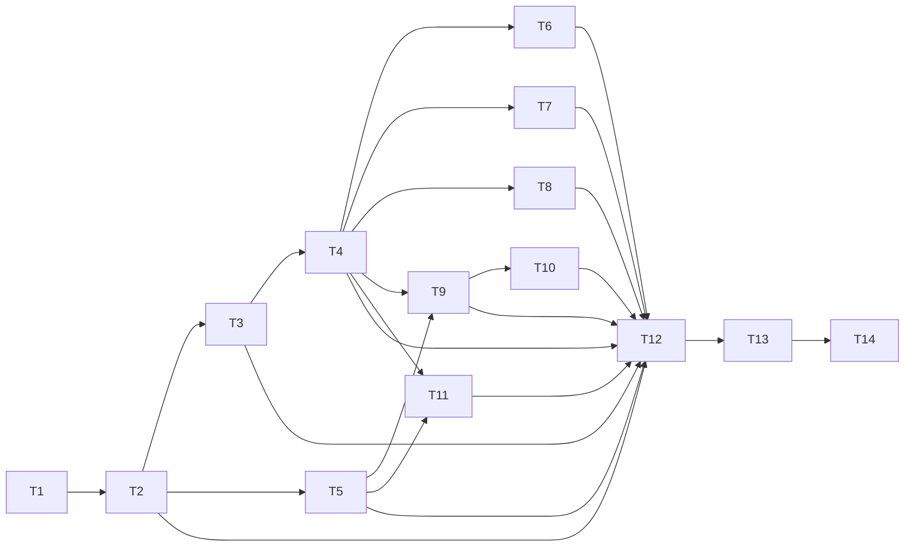

# Tasks: Modern Web Guidance for web UI work (`modern-web-guidance`)

> **Answer first.**
>
> - **14 tasks.** The design's 9 split per rules document (Step 3.2: a rules-text task stays within one rules document).
> - **T1 is the security gate.** Every other task depends on it, and a `FAIL` stops the spec (FR-1).
> - **Each wiring task carries its own contract tests**, one assertion per clause, in the new suite `test/modern-web-guidance.test.js`, and updates the consumer tests its edit turns red. T14 adds the cross-cutting checks and runs the full gates.
> - **~1,120 LOC; ~24 review rounds.** The design said ~20; see Document Control.
> - **No task is `skip-eligible`.**

## Document Control

| Field | Value |
|---|---|
| Spec Path | `changes/modern-web-guidance` |
| Depth | Standard |
| Approval Mode | `gated` |
| Source | `requirements.md` (amended, approved), `design.md` (approved 2026-11-17 after judgment-day round 1, Fix only) |
| Budget (tripwire) | Tasks **14** (design §12 said 9; the split is per rules document, scope unchanged). LOC **~1,120** (unchanged). Review rounds **~24** (design said ~20: +4 for the five small split-off tasks, at 1 round each) |
| Phase 3 gate | Continue — approved by JC, 2026-11-17, with the two-PR split (PR 1: T1–T8, PR 2: T9–T14) |
| Design route / Backend route | n/a. No task changes a UI surface or backend code (rules text, docs and tests only) |

## Task graph

## Tasks

### T1: Security review of the pinned upstream

| Field | Value |
|---|---|
| Status | [x] |
| Size | M (no repo LOC; evidence in `execution.md`) |
| Depends on | — |
| Requirements | FR-1 (both scenarios, all clauses) |
| Design | §8.1 *Untrusted output*, *Outside this gate*; P-7, P-8, P-9; DD-8, DD-14 |
| Scope | Fetch the pinned files into a scratch directory outside the repo (never into `.claude/skills/`): `SKILL.md` and `LICENSE` at `64a6d708` and the npm tarball `modern-web-guidance@1.0.1`. Verify the blob SHAs `7483c781…` and `d6456956…` and the tarball shasum `06a05dda…`. Review them with `security-audit` (guidance mode) for: <ul><li>prompt injection</li><li>fetch-and-run and `-y` auto-install</li><li>network and telemetry: the watchdog endpoint and `DISABLE_TELEMETRY`</li><li>stderr upgrade prompts and `set-allow-*` prompts</li><li>credential handling</li><li>destructive commands</li><li>hidden or encoded content, with `perl` (not BSD `grep -P`)</li></ul> Classify each item named in FR-1's AND clause, and name the requirement that handles it. Record the verdict, each scan command verbatim with its exit status (2 = "not run"), hits and classification in `execution.md`. **Execute nothing from the tarball** |
| Tests | n/a. Agent review (requirements §8 defect class 1) |
| Falsifier | n/a — not a test. Substitute: the Reviewer re-runs two of the recorded scan commands and one SHA check, and compares the output |
| Red run | n/a — no test |
| Disqualifier | A scan that exited 2 and is reported as "0 hits"; a SHA or shasum that does not match (the verdict is void, re-fetch); a classification without a quoted line |
| Consumers | none (no repo file changes) |
| Review | `full` — third-party admission gate; a FAIL stops the spec |
| Done criteria | Verdict `PASS` or `FAIL` recorded with every scan verbatim. `FAIL` → Pivot Protocol, and every other task stays `[ ]`. `PASS` → each FR-1 AND item is mapped to FR-3/4/5/6. **No repo file other than `execution.md` changed** (`git status` quoted) |
| Skills | `security-audit` |

### T2: `modern-web.md`, the MWG rules file

| Field | Value |
|---|---|
| Status | [x] |
| Size | M (~120 lines + ~200 test LOC) |
| Depends on | T1 (`PASS`) |
| Requirements | FR-2 BUT (no skills-list path: *How it is reached*); FR-3 Not-web BUT; FR-4 all clauses; FR-5 all clauses except the shipped-`@latest` BUT; FR-6 both scenarios; FR-7 AND execute (*In a task*), test/validate reads; FR-8 procedure (*Audit scan*); FR-10 install routes THEN/AND |
| Design | §8.1 (every section, both tables), §8.3 steps 1–7, §8.5; DD-5 to DD-8, DD-14, DD-15 |
| Scope | Create `.claude/skills/impeccable-bridge/references/modern-web.md` with these sections, in this order: <ol><li>*Role*</li><li>*How it is reached*</li><li>*Gate* (the six-state table)</li><li>*Pin*</li><li>*Call forms*</li><li>*Untrusted output*</li><li>*In a task*</li><li>*Test and validate reads*</li><li>*Disclosure*</li><li>*Audit scan*</li><li>*Install routes*</li><li>*Outside this gate*</li><li>*Attribution* (MIT AKILI file; MWG by Google Chrome, Apache-2.0, not affiliated)</li></ol> **No string `modern-web-guidance@latest`.** Update `SKILL_FILE_EXPECTED` (+1 term with a comment) and the `test/impeccable-bridge.test.js` file list (P-18) |
| Tests | New `test/modern-web-guidance.test.js`, section *rules file*. One assertion per clause: <ul><li>the six state heads and their report lines, each containing `not run:` except `ready`</li><li>"continue" on the five that are not `ready`</li><li>the `DISABLE_TELEMETRY=1` prefix rule and the always-on `ENABLE_FILE_LOGGING=false` prefix (execute-time amendment, T1 F-5)</li><li>no `npx` before consent</li><li>no-answer = declined</li><li>pre-approved ≠ consent</li><li>never fall back to unpinned</li><li>default pin `1.0.1`</li><li>the pin grammar and the invalid-pin line</li><li>the skills-list prohibition</li><li>the disclosure targets and its forbidden targets</li><li>the untrusted-output rule</li><li>the route table rows, with Grok Bot absent and Cursor/OpenCode marked unverified</li></ul> |
| Falsifier | Delete the telemetry rule → the telemetry assertion goes red. Turn the `declined` row's "continue" into "stop" → the continue assertion goes red. Insert `modern-web-guidance@latest` → the no-`@latest` assertion goes red. Remove the file → the `impeccable-bridge.test.js` file list goes red |
| Red run | predicted — greenfield artifact (observed in T2) |
| Disqualifier | An assertion that passes on a fragment authored in the test instead of reading the shipped file; a section found by line number |
| Consumers | `test/impeccable-bridge.test.js:38` (P-18); `test/install-cursor.test.js:257-262` (P-14) |
| Review | `full` — new rules text that agents execute |
| Done criteria | The file ships with all 13 sections. Each falsifier was executed and its red quoted in `execution.md`. `node --test test/modern-web-guidance.test.js test/impeccable-bridge.test.js test/install-cursor.test.js` is green |
| Skills | `impeccable-bridge`, `cognitive-doc-design` |

### T3: Bridge entry row and version

| Field | Value |
|---|---|
| Status | [x] |
| Size | S (~3 lines + ~20 test LOC) |
| Depends on | T2 |
| Requirements | FR-2 BUT (reached only through the bridge); NFR-3 |
| Design | §3 Layer table *Entry*; §4 |
| Scope | Add a *Roles* row to `impeccable-bridge/SKILL.md`: `modern-web-guidance` (environment-provided) · supporting: platform implementation for web UI · reached through `references/modern-web.md`, never loaded directly. Bump frontmatter `version` 2.1 → 2.2 and the `test/impeccable-bridge.test.js:33` pin (P-18). No other bridge text |
| Tests | Suite section *bridge entry*: the Roles row names the reference file and says "never loaded directly"; version is 2.2 |
| Falsifier | Remove "never loaded directly" → red. Revert to 2.1 → the version pin goes red |
| Red run | predicted — greenfield artifact (observed in T3) |
| Disqualifier | A test matching "modern-web" anywhere in `SKILL.md` instead of in the *Roles* table |
| Consumers | `test/impeccable-bridge.test.js:33` (P-18) |
| Review | `checklist` — one row and a version |
| Done criteria | Falsifier reds quoted; the two test files are green |
| Skills | `impeccable-bridge` |

### T4: Design matrix edits

| Field | Value |
|---|---|
| Status | [x] |
| Size | M (~25 lines + ~140 test LOC) |
| Depends on | T3 |
| Requirements | FR-3 (both scenarios, all clauses); FR-4 AND (non-ready finishes as today: *Platform guidance*); FR-6 THEN (Done-criteria evidence clause); FR-7 AND execute (Build route) |
| Design | §8.2 (all seven sites); DD-3, DD-4, DD-16; P-12, P-13, P-27 |
| Scope | In `design-routing.md`: <ul><li>the card row; the evidence path must resolve under `.claude/skills/` (P-12)</li><li>the *Supporting line* clause (web UI cells only)</li><li>the route form's sixth field and its `Platform` row</li><li>the new *Platform guidance* section</li><li>Build route new step 4 and the renumbering, with the craft floor still read immediately before edits</li><li>the ENV-0 sentence</li><li>the Done-criteria clause</li></ul> The matrix rows are unchanged. Update the consumer tests: `design-skill-routing.test.js` (10 cards; card set = EIGHT plus `modern-web-guidance` as environment-provided, with no folder check for it; evidence resolution) and `design-skill-routing-coverage.test.js:142-152` (six fields, form order) |
| Tests | Suite section *matrix*: <ul><li>the card's must-not list</li><li>the `Platform` values per ENV, with ENV-3 `none — native`</li><li>the field names a pin source</li><li>*Platform guidance* is keyed on the route field, not on the skill source</li><li>it runs before the craft floor (order check)</li><li>no matrix cell names MWG</li><li>the Done-criteria clause</li></ul> |
| Falsifier | Move *Platform guidance* inside the skill-source-gated text → the ENV-0 assertion goes red. Put `modern-web-guidance` into a matrix cell → the "never a lead" assertion goes red. Drop `pin` from the field → red |
| Red run | predicted — greenfield artifact (observed in T4) |
| Disqualifier | An order check that compares heading positions in a test-authored string |
| Consumers | `test/design-skill-routing.test.js:35,76-100,116-134` (P-12); `test/design-skill-routing-coverage.test.js:142-152` (P-13); readers of the `platform` signal (P-27) |
| Review | `full` |
| Done criteria | Falsifier reds quoted. The two routing suites and the new suite are green. The KZ-changes--kaizen-loop-closure-2 sweep for "every cell" and "one lead" phrasing was run and quoted before review |
| Skills | `impeccable-bridge`, `cognitive-doc-design` |

### T5: Governance rule 4 and the environment-provided paragraph

| Field | Value |
|---|---|
| Status | [x] |
| Size | S (~12 lines + ~60 test LOC) |
| Depends on | T2 |
| Requirements | FR-2 THEN, AND (three selectors), AND IT MUST (outcome per selector), BUT (all three prohibitions), AND (restatements inside `governance.md`) |
| Design | §9 rule 4 text and wording constraint; DD-1, DD-13, DD-15; P-16, P-20 |
| Scope | In `docs/skills/governance.md`: <ul><li>name MWG in the environment-provided paragraph (Google Chrome, Apache-2.0, referenced, never vendored)</li><li>rewrite rule 4 with the three selectors, the bridge gate, the never-a-skills-list sentence and the per-selector outcome</li><li>rule 2's "one narrowing" sentence (`:30`) and the *Today's instance* sentence agree with the new rule</li></ul> The *Supersession* paragraph and the Fusion Log (`:62`, `:145`) stay unchanged. Keep `video-production.test.js:278-279` passing, by keeping its clause strings or by updating them in this task (P-20) |
| Tests | Suite section *governance*: <ul><li>three selectors named</li><li>`Deliverable` stops, the others continue</li><li>never a skills-list name</li><li>MWG not in the vendored section</li></ul> |
| Falsifier | Delete the typed-mode selector → red. Change "continue" to "stop" for the route selector → red. Add MWG to *Vendored third-party* → red |
| Red run | predicted — greenfield artifact (observed in T5) |
| Disqualifier | A sweep keyed only on the word `video` (DD-13) |
| Consumers | `test/video-production.test.js:278-279,288` (P-20, P-16); `test/diagram-design.test.js:396-397` (P-16) |
| Review | `full` — rule text that every later decision cites |
| Done criteria | Obligation-keyed sweep over `governance.md` quoted ("only when", "stops at", "Today's instance"). Falsifier reds quoted. `video-production`, `diagram-design` and the new suite are green |
| Skills | `cognitive-doc-design` |

### T6: `/akili-specify` pointer

| Field | Value |
|---|---|
| Status | [x] |
| Size | XS (~2 lines + ~25 test LOC) |
| Depends on | T4 |
| Requirements | FR-3 THEN (route carries the field) and Not-web THEN; FR-7 THEN specify, BUT (no copy), AND IT MUST (no web UI → unchanged in behavior, as amended 2026-11-17); FR-2 BUT (never in a skills list) |
| Design | §8.2 route field; DD-3, DD-15; P-3, P-25 |
| Scope | One bullet in *Preferred UI/UX skill rule*: a web UI task's route carries the `platform` field per `design-routing.md` → *Design route line*, and `modern-web-guidance` is never added to a task's skills list. The `:152` rule sentence pinned by `design-skill-routing-coverage.test.js` stays verbatim |
| Tests | Suite section *specify*: the bullet names `design-routing.md`; it says never-in-skills-list; it copies no field table row |
| Falsifier | Add `modern-web-guidance` to the bullet's skills example → red |
| Red run | predicted — greenfield artifact (observed in T6) |
| Disqualifier | A test that reads the whole command file for "modern-web-guidance" without the bullet scope |
| Consumers | `test/design-skill-routing-coverage.test.js:152`; `test/design-skill-routing.test.js:192` |
| Review | `checklist` |
| Done criteria | Falsifier red quoted; the routing suites and the new suite are green |
| Skills | `cognitive-doc-design` |

### T7: `/akili-test` pointer

| Field | Value |
|---|---|
| Status | [x] |
| Size | XS (~2 lines + ~20 test LOC) |
| Depends on | T4 |
| Requirements | FR-7 AND test, BUT, AND IT MUST; FR-4 AND IT MUST NOT (no block) |
| Design | §8.1 *Test and validate reads*; P-21 |
| Scope | One sentence after the design-detector block, **outside its five-row state table**: when `execution.md` records MWG guide ids, a frontend or E2E Tester may use them as a source for platform assertions through `modern-web.md` → *Test and validate reads*; not `ready` → recorded, never failed |
| Tests | Suite section *test*: the sentence names the reference and section; the state table still has five rows (existing pin) |
| Falsifier | Add a sixth row to the state table → `impeccable-bridge.test.js:88-100` goes red (consumer check) |
| Red run | predicted — greenfield artifact (observed in T7) |
| Disqualifier | — (presence check; the behavior is an accepted risk, requirements §8) |
| Consumers | `test/impeccable-bridge.test.js:88-100` (P-21) |
| Review | `checklist` |
| Done criteria | Falsifier red quoted, then reverted; suites green |
| Skills | `cognitive-doc-design` |

### T8: `/akili-validate` pointer

| Field | Value |
|---|---|
| Status | [x] |
| Size | XS (~2 lines + ~20 test LOC) |
| Depends on | T4 |
| Requirements | FR-7 AND validate, BUT, AND IT MUST; FR-4 AND IT MUST NOT |
| Design | §8.1 *Test and validate reads*; P-21 |
| Scope | One sentence in *UI design review*, outside its five-row state table: check built code against the guides recorded in `execution.md` through `modern-web.md` → *Test and validate reads*; contradictions are findings; not `ready` → recorded, the gate is not failed on it |
| Tests | Suite section *validate*: as T7 |
| Falsifier | Change "not failed" to "WARN/FAIL" → red |
| Red run | predicted — greenfield artifact (observed in T8) |
| Disqualifier | n/a — a presence check of one sentence; the agent behavior it describes is an accepted risk (requirements §8) |
| Consumers | `test/impeccable-bridge.test.js:88-100` (P-21) |
| Review | `checklist` |
| Done criteria | Falsifier red quoted; suites green |
| Skills | `cognitive-doc-design` |

### T9: `/akili-audit modern-web` mode

| Field | Value |
|---|---|
| Status | [x] |
| Size | M (~30 lines + ~120 test LOC) |
| Depends on | T4, T5 |
| Requirements | FR-8 (both scenarios, all clauses); FR-4 AND IT MUST NOT (audit not blocked) |
| Design | §8.3 steps 1–7, *Why a mode*; DD-9; P-11, P-21, P-22, P-23, P-26 |
| Scope | In `akili-audit.md`: <ul><li>the *Usage* line and the mode dispatch sentence (P-26)</li><li>a *Modern Web Mode* section pointing at `modern-web.md` → *Audit scan* (no copied procedure rows)</li><li>the report path rule</li><li>the "never a drift report" line</li><li>a design-mode-style checklist line</li></ul> Do not use "outside `docs/specs/audits/`" without "user-directed" on that line (P-22). The `design` mode's five-row table stays untouched (P-21) |
| Tests | Suite section *audit*: <ul><li>the mode is dispatched by its argument</li><li>the report path pattern `modern-web-<YYYY-MM-DD>`</li><li>report-only and no *Modernize*</li><li>findings routed to `/akili-propose` / `/akili-quick`</li><li>`not run:` and not-applicable outcomes</li><li>`modern-web-*.md` excluded from drift reads</li></ul> |
| Falsifier | Remove the dispatch sentence → the dispatch assertion goes red. Write "outside `docs/specs/audits/`" without "user-directed" → `design-eval-contract.test.js` pattern 7 goes red |
| Red run | predicted — greenfield artifact (observed in T9) |
| Disqualifier | A dispatch check that only finds the word `modern-web` in the file |
| Consumers | `test/impeccable-bridge.test.js:88-100` (P-21); `test/design-eval-contract.test.js:465-525` (P-22); drift-read readers (P-23: `akili-archive.md:83`, `kaizen/SKILL.md:69,74`; unchanged, confirmed by the test) |
| Review | `full` — new user-facing mode |
| Done criteria | Falsifier reds quoted; `impeccable-bridge`, `design-eval-contract`, `akili-security-command` and the new suite are green |
| Skills | `impeccable-bridge`, `cognitive-doc-design` |

### T10: `/akili-propose` accepts the report

| Field | Value |
|---|---|
| Status | [x] |
| Size | XS (~1 line + ~15 test LOC) |
| Depends on | T9 |
| Requirements | FR-8 AND (routes findings to `/akili-propose`) |
| Design | §8.3 (propose source widening); P-23 |
| Scope | *Design evaluation as a source* also accepts `docs/specs/audits/modern-web-*.md`, with findings carried as the Problem table, in the same shape as design reports |
| Tests | Suite section *propose*: both report kinds named |
| Falsifier | Remove `modern-web-*.md` → red |
| Red run | predicted — greenfield artifact (observed in T10) |
| Disqualifier | n/a — a presence check of one sentence; the agent behavior it describes is an accepted risk (requirements §8) |
| Consumers | `test/impeccable-bridge.test.js` propose pointer check (`:96-100`) |
| Review | `checklist` |
| Done criteria | Red quoted; suites green |
| Skills | `cognitive-doc-design` |

### T11: `/akili-constitution` Step 8D

| Field | Value |
|---|---|
| Status | [x] |
| Size | S (~8 lines + ~70 test LOC) |
| Depends on | T4, T5 |
| Requirements | FR-9 (all clauses); FR-5 override (row token); FR-2 BUT (Skill Map row is not a skill to assign) and AND (item 3 restatement) |
| Design | §8.4; DD-7, DD-15; P-13, P-16, P-19, P-25 |
| Scope | Item 3: <ul><li>the MWG example (web UI projects only, ask first, the *When to load* text with "never assigned or loaded directly", optional `pin <x.y.z>`)</li><li>the stop sentence gains "a `platform` selector never stops"</li></ul> Item 4: the platform-guidance field after motion library, with the matrix pointer still last (P-19). No stack-skill names and no `file:line` in items (`design-skill-routing.test.js:141,213`). Update `design-skill-routing-coverage.test.js:117-138` (six → seven fields, pointer last) and `backend-skill-routing-coverage.test.js:73-74,203-213` if its item structure pin moves |
| Tests | Suite section *constitution*: <ul><li>web-UI-only condition</li><li>never assigned or loaded directly</li><li>pin token grammar named</li><li>item 4 field present and the pointer last</li></ul> |
| Falsifier | Drop "never assigned or loaded directly" → red. Move the new field after the pointer → coverage test red |
| Red run | predicted — greenfield artifact (observed in T11) |
| Disqualifier | A field-order check on a test-authored list |
| Consumers | `test/design-skill-routing-coverage.test.js:117-138`; `test/design-skill-routing.test.js:141,213`; `test/backend-skill-routing-coverage.test.js:73-74,203-213` (P-13, P-19) |
| Review | `full` |
| Done criteria | Sweep of item 3's "stops at … gate" restatements quoted; falsifier reds quoted; the three routing suites and the new suite are green |
| Skills | `cognitive-doc-design` |

### T12: Docs pages and restatements

| Field | Value |
|---|---|
| Status | [ ] |
| Size | M (~50 lines + ~80 test LOC) |
| Depends on | T2–T11 |
| Requirements | FR-11 THEN, AND, BUT; FR-10 install routes THEN/AND; FR-2 AND (restatements outside governance) |
| Design | §8.5; DD-10, DD-11; P-10, P-15, P-16, P-23, P-24 |
| Scope | Read and settle **P-10** first (Grok Bot stays out unless a primary source appears). Edit: <ul><li>`docs/skills/impeccable-bridge.md`: MWG section with role, gate, pin, security record summary (no spec-path link), install routes</li><li>`docs/overview.md` and `docs/cli.md:31-32`: env-tool rows</li><li>`docs/flow.md:193-194,617,656`</li><li>`docs/commands/akili-audit.md` and `docs/commands/README.md:17`</li><li>`AGENTS.md` *Design Skills* (MWG as environment-provided) and `:53`</li><li>`docs/skills/video-production.md:20`</li></ul> Cite Apache-2.0, Google Chrome, the eval figures and MDN only to README `v1.0.1` (P-15, P-24) |
| Tests | Suite section *docs*: <ul><li>Apache-2.0 and Google Chrome on the bridge page</li><li>no Grok Bot route</li><li>eval figures only beside the README citation</li><li>no `docs/specs/changes/modern-web-guidance` link in shipped docs</li><li>`docs/cli.md` env row lists MWG and the per-selector outcome</li></ul> |
| Falsifier | Write "MIT" for MWG → red. Add a Grok Bot route → red. Link the spec path → red |
| Red run | predicted — greenfield artifact (observed in T12) |
| Disqualifier | A claim-family grep that misses a claim split across lines (KZ-002 recurrence, grokbot-target T5) |
| Consumers | `test/design-skill-routing.test.js:100` (the `AGENTS.md` *Design Skills* expectation moves from EIGHT to EIGHT plus `modern-web-guidance` in this task, beside the `AGENTS.md` edit; T4 changes only the card checks); `test/docs-overview.test.js` (no new skill row) |
| Review | `full` — every claim quote-checked at HEAD (KZ-002) |
| Done criteria | Every claim checked against its source and listed in `execution.md`; falsifier reds quoted; `docs-overview`, routing and new suites green |
| Skills | `cognitive-doc-design` |

### T13: CHANGELOG

| Field | Value |
|---|---|
| Status | [ ] |
| Size | S (~15 lines + ~20 test LOC) |
| Depends on | T12 |
| Requirements | FR-11 THEN (CHANGELOG), BUT |
| Design | DD-11; §15 |
| Scope | One `Unreleased` entry, in the same minor release as PRs #142–#144. It states only what shipped at HEAD. The test count is re-run after T14 (KZ-002 recurrences) |
| Tests | Suite section *changelog*: reads the newest section stating the value (AGENTS.md rule); Apache-2.0; no `@latest` |
| Falsifier | State "MIT" → red |
| Red run | predicted — greenfield artifact (observed in T13) |
| Disqualifier | A clause quote-checked against design text instead of shipped text |
| Consumers | none |
| Review | `full` — summary-surface claims |
| Done criteria | Every clause quote-checked at HEAD, the list in `execution.md`; red quoted; green |
| Skills | `cognitive-doc-design` |

### T14: Cross-cutting checks and gates

| Field | Value |
|---|---|
| Status | [ ] |
| Size | M (~150 test LOC) |
| Depends on | T13 |
| Requirements | FR-5 BUT (no shipped `@latest`); FR-7 BUT (no copied rows); FR-10 THEN (no installer change, counts); NFR-1 to NFR-4; FR-7 AND IT MUST (non-UI specs unchanged in behavior: only conditional wording; amended 2026-11-17) |
| Design | §15; P-14 |
| Scope | Suite section *cross-cutting*: <ul><li>no `modern-web-guidance@latest` in packaged or shipped-docs files (excluding `docs/specs/`, `test/`, `releases/`, CHANGELOG history)</li><li>no gate-table row, pin rule or matrix row copied into any command</li><li>every command mention of MWG is conditional on web UI / `platform mwg` / the typed mode</li><li>no MWG file in the repo (NFR-2)</li><li>`engines.node` still `>=18.0.0`; no test spawns `npx` or the network</li><li>`install --tool all --dry-run` plans no MWG file</li></ul> Then run every gate |
| Tests | As scope |
| Falsifier | Add `modern-web-guidance@latest` to `docs/cli.md` → red. Paste a gate row into `akili-test.md` → red. Add an unconditional MWG mention to a command → red |
| Red run | predicted — greenfield artifact (observed in T14) |
| Disqualifier | A scan whose file list is built from a fixed array instead of walking the tree (the inert-fixture class); a green obtained with a global `akili` on `PATH` |
| Consumers | all suites (full run) |
| Review | `full` |
| Done criteria | Falsifier reds quoted. `npm test`, `npm run verify:cli`, `npm run pack:dry-run`, `git diff --check`, `node bin/akili.js install --tool all --dry-run` and `node bin/akili.js doctor --tool all` are all green, with counts quoted in `execution.md`. The CHANGELOG test count is re-checked |
| Skills | `tdd` (recommended; the Leader decides) |

## Coverage: requirement clauses to tasks

| Requirement / scenario | THEN | AND / AND IT MUST | BUT |
|---|---|---|---|
| FR-1 Review passes | T1 | T1 (classification), T1 (exit 2, perl) | T1 (no MWG text before verdict: T2–T14 depend on T1) |
| FR-1 Review fails | T1 | — | — |
| FR-2 Category and selector | T5 | T5 (three selectors); T5 (outcome per selector); T5, T11, T12 (restatements) | T5 (no load-direct, not vendored, no skills list); T2 (*How it is reached*); T6 (specify); T11 (Skill Map row) |
| FR-3 Web UI task | T4, T6 | T4 (card); T4 (lead stays) | — |
| FR-3 Not a web UI task | T4, T6 | — | T2 (*Role*), T4 (no cell names MWG) |
| FR-4 Gate outcomes | T2 | T2, T4 (continue as today); T2 (telemetry off); T2, T7, T8, T9 (never blocks) | T2 (no call before ready, no install, pre-approved ≠ consent, no unpinned fallback) |
| FR-5 Default pin | T2 | T2 (changes only via spec) | — |
| FR-5 Project override | T2 | T2, T11 (grammar, invalid fallback) | — |
| FR-5 Upstream `@latest` | T2 | — | T14 (no shipped `@latest`) |
| FR-6 Disclosure placement | T2, T4 (Done criteria) | — | T2 |
| FR-6 Trigger containment | T2 | — | — |
| FR-7 Per phase | T6 | T4 (execute), T7 (test), T8 (validate); T6, T7, T8, T14 (non-UI unchanged in behavior, as amended 2026-11-17) | T14 (no copies; each pointer task names the section) |
| FR-8 Scan runs | T9 (+T2 procedure) | T9 (verify, count); T9 (report content); T9, T10 (routing) | T9 |
| FR-8 Not applicable / not ready | T9 | — | — |
| FR-9 Web UI project | T11 | — | T11 |
| FR-10 No package change | T14 (+T2 count) | — | — |
| FR-10 Install routes | T2, T12 | T2, T12 (unverified hosts) | — |
| FR-11 Docs | T12, T13 | T12, T13 (Apache-2.0, Google Chrome) | T12, T13, T14 |
| NFR-1 to NFR-4 | T14 | — | — |

## PR strategy

~1,120 LOC is over 400, so two PRs are recommended, both into `dev`:

| PR | Tasks | What to review first | Out of scope |
|---|---|---|---|
| PR 1 | T1–T8 | T1 verdict, then `modern-web.md`, matrix, governance | Audit mode, constitution, docs |
| PR 2 (stacked on PR 1) | T9–T14 | Audit mode, then constitution, docs, CHANGELOG | Routing rules (PR 1) |

A single PR is also fine if JC prefers to bundle it with the #142–#144 release.

## Verification Checklist (`/akili-specify`, run 2026-11-17)

| Item | Result |
|---|---|
| 3 files exist, non-empty | `requirements.md` 300, `design.md` 313, `tasks.md` 338 lines |
| `general-setup/` conventions | n/a. This repo has no `docs/specs/general-setup/` (`ls` → absent). Shape follows the archived precedent `2026-11-01-changes--go-backend-routing--golang-skill` |
| Depth re-checked against the design | Standard kept. Re-sized at Phase 3 to 14 tasks (Document Control) |
| Budget recorded | `design.md` §12 + Document Control above (14 tasks, ~1,120 LOC, ~24 rounds) |
| Reversion challenge | `design.md` §10: no DD reverts shipped behavior |
| Premise Ledger | 27 rows; 1 `UNVERIFIED` (P-10, Low, owned by T12); every triggered class has rows (`consumer`, `live-path` P-26, `shared-state` P-27); consumer rows are copied into tasks' `Consumers` |
| Defect classes mapped | `requirements.md` §8, with the accepted risks stated |
| Scenarios with BUT / AND IT MUST | FR-1 to FR-11 |
| Clause-level coverage | *Coverage* table above |
| Dependency graph acyclic | Every `Depends on` points to a lower task number |
| Skills real | `security-audit`, `impeccable-bridge`, `cognitive-doc-design`, `tdd`: each has a `.claude/skills/<name>/SKILL.md` |
| Verification fields on all 14 tasks | Falsifier, Red run, Disqualifier and Consumers present 14/14, none blank; Red runs are `predicted — greenfield artifact (observed in Tn)` or `n/a` (T1) |
| `skip-eligible` named at the gate | None. Stated in the Phase 3 presentation |
| Rendered-measurement gates | n/a. No gate measures rendered output |
