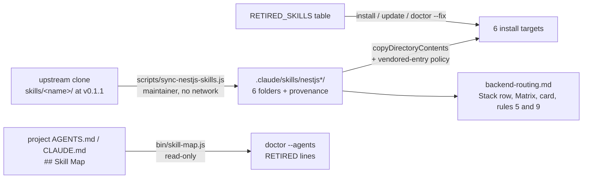

# Design: Official NestJS skills, vendored verbatim; `nestjs-expert` retired

## 1. Document Control

| Field | Value |
|---|---|
| Spec | `changes/nestjs-official-skills` |
| Depth | Standard (upper end) |
| Type | Change · Deliverable software · AI Agent no |
| Approval Mode | gated |
| Status | Phase 2 draft, awaiting the Step 2.5 gate |
| Verified at | AKILI `0d92537` · upstream `68e1d54` (`v0.1.1`), local clone, HEAD `7f05f49` |
| Inputs | `proposal.md` (approved Q1–Q4), `requirements.md` (approved, FR-1–FR-9, NFR-1–NFR-8) |
| Backend route source | `software-architect` → `references/backend-routing.md` (read by path) |
| Delegation | Step 2.1 exploration and the Step 2.3 reversion challenge ran inline (no subagent) |

## 2. Executive Summary

- **Six folders, verbatim, each self-contained.** `.claude/skills/nestjs{,-feature,-auth,-data,-testing,-production}/` hold the upstream files at `v0.1.1`, plus their own `LICENSE`, `NOTICE` and `UPSTREAM.md`. A folder copied alone still carries its license and its ownership marker (DD-1, DD-2).
- **A new maintainer script, `scripts/sync-nestjs-skills.js`.** It stages all six folders, validates them, and only then swaps them in, so a refusal never leaves a half-written folder. `sync-impeccable.js` is left alone (DD-4).
- **Three installer changes.**
  - The impeccable ownership rule becomes a set of vendored entries, which adds the six names (DD-5).
  - `LEGACY_SKILLS` becomes a table that maps each retired name to its replacement (DD-6).
  - `doctor --agents` gains a read-only Skill Map scan in a new pure module, `bin/skill-map.js` (DD-7).
- **Routing.** `nestjs-feature` leads `implement / NestJS`. The five other skills support by activity, under one family card. Decision rule 5 gains the package-preference clause, and a new Decision rule 9 holds the outward-action rule (DD-8).
- **The surface sweep is bounded by two run commands.** One finds 22 files that name `nestjs-expert` (P-9). The other finds 7 files that pin the skill count at 32, which becomes 37 (P-10).

## 3. Architecture Overview

No new runtime component. The change touches four existing layers.



| Layer | Change | Requirement |
|---|---|---|
| Package content | Add 6 folders (16 upstream + 18 provenance files); remove `nestjs-expert/` (1 file) | FR-1, FR-4 |
| Maintainer tooling | New sync script; one release-checklist step | FR-2 |
| Installer (`bin/akili.js`) | Vendored-entry ownership set; retired-name table; Skill Map scan call | FR-3, FR-4, FR-5 |
| Pure module (`bin/skill-map.js`, new) | Section bounds and retired-name matching | FR-5 |
| Routing and docs text | Matrix, governance, commands, templates, docs, panel catalog, CHANGELOG | FR-6–FR-9 |

## 4. Extended Directory Structure

```text
.claude/skills/
  nestjs/              SKILL.md + references/ (upstream) · LICENSE · NOTICE · UPSTREAM.md
  nestjs-feature/      same shape
  nestjs-auth/         same shape
  nestjs-data/         same shape
  nestjs-testing/      same shape
  nestjs-production/   same shape
  nestjs-expert/       REMOVED
bin/
  akili.js             edited (DD-5, DD-6, DD-7 call site)
  skill-map.js         NEW pure module (DD-7)
scripts/
  sync-nestjs-skills.js  NEW, maintainer-only, not in package.json "files" (P-6)
docs/skills/
  nestjs.md … nestjs-production.md   NEW, 6 pages
  nestjs-expert.md                   REMOVED
test/
  nestjs-vendor.test.js              NEW (FR-1, FR-2, NFR-1, NFR-3)
  sync-nestjs-skills.test.js         NEW (FR-2 refusals, atomicity, against a temp git repo)
  install-nestjs-foreign.test.js     NEW (FR-3)
  retired-skills.test.js             NEW (FR-4, both gsap-* and nestjs-expert)
  doctor-skill-map.test.js           NEW (FR-5)
  nestjs-retirement-surface.test.js  NEW (FR-8 grep scenario)
```

The upstream file list per folder is whatever `git ls-tree -r --name-only v0.1.1 -- skills/<name>` returns. The total is 16 (P-4); the design does not restate per-folder counts.

## 5. Data Model

There is no persisted application data. Two file contracts and one in-code table:

| Artifact | Shape | Decided by |
|---|---|---|
| `UPSTREAM.md` (per folder) | Field table: Source, Path (`skills/<name>/`), Commit, Tag, npm version, npm shasum, Vendored, Synced by. Then *Modification* (one sentence) and *Checksums* (one `sha256  path` line per upstream file; the `SKILL.md` hash is of the upstream bytes) | DD-2, same headings as `impeccable/UPSTREAM.md` so one reader shape serves both |
| `NOTICE` (per folder) | Upstream has no NOTICE (P-4). AKILI writes: source URL + commit + tag, copyright line from upstream `LICENSE`, the modification statement (frontmatter `metadata` block only, keys listed), the non-affiliation line | FR-1 |
| `RETIRED_SKILLS` | Ordered table: retired name → replacement label. 8 `gsap-*` rows → `gsap-animation`; `nestjs-expert` → `the official NestJS skills (nestjs-feature leads implement)` | DD-6 |

`SKILL.md` frontmatter after vendoring: the upstream keys in upstream order (`name`, `description`, `license`, and `compatibility` on `nestjs` only, P-5), then one `metadata` key. It holds `author: Kamil Mysliwiec (NestJS)`, `source: https://github.com/nestjs/agent-skills`, `adapted-by: AKILI-SPECS`, `adapted-for: AKILI-SPECS` and `binding: stack`. It is inserted before the closing fence, so removing that block restores the upstream bytes (DD-3).

## 6. API Design

CLI surface only. No new command and no new flag.

| Command | New output | Exit status |
|---|---|---|
| `akili install` / `update` (non-shared targets) | `deleted retired skill <dir> (replaced by <replacement>)`; `skip foreign <path> (installed by npx @nestjs/skills)` when the `.nestjs-skills` marker is present | unchanged |
| `akili doctor [--fix]` (non-shared targets) | `STALE <name> (retired, replaced by <replacement> — run with --fix or akili update to remove)` / `REMOVED <name> (retired, replaced by <replacement>)`; for a foreign vendored entry: `(not AKILI's copy; not compared)` | unchanged rules: STALE counts as missing, as today |
| `akili doctor --agents [--fix]` | `RETIRED <name> (<file>:<line>) — replaced by <replacement>`, one line per hit, printed before the persona report | **never changed by these lines** (FR-5) |

The gsap-* messages change wording from `legacy, replaced by gsap-animation` to the table form. The replacement stays `gsap-animation`, which keeps FR-4's "the `gsap-*` messages keep naming `gsap-animation`". No test pins the old wording (P-8).

## 7. Backend Module Design

### 7.1 Sync script (FR-2)

| Step | Behavior | Refusal (exit non-zero, nothing written) |
|---|---|---|
| 1. Args | `--from <checkout> --commit <sha-or-tag>` | missing arg; `--from` not a directory |
| 2. Checkout | Resolve `--commit` to a full SHA; it must equal `HEAD`; `git status --porcelain --ignored -- skills` must be empty | dirty or ignored content under `skills/`; commit not checked out |
| 3. Inventory | For each of the six names, `git ls-tree` lists tracked files under `skills/<name>/`; root `LICENSE` must exist | a folder missing; an empty folder; a `SKILL.md` that already has a `metadata` key |
| 4. Stage | Build all six folders in `.claude/skills/.nestjs-sync-staging/` (upstream bytes, `SKILL.md` with the inserted block, `LICENSE`, `NOTICE`, `UPSTREAM.md`) | any I/O error: staging removed |
| 5. Diff | Compare each staged `UPSTREAM.md` checksum set with the current one. Print added, removed and changed files per folder. Print first any changed file whose new bytes contain `observe` (case-insensitive) | — |
| 6. Swap | Per folder: rename the current folder aside, rename the staged folder in, then delete the aside copy. On a failed rename, restore the aside copy and stop | a failed rename: restored |
| 7. Reminder | Print the files to update by hand: `SKILL_FILE_EXPECTED`, the count tests, `docs/cli.md`, `CHANGELOG.md` | — |

- It never calls the network (NFR-2).
- `git` runs as a child process on the given checkout.
- Tag resolution uses `git rev-parse <tag>^{commit}`.

### 7.2 Installer: vendored-entry ownership (FR-3)

- `IMPECCABLE_ENTRY` becomes `VENDORED_ENTRIES`, a set of `impeccable` plus the six names.
- `makeImpeccableForeignPolicy` judges any member of the set with today's logic. The logic is unchanged:
  - absent folder → write;
  - folder with `UPSTREAM.md` → owned;
  - folder without it → foreign, or `--force` takeover through the same aside-and-replace path.
- `policy.detail` keeps the version suffix for `impeccable` and adds `(installed by npx @nestjs/skills)` when `.nestjs-skills` is present.
- The doctor branch at `bin/akili.js:1974` checks the set instead of the single name.
- Grok Bot keeps its ownership-record policy, which already judges every entry (P-3). The set never applies there.

### 7.3 Installer: retired-name table (FR-4)

- Both loops that read `LEGACY_SKILLS` (`bin/akili.js:1306`, `bin/akili.js:2039`) read `RETIRED_SKILLS` and print the row's replacement.
- The `!paths.sharedSkillsRoot` guard stays on both loops. Codex, Cursor and Grok Bot are therefore never scanned (P-2). The CHANGELOG migration note tells their users to delete `~/.agents/skills/nestjs-expert/` by hand (FR-9 item 2).

### 7.4 `doctor --agents`: Skill Map scan (FR-5)

`bin/skill-map.js` exports two pure functions. Neither does I/O.

- **Section bounds.**
  - It starts at the first line that is exactly `## Skill Map` after trimming trailing whitespace and `\r`.
  - It ends before the next line starting with `## `, or at end of file.
  - A `### Skill Map` or `## Skill Map (draft)` heading does not open a section.
  - Lines inside a fenced code block within the section are still scanned, because Skill Maps are tables, not code.
- **Match.** A retired name matches as a whole token. The character before it and the character after it must each be absent, or must not be one of `[A-Za-z0-9_-]`. So `nestjs-expert-v2` does not match, and `` `nestjs-expert` `` and `|nestjs-expert|` do.
- **Output.** A list of `{ name, line, replacement }` in line order, with 1-based line numbers, counted across CRLF and LF alike.

The call site in `runAgentsDoctor` runs **before** the `.agents/` ABSENT return and before the `--fix` guards. It reads `AGENTS.md` then `CLAUDE.md` from the working directory, prints the lines, and never assigns `process.exitCode`. These are the states each file can be in, and what the scan does in each:

| State | Action |
|---|---|
| File absent | Skipped silently |
| File present, no `## Skill Map` heading (e.g. `CLAUDE.md` = `@AGENTS.md`) | Nothing printed |
| Section present, no retired name | Nothing printed |
| Section present, hits | One `RETIRED` line per hit |
| Same row in both files | One line per file (each file is its own report) |
| Unreadable file (permission error) | One `warning` line naming the file; scan continues; exit status unchanged |
| Two `## Skill Map` headings | Only the first is scanned (a stated fall-through; `/akili-constitution` writes one) |

## 8. Frontend / UX Component Architecture

The change has no UI. The only panel-adjacent change is data: `SKILL_CATALOG` in `.claude/skills/akili-panel/hooks/flow.mjs` drops `nestjs-expert` and adds the six. `panel.test.tsx` lines 1058 and 1140 get the fixture names that match (P-9).

## 9. Shared Contracts or Package Extensions

| Contract | Change |
|---|---|
| `backend-routing.md` → *Stack table* | NestJS row: the six names with the idiom each supplies |
| → *Matrix* | `implement / NestJS` lead `nestjs-feature`. Support cell, by activity: auth → `nestjs-auth`, persistence → `nestjs-data`, tests → `nestjs-testing`, production setup → `nestjs-production`, project start, layout and docs → `nestjs`. `module-design` support cell: "NestJS → `nestjs` (layout)" |
| → *Decision rule* 5 | Adds: a package preference stated by a stack skill (e.g. `@nestjs/authentication` over Passport) never overrides `design.md` or the stack the project already uses |
| → *Decision rule* 9 (new) | Outward actions a stack skill suggests (linking a service, registering an MCP server, enabling a paid feature) are the user's decision. The agent may relay the suggestion once. It never runs the action unless the user asks in the session, and `pre-approved` never auto-passes it (FR-7) |
| → *Expertise cards* | One row for the official set. *Must not decide*: architecture, framework choice, API contract policy, a package choice already in `design.md`, any outward action (rule 9). *Evidence*: exact headings from the vendored `SKILL.md` files, copied at execute from the files as vendored |
| → *Attribution* | Names Kamil Mysliwiec (NestJS), MIT, in place of Daniel Avila / `nestjs-expert` |
| `governance.md` | *Vendored third-party (verbatim)* gains the official set and the checklist item 4 exception; *Current assignment* `stack` row; *Removal / Fusion Log* row dated at execute |
| Persona templates | `nestjs-expert` → `nestjs-feature` in the example lists at `leader.md:25` and `implementer.md:27`. Section hashes change; `scripts/release.js` writes `digests.json` and the `since=` markers at release, the path every template edit takes (P-11) |
| `.gitattributes` | Six lines: `.claude/skills/<name>/** -text` |

## 10. Design Decisions

| ID | Decision | Rejected alternative | Why | Req |
|---|---|---|---|---|
| DD-1 | Provenance files live **per folder** (18 files) | One shared `LICENSE`/`NOTICE` at a parent folder | No parent folder exists in any install layout; each folder is copied as its own skill entry (P-1), and `UPSTREAM.md` is the per-entry ownership marker (P-3) | FR-1, FR-3 |
| DD-2 | **sha256 lines in `UPSTREAM.md`** (impeccable style) | Git blob SHA-1 inlined in a test (golang-pro style) | The file is both evidence and ownership marker; the hash does not depend on git; one verifier shape for both vendored members | FR-1, FR-3 |
| DD-3 | `metadata` inserted before the closing fence; the script refuses an upstream `metadata` key | Appending the block elsewhere | Removing the block restores the upstream bytes, so the `SKILL.md` hash check is exact (impeccable precedent: refusal at `scripts/sync-impeccable.js:186`, insertion at `:205-206`) | FR-1, NFR-1 |
| DD-4 | **New script**, staged then swapped | Generalizing `sync-impeccable.js` | Upstream layouts differ: root `LICENSE`, no `NOTICE`, `skills/<name>/` × 6 (P-4). `sync-impeccable.js` deletes its target before writing (`scripts/sync-impeccable.js:196`), which FR-2's no-partial-write rule forbids. Editing it would widen the blast radius onto a released, working path | FR-2 |
| DD-5 | `VENDORED_ENTRIES` set in the existing no-record policy | A second policy function for NestJS | Same rule, same takeover path, one place to read; FR-3 says "under the rule `impeccable` uses today" | FR-3 |
| DD-6 | `RETIRED_SKILLS` name → replacement table; shared-root guard kept | Removing retired copies from shared roots via the Grok Bot ownership record | FR-4 forbids shared-root scanning; Codex/Cursor have no record to prove ownership; Grok Bot alone would be a partial rule | FR-4 |
| DD-7 | Pure `bin/skill-map.js`, called before the `.agents/` ABSENT exit | Inline code in `runAgentsDoctor` | Unit-testable without a project tree; running before the early return reports a stale map even in a project without personas, while the exit status stays the persona checks' alone | FR-5 |
| DD-8 | FR-7 rule lives in `backend-routing.md` (rule 9 + card) | A clause in the Implementer persona | FR-7 says "routing layer". A persona edit puts the rule in every task's context and changes another section hash. **Known gap:** the Leader brief carries names only (`leader.md:25`), so the Implementer gets the rule only through the Leader's reading. That gap is the accepted risk in `requirements.md` §8 | FR-7 |
| DD-9 | Six docs pages from one shared outline (purpose, when it leads or supports, upstream, license, Observe note on `nestjs` and `nestjs-production`) | One family page | FR-8 requires one page per skill; one outline keeps them short and uniform | FR-8 |
| DD-10 | `doctor-codex-baseline.txt` is **updated**; `test/fixtures/personas/*` are **not** | Leaving both | The baseline is a live byte-compare of today's `doctor` output (P-10); the persona fixtures are historical inputs to persona parsing and never list the skill set | FR-8, NFR-6 |
| DD-11 | The repo-wide grep test (FR-8 scenario) lives in its own test file and reads no spec path | Folding it into the routing tests | Keeps NFR-5; the allowlist (CHANGELOG, Removal Log row, `RETIRED_SKILLS`, retirement tests) is explicit in one place | FR-8, NFR-5 |

### 10.1 Reversion challenge (Step 2.3)

There are two reverting decisions: retiring `nestjs-expert` (FR-4) and removing its matrix lead (FR-6). The challenge ran inline with one question: *what does removing this break?*

| Breakage named | Addressed by |
|---|---|
| Projects whose Skill Map names `nestjs-expert` would route to a skill that no longer exists | FR-5 `RETIRED` warning + FR-9 migration note |
| Copies already installed under `~/.agents/skills` (Codex, Cursor, Grok Bot) stay behind, and their hosts can still auto-trigger them | Not removed by design (DD-6). The CHANGELOG names the path to delete by hand. **Residual:** `doctor` does not report them (P-2) |
| Topics `nestjs-expert` covered in depth: Mongoose, Passport | The official set mentions Mongoose in 1 file and Passport in 2 (`grep -rli` on `skills/` at `v0.1.1`). Decisions already in `design.md` still bind (rule 5). Depth on Mongoose drops; this is accepted, not compensated |
| `doctor-codex-baseline.txt` and 7 count-pinning files go red | P-10 sweep; each is a named task edit |
| Persona section hashes change | P-11: the normal release path |

There is no unaddressed breakage, so the design stands. The shared-root residual goes to the user at this gate.

### 10.2 Budget (Step 2.4)

| Number | Estimate | Basis |
|---|---|---|
| Tasks | 8 | T1 vendoring and sync, T2 ownership, T3 retired table, T4 Skill Map scan, T5 routing, T6 governance/docs/commands/templates/panel, T7 counts and fixtures, T8 CHANGELOG and the release checklist |
| LOC written by hand | ~1,900 | Code ~450 (sync 230, installer 80, `skill-map.js` 60, call site 20, plus slack). Tests ~1,100 (6 new files; ×3 per KZ-bugfix--init-ctrlc-abort-2). Docs and rules text ~350 |
| Vendored bytes | ~135 KB, 34 files | Generated by the script, not hand-written, so not counted as LOC |
| Review rounds | 13 | 2 each for T5, T6, T8 (rules text other agents execute); 1 each for T1–T4 and T7; +3 margin |

This sits at the upper end of Standard, which is the declared depth, so the estimate matches. These numbers are the tripwire for `/akili-execute`.

## 11. Premise Ledger

**Count line:** 13 premises: 12 verified, 1 `UNVERIFIED` (0 High, 1 Low).
**Trigger line:** `shared-state` fired: the ownership policy and the legacy loops are shared by all targets (P-2, P-3). `consumer` fired: a packaged skill is removed and six are added (P-9, P-10). `live-path` fired: a user action reaches the scan (P-12).

| # | Claim | Class | Citation (as run) | Verified at | If false | Settled by |
|---|---|---|---|---|---|---|
| P-1 | `install` copies every folder under `.claude/skills/` as its own entry, so the six install with no new copy code | location | `bin/akili.js:1431` `copyDirectoryContents(SOURCE_SKILLS, targetSkills, args, skillsPolicy)`; doctor enumerates via `listSkills()` at `bin/akili.js:523` | `0d92537` | DD-1 changes and a new copy task appears (High) | — |
| P-2 | Legacy cleanup and the STALE scan skip shared skills roots; Codex, Cursor and Grok Bot are shared | shared-state | `bin/akili.js:1303` and `:2038` guard `!paths.sharedSkillsRoot`; `sharedSkillsRoot: true` at `:193` (codex), `:204` (cursor), `:218` (grokbot); Claude, OpenCode, Antigravity entries carry no such key | `0d92537` | The FR-4 scenario's shared-root clause and DD-6 change (High) | — |
| P-3 | Only `impeccable` is judged by the no-record ownership policy; Grok Bot uses its ownership record for every entry | shared-state | `bin/akili.js:912-917` `IMPECCABLE_ENTRY`, `if (name !== IMPECCABLE_ENTRY) return "owned"`; `:1358-1360` `paths.ownershipRecord` → `makeOwnershipPolicy`; `:1430` `policy \|\| makeImpeccableForeignPolicy(...)`; doctor single-name check `:1974` | `0d92537` | DD-5 changes shape (Low) | — |
| P-4 | At `v0.1.1` upstream ships 16 files under `skills/`, one root `LICENSE`, no `NOTICE`, and the extra files bin, index, package, plugin, scripts, test | data-env | In the local clone: `git ls-tree -r --name-only v0.1.1 -- skills \| wc -l` → 16; `git ls-tree -r --name-only v0.1.1 \| grep -v ^skills/` → `.claude-plugin/marketplace.json`, `.claude-plugin/plugin.json`, `.github/workflows/ci.yml`, `.gitignore`, `LICENSE`, `README.md`, `bin/cli.js`, `index.d.ts`, `index.js`, `package.json`, `scripts/validate.js`, `test/cli.test.js` | `68e1d54` | FR-1 counts and the DD-4 NOTICE source change (High) | — |
| P-5 | No upstream `SKILL.md` has a `metadata` key; `compatibility` appears only on `nestjs` | data-env | Frontmatter keys read with an awk pass over `skills/*/SKILL.md` at `v0.1.1`: auth, data, feature, production, testing → `name description license`; `nestjs` → `name description license compatibility` | `68e1d54` | DD-3 insertion refuses; the vendor test's key list changes (Low) | — |
| P-6 | `scripts/` is not shipped except two named files | location | `node -e 'console.log(require("./package.json").files)'` → `scripts/gsc_verify.py`, `scripts/parse_tests.js` only | `0d92537` | The sync script ships; a `files` edit is needed (Low) | — |
| P-7 | No code reads a project Skill Map today | existence | `grep -rnE "Skill Map|skill-map|skillMap|SKILL_MAP" bin` → 1 hit, `bin/akili.js:2139`, a `why:` string in a recommendation table | `0d92537` | DD-7 would extend a reader instead of adding one (Low) | — |
| P-8 | No test covers the `LEGACY_SKILLS` cleanup or its messages | existence | `grep -rln "gsap-core\|LEGACY_SKILLS\|legacy, replaced" test` → no output (scope: `test/`, recursive) | `0d92537` | `retired-skills.test.js` would extend an existing file; message changes need fixture edits (Low) | — |
| P-9 | 22 live files name `nestjs-expert` outside the excluded history paths | consumer | `grep -rln "nestjs-expert" . --exclude-dir={node_modules,.git,archive,kaizen,releases,.codegraph} \| grep -v "docs/specs/changes/nestjs-official-skills\|kaizen-log.md\|test/fixtures/personas"` → 22 files: 2 commands, `flow.mjs`, `panel.test.tsx`, `nestjs-expert/SKILL.md`, `backend-routing.md`, 2 templates, `AGENTS.md`, `CHANGELOG.md`, 6 docs files (`commands/akili-constitution.md`, `commands/akili-test.md`, `flow.md`, `overview.md`, `skills/governance.md`, `skills/nestjs-expert.md`), `docs/skills/README.md`, 4 tests (`ai-agent-guardrails-evals`, `akili-panel-flow`, `backend-skill-routing-coverage`, `backend-skill-routing`), `test/fixtures/doctor-codex-baseline.txt` | `0d92537` | A missed surface fails the FR-8 grep test (Low) | — |
| P-10 | 7 files pin the skill count at 32 (or 33), and one live fixture lists the skill set; both are byte-compared | consumer | `grep -rnE "3[23] skills\|32 packaged\|SKILL_DIR_COUNT =" test docs/cli.md docs/overview.md docs/skills/README.md README.md` → `install-akili-panel.test.js:111,123,146,427,433,435`, `diagram-design.test.js:418`, `akili-marketing-docs.test.js:114,118`, `akili-panel-cli-coverage.test.js:508,520,537,543`, `install-cursor.test.js:233`, `docs/cli.md:327,339,360,377`; `SKILL_FILE_EXPECTED` at `install-cursor.test.js:258`; baseline compared at `install-cursor.test.js:891` and `install-grokbot.test.js:890`, listing `OK nestjs-expert` at line 43 | `0d92537` | T7 scope grows (Low) | — |
| P-11 | Template edits land in feature commits; `scripts/release.js` writes `digests.json` and the `since=` markers at release | other | `scripts/release.js:236-246` (dense `releases` entry + `since=` rewrite); precedent `45e7246` edited `leader.md` in a spec commit, release `9f3e9cb` followed | `0d92537` | Template edits would need a digest task (Low) | — |
| P-12 | `doctor --agents` dispatches to `runAgentsDoctor`, which returns early with exit 1 when `.agents/` is absent, before any `--fix` guard | live-path | `bin/akili.js:2445` `runAgentsDoctor(args)`; `:2457-2461` ABSENT → `process.exitCode = 1; return`; guards evaluated after at `:2471-2473` | `0d92537` | DD-7's call-site position changes (Low) | — |
| P-13 | Upstream `skills/` has not moved from `v0.1.1` by execute time | data-env | `UNVERIFIED — confirm at source before relying on it`. At spec time `git diff --stat v0.1.1 HEAD -- skills` was empty in the clone (HEAD `7f05f49`), but the remote can move | — | FR-2's deviation path: the new commit goes through the script and is recorded (Low) | T1 first step: fetch and compare the tag list and `skills/` against the pin |
