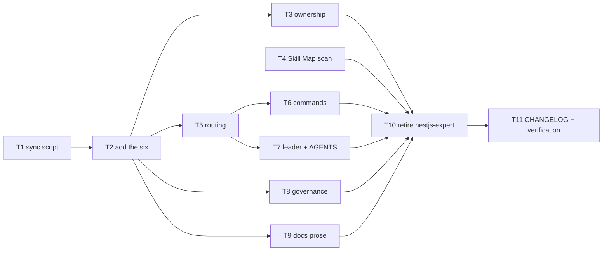

# Tasks: Official NestJS skills, vendored verbatim; `nestjs-expert` retired

## Document Control

| Field | Value |
|---|---|
| Spec | `changes/nestjs-official-skills` |
| Depth | Standard (upper end) · Approval Mode gated |
| Status | Phase 3 approved 2026-11-22 by JC (Step 3.3 gate, gated mode). Verification Checklist passed 2026-11-22 (see below) |
| Inputs | `requirements.md` (FR-1–FR-9, NFR-1–NFR-8; FR-8 amended by C-1), `design.md` (DD-1–DD-12, P-1–P-15), `judgment.md` (fixed, not re-judged) |
| Budget (design §10.2, re-sized at Phase 3) | 11 tasks · ~2,050 LOC by hand · 18 review rounds (2 each for T2, T5, T6, T8, T10; 1 each for the other six; +2 margin). Tasks went from 8 to 11 because the rules-text bound splits T5–T9 by document |
| Ordering rule | `npm test` stays green after every task. Adding the six (T2) and retiring `nestjs-expert` (T10) each update **every** registry that pins the skill-folder set in the same task: counts, `SKILL_CATALOG`, `docs/overview.md`, `docs/skills/README.md`, the doctor baseline (`AGENTS.md` *Verification*; P-10) |

## Task Graph

T4 depends on nothing and may run at any point before T10. T3 and T5 may run in parallel after T2. T6–T9 may run in parallel after their parents.

## Tasks

### T1 — Sync script with rollback

| Field | Value |
|---|---|
| Status | `[x]` · Size M · Depends on: none |
| Requirements | FR-2 (bullets 1–4), FR-2 *Dirty upstream checkout* scenario, NFR-2 |
| Design | §7.1 steps 1–7, DD-4, P-6, P-14 |
| Scope | New `scripts/sync-nestjs-skills.js` and `test/sync-nestjs-skills.test.js`. The test builds a temp git repo shaped like upstream: root `LICENSE` and `package.json`, `skills/<six names>/`. Add `.nestjs-sync/` to `.gitignore`. `Backend route: stack other; implement lead existing design support none — project conventions; test-first lead tdd support none — project conventions` |
| Tests | Refusals: missing args; shasum not 40 hex; dirty checkout; ignored content under `skills/`; commit ≠ `HEAD`; a missing folder; an upstream `metadata` key; a leftover `.nestjs-sync/`. Each asserts exit ≠ 0 **and** the six target folders byte-unchanged. Success: hashes in `UPSTREAM.md` equal git-object bytes, and `npm shasum` is the argument. Rollback: a forced rename failure on the 4th folder leaves all six at the old pin, and `.nestjs-sync/` is removed afterwards. First run: no current folders, so a failure leaves none. Bytes come from git objects: a temp repo with `core.autocrlf=true` and CRLF in the working tree still hashes the LF blob |
| Falsifier | Make step 6 delete each aside folder right after its own swap, which is the per-folder design the judges rejected: the rollback test sees folders 1–3 at the new pin and goes red. Make step 4 read with `fs.readFileSync` from the working tree: the `autocrlf` test hash differs and goes red |
| Red run | `predicted — greenfield artifact (observed in T1)` |
| Disqualifier | A rollback test that injects the failure before step 6(a) never exercises rollback; its green proves nothing. The injected failure must hit step 6(b) after at least one folder has moved |
| Consumers | `.gitignore`; `package.json` `files` (must stay without `scripts/sync-nestjs-skills.js`, P-6) |
| Review | `full`. New transactional file logic |
| Done | All tests green; both falsifiers observed red and quoted in `execution.md`; `npm run pack:dry-run` lists no `scripts/sync-nestjs-skills.js` |
| Skills | `tdd` |

### T2 — Add the six folders and every registry that pins the folder set

| Field | Value |
|---|---|
| Status | `[x]` · Size L · Depends on: T1 |
| Requirements | FR-1 (all bullets and the *Verbatim check* scenario), FR-2 bullet 5 (first pin, re-verified), FR-2 *Local edit creeps in* scenario, FR-3 bullet 3 (`doctor` counts the six), FR-8 bullet 2 (pages and rows), FR-8 bullet 5 (`SKILL_CATALOG`, +6), NFR-1, NFR-3, NFR-4 |
| Design | §4, §5, DD-1–DD-3, DD-9, DD-10, P-4, P-5, P-10, P-13, P-14 |
| Scope | **First step, settling P-13:** in the upstream clone, `git fetch --tags` and compare the latest tag and `skills/` against `v0.1.1`. Record the result in `execution.md`; a move is a recorded deviation (FR-2). Then: <ul><li>`git checkout v0.1.1` and run the script with `--npm-shasum 8c70e8b504866f6f7530b515da2c9cad6615f744`, after re-running `npm view @nestjs/skills@0.1.1 dist.shasum`;</li><li>new `test/nestjs-vendor.test.js`;</li><li>six `.gitattributes` `-text` lines;</li><li>six `docs/skills/<name>.md` pages (DD-9 outline; Observe note on `nestjs`, `nestjs-feature`, `nestjs-production`);</li><li>six rows each in `docs/skills/README.md` and `docs/overview.md`;</li><li>`SKILL_CATALOG` +6 (binding `stack`);</li><li>every P-10 pin to the interim set of 38 skills: `SKILL_FILE_EXPECTED` 321 → 355, `doctor-codex-baseline.txt` +6 `OK` lines with `ok 54` → `ok 60`, panel stack group 10 → 16, `akili-panel-cli-coverage:537` 33 → 39.</li></ul>`nestjs-expert` stays in this task |
| Tests | Vendor test, per folder: <ul><li>every `UPSTREAM.md` line matches its file's bytes (for `SKILL.md`, after removing the `metadata` block);</li><li>no file is unlisted except the 3 provenance files;</li><li>16 listed files in total;</li><li>`LICENSE` begins "(The MIT License)";</li><li>`NOTICE` names the commit and the non-affiliation line;</li><li>the frontmatter keys equal the upstream keys plus `metadata`, with `binding: stack`, `author: Kamil Mysliwiec (NestJS)` and `adapted-by: Juan Carlos Cadavid — jcadavid.com`;</li><li>no `bin/`, `index.js`, `index.d.ts`, `package.json`, `scripts/`, `test/` or `.claude-plugin/`;</li><li>`.gitattributes` holds the six `-text` lines.</li></ul>Existing suites: `docs-overview`, `akili-panel-catalog`, `akili-panel-flow`, `install-cursor`, `install-grokbot`, `install-akili-panel`, `akili-panel-cli-coverage`, `akili-marketing-docs`, `diagram-design` |
| Falsifier | Append one byte to `nestjs-data/references/*.md` (the first file listed): the vendor test goes red **naming that folder and file**, which is the FR-2 scenario. Drop one `-text` line: the `.gitattributes` assertion goes red. Remove `nestjs-auth` from `SKILL_CATALOG`: `akili-panel-catalog.test.js:55` goes red with `skills missing from SKILL_CATALOG: nestjs-auth` |
| Red run | Vendor test: `predicted — greenfield artifact (observed in T2)`. Catalog: `predicted — greenfield artifact (observed in T2)`, since the six folders do not exist at specify time |
| Disqualifier | A vendor test that hashes the vendored `SKILL.md` without removing the block, or removes it from both sides, compares a file with itself and is inert. Its hashes must come from `UPSTREAM.md` |
| Consumers | P-10, in full: `install-akili-panel.test.js`, `diagram-design.test.js`, `akili-marketing-docs.test.js`, `akili-panel-flow.test.js` (incl. the `SKILL_NAMES.stack` literal), `install-cursor.test.js`, `akili-panel-cli-coverage.test.js`, `test/fixtures/doctor-codex-baseline.txt` (compared at `install-cursor.test.js:891` and `install-grokbot.test.js:890`), `docs/cli.md:327,339,360,377`, `.claude/skills/akili-panel/hooks/flow.mjs`, `panel.test.tsx`, `test/akili-panel-catalog.test.js`, `test/docs-overview.test.js` |
| Review | `full`. Largest diff, licensing evidence |
| Done | `npm test` green; the three falsifiers observed red and quoted; the P-13 outcome recorded; every changed count quoted from a command run on the tree (NFR-4) |
| Skills | `cognitive-doc-design` (the six pages) |

### T3 — Vendored-entry ownership for the six names

| Field | Value |
|---|---|
| Status | `[x]` · Size M · Depends on: T2 |
| Requirements | FR-3 bullets 1–2 and the *Developer already ran the upstream installer* scenario (THEN, AND, BUT) |
| Design | §7.2, DD-5, P-1, P-3 |
| Scope | `bin/akili.js`: `IMPECCABLE_ENTRY` → `VENDORED_ENTRIES`; `policy.detail` reports the `.nestjs-skills` marker; doctor branch `:1974` uses the set. New `test/install-nestjs-foreign.test.js`. `Backend route: stack other; implement lead existing design support none — project conventions; test-first lead tdd support none — project conventions` |
| Tests | For each no-record target (claude, opencode, antigravity, codex, cursor), a temp target pre-holds `nestjs-auth/` with `.nestjs-skills` and one custom file, and no `UPSTREAM.md`. `install` without `--force`: <ul><li>the folder is byte-identical after;</li><li>no AKILI file appears inside it;</li><li>stdout names it `skip foreign` with `(installed by npx @nestjs/skills)`;</li><li>the other five are written.</li></ul>`--force`: the folder is replaced whole and the custom file is gone. `doctor`: `(not AKILI's copy; not compared)`. `impeccable` foreign tests stay green |
| Falsifier | Revert `VENDORED_ENTRIES` to the single name `impeccable`: the policy returns `owned`, and `copyDirectoryContents` writes `SKILL.md` and `references/` **into** the foreign folder. The byte-identical and no-merge assertions go red |
| Red run | `predicted — greenfield artifact (observed in T3)`. The six folders are not packaged at specify time, so the merge cannot happen before T2 |
| Disqualifier | A fixture folder that already holds every AKILI file name would hide a merge, because skip-existing leaves the bytes equal. The fixture must hold a file set disjoint from upstream's |
| Consumers | `test/install-impeccable-foreign.test.js`, `test/impeccable-vendor.test.js` (`impeccable` behaviour unchanged) |
| Review | `full`. Installer write policy |
| Done | Tests green on every no-record target; falsifier red quoted; `node bin/akili.js install --tool all --dry-run` clean |
| Skills | `tdd` |

### T4 — `doctor --agents` Skill Map scan

| Field | Value |
|---|---|
| Status | `[x]` · Size M · Depends on: none |
| Requirements | FR-5 bullets 1–4, *Project still maps NestJS to `nestjs-expert`* (THEN, AND, BUT), *Name in prose, not in the map* |
| Design | §7.4 (every state row), DD-7, P-7, P-12 |
| Scope | New pure `bin/skill-map.js`; the call site in `runAgentsDoctor` before the ABSENT return and the `--fix` guards; new `test/doctor-skill-map.test.js` (unit + CLI). The retired table starts in this task as the `nestjs-expert` → replacement row that `bin/skill-map.js` reads. T10 moves the cleanup loops onto the same table. `Backend route: stack other; implement lead existing design support none — project conventions; test-first lead tdd support none — project conventions` |
| Tests | Unit: section bounds (§7.4 bullets, including a fenced `## ` line and an H1); token boundaries (`nestjs-expert-v2` no match; backtick and pipe match); CRLF line numbers; two `## Skill Map` headings (only the first is scanned). CLI, in a temp project: <ul><li>the Skill Map row at line N prints `RETIRED nestjs-expert (AGENTS.md:N)`, naming `nestjs-feature`;</li><li>the exit status equals the run without the row;</li><li>`AGENTS.md` keeps its sha256 after `--agents --fix`;</li><li>the name only under `## History` prints nothing;</li><li>`CLAUDE.md` = `@AGENTS.md` prints nothing extra;</li><li>an unreadable file gives one `warning` and an unchanged exit.</li></ul> |
| Falsifier | Observed baseline at `0bdc46c`: a temp project whose `AGENTS.md` Skill Map names `nestjs-expert`, `node bin/akili.js doctor --agents` → output has `ABSENT …/.agents does not exist` and **0** `RETIRED` lines, so the new CLI assertion is red on current code. Mutations: set `process.exitCode = 1` on a hit, and the exit-status assertion goes red; drop the section-end check, and the `## History` case goes red |
| Red run | Baseline reading observed and quoted above. Unit test: `predicted — greenfield artifact (observed in T4)` |
| Disqualifier | An exit-status assertion made only in a project without `.agents/` always sees exit 1 from ABSENT and cannot tell whether the scan changed it. Assert in a project **with** current personas (exit 0) as well |
| Consumers | `test/agents-doctor.test.js`, `test/agents-doctor-io.test.js` (output ordering), `docs/cli.md` *doctor --agents* section (T9) |
| Review | `full`. New module, exit-status contract |
| Done | Tests green; baseline red and both mutations quoted |
| Skills | `tdd` |

### T5 — Backend routing: matrix, card, rules 5 and 9, `AGENTS.md` *Backend Skills*

| Field | Value |
|---|---|
| Status | `[x]` · Size M · Depends on: T2 |
| Requirements | FR-6 (all six bullets, the *Existing Passport project* scenario THEN and BUT), FR-7 (all bullets; the scenario is an accepted risk, so presence is proven, not behaviour), FR-8 bullet 3 (`AGENTS.md` *Backend Skills* only) |
| Design | §9 rows *Stack table* to *Attribution* and *Routing text-contract tests*, DD-8 |
| Scope | `.claude/skills/software-architect/references/backend-routing.md`; `AGENTS.md` → `## Backend Skills` (the `nestjs-expert` bullet → the set, `nestjs-feature` leading); `test/backend-skill-routing.test.js` (`NINE`, the AGENTS constant), `test/backend-skill-routing-coverage.test.js` (rules 1..9, card name, *Must not decide*, rule 5 clause, rule 9 incl. default telemetry, Passport-scenario route line). Edit sites: about 8 in `backend-routing.md`, 1 in `AGENTS.md`. Rules text |
| Tests | The two routing suites, extended. A text-contract asserts: the matrix `implement / NestJS` lead is `nestjs-feature`; the five support activities by name; rule 9 names the link, MCP, paid rules and default telemetry with `--no-observe`; the card *Must not decide* holds testing strategy and debugging method |
| Falsifier | Observed at `0bdc46c`: `backend-routing.md:46` reads `\| **implement** \| NestJS \| \`nestjs-expert\` \|`, so a lead assertion for `nestjs-feature` is red against today's file. Mutation: delete "default telemetry" from rule 9, and its assertion goes red |
| Red run | Lead assertion red against the observed `:46` reading |
| Disqualifier | A test that only checks "`nestjs-feature` appears in the Matrix" passes while it sits in a support cell. Assert the lead cell of the `implement / NestJS` row |
| Consumers | `test/backend-skill-routing.test.js:43,85,99-105,137`; `test/backend-skill-routing-coverage.test.js:90,110,114,143,151-156`; `.claude/templates/leader.md` (reads the matrix; unchanged here) |
| Review | `full`, 2 rounds budgeted. Rules text the Leader executes |
| Done | Suites green; red quoted; *Attribution* names Kamil Mysliwiec (MIT) |
| Skills | `software-architect`, `cognitive-doc-design` |

### T6 — Command text: `/akili-constitution` and `/akili-specify`

| Field | Value |
|---|---|
| Status | `[ ]` · Size S · Depends on: T5 |
| Requirements | FR-8 bullet 3 (commands; the no-map fallback list names `nestjs-feature`) |
| Design | §9 |
| Scope | `.claude/commands/akili-constitution.md:255` (Step 5 candidates) and `:728` (Step 8D pool: the official set); `.claude/commands/akili-specify.md:254` (Step 2.1 no-map list: `nestjs-feature`); `test/ai-agent-guardrails-evals.test.js:198`, whose anchor `- \`nestjs-expert\`` becomes `- \`nestjs-feature\``. Three sites in two command files. The split rule is kept in spirit, since one review reads all three; the deviation is recorded here |
| Tests | `ai-agent-guardrails-evals`; a new assertion in the same file that the fallback list holds `nestjs-feature` and no `nestjs-expert` |
| Falsifier | Observed at `0bdc46c`: `akili-specify.md:254` reads `- \`nestjs-expert\``, so the new assertion is red today. Mutation: restore the old line, and the anchor and the new assertion go red |
| Red run | Red against the observed `:254` reading |
| Disqualifier | The anchor test finds the list by the first fallback item; if the item is renamed without updating the anchor, the test fails on setup, not on the assertion. The quoted red must come from the content assertion |
| Consumers | `test/ai-agent-guardrails-evals.test.js` |
| Review | `full`, 2 rounds budgeted. Command text |
| Done | Green; red quoted |
| Skills | `cognitive-doc-design` |

### T7 — Persona and agent guide: `leader.md`, `AGENTS.md` *Skill Usage*

| Field | Value |
|---|---|
| Status | `[ ]` · Size S · Depends on: T5 |
| Requirements | FR-8 bullet 4 (amended: `leader.md` only), FR-8 bullet 3 (`AGENTS.md` *Skill Usage*) |
| Design | §9 *Persona templates*, DD-12, P-11, P-15 |
| Scope | `.claude/templates/leader.md:25`: `nestjs-expert` → `nestjs-feature`. `AGENTS.md:62`: the domain-skills example names `nestjs-feature`. **`implementer.md` is not touched.** Two sites |
| Tests | `npm test` (agents-doctor suites stay green, because `implementer.md` is unchanged) |
| Falsifier | Edit `implementer.md:27` the same way: `node --test test/agents-doctor.test.js test/agents-doctor-io.test.js test/persona-digests.test.js` goes from 0 fail to 4 fail (judge B's reading, P-15). That shows the guard is real, and the edit is reverted |
| Red run | Observed by judge B on a scratch copy: `# pass 65 # fail 4` (`not ok 7, 31, 33, 35`). Re-observed and quoted in T7 |
| Disqualifier | A green run with `implementer.md` also changed means the fixtures were edited too, which is out of scope (DD-12). Check `git diff --stat test/fixtures/personas` is empty |
| Consumers | `test/agents-doctor*.test.js`, `test/persona-digests.test.js`, `.claude/templates/digests.json` (written at release, P-11) |
| Review | `checklist`. Two one-word swaps; persona text |
| Done | Green; `git diff --stat test/fixtures/personas .claude/templates/implementer.md` empty |
| Skills | none |

### T8 — Governance and release checklist

| Field | Value |
|---|---|
| Status | `[ ]` · Size S · Depends on: T2 |
| Requirements | FR-8 bullet 1, FR-4 bullet 4 (*Removal / Fusion Log* row), FR-2 bullet 6 (release-checklist step) |
| Design | §9 `governance.md` and `release-checklist.md` rows (I-11) |
| Scope | `docs/skills/governance.md`: <ul><li>*Vendored* rule 4 (both scripts);</li><li>"Current members";</li><li>the checklist item 4 exception for the six-folder family;</li><li>*Current assignment* `stack` row;</li><li>*Removal / Fusion Log* row, dated.</li></ul>`docs/release-checklist.md:21`: one step per vendored pin. Six sites in two docs |
| Tests | A text assertion, in `test/nestjs-vendor.test.js`, that governance lists the official set as a vendored member and the checklist names `UPSTREAM.md` for both pins |
| Falsifier | Observed at `0bdc46c`: `governance.md:56` reads `**Current member: \`impeccable\`**`, so the new assertion is red today |
| Red run | Red against the observed `:56` reading |
| Disqualifier | An assertion on the word "nestjs" anywhere in governance passes on the Removal Log row alone. Assert the *Vendored* section |
| Consumers | none beyond the new assertion |
| Review | `full`, 2 rounds budgeted. Maintainer rules |
| Done | Green; red quoted |
| Skills | `cognitive-doc-design` |

### T9 — Docs prose: `flow.md`, command docs, `cli.md` output

| Field | Value |
|---|---|
| Status | `[ ]` · Size S · Depends on: T2, T4 (the output wording) |
| Requirements | FR-8 bullet 3 (`docs/commands/akili-constitution.md`, `docs/commands/akili-test.md`, `docs/flow.md`); design §6 (`docs/cli.md` output lines) |
| Design | §6, §9 |
| Scope | `docs/flow.md:658`; `docs/commands/akili-constitution.md:123`; `docs/commands/akili-test.md:70`; `docs/cli.md`: install and doctor output sections gain `deleted retired skill`, `skip foreign … (installed by npx @nestjs/skills)`, `STALE/REMOVED … (retired, replaced by …)`, and `RETIRED <name> (<file>:<line>)` with a placeholder name, not `nestjs-expert` (I-14). Six sites |
| Tests | `npm test` (docs suites) |
| Falsifier | Observed at `0bdc46c`: `grep -n nestjs-expert docs/flow.md docs/commands/akili-constitution.md docs/commands/akili-test.md` → 3 hits. After the task: 0 hits; this check is re-run by the T10 grep test |
| Red run | 3 hits observed |
| Disqualifier | A `cli.md` example that shows `RETIRED nestjs-expert` fails the T10 grep test later. Use a placeholder |
| Consumers | `test/docs-overview.test.js`, `test/akili-marketing-docs.test.js` (cli.md lines) |
| Review | `checklist`. Human-facing docs |
| Done | Green; 0 hits |
| Skills | `cognitive-doc-design` |

### T10 — Retire `nestjs-expert`: installer table, folder, every pinned registry, surface test

| Field | Value |
|---|---|
| Status | `[ ]` · Size L · Depends on: T3, T4, T6, T7, T8, T9 |
| Requirements | FR-4 bullets 1–3 and the *Upgrade over an older install* scenario (THEN, AND, BUT), FR-8 bullet 5 (`SKILL_CATALOG`, −1), FR-8 *No live surface names the retired skill* scenario (THEN, BUT), NFR-4, NFR-5 |
| Design | §6, §7.3, DD-6, DD-10, DD-11, P-2, P-8, P-9, P-10 |
| Scope | <ul><li>`bin/akili.js`: `LEGACY_SKILLS` → `RETIRED_SKILLS` (the gsap rows plus the T4 row), both loops print the replacement, the shared-root guard is kept.</li><li>Delete `.claude/skills/nestjs-expert/` and `docs/skills/nestjs-expert.md`, and their rows in `docs/skills/README.md` and `docs/overview.md`.</li><li>`SKILL_CATALOG` −1.</li><li>Every P-10 pin to the final set of 37: `SKILL_FILE_EXPECTED` 355 → 354; baseline −1 line, `ok 60` → `ok 59`; panel stack group 16 → 15; `akili-panel-cli-coverage:537` 39 → 38.</li><li>New `test/retired-skills.test.js` and `test/nestjs-retirement-surface.test.js`, which excludes `docs/specs/` wholesale and allows: `CHANGELOG.md`, the Removal Log row, `RETIRED_SKILLS`, the retirement tests, `implementer.md:27`.</li></ul>`Backend route: stack other; implement lead existing design support none — project conventions; test-first lead tdd support none — project conventions` |
| Tests | Retired: <ul><li>for claude, opencode and antigravity, a temp target holding `nestjs-expert/` gives `doctor` `STALE nestjs-expert (retired, replaced by the official NestJS skills …)`, then `--fix` `REMOVED`, and the folder is gone;</li><li>`install` and `update` delete it with the replacement in the line;</li><li>a `gsap-core/` still reports `gsap-animation`;</li><li>for codex, cursor and grokbot, a `nestjs-expert/` in the shared root is untouched and not reported.</li></ul>Surface: the FR-8 grep over the repo, allowlisted; every other hit fails the test, naming file and line |
| Falsifier | Observed at `0bdc46c`: a Claude target from `install`, then `doctor --tool claude` → `OK nestjs-expert` and `CLAUDE HEALTHY ok 55`, so the STALE assertion is red today. Mutations: remove the shared-root guard, and the codex/cursor/grokbot untouched assertion goes red; add `nestjs-expert` to a docs page, and the surface test goes red naming it |
| Red run | Baseline `OK nestjs-expert` observed. Surface test: `predicted — greenfield artifact (observed in T10)` |
| Disqualifier | A shared-root test that never creates `nestjs-expert/` in that root passes whether the guard exists or not. The folder must exist there before the run. A surface test whose scope excludes `test/` or `.claude/` cannot see the surfaces FR-8 names |
| Consumers | P-9 and P-10 in full, plus `test/akili-panel-catalog.test.js` and `test/docs-overview.test.js` |
| Review | `full`. Destructive installer path |
| Done | `npm test` green; baseline red and mutations quoted; `grep -rn nestjs-expert` over the FR-8 scope returns only allowlisted hits, quoted |
| Skills | `tdd` |

### T11 — CHANGELOG migration note and full verification

| Field | Value |
|---|---|
| Status | `[ ]` · Size S · Depends on: T10 |
| Requirements | FR-9 (all four bullets and the *Release reader* scenario), NFR-4, NFR-6, NFR-7, NFR-8 |
| Design | §10.1 residuals (shared-root copies, DD-12) |
| Scope | `CHANGELOG.md` > `Unreleased`: <ul><li>six added and one removed, with counts quoted from a run;</li><li>what `akili update` does, and the hand-delete path for `~/.agents/skills/nestjs-expert/` on Codex, Cursor and Grok Bot;</li><li>the `RETIRED` warning and its fix (re-run `/akili-constitution` Step 8D or edit the row);</li><li>coexistence with `npx @nestjs/skills` (foreign folders skipped, `--force` takes over) and the `nestjs@nestjs` plugin (namespaced `nestjs:<name>`);</li><li>release type: **minor**, conditional on FR-5 and FR-9 (NFR-8).</li></ul>Then the NFR-7 set |
| Tests | `npm test`, `npm run verify:cli`, `npm run pack:dry-run`, `git diff --check`, `node bin/akili.js install --tool all --dry-run`, `node bin/akili.js doctor --tool all` (on temp targets, see Disqualifier) |
| Falsifier | NFR-6: `git diff --stat <base>.. -- docs/specs/archive docs/specs/kaizen releases` must be empty, and released CHANGELOG sections byte-equal. Mutate one released line and the check reports it |
| Red run | n/a. Verification task; the mutation is the falsifier |
| Disqualifier | `doctor --tool all` on the maintainer's real home reports `STALE nestjs-expert` until `update` runs (I-15), so that red is the environment, not the change. Run it with `HOME` pointed at a fresh temp install. A pack listing that shows `.nestjs-sync/` means a leftover; clean it and re-run |
| Consumers | `CHANGELOG.md` tests that read `[Unreleased]` first (`AGENTS.md` rule) |
| Review | `checklist`. Human-facing note |
| Done | All six commands green, outputs summarised in `execution.md`; the release reader finds the three migration facts in `Unreleased` alone |
| Skills | `cognitive-doc-design` |

## Coverage: scenarios and clauses

| Requirement clause | Owner |
|---|---|
| FR-1 metadata keys and values · no other byte differs · upstream bin/index/package/scripts/test/plugin not shipped | T2 |
| FR-1 *Verbatim check*: THEN hashes match · BUT no unlisted file · AND 16 files and MIT `LICENSE` | T2 |
| FR-2 copies, frontmatter, provenance · refuses dirty / commit not checked out / missing folder · no download · diff summary | T1 |
| FR-2 first pin `v0.1.1`, re-verified at execute | T2 (first step) |
| FR-2 release-checklist step | T8 |
| FR-2 *Local edit creeps in*: THEN vendor test fails naming folder and file | T2 |
| FR-2 *Dirty upstream checkout*: THEN exit ≠ 0, nothing written · BUT no partly rewritten folder | T1 |
| FR-3 delivery to every target · ownership rule · marker reported · `--force` | T3 |
| FR-3 `doctor` counts the six | T2 (baseline fixture) |
| FR-3 scenario: THEN untouched and named foreign · AND other five written · BUT no merge | T3 |
| FR-4 folder and page removed · retired treatment on install/update/`doctor --fix` · never shared root · messages name the replacement, gsap keeps `gsap-animation` | T10 |
| FR-4 Removal Log row | T8 |
| FR-4 scenario: THEN STALE naming the set · AND `--fix` REMOVED · BUT not under a shared root | T10 |
| FR-5 reads both files' Skill Map · one RETIRED line with file, line, name, replacement · never edits · exit unchanged · outside the section not reported | T4 |
| FR-5 *Project still maps…*: THEN line naming `nestjs-feature` · AND exit as persona checks alone · BUT no byte of `AGENTS.md` changes, even with `--fix` | T4 |
| FR-5 *Name in prose*: THEN no line | T4 |
| FR-6 all six bullets · Passport scenario THEN (route line) · BUT (no reopening) | T5 |
| FR-7 relay allowed · never runs unless asked · never auto-passed under `pre-approved` · rule outside the vendored folders | T5 (presence). Behaviour is the accepted risk in `requirements.md` §8 |
| FR-7 *Pre-approved run on an unlinked project*: THEN at most one sentence · BUT no `npx @nestjs/observe link`, no MCP server | T5 (rule 9 text, its text-contract assertion). Runtime behaviour is the same accepted risk |
| FR-8 bullet 1 governance | T8 |
| FR-8 bullet 2 pages and rows | T2 (added), T10 (old row and page removed) |
| FR-8 bullet 3 commands and docs | T6 (commands), T5 and T7 (`AGENTS.md`), T9 (docs) |
| FR-8 bullet 4 persona (amended) | T7 |
| FR-8 bullet 5 `SKILL_CATALOG` | T2 (+6), T10 (−1) |
| FR-8 scenario: THEN only allowlisted hits · BUT none in a command, template (except the amended allowlist entry), matrix, skill or docs page | T10 |
| FR-9 four bullets and the *Release reader* scenario | T11 |
| NFR-1 verbatim | T2 |
| NFR-2 no network | T1 (script), T2 (vendor test) |
| NFR-3 `-text` lines, Windows legs | T2; Windows legs are seen in CI after push |
| NFR-4 counts as run | T2, T10, T11 |
| NFR-5 no active spec path | T10 (the surface test excludes `docs/specs/`); every new test reads no spec path, checked by the Reviewer |
| NFR-6 historical text untouched | T11 |
| NFR-7 verification green | T11 |
| NFR-8 minor, conditional on FR-5 and FR-9 | T11 |

Premise hand-off: P-13 (`UNVERIFIED`) is settled in T2 as its first step. Consumer rows P-9 and P-10 are copied into the `Consumers` fields of T2 and T10.

## Estimated LOC and PR strategy

| Area | LOC (hand-written) |
|---|---|
| Code (`sync-nestjs-skills.js`, `bin/akili.js`, `bin/skill-map.js`, `flow.mjs`) | ~500 |
| Tests (6 new files + edits to 12 existing ones) | ~1,200 |
| Docs and rules text (6 pages, matrix, governance, commands, CHANGELOG) | ~350 |
| **Total** | **~2,050**, plus ~135 KB of script-generated vendored files |

The total is well above the ~400 LOC threshold, so I recommend **three stacked PRs into `dev`**. All three must land before one release, because the six without the retirement would ship both skills.

| PR | Tasks | Review first | Out of scope |
|---|---|---|---|
| 1. Vendor + installer + doctor | T1–T4 | `sync-nestjs-skills.js` rollback, then `nestjs-vendor.test.js`, then `bin/akili.js` policy | Routing, docs prose |
| 2. Routing and rules text | T5–T9 | `backend-routing.md` rule 9 and the card | Installer code |
| 3. Retirement + CHANGELOG | T10–T11 | `RETIRED_SKILLS` and the surface-test allowlist | — |

## `skip-eligible` tasks

None. Every task is `full` or `checklist`.

## Verification Checklist (2026-11-22)

| Check | Result |
|---|---|
| 3 files exist, non-empty | pass: `requirements.md` 276 lines, `design.md` 272, `tasks.md` 285 |
| `general-setup/` conventions | n/a: the folder does not exist; the format source is the archived `impeccable-hardening` spec (`requirements.md` Document Control) |
| Depth re-checked against the finished design | pass: Standard, upper end (`design.md` §10.2) |
| Budget recorded | pass: 11 tasks · ~2,050 LOC · 18 review rounds |
| Reverting DDs carry the challenge outcome | pass: DD-6 and the FR-6 lead removal (`design.md` §10.1) |
| Premise Ledger present; every row cited or `UNVERIFIED` with an owner | pass: P-1–P-15; P-13 owned by T2's first step |
| Blast-radius triggers have rows | pass: `shared-state` (P-2, P-3, P-15), `consumer` (P-9, P-10), `live-path` (P-12) |
| `consumer` rows in the owning task's `Consumers` | pass: P-10 in T2; P-9 and P-10 in T10 |
| Defect classes mapped to gates | pass: `requirements.md` §8; two classes are accepted risks (FR-7 runtime, upstream recipes) |
| Every scenario and `BUT` / `AND IT MUST` clause owned | pass: 11 scenarios, 8 `BUT`, 1 `AND IT MUST`. The FR-7 scenario row was named explicitly at this check |
| Every task cites requirements and design; done criteria and negative cases | pass: 11 of 11 |
| Dependency graph acyclic | pass (Task Graph) |
| Bug Mode, Video Mode, AI Agent Mode | n/a: `Type: Change`, `Deliverable: software`, `AI Agent: no` |
| Skills referenced exist | pass: `tdd`, `cognitive-doc-design`, `software-architect` |
| Four verification fields on every task | pass: 11 of 11; every `predicted` red names its observing task; T11's red is n/a with a reason |
| `Backend route:` on backend tasks | pass: T1, T3, T4, T10 (the tasks that write script or installer code) |
| `skip-eligible` named at the gate | pass: none, stated at Step 3.3 |
| Rendered-measurement checklist | n/a: no gate asserts size, overflow, visibility, position or containment |
