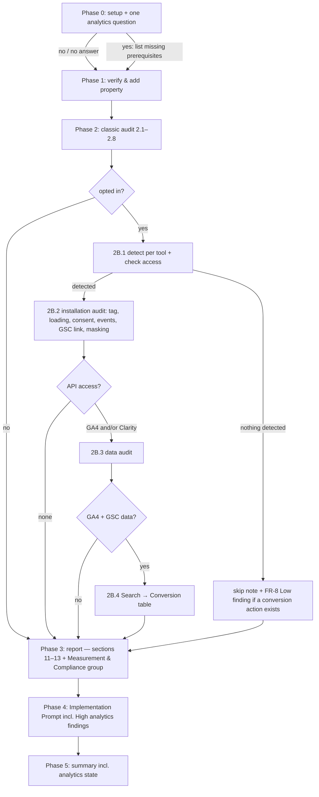

# Design: `/akili-seo` optional analytics phase — GA4 + Microsoft Clarity

## 1. Document Control

| Field | Value |
|---|---|
| Spec Path | `changes/seo-analytics` |
| Depth | Standard |
| Type / Deliverable | Change / software |
| Approval Mode | `gated` |
| Status | **Draft**, awaiting the Phase 2 gate |
| Date | 2026-10-22 |
| Requirements | `requirements.md`: Phase 1 approved 2026-10-22, D-1 approved |
| Base commit | `85dba0f` (premises verified there unless a row says otherwise) |
| Architecturally significant? | **No.** This is instruction text for an existing command and skill. There is no new module, service, persistence or runtime data flow in this repository; the GA4 and Clarity calls are made by the agent at audit time. `software-architect` and `diagram-design` are not loaded |

## 2. Executive Summary

Five files change and two are new. **No code ships except one test.**

| File | Change |
|---|---|
| `.claude/commands/akili-seo.md` | The Phase 0 question, prerequisites, Tool Inventory rows, a new **Phase 2B** (2B.1–2B.4), report sections 11–13, the Measurement & Compliance group, Phase 4/5, checklist and error rows |
| `.claude/skills/seo-audit/references/analytics.md` (new) | The method and evidence: access, detection, installation and data checklists, the legal table, the join, sources with tiers and check dates |
| `.claude/skills/seo-audit/SKILL.md` | A short *Analytics & Conversion Measurement* section; the engagement-signals rule widened to all behavior metrics; references, tools and AKILI integration |
| Docs (`docs/commands/akili-seo.md`, `docs/skills/seo-audit.md`, `README.md:801`) | Describe Phase 2B and the widened rule |
| `evals.json` | Two cases: opted-in audit, and no analytics |
| `test/seo-analytics.test.js` (new) | Text contract for FR-11 and the clauses the agent must find in the shipped text |
| `CHANGELOG.md` | `[Unreleased]` entry |

The command keeps the *what and when*: steps, order, skip rules and report shape. The reference holds the *how and why*: checklists, sources and tiers. This is the split GEO already uses: command Step 2.8 is short and the evidence lives in `references/geo.md`.

## 3. Architecture Overview



## 4. Extended Directory Structure

```text
.claude/commands/akili-seo.md                       (edit)
.claude/skills/seo-audit/SKILL.md                   (edit)
.claude/skills/seo-audit/references/analytics.md    (new, ~200 lines)
.claude/skills/seo-audit/evals/evals.json           (edit: +2 cases, ids 10 and 11)
docs/commands/akili-seo.md                          (edit)
docs/skills/seo-audit.md                            (edit)
README.md                                           (edit: line 801 summary)
test/seo-analytics.test.js                          (new)
CHANGELOG.md                                        (edit: [Unreleased])
```

The installer copies `.claude/skills/**` whole, so the new reference ships without a code change (P-15).

## 5. Data Model — report contract

### 5.1 Report sections (Phase 3, FR-12)

The current sections 1–10 are kept. These are inserted after **10. GEO Findings**:

| # | Section | Holds |
|---|---|---|
| 11 | Analytics Installation Findings | 2B.2 findings, one sub-table per tool; or the skip/declined note |
| 12 | Analytics Data Findings | 2B.3 findings, with the data window beside every figure; or the skip reason per tool |
| 13 | Search → Conversion | The 2B.4 table + caveats + unmatched rows; or the skip reason |
| 14 | Remediation Plan | Unchanged SEO priority list **plus** a separate **Measurement & Compliance** group (D-1) |
| 15 | Re-audit Schedule | Unchanged |

The existing sections renumber: Remediation Plan moves from 11 to 14 and Re-audit Schedule from 12 to 15.

### 5.2 Phase-state vocabulary (one closed set, used in report, Phase 5 and tests)

| State string | When |
|---|---|
| `Analytics: not run — declined at Phase 0` | FR-1 no or no answer |
| `Analytics: skipped — no GA4 or Clarity detected` | FR-8 |
| `<Tool>: data audit skipped — <missing prerequisite>` | FR-2 installed, no access |
| `not determined` | A check that the evidence could not settle (FR-2 no renderer, FR-4 Art. 9 record, FR-6, FR-7 mode) |
| `n/a — <reason>` | The check does not apply (FR-5 no conversion action) |

Any state outside this set falls through to `not determined`. The command states that rule in one sentence, so a reader of a non-conforming report knows where it lands.

### 5.3 Finding shape

The existing Issue / Impact / Evidence / Fix / Priority shape. Analytics findings add one field, **Basis**: the rule or vendor document, with its tier. This field exists only for consent and vendor claims, because those carry legal or factual weight. Every other finding format is unchanged.

## 6. API Design — external calls the agent makes at audit time

These are described in the command and reference, not shipped as code (Q1 = c). All calls are read-only (NFR-6).

| Purpose | Preferred route | Fallback route | Notes (premise) |
|---|---|---|---|
| GA4 property and streams | Analytics MCP `get_account_summaries`, `get_property_details` | Admin API `properties.get`, `properties.dataStreams.list` | MCP is experimental and uses ADC, not a key file (P-10) |
| Key events | (MCP has no key-events tool) | Admin API `properties.keyEvents.list` (`conversionEvents` deprecated) | P-13 |
| Organic landing pages + key events | MCP `run_report` | Data API `properties.runReport` with dimensions `landingPage`, `sessionDefaultChannelGroup`, metrics `sessions`, `keyEvents` | P-14 |
| GA4 ↔ GSC link probe | MCP `run_report` | Data API `runReport` with a Search Console metric such as `organicGoogleSearchClicks` | The metric "requires an active Search Console link" (P-5); there is no Admin API link resource (P-4) |
| Clarity insights | — | `GET https://www.clarity.ms/export-data/api/v1/project-live-insights?numOfDays=1..3&dimension1=URL`, `Authorization: Bearer <token>` | At most 10 requests per day, last 1–3 days, 1,000 rows, no pagination (P-6) |
| GSC side of the join | existing `gsc` MCP `search_analytics_query` grouped by `page` and `query,page` | — | Already used in Step 2.4 |

The call budget is stated in the report. Clarity uses at most **3** requests in a run: URL with `numOfDays=3`, then URL × Device, then one spare. That leaves the owner 7 of the 10 daily requests.

## 7. Backend Module Design — command text by step

| Command site | Change | FR |
|---|---|---|
| `:11` intro | Mentions "an optional analytics phase (GA4, Microsoft Clarity)" | FR-14 |
| Prerequisites (after item 5) | A new **Optional — analytics phase** block, needed only on yes. (6) GA4: Data API + Admin API enabled in the same GCP project; the service-account email added as Viewer on the GA4 property; the Analytics MCP if the user prefers it. (7) Clarity: a Data Export API token, generated by a project admin and supplied at run time, never stored | FR-2, FR-13 |
| Tool Inventory | Rows for 2B.1 (rendering browser), 2B.2 (rendering browser + Admin API), 2B.3 (Data API / MCP, Clarity export), 2B.4 (`gsc` + Data API) | FR-2 |
| Phase 0, new item 5 | Asks once; a no or no answer records the declined state; a yes lists only the missing analytics prerequisites; never blocks Phases 1–2 | FR-1 |
| Phase 2 skill bullets | Adds: "apply its **Analytics** section in Phase 2B". The existing GEO bullet is untouched | FR-11 |
| Step 2.8 *Do not raise* | Widened to "any finding that asserts a behavior metric (bounce or engagement rate, time on page, scroll, heatmaps, recordings) affects rankings". Adds "they serve conversion and UX findings" | FR-11 |
| **Phase 2B** (new, after Step 2.8) | **2B.1** detection per tool by rendering fetch + access check → the FR-2 state table (inline) + the FR-8 rule. **2B.2** installation audit: six bullets (tag, loading, consent, events, GSC link, masking), each one line pointing at `references/analytics.md` for the checklist, plus the FR-4 not-legal-advice sentence and the `Other jurisdictions: not audited` line. **2B.3** data audit: the GA4 and Clarity reads, the data window, the call budget. **2B.4** the join: normalization, unmatched rows, caveats, no causal wording. A closing paragraph states the hard rule and FR-13 | FR-2…FR-11, FR-13 |
| Phase 3 report list | Inserts sections 11–13; Remediation Plan (14) gains the Measurement & Compliance group; renumbers | FR-12 |
| Phase 4 | The Implementation Prompt also covers the High findings in Measurement & Compliance | FR-12 |
| Phase 5 | The summary adds the analytics state and counts | FR-12 |
| Verification Checklist | Five items: declined/skip state named; no ranking claim from any behavior metric; consent findings carry Basis + not-legal-advice + other-jurisdictions line; no token or personal data in the report; Search → Conversion carries its caveats | FR-1, FR-4, FR-10, FR-11, FR-13 |
| Error Handling | GA4 403 → the Viewer grant is missing (data audit skipped, never retried blindly); Clarity 401/403 → token invalid; Clarity 429 → quota spent, data audit skipped for the day; a Search Console metric request that errors → link `not determined` | FR-2, FR-6, FR-9 |

## 8. Frontend / UX Component Architecture

n/a. There is no UI; the "interface" is the Phase 0 question and the report (§5).

## 9. Shared Contracts or Package Extensions

### 9.1 `references/analytics.md` outline

1. **Scope and source tiers.** It reuses `references/geo.md`'s `[PRIMARY]` / `[INDUSTRY]` definitions by quoting them, and adds that official legal text is `[PRIMARY]` (Q7).
2. **The hard rule.** Behavior metrics are for conversion and UX, never ranking, with sources. Then a metric → "read it as" table extending the skill's.
3. **Access.** MCP vs direct API, the Viewer grant, the Clarity token, read-only scopes, and the Clarity quota.
4. **Detection.** Rendering fetch signals per tool: GA4 collection requests, measurement ID, GTM container ID, the Clarity tag and project ID. Includes the static-fetch limitation.
5. **Installation checklist.** Tag and duplicates; loading; consent (the legal table: Ley 1581 Art. 3(a), 9, 12; GDPR/ePrivacy; Consent Mode v2's four parameters before measurement; Clarity `consentv2`); conversion events (form, WhatsApp URL patterns, key-event marking); GA4 ↔ GSC link (the probe order); Clarity masking (modes, attributes, what an API cannot see).
6. **Data checklist.** GA4 reads and their thresholds; Clarity metrics and window.
7. **Search → Conversion join.** Normalization rules, unmatched rows, the caveats, wording.
8. **Do not raise.** Ranking claims from behavior data; a millisecond CWV cost without a measurement; "violates the law"; any user-level data.
9. **Sources.** Each with tier and `checked 2026-10-xx`.

### 9.2 `SKILL.md` additions (≤ 40 lines, NFR-3)

- *User Engagement Signals*: the heading keeps its anchor. The first paragraph extends to "analytics engagement metrics **and behavior data** (GA4 engagement/bounce rate, session duration, scroll; Clarity heatmaps, recordings, dead/rage clicks)". One sentence states the positive use (conversion and UX). The table gains one row: rage/dead clicks on a CTA are read as a conversion blocker.
- New `## Analytics & Conversion Measurement (optional)`, after GEO and before Common Issues, ≤ 15 lines: what it covers, the hard rule, tiers, a pointer to `references/analytics.md`, and "not legal advice".
- *Do not raise these* (`:491`): the bounce-rate bullet is widened to behavior metrics.
- *References*, *Tools Referenced* (GA4, Clarity), and *AKILI-SPECS Integration* (a Phase 2B row; `:618` is rewritten so that `analytics` points at the new section, while `programmatic-seo` and `cro` stay not packaged).

### 9.3 Test contract — `test/seo-analytics.test.js`

The test reads the shipped files (never `docs/specs/`, KZ-changes--archify-diagrams-1) and asserts, per clause:

- **FR-11:** each of the seven surfaces contains a ranking prohibition **and** a conversion/UX use. The surfaces are the skill's *User Engagement Signals*, the skill's *Do not raise these*, the skill's Analytics section, command Step 2.8, command Phase 2B, `references/analytics.md` §2 and `docs/skills/seo-audit.md`. The checklist is an eighth site for the prohibition only.
- **FR-11 metric coverage:** the skill's *User Engagement Signals* and the reference §2 each name `heatmap`, `recording`, `engagement rate`, `bounce`.
- **FR-1:** Phase 0 contains the declined state string; Phase 2B appears after Step 2.8 and before Phase 3.
- **FR-12:** report list items 11–15 in order; "Measurement & Compliance" appears in item 14 and in Phase 4.
- **FR-4:** the command and reference contain "not legal advice" and `Other jurisdictions: not audited`; the reference cites Ley 1581 Art. 3, 9 and 12 and names all four Consent Mode parameters.
- **FR-6:** the command states there is no Admin API link resource and names the probe.
- **FR-8:** the skip string and "exactly one" Low finding.
- **FR-13:** the command and reference forbid tokens and user-level data in the report.
- **NFR-2/3:** command ≤ 440 lines; `SKILL.md` ≤ 658 lines.
- **NFR-4:** every line in the reference's Sources section carries `[PRIMARY]` or `[INDUSTRY]` and `checked 20`.

Expected literals come from `requirements.md`, copied into the test as constants at spec commit time. They are never read from the file under test (the `akili-security-docs.test.js` precedent).

## 10. Design Decisions

| ID | Decision | Why | Rejected | FR |
|---|---|---|---|---|
| DD-1 | The command holds the steps; `references/analytics.md` holds the checklists and sources | The GEO split; keeps the command within NFR-2 and lets the evidence be updated without touching the flow | Everything in the command (exceeds the cap; mixes flow and evidence) | all |
| DD-2 | Phase 2B runs **after** Step 2.8, as a separate phase, not as Step 2.9 | It is optional and has its own skip states; a separate phase makes "the classic audit is unchanged" testable by position | Step 2.9 (blurs optional vs required) | FR-1, FR-2 |
| DD-3 | The installation audit needs only a rendering browser; the data audit needs API access | Lets most of the value (consent, events, masking) land with zero credentials | Requiring API access for the whole phase (fails most client audits) | FR-2 |
| DD-4 | The GA4 ↔ GSC link is probed through a Search Console metric in the Data API, then owner confirmation, then `not determined` | The Admin API has no link resource (P-4); the Data API metric needs an active link (P-5) | Calling a non-existent resource; inferring from the GSC side (GSC exposes no GA4 links) | FR-6 |
| DD-5 | Clarity masking mode is owner-confirmed or `not determined`; page-level attributes are checked from the DOM | The mode is a project setting outside the Data Export API (P-7) | Assuming Balanced (the default) | FR-7 |
| DD-6 | The Analytics MCP is preferred and direct API calls are the fallback, both described in the command | Q1 = c; the MCP uses ADC (user OAuth or SA impersonation, P-10), so the command names both credential paths | Shipping `scripts/ga4_query.py` (installer change, deferred) | FR-2 |
| DD-7 | Consent checks are phrased as **signals** with a **Basis** field; the line "not legal advice" and `Other jurisdictions: not audited` appear in both command and reference | Legal exposure for the auditor; Q5 | Pass/fail "compliant" verdicts | FR-4 |
| DD-8 | A Measurement & Compliance group in the Remediation Plan | D-1 (approved) | Merging into the SEO list | FR-12 |
| DD-9 | Clarity call budget of ≤ 3 per run, stated in the report | The 10/day project quota is shared with the owner (P-6) | Unbounded calls | FR-9 |
| DD-10 | One closed state vocabulary (§5.2) with `not determined` as the fall-through | Gives every check an outcome, including non-conforming input (KZ-004) | Free-text states | FR-2, FR-4…FR-8 |
| DD-11 | Form checks never submit real data: the page's validation path only, otherwise `not determined` | An audit must not create leads or personal data in the client's systems | Test submissions | FR-5 |

### Reversion challenges (Step 2.3)

No decision removes delivered behavior. The Step 2.8 *Do not raise* sentence and the skill's engagement section are **widened**, not removed: every metric they name today stays named. Challenge skipped as not triggered. The Remediation Plan renumbering (11→14, 12→15) is the one visible shift in an existing contract; no test or doc pins those numbers (P-3, P-16).

## 11. Budget (Step 2.4 — tripwire for `/akili-execute`)

| Measure | Expected |
|---|---|
| Tasks | 7 |
| LOC | ~700 (reference ~200, command ~110, `SKILL.md` ~35, docs + README + evals ~60, test ~280, CHANGELOG ~15) |
| Review rounds | 14 (two per task: rules documents executed by agents) |

Standard depth matches. Test LOC is budgeted per clause (§9.3 has ~30 assertions; KZ-bugfix--init-ctrlc-abort-2).

## 12. Premise Ledger

Count: 19 verified · 1 `UNVERIFIED` (0 High, 1 Low).

Blast-radius triggers: `consumer` fires (the ranking-rule wording, the report section numbering and the `/akili-seo` summary are read by docs and evals). `live-path` none apply: there is no user-action dispatch code; the change is instruction text. `shared-state` none apply: no state, service or lifecycle is shared by components.

| # | Claim | Class | Citation (as run) | Verified at | If false | Settled by |
|---|---|---|---|---|---|---|
| P-1 | The command has no analytics source; "analytics" means GSC search analytics only | existence | `grep -n -i 'analytics\|clarity\|GA4\|gtag\|consent' .claude/commands/akili-seo.md` → `:11,:69,:177,:179,:246,:314`, all GSC search analytics; no `clarity`, `GA4`, `gtag`, `consent` hit | 85dba0f | Phase 2B partly exists → rescope (High) | — |
| P-2 | Restatements of the engagement-metrics rule outside spec folders | consumer | `grep -rn -i 'bounce\|engagement metric\|time on page' README.md docs .claude test CHANGELOG.md \| grep -v '^docs/specs/'` → relevant hits `SKILL.md:414,415,418,427,431,491`, command `:229,:303`, `docs/skills/seo-audit.md:9,26`, `evals.json:139`, `CHANGELOG.md:546` (the rest are CSS/animation "bounce" in other skills) | 85dba0f | A restatement keeps the narrow rule (High — owned by T4/T5 sweep + T6 test) | — |
| P-3 | Consumers of the `/akili-seo` description and report shape | consumer | `grep -rn 'seo-audit-report\|Re-audit Schedule\|twelve' README.md docs .claude \| grep -v '^docs/specs/'` → `README.md:587,801`, `docs/commands/README.md:19`, `docs/commands/akili-seo.md:45`, command `:11,:235,:237,:252,:297`. `:587` and `docs/commands/README.md:19` name only the output files (unchanged); `:801` lists audit areas (edited) | 85dba0f | A doc misdescribes the command (Low) | — |
| P-4 | The GA4 Admin API has no Search Console link resource | data-env | WebFetch `developers.google.com/analytics/devguides/config/admin/v1/rest` (2026-10-21): v1alpha/v1beta `properties.*` resources listed, `searchAds360Links` present, no `searchConsoleLinks`; `…/v1alpha/properties.searchConsoleLinks/list` → HTTP 404 | external, 2026-10-21 | DD-4 could call the resource directly (Low) | — |
| P-5 | Data API Search Console metrics require an active link | data-env | WebFetch `…/reporting/data/v1/api-schema` offset 100000: `organicGoogleSearchClicks` etc. "This metric requires an active Search Console link." | external, 2026-10-21 | DD-4 probe invalid → owner confirmation only (High) | — |
| P-6 | Clarity Data Export: `project-live-insights`, Bearer token generated by a project admin, `numOfDays` 1–3, ≤ 10 requests/project/day, ≤ 3 dimensions, ≤ 1,000 rows, no pagination; dimension `URL`; metrics include Dead/Rage/Quickback Click Count, Scroll Depth, Script Error Count | data-env | WebFetch `learn.microsoft.com/en-us/clarity/setup-and-installation/clarity-data-export-api` (updated_at 2025-12-05) | external, 2026-10-21 | FR-9 / DD-9 wrong (High) | — |
| P-7 | Clarity: input boxes and dropdowns masked in all modes; default mode Balanced (numbers, emails masked); Strict masks all; Relaxed masks only inputs; `data-clarity-mask` / `data-clarity-unmask` override; the mode is set in Settings › Masking. The Data Export API (P-6) lists no masking field | data-env | WebFetch `…/clarity-masking` (updated_at 2025-12-05); P-6 page parameters and metrics | external, 2026-10-21 | DD-5 / FR-7 wrong (High) | — |
| P-8 | Consent Mode v2 parameters `ad_storage`, `analytics_storage`, `ad_user_data`, `ad_personalization`; `gtag('consent','default',…)` before any command that sends measurement data; `wait_for_update` for async banners | data-env | WebFetch `developers.google.com/tag-platform/security/guides/consent` ("Last updated 2026-10-13 UTC") | external, 2026-10-21 | FR-4 check wrong (High) | — |
| P-9 | Clarity enforces consent signals for EEA/UK/CH visits from 2025-10-31; `consentv2` takes `ad_Storage` and `analytics_Storage` (both required); without consent, one ID per page view and no cookies | data-env | WebFetch `learn.microsoft.com/en-us/clarity/setup-and-installation/clarity-consent-api-v2` (ms.date 2025-08-28, updated_at 2025-12-05): "Starting October 31, 2025, Clarity begins enforcing consent signal requirements for page visits originating from the European Economic Area (EEA), United Kingdom (UK), and Switzerland (CH)"; Parameters table `ad_Storage`, `analytics_Storage`, Required: Yes; "If consent is not granted, Clarity assigns a **unique ID per page view** and does not use cookies". Marked verified at the user's instruction (Phase 2 gate, 2026-10-22) | external, 2026-10-22 | FR-4's Clarity row loses its date basis → the check stays, the date is dropped (Low) | — |
| P-10 | The Analytics MCP (`googleanalytics/google-analytics-mcp`) is "Experimental", uses ADC (user OAuth or `--impersonate-service-account`), scope `analytics.readonly`; tools include `get_account_summaries`, `get_property_details`, `run_report`, `run_realtime_report`, `run_funnel_report`, `get_custom_dimensions_and_metrics`, `list_google_ads_links`; no key-events or Search Console link tool | data-env | WebFetch `github.com/googleanalytics/google-analytics-mcp` (2026-10-21) | external, 2026-10-21 | DD-6 credential text wrong (Low) | — |
| P-11 | Ley 1581/2012 (vigente 2012-10-17): Art. 3(a) "Consentimiento previo, expreso e informado"; Art. 9 "autorización previa e informada … por cualquier medio que pueda ser objeto de consulta posterior"; Art. 12 "Deber de informar al Titular" (purpose, rights …) | other | `curl -skL 'https://www.funcionpublica.gov.co/eva/gestornormativo/norma.php?i=49981'`, text extracted (scratchpad `ley/l1581.html`), quoted strings found at offsets 8016, 16365, 17921 | external, 2026-10-21 | FR-4 legal table misquotes (High) | — |
| P-12 | ePrivacy Directive Art. 5(3) requires prior consent for storing or accessing information on the user's terminal except when strictly necessary; GDPR Art. 4(11) and 7 define consent conditions | other | `UNVERIFIED — confirm at source before relying on it` (not fetched this session) | — | FR-4 basis rows reworded (Low) | T1, first step: fetch EUR-Lex 32002L0058 and 32016R0679 and quote them |
| P-13 | GA4 calls conversions "key events": Data API metric `keyEvents`, Admin `properties.keyEvents`, `properties.conversionEvents` deprecated | data-env | WebFetch Admin REST index (P-4) shows `conversionEvents (deprecated)` and `keyEvents`; api-schema `keyEvents` "The count of key events" | external, 2026-10-21 | Terminology in FR-5/FR-9 (Low) | — |
| P-14 | Data API dimensions `landingPage` ("page path … first pageview in a session"), `sessionDefaultChannelGroup` (value `Organic Search`); metrics `sessions`, `engagementRate`, `bounceRate` | data-env | WebFetch api-schema (both offsets) | external, 2026-10-21 | §6 join fields wrong (Low) | — |
| P-15 | The installer copies `.claude/skills/**` whole and the package ships `.claude/skills`, so a new reference file needs no code change | location | `package.json` `"files"` includes `".claude/skills"`; `geo.md` shipped this way (no `references/` path in `bin/akili.js`: `grep -n 'references' bin/akili.js` → 0 hits) | 85dba0f | An installer task is needed (High) | — |
| P-16 | No test pins `/akili-seo` or `seo-audit` text; `npm test` = `node --test`, which picks up `test/*.test.js` | existence | `grep -rln 'akili-seo\|seo-audit' test/` → only `test/fixtures/doctor-codex-baseline.txt`; `package.json:39` `"test": "node --test"` | 85dba0f | A consumer test needs editing (Low) | — |
| P-17 | Line baselines: command 322, `SKILL.md` 618, `docs/skills/seo-audit.md` 41, `docs/commands/akili-seo.md` 75 | data-env | `wc -l` on the four files | 85dba0f | NFR-2/3 caps mis-set (Low) | — |
| P-18 | No browser-automation skill is packaged; the command must name a rendering tool generically | existence | `ls -d .claude/skills/*/ \| wc -l` → 27 directories, none browser-related (`playwright-cli` is a session skill, not packaged) | 85dba0f | The command could name a packaged skill (Low) | — |
| P-19 | `evals.json` holds 9 cases (ids 1–9) and is not run by any test | existence | `grep -c '"id"' .claude/skills/seo-audit/evals/evals.json` → 9; `grep -rn 'evals.json' test bin scripts` → 0 hits | 85dba0f | New ids collide (Low) | — |
| P-20 | `CHANGELOG.md:546` (the engagement rewrite) sits in a released section and is not edited | other | `grep -n '^## \[' CHANGELOG.md` → `[Unreleased]` at `:7`, `[2.34.2]` at `:13`; `:546` is far below | 85dba0f | An edit to a released entry (Low) | — |
