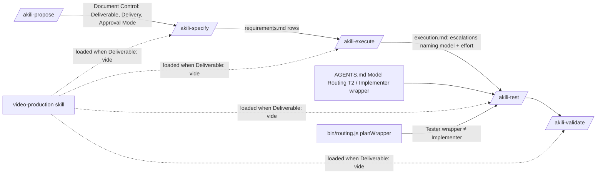

# Design: Video Production Hardening

## 1. Document Control

| Field | Value |
|---|---|
| Spec Path | `changes/video-production-hardening` |
| Depth | Standard (re-checked at §12, Step 2.4) |
| Type / Deliverable | Change / software |
| Approval Mode | pre-approved (Juan Carlos Cadavid, 2026-10-23) |
| Requirements | `requirements.md` (amended in judgment round 1: FR-2, FR-3, FR-9, FR-11, FR-17, §4) |
| Base commit | 8679e25 (`dev`) |
| Revision | r2 — judgment-day round-1 corrections C-1–C-9 and S-1 applied, plus the adopted info items (`judgment.md` §2–§3). The user chose **Fix and Re-judge** on 2026-10-23 |
| Phase 2 gate | see §14 |

## 2. Executive Summary

| Part | Approach |
|---|---|
| Rules text | Every rule lands in the file an agent reads at that moment: the `video-production` skill (3 files), five commands, the `leader.md` and `tester.md` personas, the `judgment-day` integration section, and the docs pages that mirror them |
| Code: Tester derivation | `bin/routing.js` binds the Tester to the first auditor-tier model (T3, then T1 cells) whose bound wrapper model differs from the Implementer's. When none exists it skips and reports |
| Code: `--version` | `bin/akili.js` gains `--version`/`-v`, read before argument validation and before the network update check |
| Tests | Text-contract tests pin each new clause where it is read |

## 3. Architecture Overview

The Document Control rows are the only channel between phases, and `Delivery` joins `Deliverable` on it. The `/akili-test` runtime rule takes the Implementer models from two places (C-1):

- the registry T2 pick, or the Implementer wrapper's `model` when one exists;
- every escalation the Leader records in `execution.md` ("naming the model and the effort chosen", `.claude/templates/leader.md:26`).

It no longer relies on the `spawns:` line, which names no model.

## 4. Extended Directory Structure (files touched)

| File | FRs | Sites |
|---|---|---|
| `.claude/skills/video-production/SKILL.md` | 1, 2, 3, 4, 5, 6, 10 | Step 0 (gate, route, host table), commands table (`:62-68`), privacy 1–3, phase map, render rules (`:80` delivery row), deferral table + precedence sentence |
| `.claude/skills/video-production/references/render-evidence.md` | 1, 2, 5, 6 | evidence set, new *Evidence files* block, final look |
| `.claude/skills/video-production/references/acceptance-criteria.md` | 4, 5, 6, 14 | rows 8, 9, 10, defect table |
| `.claude/commands/akili-propose.md` | 6, 7, 12, 16 | path rules, Step 1 Approval Mode, Step 1.1, Step 2 list, new Deliverable Outline block |
| `.claude/commands/akili-specify.md` | 6, 7, 9, 12, 15, 17 | Arguments + paths, Video Mode, Approval Mode, Step 1.2, Step 3.2 field list (`Red run`) + item 8, Step 2.4, Step 2.5 second menu, Verification Checklist |
| `.claude/commands/akili-execute.md` | 12, 13, 15 | Arguments + paths, loop pseudo-code, Loop Rules, Budget Tripwire, Approval Mode paragraph |
| `.claude/commands/akili-test.md` | 8, 11, 15 | Arguments + paths, tier note `:15`, delegation `:54`, Deployment Rule, new exception sentence, Phase 4 |
| `.claude/commands/akili-validate.md` | 6, 15 | Arguments + paths (including `:36`, `:175`), the delivery-render paragraph |
| `.claude/templates/leader.md` | 11, 13 | instruction 3 (`:27`), instruction 4 (`:35`), test-harness item 2 (`:333`) |
| `.claude/templates/tester.md` | 11 | tier note `:7` |
| `.claude/skills/judgment-day/SKILL.md` | 17 | AKILI-SPECS Integration adaptation rules |
| `.claude/commands/akili-constitution.md` | 11 | `:459`, `:791-793`, `:827-832`, `:844-846`, `:864`, `:1020-1022`, `:1429` |
| `bin/routing.js` | 11 | `planWrapper` (Tester branch), `buildPlan` Tester checks and report lines |
| `bin/akili.js` | 18 | options, `getArgs`, `main`, `printHelp` |
| Docs | 6, 7, 8, 11, 15, 17, 18 | `docs/model-routing.md`, `docs/cli.md`, `README.md`, `docs/flow.md` (`:394`, `:489`), `docs/commands/akili-{propose,specify,execute,test,validate}.md`, `docs/skills/video-production.md`, `docs/skills/judgment-day.md` |
| Tests | all | `test/video-production.test.js`, `test/routing.test.js`, `test/routing-io.test.js`, new `test/command-contracts.test.js`, new `test/cli-version.test.js` |
| `CHANGELOG.md` | 19 | `Unreleased` |

## 5. Data Model — Document Control rows

| Row | Values | Written by | Read by | Absent means |
|---|---|---|---|---|
| `Deliverable` (existing) | `software` \| `video` | propose; copied by specify | specify, test, validate | `software` |
| `Delivery` (new) | `render` \| `deferred` | propose, only when `Deliverable: video`; copied by specify into `requirements.md` | validate (delivery-render step); `video-production` phase map and render rules | `render` (today's behavior) |
| `Approval Mode` (existing) | `gated` \| `pre-approved (<who>, <date>)` | propose | all | `gated` |

- `Delivery` on a `software` spec is ignored: validate's video blocks are gated on `Deliverable: video` (NFR-1).
- Any `Delivery` value other than the two is read as `render` and reported in the validation report. That is the stated fall-through.

## 6. API Design (CLI and report contracts)

| Surface | Contract |
|---|---|
| `akili --version`, `akili -v` | stdout `<package.json version>\n`, exit 0. `getArgs` returns `{ command: "version" }` **before** its `--tool`/`--commands-only` validations (`bin/akili.js:381-388`), so `akili --version --tool bogus` also prints the version. `main` handles it before `checkForUpdates` (`:2898`), so no network call is made. It takes precedence over `--help` and over any command positional |
| Tester line, written | `<Host> Tester: \`<bound model>\` ≠ Implementer \`<bound model>\` (author ≠ tester)`. The bound model is the wrapper's `model` value without a Cursor `[effort=…]` bracket; on Antigravity it is `flash`/`pro`. Replaces the line at `bin/routing.js:848-850` |
| Tester line, no candidate | `<Host> Tester: no wrapper — no model distinct from the Implementer's \`<m>\` has a wrapper value; /akili-test picks one per spawn` |
| Tester line, Implementer unwritten | `<Host> Tester: no wrapper — the Implementer has no wrapper, so author ≠ tester cannot be checked`. This changes Cursor on its packaged roster: today it reports `Tester: no wrapper — T2 resolves to <CONFIRM SLUG>…` |
| Tester write token, belt and braces | `skipped (author ≠ tester unsatisfiable)` — mirrors the Reviewer token |
| Stale Tester file | When the Tester is not planned and a Tester wrapper file exists that declares the Implementer's model: `<Host> Tester: existing <relPath> binds the Implementer's model \`<m>\` — remove it by hand`. Never deleted (installer safety rule) |
| Drifted Tester file | A planned Tester whose existing file differs keeps today's `skipped (exists; --force to replace) — model drift: file says <old>, mapping says <new>`. The MUST takes effect on `--force`. `docs/cli.md` and CHANGELOG state this |
| Report lines under `wrappers=no` and `author ≠ auditor unsatisfiable` | Unchanged: those paths `continue` before any Tester report (`bin/routing.js:794-801`) |

## 7. Backend Module Design

### 7.1 `bin/routing.js` — Tester derivation (FR-11)

| Step | Rule |
|---|---|
| Location | Inside `planWrapper`, as the `role === "tester"` branch, so `renderWrapper`, the effort-bracket decision (`:747`) and `buildPlan` all see one Tester (A J-11). The branch plans the Implementer with the same function, then plans candidates through the shared per-host rendering. Effort stays `medium` (`ROLE_EFFORT.tester`) |
| 1 | If the Implementer plan has no content (any skip), the Tester returns `skipText` = the *Implementer unwritten* line |
| 2 | Candidates in order: T3 primary, T3 fallback, T1 primary, T1 fallback, from the host's mapping cells. Placeholders, `—`, and cross-host `→ <host>` cells are passed over |
| 3 | Each candidate is rendered as any role on that host would be, and its bound model is compared with the Implementer's: the Antigravity `wrapperModel`; the Cursor id without the bracket; the id itself elsewhere. A candidate with no wrapper value (an Antigravity id without `wrapperModel`) is passed over. The first candidate whose bound model differs is the Tester |
| 4 | No candidate → `skipText` = the *no candidate* line |
| 5 | `buildPlan` belt and braces, mirroring `:814-820`: a Tester whose bound model equals the Implementer's is written as `skipped (author ≠ tester unsatisfiable)` |
| 6 | `ROLE_TIER.tester` stays `T2`: it labels the *role's* tier and effort. Only the *model source* changes. The comment at `:603` is updated to say so |

**Packaged-roster outcome** (expected values; T14 executes them against the code it ships):

| Host | Implementer | Tester today (`--dry-run`, 8679e25) | Tester after |
|---|---|---|---|
| Claude Code | `sonnet` | `sonnet` | `opus` (T3 primary) |
| OpenCode | `opencode-go/deepseek-v4.1-flash` | same | `opencode-go/deepseek-v4-pro` (T3 primary) |
| Antigravity | `flash` | `flash` | not written. T3 `gemini-4-argon-high` and `claude-sonnet-5-5-high`, and T1 `gemini-4-argon-high`, carry no `wrapperModel` |
| Codex | `gpt-5.6-luna` | `gpt-5.6-luna` | `gpt-5.6-terra` (T3 primary) |
| Cursor | placeholders | `no wrapper — T2 resolves to <CONFIRM SLUG>…` | *Implementer unwritten* line |

On Antigravity the unwrapped Tester is a generic subagent that inherits the session model. The documented Argon session mitigation (CHANGELOG `changes/antigravity-argon-registry`) keeps author ≠ tester, and the `/akili-test` runtime rule (§8.4) checks it per spawn.

### 7.2 `bin/akili.js` — `--version` (FR-18)

- Add the option `version` (boolean, short `v`). Only `-l` and `-h` are taken (`:346`, `:348`).
- `getArgs` returns early with `command: "version"` right after `parseArgs`, before any validation.
- `main` handles `"version"` first: print `currentVersion` (`:2294`) and return.
- `printHelp` gains `-v, --version`.

## 8. Rules-Text Design (per file)

### 8.1 `video-production` skill (FR-1–FR-6, FR-10, FR-14)

Issue numbers are cited in the bare `#6138` form. The FR-8 placement test (`test/video-production.test.js:128-143`) confines "HeyGen" and `heygen-com` to the inspired-by line, the install-route lines, and the Attribution section. A bare `#n` keeps that test as is, and the Attribution section names the repository once (C-7).

| Site | Change |
|---|---|
| Step 0 gate | The router-found row gains a lock-file check. When the project has `skills-lock.json`, list the lock's skills missing from the host's project skill directory, and the installed skills absent from the lock. Report both as a warning and record it in `execution.md`. A found router still passes |
| Install route | The core set is `hyperframes`, `hyperframes-cli`, `hyperframes-registry`, `media-use`. The source is cited as the installed `hyperframes` skill's skill-lifecycle reference, by name. The command gains `--agent <id>`; the line keeps `--skill hyperframes ` and "project-scoped". Other skills: "installed on demand by name" |
| Host table | One row per host with an `--agent` id column: `claude-code` → `.claude/skills`; `opencode`, `codex`, `cursor`, `antigravity` → `.agents/skills`. The NFR-4 test row regex (`:235-241`) is updated in T5 |
| Commands table | `snapshot` row → `snapshot --at <t…> --describe false --output <spec>/evidence/stills/<task>-<label>/` (one folder per run, C-2). `render` rows → `--output <spec>/evidence/<name>.mp4`. Delivery row (`:65`) → "after final-look approval only; not run when `Delivery: deferred`". The `skills check` row is unchanged |
| Privacy 1 | The prefix `HYPERFRAMES_NO_TELEMETRY=1 HYPERFRAMES_SKIP_SKILLS=1` applies to `check`, `snapshot`, `render` and `preview`. `skills update` and `skills check` are **exempt**, because the variable turns them into silent no-ops (skill-lifecycle reference; C-6). Opt-ins are recorded in `execution.md` |
| Privacy 2 (consent line) | Adds `snapshot --describe` (it "may send frames to a third-party model when `GEMINI_API_KEY` is set", #6138) and the rule that every snapshot passes `--describe false` unless the user consents for that use |
| Privacy 3 | The sanitize rule, pointing to `render-evidence.md` *Evidence files* |
| Phase map | New rows: <ul><li>`story.md` → `/akili-propose`: the Deliverable Outline on the Change track; the Lite proposal's Intent on the Trivial track; the Bug Diagnosis's expected behavior on the Bug track. Then `requirements.md`. The storyline pick is that proposal's approval (A J-15).</li><li>`SPEC.md` → `design.md` (beat table + look). It is generated from the approved docs and stored at the composition root. A review that changes the film changes `design.md` first: a beat change is a Pivot, a look change is an Adjust at the next gate. `SPEC.md` is regenerated, never approved on its own (A J-16).</li><li>`snapshot --review` + `REVIEW.md` → each execute task's verification. Run as `snapshot --review --describe false --output <spec>/evidence/review/<task>/`, with `REVIEW.md` copied there (A J-14).</li><li>The delivery row → "after final-look approval, unless `Delivery: deferred`".</li></ul> |
| Render rules | `:80` (draft vs delivery) adds the deferral. New rows: <ul><li>**Fonts**: every family is self-hosted via `@font-face` to a local file, "bundled" families included (#6137). "Local only" is evidenced by a cold-cache `check` per `render-evidence.md` item 7.</li><li>**Environment**: a dedicated worktree (Orca's when present, else `git worktree`); one render at a time.</li><li>**Quiet tree**: a running tool daemon breaks it (the source run observed a HyperFrames warm-check process). Wait for it to exit or stop it, and record which.</li></ul> |
| Deferral table | <ul><li>Composition rules, motion, visual direction and captions → `hyperframes` (router) and its references (S-1).</li><li>CLI → `hyperframes-cli`; media → `media-use`; registry → `hyperframes-registry`.</li><li>The precedence sentence gains: known open upstream doc conflicts (#6136 clip window, #6139 multi-mount host id) — follow the router's contract and record the choice in `execution.md`.</li></ul> |

### 8.2 `render-evidence.md`

| Site | Change |
|---|---|
| Evidence set | <ul><li>Item 2: `snapshot --at <beat times> --describe false --output <spec>/evidence/stills/<task>-beats/`.</li><li>Item 3: `--output <spec>/evidence/draft.mp4`.</li><li>New item 7, only when the requirements claim "local only": `check` run with HyperFrames' font cache moved aside for that run. The cache path the source run observed is `~/.cache/hyperframes/fonts` (P-24, `UNVERIFIED`). The first video task confirms the path before relying on it; if it is wrong, the item says the run was not cold and the claim stays unproven (C-3).</li></ul> |
| New block *Evidence files* | <ol><li>Everything committed lives under `<spec>/evidence/`, written there by the command's own output flag, one subfolder per snapshot run.</li><li>Captured logs are `.txt`, never `.log`; no `.gitignore` change is needed.</li><li>Sanitize: replace absolute home, cache and temp paths with `<HOME>`, `<CACHE>`, `<TMP>` or relative paths. Gate: `grep -rn "$HOME" <spec>/evidence/` and `grep -rnE "/(private/)?var/folders/\|/tmp/" <spec>/evidence/` both return nothing before `git add` (A J-24).</li></ol> |
| Final look | Step 4 gains: unless `Delivery: deferred`. In that case record the deferral and stop after the approval |

### 8.3 `acceptance-criteria.md`

- **Row 8:** a film over about 15 s states its music bed, or `n/a — <reason>`.
- **Row 9:** names the font files and their local paths.
- **Row 10:** the delivery quality, or `Delivery: deferred`.
- **Defect table, new row:** "Motion — a transition missing or wrong (entry, exit, fade)" maps to stills just before and just after each transition boundary, then the final look. The row says `check --at-transitions` samples overlap and layout at tween boundaries (installed `hyperframes-cli` lint reference), not motion. That is stated as an AKILI gate rule from the source run, not as a tool fact.

### 8.4 Commands

**`akili-propose.md`**

- (a) **Path rules** (FR-16): a literal path the brief mandates for a bare slug wins and is recorded.
- (b) **Step 1 Approval Mode bullet** (FR-12): add the owner-mandate sentence (below), quoting the mandate in Document Control.
- (c) **Step 1.1** (FR-16): under `pre-approved`, the Jira/Figma questions are skipped when the brief supplies the source, and the skip is logged.
- (d) **Step 2 item 9 and a new block** (FR-7): item 9 names the **Deliverable Outline** for `Deliverable: video` on the Change track. The block defines it: beats, assets, and constraints (including `Delivery`).
- (e) **Step 2 item 1** (FR-6): add `Delivery: render | deferred` beside `Deliverable` for video.

**`akili-specify.md`**

- (a) **Arguments** (FR-15): the first-token rule; every `docs/specs/$ARGUMENTS` becomes `docs/specs/$SPEC_PATH`.
- (b) **Video Mode** (FR-6, FR-7): copy `Delivery` beside `Deliverable`, and convert a Deliverable Outline.
- (c) **Approval Mode paragraph and Step 2.5 second menu** (FR-17): **Fix only** never yields `JUDGMENT: APPROVED`. `judgment.md` closes with the AKILI annotation `fixed, not re-judged` and the fixed IDs. Severe findings still stop under `pre-approved`, unchanged (C-4).
- (d) **Step 1.2** (FR-7): an Outline conversion bullet beside the Delta conversion.
- (e) **Greenfield exception** (FR-9, A J-25), stated in three places:
  - Step 3.2 field list: `Red run` may read `predicted — greenfield artifact (observed in <task>)`.
  - Falsifiability item 8: the exception for a target that does not exist at specify time; the observing task's Done criteria require the red quoted in `execution.md`, and a different red is recorded as observed.
  - Verification Checklist: one clause.
- (f) **Step 2.4** (FR-12): the video guard/gate multiplier.

**`akili-execute.md`**

- (a) **Arguments + paths** (FR-15).
- (b) **Loop pseudo-code and Loop Rules** (FR-13): the ceiling rung (below).
- (c) **Budget Tripwire bullet and Approval Mode paragraph** (FR-12): the owner-mandate sentence.

**`akili-test.md`**

- (a) **Arguments + paths** (FR-15).
- (b) **`:15` and `:54`** (FR-11, C-1): "Prefer" becomes MUST. The Tester's *role* is T2. Its *model* differs from every Implementer model: the registry T2 pick or the Implementer wrapper's `model`, plus every escalation recorded in `execution.md`. Use the `akili-tester` wrapper when its model is none of them; else spawn on another model; else cross-host dispatch; else stop.
- (c) **Exception sentence**: that stop is an exception that is never auto-passed under `pre-approved`, joining HALT, Pivot, budget tripwire, `FATAL_FAIL` and `PRODUCT_BUG` (B J-10).
- (d) **Deployment Rule *Run inline* row** (FR-11): only when the Leader's model is not among those Implementer models.
- (e) **Phase 4** (FR-8): for `Deliverable: video` with no software suite, sections 3–6 become Render Evidence, Final-look pending, and Deferred suspicions. Mixed specs keep their software sections.

**`akili-validate.md`**

- (a) **Arguments + paths** (FR-15): `:36` and `:175` (`/akili-archive $SPEC_PATH`) included.
- (b) **Delivery-render paragraph** (FR-6): `Delivery: deferred` → skip the render, keep the final look, and record `Delivery: deferred — final look on draft render <path>`. The report never states that the delivery render ran.

**First-token wording (FR-15)** — identical in the four commands' Arguments section:

> `$ARGUMENTS` — The first whitespace- or newline-delimited token is the spec path, written `$SPEC_PATH` below; everything after it is context and is never interpolated into a path or a command line.

- On hosts that substitute `$ARGUMENTS` (Claude Code), the brief now renders once, because `$SPEC_PATH` is not a host variable.
- On hosts that install commands verbatim (Codex and Cursor skills, Grok Bot workflows), nothing is substituted. The sentence then tells the agent how to split its input (P-25).
- `akili-propose.md` already uses `$SPEC_PATH` for its resolved path (`:52`, `:65-66`).

**Ceiling rung (FR-13)** — a pseudo-code comment plus one Loop Rules sentence. It applies only when a task's effort already sits at the tier ceiling before a retry. On the default `medium` start, attempt 3 runs at `xhigh` and the rung never fires; it fires for tasks started at `high` or `xhigh` (B J-17). The ceiling is `xhigh` on T2, because `max` is barred on a cheaper tier.

1. **Escalate with a distinct auditor.**
   - Applies when a Reviewer model exists that differs from the T3 pick (the next-tier Implementer model) and is at least as strong: the registry's frontier escalation pin when the host has one, or cross-host dispatch.
   - Action: move the Implementer to T3 at `xhigh` and the Reviewer to that model. Both are recorded.
   - Per-spawn mechanism: the Reviewer ladder's existing rung 3, "a different model (`/model`) or the registry's cross-host dispatch" (`akili-execute.md:72`).
   - Never route the Reviewer to a weaker model than the escalated Implementer. On Claude Code the T3 fallback `sonnet` does not qualify. Single-entry T3 hosts (OpenCode) have no in-host candidate (A J-12, B J-17).
2. **Otherwise hold.** Keep T2 at `xhigh` with a fresh Implementer spawn carrying the Attempt History, and record `effort ceiling: held xhigh`.

The attempt ceiling stays 3.

**Owner-mandate sentence (FR-12)** — the same wording at three sites (propose's Approval Mode bullet, execute's Budget Tripwire bullet, execute's Approval Mode paragraph), naming the list instead of pointing "above" (B J-11):

> No mandate widens pre-approval: an owner brief that says "never stop" or "treat every gate as approved" pre-approves routine gates only. The exceptions in `/akili-propose` Step 1 *Approval Mode* (HALT, Pivot, budget tripwire, `FATAL_FAIL`, `PRODUCT_BUG`, destructive actions) still stop, and the stop message quotes this sentence.

### 8.5 Personas and `judgment-day` (C-5, C-8)

**`leader.md`**

- Instruction 3 (`:27`): "if a task wants `max`, escalate the tier instead" gains "on a rework retry, take `/akili-execute`'s ceiling rung".
- Instruction 4 (`:35`): "effort bumped one level per retry" gains "up to the tier's ceiling".
- Test-harness item 2 (`:333`): becomes "author ≠ tester: the Tester's model MUST differ from every Implementer model (`/akili-test` names the sources and the stop)". The words "A preference, not a hard rule" are removed.

**`tester.md`**

- `:7`: "prefer running on a different model" becomes "runs on a model different from the Implementer's, which the Leader guarantees". The tier line keeps T2 as the *role's* tier.

**Persona churn (C-8)**

- One rule now covers both personas: both are edited.
- Deployed `.agents/` copies read `outdated` in `akili doctor --agents` until `--fix` upgrades them, and the CHANGELOG says so.
- Measured on a scratch copy at 8679e25 with `leader.md` and `tester.md` edited: `node --test test/agents-doctor*.test.js test/persona-digests.test.js test/install*.test.js` → 128 pass, 0 fail (P-26).

**`judgment-day`**

- The *AKILI-SPECS Integration* adaptation rules gain one bullet. Under AKILI `pre-approved` mode the review still runs. A target corrected without re-judgment gets the AKILI annotation `fixed, not re-judged` in `judgment.md`. That annotation sits outside this skill's terminal states, which stay `approved | escalated`.
- The skill's Hard Rules are untouched (C-4).

## 9. Shared Contracts — restatement sites for FR-11

The phrase family is keyed on the obligation:

- `author ≠ tester`
- `prefer … Tester` / `Tester … prefer`
- `Tester … different model`
- `not a hard rule`
- `Rule 1 allows`
- `Tester(s) … T2` in model-binding sentences
- `Implementer/Tester … sonnet`
- `Implementer and Tester keep their`

Run as `grep -rn -i -E "author ≠ tester|prefer.*tester|tester.*prefer|Tester.*T2|T2.*Tester|not a hard rule|Implementer and Tester|Implementer/Tester|Testers\) stay" README.md docs .claude bin`, excluding `docs/specs/` (8679e25).

| Site | Action | Task |
|---|---|---|
| `akili-test.md:15,54` | MUST; role T2, model distinct | T9 |
| `leader.md:333`; `tester.md:7` | §8.5 | T11 |
| `akili-constitution.md:459` | "Author ≠ tester: the Tester's model MUST differ from the Implementer's" | T15 |
| `akili-constitution.md:791-793` | Claude Code example: tester `opus` | T15 |
| `akili-constitution.md:827-832` | OpenCode: Tester = `deepseek-v4-pro`; drop "prefer … note it per rule 1" | T15 |
| `akili-constitution.md:844-846, 864` | Antigravity: only `akili-implementer/` is written on the packaged roster; the Tester is skipped and reported | T15 |
| `akili-constitution.md:1020-1022` | Rule 1: the Tester MUST differ; skipped and reported when no distinct model has a wrapper value | T15 |
| `akili-constitution.md:1429` (twice) | "the Tester takes a model distinct from the Implementer's" | T15 |
| `docs/model-routing.md:71-72, 87, 189, 252, 795` | MUST; Testers no longer "stay on sonnet"; the Antigravity Tester is skipped | T16 |
| `docs/cli.md:504` | Roles map: "Tester role T2, model = first auditor-tier pick distinct from the Implementer's" | T17 |
| `README.md:898` | "Ideally" → MUST | T17 |
| `docs/flow.md:394` | "T1 / T2 (model ≠ Implementer)" | T17 |
| `docs/commands/akili-test.md:23,32` | MUST; "Step 8E wrapper (role T2, model distinct)" | T17 |
| **True as is:** `akili-constitution.md:666`, `docs/model-routing.md:402`, `model-routing.section.md:86` (effort `medium` for the role); `akili-constitution.md:726`, `docs/flow.md:476` (skill loading) | Not a model claim | — |
| **Kept (debt):** `.claude/templates/model-routing.section.md:30,36` and its description `akili-constitution.md:576-578` | Editing the section template refuses existing fences (P-3, verified). "Prefer" is weaker than MUST but not false, and the T2 row describes the role. Recorded as debt in CHANGELOG | T19 |

## 10. Design Decisions

| ID | Decision | Rejected alternative | Lessons |
|---|---|---|---|
| DD-1 | The Tester binds the first auditor-tier candidate (T3, then T1) whose bound model differs from the Implementer's | T2 fallback first (Claude Code → `haiku`, a weaker test author; Codex and Antigravity have none). A new `tester` tier (registry schema change, drift-test churn) | Matches the owner's manual override (`opus`) in the source run |
| DD-2 | No candidate → skip and report, never write. A stale file is reported, never deleted; a drifted file needs `--force` | Fall back to the Implementer's model with a warning (violates the MUST). Delete the file (violates installer safety) | KZ-004 |
| DD-3 | `/akili-test` takes the Implementer models from the registry T2 or the wrapper binding, plus escalations recorded in `execution.md` (C-1) | Add a `model` item to `spawns:` (an execute log-format change that every entry would carry) | — |
| DD-4 | `$SPEC_PATH` replaces `$ARGUMENTS` in paths and command lines, plus one Arguments sentence per command | A sentence only (the host still pastes the brief into every path) | — |
| DD-5 | `Delivery` is a separate Document Control row, default `render` | A third `Deliverable` value (it would multiply the `Deliverable: video` gates and break the NFR-1 counting test) | — |
| DD-6 | **Keep** the 20,000-byte cap and 3 files. The skill task measures the drafted content; if it exceeds the cap, that is a Pivot with the measured size (judgment A J-17 / B J-16; the round-1 draft's raise is reversed) | Raise to 24,000 on an estimate | Step 2.4 cap rule |
| DD-7 | Upstream behavior is cited by bare issue number: #6138 describe, #6137 fonts, #6136 and #6139 doc conflicts (P-27). Never asserted as fact | Restate tool internals | NFR-3 |
| DD-8 | Ceiling rung: escalate only with a distinct auditor at least as strong, set per spawn by the Reviewer ladder's rung-3 mechanism; else hold `xhigh` with a fresh spawn | `max` on T2 (contradicts `leader.md:27`). A 4th attempt (changes the hard ceiling) | — |
| DD-9 | Edit both personas (`leader.md`, `tester.md`); keep only the section template, because of the verified template-evolution refusal | Keep `tester.md` while editing `leader.md` (inconsistent; C-8) | P-3, P-26 |
| DD-10 | `--version` is read before argument validation and before the update check | Inside the validated path (`--version --tool bad` would exit 1) | — |
| DD-11 | New test files per concern (`command-contracts`, `cli-version`); video clauses extend `video-production.test.js` | One mega-file | KZ-bugfix--init-ctrlc-abort-2 |
| DD-12 | The argument-parsing residual (archive, seo, quick) and the two unmapped friction items (GSAP vendoring, the source project's D-3) stay out of scope, recorded in `requirements.md` §4 | Fixing them here (scope not approved) | AGENTS.md "Scope only grows through approval" |

**Step 2.3 reversion challenges:** see `judgment.md` §4. Each named breakage is owned by a task here; DD-6's raise is reversed.

## 11. Premise Ledger

**Count:** 27 rows — 24 verified, 3 `UNVERIFIED` (High 0, Low 3).
**Blast-radius triggers fired:** `consumer` (report lines, wrapper models, skill and command text pinned by tests and docs), `shared-state` (`planWrapper` readers; persona digests), `live-path` (`--version` dispatch).

| # | Claim | Class | Citation (as run) | Verified at | If false | Settled by |
|---|---|---|---|---|---|---|
| P-1 | `test/video-production.test.js` pins the skill and commands. Test-by-test: frontmatter `:111`; HeyGen placement `:128-143`; ≤3 files/≤20,000 bytes `:145-150`; verified subcommand set + outward-action placement `:152-175`; consent line `:177-188`; gate `:190-200`; route `--yes`/`--skill hyperframes `/project-scoped `:202-214`; first-render row `:216-225`; `skills check` row `:227-233`; host-table rows `:235-241`; duration `:243-252`; `Deliverable: video` counts ≥ specify 5 / test 3 / validate 4 `:254-260`; Video Mode default `:262-266` | consumer | `grep -n "^test(" test/video-production.test.js` + reading each body | b3d3df1 | T1–T5, T7, T9, T10 sites must keep or deliberately amend each pin → High | — |
| P-2 | Readers of Tester wrapper models and report lines: `test/routing.test.js:313-318` (OpenCode T3 = T2 roster), `:638`, `:646`, `:658-663`, `:688`, `:697`, `:718-724` (four wrappers created), `:742-746` (six unchanged writes), `:801` (cross-host sonnet-only roster), `:842-852` (collapse line); `test/routing-io.test.js:154,214` (token-line counts), `:235` | consumer | `grep -rn -i tester test/*.js` (whole `test/`) and the body reads cited | b3d3df1 | T14 test scope → High | — |
| P-3 | Editing `model-routing.section.md` makes an existing fence refuse: `replaceFencedSection` renders the expected body from previous answers with the current template and returns `TOKEN_REFUSED_EDIT` on mismatch | data-env | `bin/routing.js:422-436` | 8679e25 | DD-9 → Low | — |
| P-4 | `skills` CLI 1.7.4 `add` has `-a, --agent <agents>`; ids `claude-code`, `opencode`, `codex`, `cursor`, `antigravity` | data-env | `npx skills@1.7.4 add --help`; `grep -rhoE "\b(claude-code\|opencode\|codex\|cursor\|antigravity)\b" <skills pkg>/dist \| sort \| uniq -c` → 12/10/13/93/11 | 8679e25 (skills 1.7.4, 2026-10-23) | §8.1 host table → High | — |
| P-5 | The upstream eager core set is the 4 skills | data-env | installed `hyperframes/references/skill-lifecycle.md:7` (video project, read only) | 8679e25 | FR-3 → High | — |
| P-6 | `snapshot --describe` sends frames to Gemini when `GEMINI_API_KEY` is set | other | `UNVERIFIED — confirm at source before relying on it` (user-stated; #6138 title "frames are sent to Gemini by default whenever GEMINI_API_KEY is set"; `--describe false` exists as a flag: installed `hyperframes/references/storyboard.md:12`) | — | Wording of one clause; `--describe false` stands either way → Low | user-stated; T2 cites #6138 |
| P-7 | The compiler fetches "bundled" fonts from Google Fonts; a warm cache hides it | other | `UNVERIFIED — confirm at source before relying on it` (user-stated; #6137; counter-evidence: installed `format.md:96` "Bundled, so they resolve by name") | — | Note wording → Low; the self-host rule stands either way | user-stated; T2 cites #6137 |
| P-8 | The source project ignores `*.log` | data-env | `git check-ignore -v video/x.log` in the video project → `.gitignore:41:*.log` | 8679e25 | FR-2 `.txt` rule → Low | — |
| P-9 | `akili --version` exits 1 today | existence | `node bin/akili.js --version` → `ERROR: Unknown option '--version'`, exit 1 | 8679e25 | FR-18 unnecessary → Low | — |
| P-10 | `currentVersion` is a module constant from `package.json` | location | `bin/akili.js:2294` | 8679e25 | T18 → Low | — |
| P-11 | Only `-l` and `-h` short options exist | existence | `grep -n 'short:' bin/akili.js` → `:346`, `:348` | 8679e25 | `-v` collision → Low | — |
| P-12 | `main` → `getArgs` → validation (`:381-388`) → the `check-update` branch → `checkForUpdates` (`:2898`) → switch | live-path | `bin/akili.js:2884-2898`, `:372-388` | 8679e25 | DD-10 placement → Low | — |
| P-13 | `planWrapper` is read by `renderWrapper` (`:689`), the effort-bracket decision (`:747`) and `buildPlan` (`:793`, `:815`); `ROLE_TIER.tester = "T2"` (`:603`) | shared-state | `grep -n "planWrapper(" bin/routing.js` | 8679e25 | T14 keeps the Reviewer path and bracket decision intact → High | — |
| P-14 | On the packaged roster the Tester binds the Implementer's model on Claude Code, OpenCode, Antigravity and Codex | existence | `node bin/akili.js routing --project <tmp> --hosts claude,opencode,antigravity,codex --models claude=opus,sonnet,haiku --models opencode=opencode-go/deepseek-v4-pro,opencode-go/deepseek-v4.1-flash,opencode-go/deepseek-v4-flash --models antigravity=gemini-4-argon-high,gemini-3.8-flash-high,gemini-3.8-flash-medium,gemini-3.8-flash-low,claude-sonnet-5-5-high --models codex=gpt-5.6-terra,gpt-5.6-sol,gpt-5.6-luna --cli claude=claude --cli opencode=opencode --cli antigravity=agy --cli codex=codex --wrappers yes --yes --dry-run` → four `Tester: same model as the Implementer` lines | 8679e25 | FR-11 unnecessary → High | — |
| P-15 | `$ARGUMENTS` occurrences: specify 6 (`:31,35,88,97,99,104`), execute 5 (`:28,103-106`), test 6 (`:30,34,98-100,143`), validate 11 (`:30,34,36,66,67,69-72,151,175`) | location | `grep -n '\$ARGUMENTS'` per file | 8679e25 | T7–T10 site lists → Low | — |
| P-16 | The router names `story.md`, `SPEC.md`, `snapshot --review`/`REVIEW.md`, and a music bed for films over about 15 s | data-env | installed `hyperframes/SKILL.md:46-47`; `references/sound.md:7`; `references/review.md:44`; `references/spec.md:5` | 8679e25 | §8.1 rows → Low | — |
| P-17 | `snapshot` and `render` take `--output`; defaults are `.hyperframes/artifacts/snapshots/<id>/` and `renders/…` | data-env | installed `hyperframes-cli/references/lint-validate-inspect.md:120`; `preview-render.md:116,122` | 8679e25 | FR-2 → High | — |
| P-18 | `check --at-transitions` samples tween start/end boundaries | data-env | installed `hyperframes-cli/references/lint-validate-inspect.md:37` | 8679e25 | FR-14 wording → Low | — |
| P-19 | `skills-lock.json` shape is `{version, skills: {<name>: {source, …}}}` | data-env | video project `skills-lock.json`, read only | 8679e25 | FR-3 gate wording → Low | — |
| P-20 | `HYPERFRAMES_SKIP_SKILLS=1` stops `init`/`skills` refresh, and also makes `skills update` and bare `skills` exit 0 without installing | data-env | installed `hyperframes/references/skill-lifecycle.md:14-16` | 8679e25 | Privacy 1 scope → High | — |
| P-21 | Escalations above T2 are recorded in `execution.md` "naming the model and the effort chosen"; the `spawns:` line names no model | location | `.claude/templates/leader.md:26`; `akili-execute.md:393` | 8679e25 | DD-3 source → High | — |
| P-22 | The `akili-quick-args` worktree holds no commits beyond `dev` | existence | `git log --oneline dev..JuankCadavid/akili-quick-args` → empty | 8679e25 | duplicate work → Low | — |
| P-23 | Every `snapshot` run clears its `-o` folder and numbers from `00` | data-env | installed `hyperframes/references/storyboard.md:12` | 8679e25 | Per-run subfolders (§8.1, §8.2) → High | — |
| P-24 | HyperFrames caches fonts at `~/.cache/hyperframes/fonts` | data-env | `UNVERIFIED — confirm at source before relying on it` (user-stated, friction log; no installed-skill hit for a font cache) | — | Item 7's procedure → Low (the item reports "not cold" when the path is wrong) | user-stated; the first video task to claim "local only" (the T2 text states it) |
| P-25 | Codex and Cursor install commands as skills verbatim; Grok Bot installs commands as workflows verbatim, so `$ARGUMENTS` is not substituted there | other | `bin/akili.js:1142` (commands as skills); `docs/cli.md:262` | 8679e25 | FR-15 rationale wording → Low | — |
| P-26 | Editing `leader.md` and `tester.md` between releases keeps the doctor, digest and install suites green | data-env | scratch copy at b3d3df1 with both templates edited: `node --test test/agents-doctor*.test.js test/persona-digests.test.js test/install*.test.js` → 128 pass, 0 fail | b3d3df1 | DD-9 → Low | — |
| P-27 | Issue topics: #6136 clip window, #6137 fonts, #6138 snapshot Gemini, #6139 multi-mount host id; all OPEN | data-env | `gh issue view <n> -R heygen-com/hyperframes --json number,title,state` (2026-10-23) | 8679e25 | DD-7 citations → Low | — |

Hand-off:

- P-1 → `Consumers` of T1, T2, T3, T4, T5, T7, T9, T10.
- P-2 → `Consumers` of T14.
- P-26 → T11.
- `UNVERIFIED` P-6, P-7 → T2. P-24 → T3, whose text carries the settle-at-first-use clause.

## 12. Budget (Step 2.4)

| Measure | Estimate | Basis |
|---|---|---|
| Tasks | 21 | §4, split per rules document (about 8 sites each; the mechanical `$ARGUMENTS` replacement counts as one site): 15 rules-text tasks, 6 code/test/docs tasks |
| LOC | ~1,250 | Rules text ~+380 (now including `docs/commands/*` and personas). Tests ~+650: ~65 clauses × ~10 LOC (KZ-bugfix--init-ctrlc-abort-2). Code ~+90. CHANGELOG/docs ~+130 |
| Review rounds | ~39 | 15 rules-text tasks × 2 (Step 2.4 rules-document rule) + 6 × 1.5 |

The skill byte figure is a drafted measurement owed by T2 (DD-6). The estimate is about +4,900 bytes on top of 12,250 today; a measurement over 20,000 is a Pivot.

**Depth check:** Standard was declared. The estimate is large but made of single-file, low-risk tasks, so stay at Standard and split into three PRs (§13). The video ×2–3 multiplier (FR-12) does not apply: `Deliverable: software`.

## 13. PR Strategy

| PR | Tasks | Review first |
|---|---|---|
| 1 — video skill | T1–T5 | `SKILL.md` Step 0 + privacy |
| 2 — commands, personas, judgment-day | T6–T13 | the first-token rule (T13 tests) |
| 3 — routing + CLI + docs + CHANGELOG | T14–T21 | `bin/routing.js` Tester derivation |

## 14. Gates

- Step 2.3 reversion challenge: done (`judgment.md` §4).
- Judgment-day round 1: 9 confirmed findings (8 severe), corrected in r2 after the user chose **Fix and Re-judge**.
- Round-2 scoped re-judgment: see `judgment.md`.
