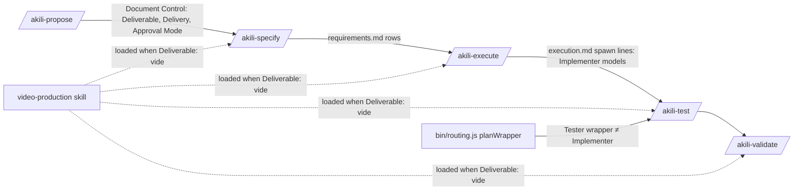

# Design: Video Production Hardening

## 1. Document Control

| Field | Value |
|---|---|
| Spec Path | `changes/video-production-hardening` |
| Depth | Standard (re-checked at §12, Step 2.4) |
| Type / Deliverable | Change / software |
| Approval Mode | pre-approved (Juan Carlos Cadavid, 2026-10-23) |
| Requirements | `requirements.md` (814a520) |
| Base commit | 8679e25 (`dev`) |
| Phase 2 gate | see §14 |

## 2. Executive Summary

| Part | Approach |
|---|---|
| Rules text | Every rule lands in the file an agent reads at that moment: the `video-production` skill (3 files), five commands, `leader.md`, and the `judgment-day` integration table |
| Code: Tester derivation | One new derivation in `bin/routing.js` binds the Tester to the first distinct auditor-tier model (T3 → T1 cells) whose rendered wrapper `model` differs from the Implementer's, and skips with a report when none exists |
| Code: `--version` | `bin/akili.js` gains `--version`/`-v`, handled before the network update check |
| Tests | Text-contract tests pin each new clause where it is read |

## 3. Architecture Overview

The Document Control rows are the only channel between phases. `Delivery` joins `Deliverable` on that channel. The `/akili-test` runtime rule reads the Implementer models from `execution.md` spawn lines, a field that already exists (`akili-execute.md:393`).

## 4. Extended Directory Structure (files touched)

| File | FRs | Sites (approx.) |
|---|---|---|
| `.claude/skills/video-production/SKILL.md` | 1, 2, 3, 4, 5, 6, 10 | Step 0 (gate, route, host table), commands table, privacy 1–3, phase map, render rules, deferral table |
| `.claude/skills/video-production/references/render-evidence.md` | 1, 2, 5, 6 | evidence set, new *Evidence files* block, final look |
| `.claude/skills/video-production/references/acceptance-criteria.md` | 4, 5, 6, 14 | rows 8, 9, 10, defect table |
| `.claude/commands/akili-propose.md` | 6, 7, 12, 16 | path rules, Step 1 Approval Mode, Step 1.1, Step 2 list, new Deliverable Outline block |
| `.claude/commands/akili-specify.md` | 6, 7, 9, 12, 15, 17 | Arguments + paths, Video Mode, Approval Mode, Step 1.2, item 8, Step 2.4, Step 2.5 |
| `.claude/commands/akili-execute.md` | 12, 13, 15 | Arguments + paths, loop pseudo-code, Budget Tripwire, Approval Mode paragraph |
| `.claude/commands/akili-test.md` | 8, 11, 15 | Arguments + paths, tier note :15, delegation :54, Deployment Rule, Phase 4 |
| `.claude/commands/akili-validate.md` | 6, 15 | Arguments + paths, delivery-render paragraph |
| `.claude/templates/leader.md` | 13 | instruction 3 effort bullet (:27), instruction 4 loop sentence (:35) |
| `.claude/skills/judgment-day/SKILL.md` | 17 | AKILI-SPECS Integration adaptation rules |
| `.claude/commands/akili-constitution.md` | 11 | Step 8B tester bullet, Step 8E Claude Code/OpenCode/Antigravity bullets, Antigravity table, Rule 1, Step 9 summary |
| `bin/routing.js` | 11 | `planWrapper`, `buildPlan` report lines |
| `bin/akili.js` | 18 | options, `getArgs`, `main`, `printHelp` |
| `docs/model-routing.md`, `docs/cli.md`, `README.md` | 11, 18, 19 | restatements, `--version` |
| `test/video-production.test.js`, `test/routing.test.js`, new `test/command-contracts.test.js`, new `test/cli-version.test.js` | all | tests |
| `CHANGELOG.md` | 19 | `Unreleased` |

## 5. Data Model — Document Control rows

| Row | Values | Written by | Read by | Absent means |
|---|---|---|---|---|
| `Deliverable` (existing) | `software` \| `video` | propose; copied by specify | specify, test, validate | `software` |
| `Delivery` (new) | `render` \| `deferred` | propose, only when `Deliverable: video`; copied by specify into `requirements.md` | validate (delivery-render step); `video-production` phase map | `render` (today's behavior) |
| `Approval Mode` (existing) | `gated` \| `pre-approved (<who>, <date>)` | propose | all | `gated` |

`Delivery` on a `software` spec is ignored: validate's video blocks are already gated on `Deliverable: video` (NFR-1). A `Delivery` value other than the two is read as `render` and reported in the validation report. That is the stated fall-through for a field-state rule (Step 2.2 guideline "a rule keyed to a field's states lists every state").

## 6. API Design (CLI and report contracts)

| Surface | Contract |
|---|---|
| `akili --version`, `akili -v` | stdout `<package.json version>\n`, exit 0. Handled in `main` before `checkForUpdates` (`bin/akili.js:2898`), so no network call. Takes precedence over `--help` and over any command positional |
| `akili routing` Tester line, written | `<Host> Tester: \`<tester model>\` ≠ Implementer \`<implementer model>\` (author ≠ tester)` — replaces `<Host> Tester: same model as the Implementer … Rule 1 allows it` (`bin/routing.js:848-850`) |
| `akili routing` Tester line, skipped | `<Host> Tester: no wrapper — no model distinct from the Implementer's \`<m>\` has a wrapper value; /akili-test picks one per spawn` |
| `akili routing` Tester line, Implementer unwritten | `<Host> Tester: no wrapper — the Implementer has no wrapper, so author ≠ tester cannot be checked` |
| `akili routing` stale file line | When the Tester is not planned but a Tester wrapper file exists that declares the Implementer's model: `<Host> Tester: existing <relPath> binds the Implementer's model \`<m>\` — remove it by hand`. The file is never deleted (installer safety rule) |

## 7. Backend Module Design

### 7.1 `bin/routing.js` — Tester derivation (FR-11)

| Step | Rule |
|---|---|
| 1 | Plan the Implementer first (unchanged). If it is not written (any skip), the Tester is not written: report the *Implementer unwritten* line |
| 2 | Tester candidates, in order: T3 primary, T3 fallback, T1 primary, T1 fallback, taken from the host's mapping cells. Placeholders, `—`, and cross-host `→ <host>` cells are not ids and are passed over |
| 3 | For each candidate, render the wrapper exactly as `planWrapper` renders any role on that host (same shape switch, Tester effort `medium`), and compare its **bound model** with the Implementer's: the Antigravity `wrapperModel`, the Cursor id without the `[effort=…]` bracket, or the id itself on Claude Code / OpenCode / Codex. The first candidate whose bound model differs is the Tester. A candidate with no wrapper value (an Antigravity id without `wrapperModel`) is passed over |
| 4 | No candidate qualifies → the Tester is not written; report the *skipped* line |
| 5 | Belt and braces in `buildPlan`, mirroring the Reviewer check at `bin/routing.js:814-820`: a Tester whose rendered bound model equals the Implementer's is never written, whatever step 3 returned |
| 6 | `ROLE_TIER.tester` stays `T2` for effort and labels. Only the model source changes |

**Packaged-roster outcome** (expected values; executed in T14 against the code it ships):

| Host | Implementer | Tester today (`--dry-run`, 8679e25) | Tester after |
|---|---|---|---|
| Claude Code | `sonnet` | `sonnet` | `opus` (T3 primary) |
| OpenCode | `opencode-go/deepseek-v4.1-flash` | same | `opencode-go/deepseek-v4-pro` (T3 primary) |
| Antigravity | `flash` | `flash` | not written — T3 `gemini-4-argon-high` and `claude-sonnet-5-5-high` and T1 `gemini-4-argon-high` carry no `wrapperModel` |
| Codex | `gpt-5.6-luna` | `gpt-5.6-luna` | `gpt-5.6-terra` (T3 primary) |
| Cursor | placeholders → no wrappers | — | unchanged (Implementer unwritten) |

On Antigravity the unwrapped Tester is a generic subagent that inherits the session model. The documented Argon session mitigation (CHANGELOG `changes/antigravity-argon-registry`) then gives author ≠ tester for free, and the `/akili-test` runtime rule (§8.4) still checks it per spawn.

### 7.2 `bin/akili.js` — `--version` (FR-18)

- Add the option `version` (boolean, short `v`) to the `parseArgs` options. Only `-l` and `-h` are taken today (`bin/akili.js:346,348`).
- `getArgs` sets `command = "version"` when it is present, after the `help` override, so version wins.
- `main` handles `"version"` first: it prints `currentVersion` (`bin/akili.js:2294`) and returns.
- `printHelp` gains one `-v, --version` line.

## 8. Rules-Text Design (per file)

### 8.1 `video-production` skill (FR-1–FR-6, FR-10, FR-14)

| Site | Change |
|---|---|
| Step 0 gate | The router-found row gains: when the project has `skills-lock.json`, list the lock's skills missing from the host's project skill directory, and installed skills absent from the lock. Report both lists as a warning and record it in `execution.md`. A found router still passes |
| Install route | Core set = `hyperframes`, `hyperframes-cli`, `hyperframes-registry`, `media-use` (cite the installed `hyperframes` skill's skill-lifecycle reference by name, not by line). The command gains `--agent <id>`. Other skills: "installed on demand by name" |
| Host table | Third column `--agent id`: `claude-code`; `opencode`, `codex`, `cursor`, `antigravity` (the shared row splits into one row per host) |
| Commands table | `snapshot` row → `snapshot --at <t…> --describe false --output <spec>/evidence/stills/<name>`; `render` rows gain `<spec>/evidence/` paths; the `skills check` row's lock-file sentence stays |
| Privacy 1 | Prefix = `HYPERFRAMES_NO_TELEMETRY=1 HYPERFRAMES_SKIP_SKILLS=1`. The reason for the second: `init`/`skills` refresh skills from GitHub otherwise. Opt-ins are recorded in `execution.md` |
| Privacy 2 (consent line) | Adds `snapshot --describe` ("may send frames to a third-party model when `GEMINI_API_KEY` is set — heygen-com/hyperframes#6138") and the rule that every snapshot passes `--describe false` unless the user consents for that use |
| Privacy 3 | Becomes the sanitize rule (pointer to `render-evidence.md` *Evidence files*) |
| Phase map | New rows: `story.md` → `/akili-propose` Deliverable Outline + `requirements.md` (the storyline pick is the outline's approval); `SPEC.md` → `design.md` (beat table + look); generated from approved docs, stored at the composition root, never approved separately; `snapshot --review` + `REVIEW.md` → each execute task's verification, stored under `<spec>/evidence/review/`; the delivery row reads "after final-look approval, unless `Delivery: deferred`" |
| Render rules | New rows. **Fonts**: every family self-hosted via `@font-face` to a local file, "bundled" included (heygen-com/hyperframes#6137), with "local only" evidenced by a cold-cache `check`. **Environment**: a dedicated worktree (Orca's when present, else `git worktree`) and one render at a time. The quiet-tree row adds: a running tool daemon (e.g. the HyperFrames warm-check process) breaks the quiet tree; wait for it to exit or stop it, and record which |
| Deferral table | Rows re-pointed: composition rules, motion and visual direction → `hyperframes` (router) and its references; CLI → `hyperframes-cli`; media → `media-use`; registry → `hyperframes-registry`. Captions keep `embedded-captions`, marked environment-provided on demand. The precedence sentence below the table gains: known open upstream doc conflicts (heygen-com/hyperframes#6136 clip window, #6139 multi-mount host id) — follow the router's contract and record the choice in `execution.md` |

### 8.2 `render-evidence.md`

| Site | Change |
|---|---|
| Evidence set | Item 2: `snapshot --at <beat times> --describe false --output <spec>/evidence/stills/`. Item 3: `--output <spec>/evidence/draft.mp4`. New item 7: a cold-cache `check` when the requirements claim "local only" (the font cache cleared or redirected, as the installed `hyperframes-cli` skill documents) |
| New block *Evidence files* | (1) Everything committed lives under `<spec>/evidence/`. (2) Captured logs are `.txt`, never `.log`; no `.gitignore` change is needed. (3) Sanitize: replace absolute home, cache and temp paths with `<HOME>`, `<CACHE>`, `<TMP>` or relative paths. Gate: `grep -rn "$HOME" <spec>/evidence/` returns nothing before `git add` |
| Final look | Step 4 gains: unless `Delivery: deferred` — then record the deferral and stop after the approval |

### 8.3 `acceptance-criteria.md`

Row 8: a film over about 15 s states its music bed, or `n/a — <reason>`. Row 9: font files and their local paths. Row 10: the delivery quality, or `Delivery: deferred`. Defect table gains `Motion — a transition missing or wrong (entry, exit, fade)` → stills just before and after each transition boundary, then the final look; the row states that `check --at-transitions` samples overlap and layout at tween boundaries, not motion (observed in the source run; no upstream issue filed — stated as an AKILI gate rule, not a tool fact).

### 8.4 Commands

| File | Change |
|---|---|
| `akili-propose.md` | (a) Path rules: a literal path the brief mandates for a bare slug wins and is recorded (FR-16). (b) Step 1 Approval Mode bullet: a sentence that an owner mandate ("never stop", "treat every gate as approved") pre-approves routine gates only and cannot pre-approve an exception; the mandate is quoted in Document Control (FR-12). (c) Step 1.1: under `pre-approved`, the Jira/Figma questions are skipped when the brief supplies the source, and logged (FR-16). (d) Step 2 item 9 names the **Deliverable Outline** for `Deliverable: video` on the Change track; a new block defines it: beats, assets, constraints (including `Delivery`) (FR-7). (e) Step 2 item 1: `Delivery: render \| deferred` beside `Deliverable` for video (FR-6) |
| `akili-specify.md` | (a) Arguments: the first-token rule; every `docs/specs/$ARGUMENTS` becomes `docs/specs/$SPEC_PATH` (FR-15). (b) Video Mode: copy `Delivery` beside `Deliverable`; convert a Deliverable Outline (FR-6, FR-7). (c) Approval Mode paragraph: **Fix only** cannot end `APPROVED`; under `pre-approved`, confirmed non-severe findings take **Fix and Re-judge**; severe findings still stop, unchanged (FR-17). (d) Step 1.2: an Outline conversion bullet beside the Delta conversion (FR-7). (e) Falsifiability item 8: the greenfield exception (FR-9). (f) Step 2.4: the video guard/gate multiplier (FR-12). (g) Step 2.5's second menu: the **Fix only** line states its terminal (FR-17) |
| `akili-execute.md` | (a) Arguments + paths (FR-15). (b) Loop pseudo-code `effort = bump…`: the ceiling rung (FR-13). (c) The Budget Tripwire bullet and the Approval Mode paragraph each gain the owner-mandate sentence (FR-12) |
| `akili-test.md` | (a) Arguments + paths (FR-15). (b) :15 and :54: "Prefer" → MUST. The Leader determines the Implementer models from `execution.md` `spawns:` lines (plus registry T2 and recorded escalations). Then the Tester wrapper when its model is none of them, else another model, else cross-host dispatch, else a user stop (FR-11). (c) Deployment Rule *Run inline* row: only when the Leader's model wrote no code under test (FR-11). (d) Phase 4: when `Deliverable: video` with no software suite, sections 3–6 become Render Evidence, Final-look pending, Deferred suspicions; mixed specs keep their software sections (FR-8) |
| `akili-validate.md` | (a) Arguments + paths (FR-15). (b) The delivery-render paragraph: `Delivery: deferred` → skip the render, keep the final look, record `Delivery: deferred — final look on draft render <path>`; the report never states the delivery render ran (FR-6) |

**First-token wording (FR-15)** — identical in the four commands' Arguments section:

> `$ARGUMENTS` — The first whitespace- or newline-delimited token is the spec path, written `$SPEC_PATH` below; everything after it is context and is never interpolated into a path.

`$SPEC_PATH` is not a host variable, so the host leaves it as written and the brief is rendered once. `akili-propose.md` already uses `$SPEC_PATH` for its resolved path (`akili-propose.md:52,65-66`).

**Ceiling rung (FR-13)** — pseudo-code comment and one Loop Rules sentence. The bump climbs `medium → high → xhigh`. When the next rung would pass the tier's ceiling (`xhigh` on T2; `max` is barred on a cheaper tier):

1. **Distinct Reviewer model available** (the registry T3 fallback, or cross-host dispatch, differing from the next-tier Implementer model): escalate the Implementer one tier at `xhigh`, move the Reviewer to that model, and record both.
2. **Otherwise**: hold `xhigh` on T2 with a fresh Implementer spawn carrying the Attempt History, and record `effort ceiling: held xhigh`.

The attempt ceiling stays 3.

**Owner-mandate sentence (FR-12)** — one wording, in propose's Approval Mode bullet, execute's Budget Tripwire bullet, and execute's Approval Mode paragraph:

> No mandate widens pre-approval: an owner brief that says "never stop" or "treat every gate as approved" pre-approves routine gates only, and the exceptions above still stop.

### 8.5 `leader.md` and `judgment-day`

- `leader.md` instruction 3 (:27): "if a task wants `max`, escalate the tier instead" gains "— and on a rework retry, take `/akili-execute`'s ceiling rung, which escalates only when the Reviewer can move to a distinct model".
- `leader.md` instruction 4 (:35): "effort bumped one level per retry" gains "up to the tier's ceiling (the command's ceiling rung)".
- `judgment-day` *AKILI-SPECS Integration* adaptation rules gain one bullet: under AKILI `pre-approved` mode the review still runs; a target corrected without re-judgment closes as `fixed, not re-judged`, never `APPROVED`.

## 9. Shared Contracts — restatement sites for FR-11

Phrase family keyed on the obligation: `author ≠ tester`, `prefer … Tester`, `Tester … different model`, `Rule 1 allows`, `tester T2` in model-binding sentences, `Implementer/Tester … sonnet`, `Implementer and Tester keep their`.

| Site (8679e25) | Action |
|---|---|
| `akili-test.md:15,54` | MUST (T9) |
| `akili-constitution.md:459` (Step 8B `tester.md` bullet) | "Author ≠ tester: the Tester's model MUST differ from the Implementer's" (T15) |
| `akili-constitution.md:791-793` (Claude Code example `opus / sonnet / opus / sonnet`) | tester `opus` (T3 pick) (T15) |
| `akili-constitution.md:827-832` (OpenCode) | Tester = T3 pick `deepseek-v4-pro`; drop "prefer … note it per rule 1" (T15) |
| `akili-constitution.md:844-846, 864` (Antigravity) | Only `akili-implementer/` is written on the packaged roster; the Tester is skipped and reported (T15) |
| `akili-constitution.md:1020-1022` (Rule 1) | The Tester wrapper's model MUST differ; when no distinct model has a wrapper value, the Tester wrapper is skipped and reported (T15) |
| `akili-constitution.md:1429` (Step 9 summary, twice) | "the Tester takes a model distinct from the Implementer's" (T15) |
| `docs/model-routing.md:71-72, 87, 189, 252, 795` | MUST; Testers no longer "stay on sonnet"; the Antigravity Tester is skipped (T16) |
| `docs/cli.md:504` | Roles map: "Tester on the first auditor-tier model distinct from the Implementer's" (T17) |
| `README.md:898` | "Ideally" → MUST (T17) |
| **Kept:** `.claude/templates/model-routing.section.md:36` and its description `akili-constitution.md:576-578` | Editing the section template trips the known template-evolution bug (P-3). "Prefer" is weaker than MUST but not false, and the wrapper and `/akili-test` enforce the MUST. Recorded as debt in CHANGELOG |
| **Kept:** `.claude/templates/tester.md:7` | A persona never selects its own model, so "prefer" there is not false. Editing it changes the persona digest and costs a doctor upgrade for every project. Recorded as debt |

## 10. Design Decisions

| ID | Decision | Rejected alternative | Lessons |
|---|---|---|---|
| DD-1 | The Tester binds the first auditor-tier candidate (T3, then T1) whose bound model differs from the Implementer's | T2 fallback first (Claude Code → `haiku`, a weaker test author; Codex/Antigravity have none) · a new `tester` tier in the registry (schema change, drift-test churn) | Matches the owner's manual override (`opus`) in the source run |
| DD-2 | When no candidate qualifies, skip and report, never write. An existing stale Tester file is reported, never deleted | Falling back to the Implementer's model with a warning (violates the MUST) · deleting the file (violates installer safety) | KZ-004: every state gets an action |
| DD-3 | Runtime enforcement lives in `/akili-test` Phase 0/1 and reads `execution.md` `spawns:` lines | A new execution-log field (scope growth) | — |
| DD-4 | `$SPEC_PATH` replaces `$ARGUMENTS` in paths, plus one Arguments sentence per command | A sentence only (the host still pastes the brief into every path, as the source run shows) | — |
| DD-5 | `Delivery` is a separate Document Control row, default `render` | A third `Deliverable` value (`video-draft`) — it would multiply the `Deliverable: video` gates and break the NFR-1 counting test | — |
| DD-6 | Raise the bridge skill's byte cap from 20,000 to 24,000; keep it at 3 files | Keep 20,000 (estimate §12 leaves ~2.8 kB margin, and the cap rule forbids meeting a cap by compressing obligations) · a 4th reference file | Step 2.4 cap rule (`changes/subagent-context-budget`) |
| DD-7 | Upstream behavior is cited by issue number — #6138 (snapshot describe), #6137 (fonts); #6136 and #6139 are upstream doc defects outside this spec (proposal §5) — never asserted | Restating tool internals as fact | NFR-3; P-6, P-7 |
| DD-8 | Ceiling rung: escalate only with a distinct Reviewer model, else hold `xhigh` with a fresh spawn | Allow `max` on T2 (contradicts `leader.md:27`) · a 4th attempt (changes the hard ceiling) | — |
| DD-9 | Two templates keep "prefer" (§9 Kept) | Edit them now (template-evolution bug; persona churn) | P-3 |
| DD-10 | The `--version` check precedes the update check | After the banner (network call, banner noise) | — |
| DD-11 | One new test file per concern (`command-contracts`, `cli-version`). Video clauses extend `video-production.test.js` | One mega-file | KZ-bugfix--init-ctrlc-abort-2 (budget per clause) |
| DD-12 | The argument-parsing residual (archive, seo, quick) stays out of scope and is recorded | Fixing it here (scope the owner did not approve) | AGENTS.md "Scope only grows through approval" |

### Step 2.3 — reversion challenges

Recorded in §14 after the challenge pass. Reverting DDs:

- DD-1/DD-2 remove the Antigravity Tester wrapper and the "Rule 1 allows it" line.
- DD-6 removes the 20,000 cap.
- §8.1 removes the 10-skill route.

## 11. Premise Ledger

**Count:** 22 rows — 17 verified, 5 `UNVERIFIED` (High 0, Low 5).
**Blast-radius triggers fired:** `consumer` (report lines, wrapper models, skill text pinned by tests; command text pinned by tests), `shared-state` (`planWrapper` is shared by `buildPlan` and `renderWrapper`), `live-path` (`--version` dispatch).

| # | Claim | Class | Citation (as run) | Verified at | If false | Settled by |
|---|---|---|---|---|---|---|
| P-1 | `test/video-production.test.js` pins the skill: ≤3 files / ≤20,000 bytes, the consent line names `feedback`…`cloudrun`, the route line has `--yes` and `--skill hyperframes `, `Deliverable: video` lower-bound counts (specify 5, test 3, validate 4) | consumer | `test/video-production.test.js:145-150,177-188,202-214,254-260` | 8679e25 | T5 test edits change; counts may drop below the bounds → High | — |
| P-2 | Routing tests pin Tester models and the collapse report: `test/routing.test.js:638,646,660,688,697,842-852`; `test/routing-io.test.js:235` | consumer | `grep -n "tester\|Tester" test/routing*.test.js` | 8679e25 | T14 test scope → High | — |
| P-3 | Editing `model-routing.section.md` makes `akili routing` refuse existing fences (exit 1) | data-env | `UNVERIFIED — confirm at source before relying on it` (CHANGELOG `changes/antigravity-argon-registry` entry names it "the template-evolution bug"; a document, so secondary) | — | DD-9 kept site could be edited → Low | not needed while DD-9 holds; T16 confirms no edit of the template (owner: T16) |
| P-4 | `skills` CLI 1.7.4 `add` has `-a, --agent <agents>`; ids `claude-code`, `opencode`, `codex`, `cursor`, `antigravity` exist in its `dist/` | data-env | `npx skills@1.7.4 add --help`; `grep -rhoE` over `dist/` (counts 12/10/13/93/11) | 8679e25 (run 2026-10-23, skills 1.7.4) | §8.1 host table → High | — |
| P-5 | The upstream eager core set is the 4 skills | data-env | installed `hyperframes/references/skill-lifecycle.md:7` (in the video project, read only) | 8679e25 | FR-3 route → High | — |
| P-6 | `snapshot --describe` sends frames to Gemini when `GEMINI_API_KEY` is set | other | `UNVERIFIED — confirm at source before relying on it` (user-stated; friction log; `grep -rn describe` over the installed `hyperframes-cli` skill: 0 hits) | — | Wording only: the rule cites the upstream issue, so a false claim changes one clause → Low | user-stated; T2 cites the issue (owner: T2) |
| P-7 | The compiler fetches "bundled" fonts from Google Fonts; a warm cache hides it | other | `UNVERIFIED — …` (user-stated, friction log) | — | FR-5 note wording → Low; the self-host rule stands either way | user-stated; T2 cites the issue |
| P-8 | Target projects may ignore `*.log` | data-env | `UNVERIFIED — …` (user-stated, video project `.gitignore`, not read) | — | FR-2 `.txt` rule is harmless either way → Low | user-stated |
| P-9 | `akili --version` exits 1 today | existence | `node bin/akili.js --version` → `ERROR: Unknown option '--version'`, exit 1 | 8679e25 | spec unnecessary for FR-18 → Low | — |
| P-10 | `currentVersion` is a module constant from `package.json` | location | `bin/akili.js:2294` | 8679e25 | T18 reader → Low | — |
| P-11 | Only `-l` and `-h` short options exist | existence | `grep -n 'short:' bin/akili.js` → `:346`, `:348` | 8679e25 | `-v` collision → Low | — |
| P-12 | `main` runs `checkForUpdates` before the switch for every command but `check-update` and `routing --json` | live-path | `bin/akili.js:2884-2898` (entry `main` → `getArgs` → the `check-update` branch → `checkForUpdates`) | 8679e25 | DD-10 placement → Low | — |
| P-13 | `planWrapper` is shared by `renderWrapper` (`:689`), the effort-bracket decision (`:747`), and `buildPlan` (`:793`, `:815`); the Tester tier is `T2` (`:603`) | shared-state | `grep -n "planWrapper(" bin/routing.js` | 8679e25 | T14 must keep the Reviewer path byte-identical → High | — |
| P-14 | On the packaged roster the Tester binds the Implementer's model on Claude Code, OpenCode, Antigravity and Codex | existence | `node bin/akili.js routing --project <tmp> --hosts claude,opencode,antigravity,codex --models … --wrappers yes --yes --dry-run` → four `Tester: same model as the Implementer` lines | 8679e25 | spec unnecessary for FR-11 → High | — |
| P-15 | `$ARGUMENTS` occurrences: specify 6 (`:31,35,88,97,99,104`), execute 5 (`:28,103-106`), test 6 (`:30,34,98-100,143`), validate 11 (`:30,34,36,66,67,69-72,151,175`) | location | `grep -n '\$ARGUMENTS'` per file | 8679e25 | T7–T10 site lists → Low | — |
| P-16 | The HyperFrames router names `story.md`, `SPEC.md`, `snapshot --review`/`REVIEW.md`, and a music bed for films over about 15 s | data-env | installed `hyperframes/SKILL.md:46-47`; `references/sound.md:7`; `references/review.md:44`; `references/spec.md:5` | 8679e25 | §8.1 phase map rows → Low | — |
| P-17 | `snapshot` and `render` take `--output`; snapshot's default is `.hyperframes/artifacts/snapshots/<id>/`, render's is `renders/…` | data-env | installed `hyperframes-cli/references/lint-validate-inspect.md:120`; `preview-render.md:116,122` | 8679e25 | FR-2 commands → High | — |
| P-18 | `check --at-transitions` samples tween start/end boundaries | data-env | installed `hyperframes-cli/references/lint-validate-inspect.md:37` | 8679e25 | FR-14 wording → Low | — |
| P-19 | `skills-lock.json` has the shape `{version, skills: {<name>: {source, …}}}` | data-env | video project `skills-lock.json`, read only | 8679e25 | FR-3 gate wording → Low | — |
| P-20 | `HYPERFRAMES_SKIP_SKILLS=1` makes `init`/`skills` skip installing or pruning | data-env | installed `hyperframes/references/skill-lifecycle.md:14-16` | 8679e25 | FR-2 prefix → Low | — |
| P-21 | `execution.md` entries carry a `spawns:` line naming each role's spawn | location | `akili-execute.md:393` | 8679e25 | DD-3 source → High | — |
| P-22 | The `akili-quick-args` worktree holds no commits beyond `dev` | existence | `git log --oneline dev..JuankCadavid/akili-quick-args` → empty | 8679e25 | duplicate work → Low | — |

Hand-off: P-1, P-2 → `Consumers` fields of T5, T13, T14. The `UNVERIFIED` rows P-3, P-6, P-7 and P-8 are owned by T16 and T2.

## 12. Budget (Step 2.4)

| Measure | Estimate | Basis |
|---|---|---|
| Tasks | 20 | §4 split per rules document (≤ ~8 sites each; mechanical `$ARGUMENTS` replacement counted as one site) |
| LOC | ~1,150 | rules text ~+330; tests ~+650 (per clause: ~60 clauses × ~10 LOC, KZ-bugfix--init-ctrlc-abort-2); code ~+90; CHANGELOG/docs ~+80 |
| Review rounds | ~36 | 13 rules-text tasks × 2 (Step 2.4 rules-document rule) + 7 code/test/docs tasks × ~1.5 |

The skill byte estimate is 12,250 today plus about 4,900 → about 17,150, which fits the 20,000 cap with ~2.8 kB margin. DD-6 raises the cap to 24,000 anyway so the cap cannot force compression.

**Depth check:** Standard was declared, and the estimate is large but made of single-file, low-risk tasks. Recommend Standard with three PRs (§13), not Full. The video ×2–3 multiplier (FR-12) does not apply: `Deliverable: software`.

## 13. PR Strategy

| PR | Tasks | Review first |
|---|---|---|
| 1 — video skill | T1–T5 | `SKILL.md` Step 0 + privacy |
| 2 — commands, personas, judgment-day | T6–T13 | the first-token rule (T13 tests) |
| 3 — routing + CLI + docs + CHANGELOG | T14–T20 | `bin/routing.js` Tester derivation |

## 14. Gates

- Step 2.3 reversion challenge: *pending*.
- Judgment-day: *pending*.
